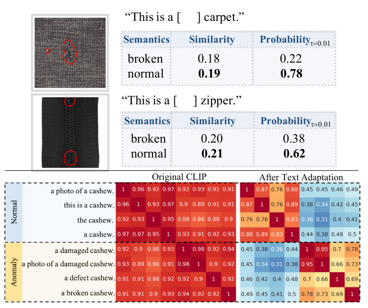
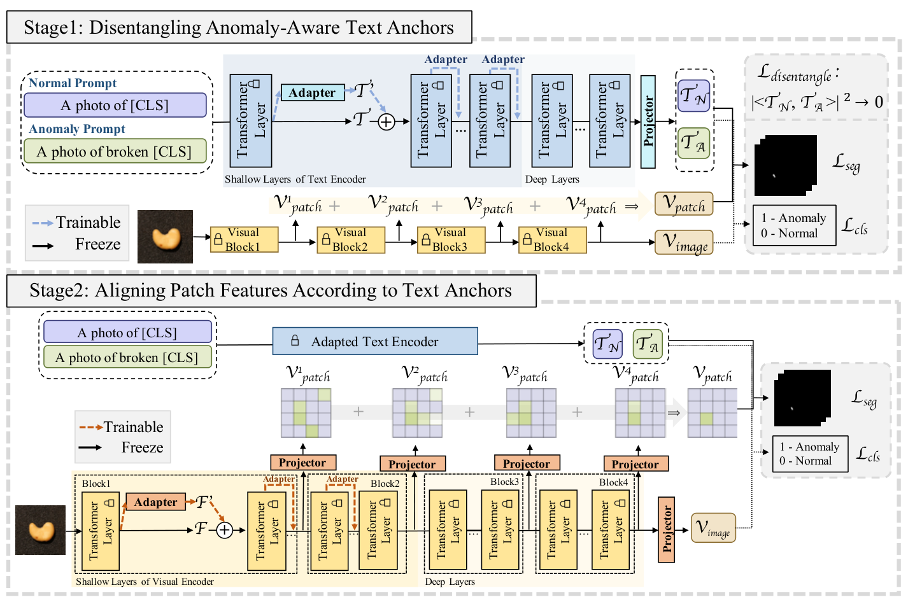

# 精读笔记 · AA-CLIP: Enhancing Zero-shot Anomaly Detection via Anomaly-Aware CLIP

> arXiv 2503.06661 · CVPR 2025 · 中科大（苏州高研院 MIRACLE）+ 中科院计算所 + 斯坦福
> 代码：https://github.com/Mwxinnn/AA-CLIP（本目录 `code/`，**没有放预训练权重**）
> 材料：paper.pdf（11 页）/ source/ / paper.tex / figures/ / code/

## 基本情况

- 一句话：先让**文本塔**学会区分正常/异常（第一阶段），再让 **patch 特征**对齐这些锚点（第二阶段）；全程只训残差 adapter，CLIP 冻结。
- 核心论点：CLIP 有 **Anomaly Unawareness**——文本编码器分不开 normal/anomaly，甚至在明显缺陷图上给 normal 更高分。
- 可训练：文本塔前 3 层的 residual adapter + 文本 projector（阶段一）；视觉塔前 6 层的 residual adapter + 4 个 projector（阶段二）。
- 开源：代码 ✅、**权重 ❌**（要自己下 OpenCLIP ViT-L-14-336 再训）。
- 路线：`① 动机（图 2）→ ② 架构（图 4）→ ③ 训练（两阶段 + Disentangle Loss）→ ④ 数据（11 数据集 / 2-16-64-full shot）→ ⑤ 信息流 → ⑥ 例子 → ⑦ 实验`

## 导读地图

行号指 `paper.tex`（正文 L12–363，无附录；prompt 细节要读代码 `dataset/constants.py`）。

| 站 | 这一站讲清楚什么 | 图 | 原文位置 | 代码 |
|---|---|---|---|---|
| ① 动机 | CLIP 的 Anomaly Unawareness + 适配的两难 | 图 2、图 1 | §1 L16–42、§3.1.2 L65–100 | — |
| ② 架构 | 两阶段：文本 adapter → patch adapter；residual 混合 | 图 4 | §3.2 L116–190 | `model/adapter.py`、`forward_utils.py` |
| ③ 训练 | BCE + dice + focal + γ·Disentangle；两阶段 lr/epoch | 式 (1)–(5) | §3.2.2 L138–190 | `train.py` |
| ④ 数据 | 11 数据集、2/16/64/full shot、1:1 正负比、REAL_NAMES | 表 1 | §4.1 L192–203 | `dataset/constants.py:136` |
| ⑤ 信息流 | 518² → 4 层 patch → 求和 → 相似度 | 图 4 | §3.2.2 | `test.py` |
| ⑥ 例子 | 一张 PCB 图走一遍 | — | — | `forward_utils.py` |
| ⑦ 实验 | MVTec 90.5/91.9、VisA 84.6/95.5；2-shot 也不差 | 表 1、2 | §4.2 L204–286 | — |

## ① 动机



**图 2 怎么读**，上下两块：

- **上半**：两张有明显缺陷的图（地毯破洞、拉链缺齿，红圈标出），配上 CLIP 的判断表。
  以地毯为例：`This is a [ ] carpet.`，填 `broken` 相似度 **0.18**、填 `normal` 相似度 **0.19**——CLIP 认为它 **78% 是正常的**。
  拉链更明显：`broken` 0.20、`normal` 0.21 → 62% 正常。
- **下半**：`cashew` 这个类里，8 条 prompt（4 条正常 + 4 条异常）两两之间的余弦相似度热图。
  **原始 CLIP 全红**（0.9+）——正常 prompt 和异常 prompt 挤在一起；**文本自适应之后**变成对角红、其余蓝绿，两者被推开了。

**要解决什么**：CLIP 的文本编码器**分不开"正常"和"异常"**。作者给这个现象起名 **Anomaly Unawareness**。

**以前的做法卡在哪**：

1. **WinCLIP 那类手写 prompt**：换词当然有用，但它改的是「问什么」，改不了 CLIP 内部对这两个状态的理解——图 2 上半那张表就是证据，写得多明白它还是判 normal。
2. **AdaCLIP / AnomalyCLIP 那类可学习 prompt**：能改，但作者认为它们有两个隐患——
   一是**可能损伤 CLIP 的类别知识**（原文：*the class information in CLIP can be damaged*）；
   二是**训多了会过拟合辅助集**（图 7 展示了一阶段训练到后期 t-SNE 直接崩掉）。
3. **直接微调 CLIP**：最朴素的做法，但 CLIP 的表示已经在大规模数据上优化好了，一微调就把泛化毁掉。

**押注的关键想法**（一句话）：

> 别急着改视觉——**先把文本空间里的正常/异常拆开**（阶段一），等锚点立住了，**再让 patch 特征去对齐它**（阶段二）；每一步都用 residual adapter 只加一点点扰动，保住 CLIP 原有的泛化。

拆成两句话就是：

- **阶段一**：冻结视觉塔，在文本塔前 3 层插 residual adapter，用 `Disentangle Loss`（`|<T_N, T_A>|²`）把两个锚点推成近似正交。
- **阶段二**：冻结文本塔，在视觉塔前 6 层插 residual adapter，让 4 个粒度的 patch 特征去对齐已经拆开的锚点。

**一个具体例子**（同一个 cashew 类）：原始 CLIP 里 `a damaged cashew.` 和 `this is a cashew.` 的余弦是 **0.92**——几乎没区别；
文本自适应之后降到 **0.38**。**这就是"文本侧先动手"的全部意义**：视觉侧再怎么对齐，也得先有个能对齐的目标。

**为什么不能一步到位**：图 7 给了反面证据——只做一个阶段（文本+视觉同时训）时，epoch 1 的 t-SNE 还是分开的，epoch 5 就混成一团，
说明**同时适配两个空间会互相拉扯，最后退化成对辅助集的过拟合**。分两阶段、逐段冻结，是在"改得动"和"别改坏"之间找的平衡点。

## ② 架构



**图 4 怎么读**：上下两块就是两个阶段。

- **Stage 1（上）**：两条 prompt → 文本塔。**浅层**（前 3 层）每层挂一个 Adapter（蓝色虚线=可训练），
  输出和原特征按 0.1 : 0.9 混合；深层冻结。最后接一个**可训练的 Projector**，得到两个锚点 T'_N、T'_A。
  右边 `L_disentangle: |<T'_N, T'_A>|² → 0` 就是把两个锚点推正交。
  下面是**冻结**的视觉塔：4 个 block 输出 patch 特征，相加得 V_patch → 和锚点算相似度 → `L_seg`；V_image → `L_cls`。
- **Stage 2（下）**：文本塔整体冻结（用的是阶段一训好的），视觉塔**浅层**（前 6 层）挂 Adapter，
  4 个粒度的 patch 各过一个**可训练 Projector**（橙色），相加得 V_patch → `L_seg`；V_image → `L_cls`。

**接口**

| 项 | 值 |
|---|---|
| 输入 | 518×518，ViT-L/14@336（24 层、width 1024、37×37=1369 patch） |
| 文本侧 | 前 K_T=3 层加 adapter + 最后 projector 可训练（768 维） |
| 视觉侧 | 前 K_I=6 层加 adapter；4 个 seg projector（1024→768）+ 1 个 det projector |
| 取特征的层 | 6 / 12 / 18 / 24 |
| 混合系数 λ | 0.1（文本、视觉各自独立） |
| 可训练（阶段一） | ≈2.36M（3×768² + 768²） |
| 可训练（阶段二） | ≈10.2M（6×1024² + 4×1024×768 + 1024×768） |
| 推理 | 一遍 ViT-L + 一遍文本塔 |

**A. Residual Adapter：只改方向，不改大小**

论文式 (1)(2) 写的是 `x_enh = λ·Norm(Act(Wx)) + (1−λ)·x`，**代码里多了一步归一化匹配**：

```python
adapt_out = self.text_adapter[i](x)          # Linear(768,768) + LeakyReLU
adapt_out = adapt_out * x.norm(dim=-1, keepdim=True) / adapt_out.norm(dim=-1, keepdim=True)
x = self.t_w * adapt_out + (1 - self.t_w) * x   # t_w = 0.1
```

- **为什么先把模长对齐**：adapter 输出和原特征的尺度可能差很多，直接按 0.1 混合会让模长抖动。
  对齐之后，混合只改变**方向**（语义），不改变**大小**（置信度）。这个细节论文没写。
- **为什么 λ 只有 0.1**：CLIP 的表示已经很好，改动越小越安全。0.1 意味着每一层只把特征往"异常方向"推 10%，
  3 层文本 / 6 层视觉累积下来是"温和但明确"的偏移。λ 是全文最主要的超参。
- **为什么是残差而不是替换**：替换等于把 CLIP 的某层输出扔掉，类别知识立刻受损。残差保底。

**B. 阶段一：把两个锚点推开**

```python
x = prompts + positional_embedding
for i in range(12):
    x, _ = text_blocks[i](x)
    if i < 3:                       # 只改前 3 层
        x = 0.1 * adapt(x) + 0.9 * x
x = ln_final(x)
x = self.text_adapter[-1](x[arange, text.argmax(-1)])   # 可训练 projector 替掉原 text_projection
```

- 锚点来自 prompt 平均：正常 3 个状态词 × 2 模板 = 6 条，异常 5 个 × 2 = 10 条，各自平均得 T_N、T_A。
- `L_disentangle = |<T_N, T_A>|²` 直接惩罚两个锚点的余弦，**目标是正交**。
- 这一步只动文本塔，视觉塔冻结——所以视觉特征是一个"稳定的参照物"，不会跟着一起漂。

**C. 阶段二：让 patch 去对齐锚点**

- 视觉塔前 6 层加 adapter；4 个粒度（6/12/18/24 层）的 patch 各过一个 1024→768 的 projector，然后**相加**成 V_patch。
- 损失还是 `L_cls + L_seg`，但这次梯度只回视觉侧的 adapter 和 projector。
- 文本塔此时已冻结——**锚点是固定的靶子**，视觉侧只管往上打。

| 模块 | 来源 | 参数量 | 阶段一更新 | 阶段二更新 |
|---|---|---|---|---|
| CLIP 文本塔 | OpenCLIP | ≈123M | 冻结（只挂 adapter） | 冻结（用训好的） |
| 文本 residual adapter ×3 | Xavier 初始化 | 1.77M | ✅ | ❌ |
| 文本 projector | 同上 | 0.59M | ✅ | ❌ |
| CLIP 视觉塔 | 同 | ≈303M | 冻结 | 冻结（只挂 adapter） |
| 视觉 residual adapter ×6 | 同上 | 6.29M | ❌ | ✅ |
| seg projector ×4 + det projector | 同上 | 3.93M | ❌ | ✅ |
| **合计** | — | **≈12.6M** | 2.36M | 10.2M |

**和前三篇对比**：WinCLIP 0 参数、AdaCLIP 10.7M（一次训完）、AnomalyCLIP 43K（只改文本）、AA-CLIP 12.6M（分两段）。
**参数量不是关键，关键是"改的顺序"**——AA-CLIP 的贡献本质是"先文本后视觉"这个顺序，而不是某个模块。

## ③ 训练

**一句话**：阶段一只干一件事——把两个文本锚点推开（分割损失 + 正交惩罚）；阶段二只干一件事——让 patch 特征贴上这两个锚点（分类 + 分割）。

```
L_align = L_cls + L_seg
L_seg   = Dice(p_seg, S) + Focal(p_seg, S)
L_dis   = |<T_N, T_A>|²
L_total = L_align + γ · L_dis                 γ = 0.1

p_cls = CosSim(V_image, [T_N, T_A])           → 2 维
p_seg = CosSim(V_patch, [T_N, T_A])           → N×2 → reshape/上采样
```

| 符号 | 是什么 | 形状 / 取值 |
|---|---|---|
| T_N / T_A | 正常/异常文本锚点（6 条 / 10 条 prompt 的平均） | [768] |
| V_image | 图像级视觉特征 | [768] |
| V_patch | 4 个粒度投影后相加的 patch 特征 | [1369, 768] |
| S | GT mask | {0,1} |
| γ | 正交惩罚权重 | 0.1 |

**L_dis 代数字**：若两个锚点的余弦是 0.9 → 惩罚 0.81 × 0.1 = **0.081**；推到 0.1 → 0.01 × 0.1 = **0.001**。
这个惩罚本身很小，**它更像一个"别让两者重合"的护栏**，真正干活的还是分割损失。

**两阶段对照**

| | 阶段一（文本） | 阶段二（视觉） |
|---|---|---|
| 动谁 | 文本塔前 3 层 adapter + 末尾 projector | 视觉塔前 6 层 adapter + 4 个 seg projector + 1 个 det projector |
| 冻结谁 | 视觉塔全部；文本塔 4~12 层 | 文本塔全部；视觉塔 7~24 层 |
| 损失 | **L_seg + γ·L_dis**（代码里**没有** L_cls） | **L_cls + L_seg** |
| lr | **1e-5** | **5e-4** |
| epoch | 5 | 20 |
| batch | 16 | **2** |
| 优化器 | Adam | Adam + MultiStepLR（milestones 16000/32000 步，×0.5） |

**为什么两阶段 lr 差 50 倍**：阶段一改的是文本嵌入的**方向**，CLIP 的文本空间很敏感，大 lr 一下就把类别知识冲掉；
阶段二改的是视觉 patch 特征，目标是"贴近锚点"，可以走得快一些。batch 从 16 掉到 2，是因为阶段二要**反传穿过 ViT-L 的 6 层**，
518² 的激活存不下。

**代码 ↔ 论文**

| 论文 | 代码 | 备注 |
|---|---|---|
| `L_cls` 是 BCE | `F.cross_entropy(cls_preds, label)` | 2 类 CE ≈ BCE，等价 |
| 阶段一也画了 `L_cls`（图 4） | `train.py:89-96` 阶段一**只用 seg + orthogonal** | 图比代码多画了一条线 |
| 式 (1) 有 `Norm(Act(Wx))` | `SimpleAdapter = Linear + LeakyReLU`，额外做**模长对齐** | 论文没写模长对齐，见 ② |
| 未提分类温度 | `matmul(det, text)` **没有温度缩放** | logits 就是余弦（0.0x），CE 很平——所以推理时图像级分数是 `(cos_a+1)/2` 而不是 softmax 概率 |
| 未提 lr 衰减 | 阶段二用 MultiStepLR ×0.5 | 论文只写了固定 lr |

## ④ 数据

**一条训练样本**：

| 字段 | 形状 | 取值 | 真实例子 |
|---|---|---|---|
| img | [3, 518, 518] | CLIP 归一化 | MVTec `pill/test/color/000.png` |
| mask | [518, 518] | {0,1} | 药片上的变色区域 |
| label | {0,1} | 图像级 | 1 |
| cls_name | str | **自然语言描述**（不是类名本身） | `pill` → "oval white pill with small red speckles and the letters 'FF' engraved" |

**和前三篇最不一样的一点**：AA-CLIP 的「类别名」是**手写的整句描述**（`dataset/constants.py` 的 `REAL_NAMES`）：

| 数据集里的类名 | AA-CLIP 手写的描述 |
|---|---|
| `grid` | metal or plastic mesh |
| `metal_nut` | metal nut which has four notched edges |
| `transistor` | a three-legged transistor placed vertically |
| `pill` | oval white pill with small red speckles and the letters 'FF' engraved |
| `pcb1` (VisA) | dual ultrasonic distance sensor pcb module |

这正是我在 WinCLIP 那站吐槽的「`metal_nut` 直接拼进 prompt」的正解——**作者把 11 个数据集的每个类都手工写成了自然语言**。
代价是：换一个全新的类，你得先给它写一句话。

**prompt 组成**：3 个正常状态词（`{}` / `a {}` / `the {}`）× 2 个模板 = 6 条；5 个异常状态词 × 2 = 10 条。共 **16 条**。

**预处理**：Resize 到 518×518 + CLIP 归一化（和 AdaCLIP / AnomalyCLIP 一样直接拉伸）。

**shot 的定义（关键）**：*2-shot per class = 1 张正常 + 1 张异常*，正负严格 1:1。

| shot | 每类张数 | MVTec（15 类）总张数 |
|---|---|---|
| 2 | 1 正 + 1 负 | **30** |
| 16 | 8 + 8 | 240 |
| 64 | 32 + 32 | 960 |
| full | 全部 | 1725 |

**2-shot 只要 30 张图，MVTec 像素就能到 91.0**——这是全篇最惊人的数字。

**11 个数据集**：

- **工业 4 个**：MVTec AD（15 类）、VisA（12）、BTAD（3）、MPDD（6）。
- **医学 7 个**：BMAD 的 Brain MRI / Liver CT / Retina OCT（各 1 类）+ 4 个息肉数据集（CVC-ClinicDB、CVC-ColonDB、Kvasir-SEG、CVC-300）。

**协议**：默认在 **VisA** 上训、评其余 10 个；VisA 自己的结果用 **MVTec** 训。

**四篇的数据需求对比**

| | WinCLIP | AdaCLIP | AnomalyCLIP | AA-CLIP |
|---|---|---|---|---|
| 训练图 | **0** | ~2337 | ~1725 | **30（2-shot）** ~ 1725 |
| 需要异常图 | ❌ | ✅ | ✅ | ✅ |
| 需要像素 mask | ❌ | ✅ | ✅ | ✅ |
| 需要物体名 | ✅ | ✅ | ❌ | ✅（且要写整句） |
| 需要正常参考图 | 1~4（WinCLIP+） | ❌ | ❌ | ❌ |

有意思的是 AA-CLIP 在「要不要物体名」上**退回了 AnomalyCLIP 之前**——它需要名字，而且需要写得更细。

## ⑤ 信息流

```
【文本支路｜每个类一次，可缓存】
16 条 prompt（6 正常 + 10 异常）
  └ tokenize [16,77] ─ 文本塔（前 3 层带 adapter + 可训练 projector）─▶ [16,768]
      └ 按 6 / 10 平均 + L2 ─▶ T [2,768]

【图像支路｜每张图一次】
[1,3,518,518]
  └ conv1 14×14 ─▶ [1,1369,1024] +CLS ─▶ [1,1370,1024]
      └ 24 层（前 6 层：x ← 0.1·norm_match(adapt(x)) + 0.9·x）
          ├ 第 6 层 patch ─┐
          ├ 第 12 层 patch ─┤ 各 [1,1369,1024]
          ├ 第 18 层 patch ─┤
          └ 第 24 层 patch ─┘
      ├ 4 × [ln_post → seg_proj(1024→768) → L2] ─▶ 4×[1,1369,768]
      └ 第 24 层 → det_proj(1024→768) → 逐 patch 归一化 → 平均 ─▶ V_image [1,768]

【像素打分】
4×[1,1369,768] @ Tᵀ ×100 ─▶ 4×[1,1369,2] ─reshape─▶ 4×[1,2,37,37]
  └ (s_a + 1 − s_n)/2 ─▶ [1,37,37]
      └ 高斯 σ=1（工业）/1.5（医学），k=7/9 ─▶ [1,37,37]
          └ 双线性到 518 ─▶ [1,518,518]
              └ 4 层相加 ─▶ [1,518,518]

【图像级】
V_image @ Tᵀ ─▶ [1,2] ─▶ (cos_a + 1)/2 ─▶ 标量
```

| 阶段 | 次数 | 说明 |
|---|---|---|
| 文本编码 16 条 | 每类 1 次 | 与图无关，可跨图缓存 |
| 图像前向（24 层，前 6 层带 adapter） | 每图 1 次 | 两阶段的模型在这里合并成一个 |
| 4 个 seg_proj | 每图 4 次 | 1024→768 |
| 相似度 | 每图 4×1369×2 | 小矩阵乘 |
| 高斯 + 插值 | 每图 **4 次，在 37×37 上做** | 高斯在低分辨率做，很便宜 |
| 4 层相加 | 每图 1 次 | **相加，不是平均** |

**被丢掉的**：20 层的 patch token（只留 6/12/18/24）；每层的 CLS；**图像级也不用 CLS**（代码里 `tokens.append(x[1:])` 把 CLS 扔了）。

**三个值得单独说的点**

1. **两阶段在推理时只剩一条路**。阶段一训好的文本塔 + 阶段二训好的视觉塔拼在一起，就是一个普通的"文本编码器 + 图像编码器"，
   不需要跑两遍、也没有动态 prompt。这是它比 AdaCLIP 轻的地方（AdaCLIP 每图要两遍 ViT-L）。
2. **高斯模糊做在 37×37 上，不是 518² 上**。先模糊再插值，计算量小 200 倍，效果几乎一样——这是个很实用的工程细节。
3. **推理全程没有 softmax**。`(s_a + 1 − s_n)/2` 里的 s 是 `100×cos` 的原始值，不是概率；图像级是 `(cos_a+1)/2`。
   **它输出的本质是"异常方向上的投影"，不是置信度**——所以只报 AUROC，不报 F1。

## ⑥ 例子走一遍

**场景**：VisA `pcb1`，一条划痕在 patch 5、6。

**玩具尺寸**（括号真实值）：56²（518²）；4×4=16 patch（37×37=1369）；宽度 8/4（1024/768）；
4 层取第 2、4 层（24 层取 6/12/18/24）；K_T=1、K_I=2（3、6）；λ=0.1；每类 2 条 prompt（6/10）；2 个粒度（4）。

```
 0  1  2  3
 4  5  6  7      ← 划痕在 5、6
 8  9 10 11
12 13 14 15
```

| 步 | 手里有什么 | 做了什么 | 变成什么 | 代码 |
|---|---|---|---|---|
| 0 | `pcb1` 的描述 | 填 4 条 prompt → 文本塔（带 adapter） | `T_N, T_A` [4] | `forward_utils.py:135` |
| 1 | `T_N, T_A` | `L_dis = |<T_N,T_A>|²` 反向 | 锚点被推开 | `train.py:91` |
| 2 | `[1,3,56,56]` | 视觉塔 4 层，前 2 层残差 adapter | `[1,17,8]` | `model/adapter.py:90` |
| 3 | 第 2、4 层 patch | 各过 seg_proj → L2 | `2×[1,16,4]` | `adapter.py:108` |
| 4 | `[1,16,4] @ [4,2]` | ×100 → margin → 高斯 → 插值 | `2×[1,56,56]` | `forward_utils.py:196` |
| 5 | det_proj(第 4 层 patch) | 逐 patch 归一化 → 平均 | `V_image` [4] | `adapter.py:111` |

**第 2 步是全文的核心**（`adapter.py:90-97`）：

```python
x, _ = blocks[i](x)
if i < image_adapt_until:            # 只在前 K_I 层
    adapt_out = adapters[i](x)       # Linear(1024,1024) + LeakyReLU
    adapt_out = adapt_out * x.norm(dim=-1, keepdim=True) / adapt_out.norm(dim=-1, keepdim=True)
    x = 0.1 * adapt_out + 0.9 * x
```

**大白话**：设某个 patch 的特征是 `x = [0.8, 0.2, 0.3, 0.1]`（模长 0.883），adapter 想把它变成 `[0.3, 0.9, 0.2, 0.2]`（模长 0.990）。

1. **先把 adapter 的输出按比例缩到和 x 一样长** → `[0.268, 0.803, 0.178, 0.178]`，模长回到 0.883。
2. **再按 1:9 混合** → `[0.747, 0.260, 0.288, 0.108]`。
3. 这个新向量和原来的夹角是多少？`cos = 0.997`，即 **4.4 度**。

所以每一层只把特征"转"约 4 度，6 层累计下来大概 25 度——**方向明确地偏了，但没翻过去**。
这就是"受控适配"的字面含义：**只改方向、不改大小、每层只转一点点**。如果去掉模长对齐，adapter 输出模长是 0.99，
混合后模长会变成 0.894，逐层累积就会漂走——那正是 CLIP 泛化能力被破坏的机制。

**第 4 步的数字**（cos 是示意值）：

| patch | cos(normal) | cos(anomalous) | s_n = 100cos | s_a = 100cos | (s_a+1−s_n)/2 |
|---|---|---|---|---|---|
| 5（划痕） | 0.28 | 0.32 | 28 | 32 | **2.5** |
| 6 | 0.29 | 0.315 | 29 | 31.5 | 1.75 |
| 0 | 0.32 | 0.28 | 32 | 28 | **−1.5** |

**注意这里没有 softmax**：`(32 + 1 − 28)/2 = 2.5` 是个 margin（差值的一半 + 0.5），不是概率。
所以 AA-CLIP 的"热力图"取值范围大约 −50 ~ +50，靠排序算 AUROC，靠扫阈值算不了 F1——
这就是它只报 AUROC 的原因。另外三篇（WinCLIP/AdaCLIP/AnomalyCLIP）都做了 softmax，输出是 [0,1] 的概率。

**第 5 步**：`V_image = mean(normalize(det_proj(第 4 层 patch)))`——**是 patch 的归一化平均，不是 CLS**。
原因不难猜：CLS 经过 24 层全局注意力，两个缺陷 patch 的信息早就被抹平（WinCLIP 那站我们算过，不到 0.15%）；
用 patch 平均至少保留了局部统计。

**真实规模只是换数字**：4×4→37×37、8→1024（文本 768）、2 层→4 层、K_T 1→3、K_I 2→6、2 条→6/10 条、2 粒度→4 粒度。
