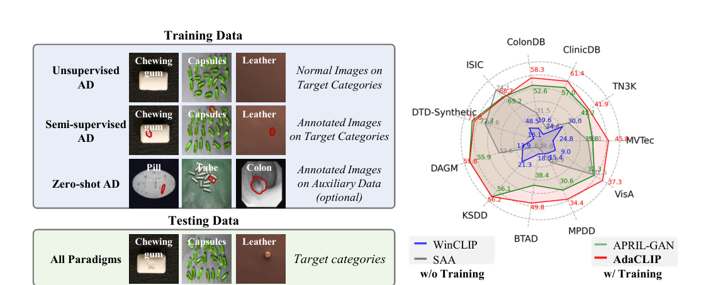
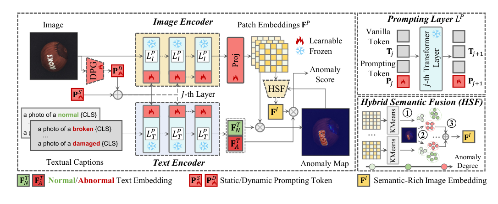
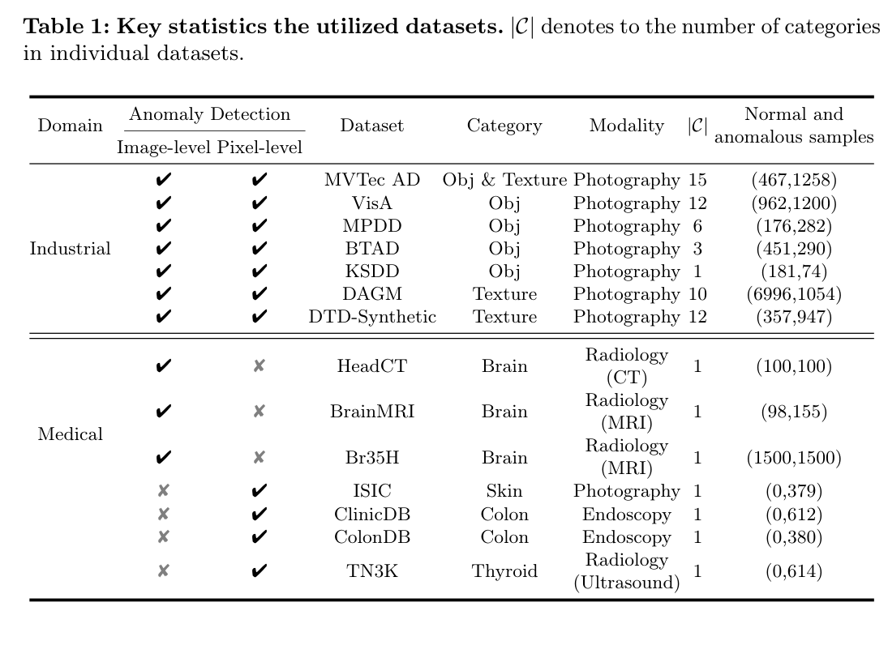

# 精读笔记 · AdaCLIP: Adapting CLIP with Hybrid Learnable Prompts for Zero-Shot Anomaly Detection

> arXiv 2407.15795 · ECCV 2024 · 华科 + 米兰理工 + 浙大 + 腾讯优图
> 代码：https://github.com/caoyunkang/AdaCLIP（本目录 `code/`，权重在 HuggingFace Space）
> 材料：paper.pdf（41 页，含 20 页附录）/ source/ / paper.tex / figures/ / code/

## 基本情况

- 一句话：给一张图 + 类别名 → 输出像素级异常图 + 图像级分数；**训练时完全不用目标类别的图像**，只用「别的类别」的标注异常数据把 CLIP 调一下。
- 和其他 ZSAD 的区别：WinCLIP 是零训练、手写 prompt；AdaCLIP 要训练，但只训 prompt/投影（主干冻结）。
- 开源：代码 ✅、三个预训练权重 ✅（HF Space）、数据处理脚本 ✅（图片数据要自己下）。
- 和读过的哪篇最像、差在哪：和 WinCLIP 同一套骨架（文本比 patch），把「手写 prompt + 滑窗」换成「可学习 prompt + 直接取 patch token」。
- 路线：`① 动机（图 1）→ ② 架构（图 2）→ ③ 训练（三个 loss）→ ④ 数据（14 个数据集 + 辅助集划分）→ ⑤ 信息流 → ⑥ 一张 PCB 图走一遍（code/）`

## 导读地图

行号指 `paper.tex`（正文 L30–702；附录在 PDF 21–41 页，`paper.tex` 里只有 `\includepdf{supp.pdf}`，要读 `paper.txt`）。

| 站 | 这一站讲清楚什么 | 图 | 原文位置 | 代码 |
|---|---|---|---|---|
| ① 动机 | cold start + 免训练 ZSAD 不够 + 押注辅助数据 | 图 1 | §1 L37–65 | — |
| ② 架构 | prompting layer（static + dynamic）、projection、HSF | 图 2 | §4 L102–154；附录 Fig 1/2 | `method/adaclip.py:28`（PromptLayer）、`:16`（ProjectLayer）、`:236`（HSF）、`:571`（forward） |
| ③ 训练 | 像素 focal + dice、图像 focal；5 epoch、FP16 | 式 (1)(2) | §4.5 L135–141、§4.7 L151–154 | `method/trainer.py:113-141` |
| ④ 数据 | 14 个数据集（7 工业 + 7 医学）、辅助/测试集必须不同类别 | 表 1 | §5.1 L158–170、附录 §3 | `dataset/*.py`、`data_preprocess/*.py` |
| ⑤ 信息流 | 518² → 37×37 patch → 4 层 → proj → 相似度 → 上采样 | 图 2 | §4 | `adaclip.py:512`（visual_text_similarity） |
| ⑥ 例子 | 一张 PCB 图走一遍 | — | — | `adaclip.py:550`（extract_feat） |
| ⑦ 实验 | 7 工业平均 90.2/94.2、7 医学 94.6/85.3；vs WinCLIP 82.8/80.7 | 表 1、表 2 | §5.2 L171–170 | — |

## ① 动机



**先说这张图是什么。** 左边一张表把三种范式并排放：

| 范式 | 训练时需要什么 | 代表 |
|---|---|---|
| Unsupervised AD | 目标类别的**正常图**（几百张） | PatchCore、PaDiM |
| Semi-supervised AD | 目标类别的**正常图 + 异常图 + 像素标注** | BiaS、CDO |
| **Zero-shot AD** | **目标类别一张图都不要**；用别的类别的标注异常图 | AdaCLIP、WinCLIP、APRIL-GAN |

表格左边三列的图是「训练数据」，下面一行是「测试数据」——**三种范式最后都在目标类别上测**，区别只在训练时能看什么。右边是雷达图，11 个数据集的像素级 max-F1：红线的 AdaCLIP 在最外圈，绿线 APRIL-GAN、灰线 SAA、蓝线 WinCLIP 都缩在里面（WinCLIP 在好几个集上贴着 0~20）。

**任务是什么**：冷启动场景——产线上一种新产品第一次上线，一张正常图都没有，但还是要判断它有没有缺陷、缺陷在哪。

**以前卡在哪**，三条：

1. **无监督方法训不了**。PatchCore 这类方法要目标类的几百张正常图拟合「正常的样子」。新产品上线时拿不到，这就是 cold start。
2. **半监督/全监督更不可能**。要目标类的异常样本和像素标注——工业缺陷本来就稀少，新产品更不会有。
3. **免训练的零样本（WinCLIP）能跑，但不够准**。WinCLIP 靠手写 prompt 问 CLIP「这像不像 damaged 的螺丝」，MVTec 的图像级能到 91.8，但**像素级 max-F1 只有 31.6**，VisA 更差（14.8）。它能够排序，却给不出能用的绝对分数——因为 CLIP 是在自然图文上训的，它心里的「damaged」是破了的杯子、坏的电脑，不是虚焊和划痕。

**作者押注的关键想法**（一句话）：

> 现实里已经躺着一堆**别的类别**的标注异常数据（MVTec、VisA、医学影像…），这些数据里含有通用的异常模式（划痕、凹陷、缺件、污渍）；只要用一小撮可学习参数把这些模式「注入」CLIP，就能迁移到从没见过的新类别上。

这个想法的关键约束是**不能改主干**——CLIP 的泛化能力就藏在主干里，一微调就毁了。所以只加两类东西：

- **prompt token**：塞进图像塔和文本塔的前 4 层，每层 5 个可学习 token；
- **投影层**：把 patch 特征投到文本空间（CLIP 原始维度对不上）。

其中 prompt 又分成两种，这是论文的核心：

- **static prompt**：所有图共用，学「异常大致长什么样」的一般知识。
- **dynamic prompt**：由**当前这张测试图**生成，让 CLIP 针对这张图调整——因为「这张图上哪里不对」是逐图变化的。

**一个具体例子**（论文引言自己举的）：`pill`（药片）上的划痕，能帮模型在 `chewing gum`（口香糖）上认出类似的划痕。这两类东西外形毫无关系，但「细长的划伤 + 局部对比度突变」这个模式是共通的。反过来，WinCLIP 只能对 CLIP 说「damaged chewing gum」，而 CLIP 从没见过任何一块被划伤的口香糖。

**为什么不是「把所有异常数据混进去训练一个分类器」**：那样就变成了监督学习，泛化到新类别靠的是模型容量，而不是 CLIP 的通用表征；而且目标类别的分布完全没出现过。AdaCLIP 的做法是「只调一点点」，本质是在**保留泛化的前提下做适配**——论文占了大篇幅的消融（冻结 vs 可学习投影、只 prompt 文本 vs 只 prompt 图像）都在证明这一点的边界在哪。

一句话回顾：**工业质检的冷启动场景下连正常图都没有，免训练的 WinCLIP 能排序但分数不可用；AdaCLIP 赌的是「辅助数据集里存在通用的异常模式」，用一小撮可学习的 static/dynamic prompt 把它注入冻结的 CLIP。**

## ② 架构



**图 2 怎么读**：左边是主流程（图像塔在上、文本塔在下），右边两个放大镜——上「Prompting Layer」、下「HSF」。
红块 = 可学习，蓝雪花 = 冻结。整体骨架和 WinCLIP 一样：**图像出 patch 特征、文本出 2 个嵌入、两者点积**。

**接口（真实数值）**

| 项 | 值 |
|---|---|
| 输入 | 518×518 RGB |
| 主干 | CLIP ViT-L/14@336：24 层、width 1024、patch 14 → **37×37 = 1369** 个 patch |
| 取特征的层 | 第 6 / 12 / 18 / 24 层（4 个层级） |
| 文本侧 | 7 个正常状态词 + 5 个异常状态词，× 4 个模板 = 48 条；文本 width 768 |
| 投影 | patch 1024 → 768（每层一个线性层） |
| 输出 | 518×518 异常图 + 1 个图像级分数 |
| 可训练 | **≈10.7M**（主干 ≈428M 全冻结，占 2.5%） |
| 推理 | **图像塔跑两遍**（DPG 一遍 + 主流程一遍）+ 文本塔一遍（可缓存） |

**A. 文本支路（左下）**

- 输入形如 `a photo of a normal {CLS}` / `a photo of a broken {CLS}` / `a photo of a damaged {CLS}`。
- 文本塔的**前 4 层**插 prompt token（可学习），输出 2 个 768 维文本嵌入 F^T_N / F^T_A。
- 为什么要 prompt 文本塔：光换输入词（WinCLIP 的做法）只能改「问什么」，改不了「塔怎么理解这句话」；
  prompt token 让文本塔内部也偏向异常语义。
- 代码里实际是 7 个正常状态词 + 5 个异常状态词（比 WinCLIP 多一个 `broken`）× 4 个模板，
  而论文 §4.1 只写了 3 条示例 caption —— 论文没写全。

**B. 图像支路（左上）**

- 518² 图 → 冻结 ViT-L → 前 4 层各插 5 个 prompt token；prompt = 静态 P^S（可学习）+ 动态 P^D（逐图生成）。
- 从第 6/12/18/24 层各取一次 patch token（1024 维），经 4 个线性层投到 768。
- 为什么要 4 层：浅层保细节（划痕）、深层保语义（缺件/装反），单层不够。

**C. DPG：动态 prompt 生成器（左上红色小梯形）**

- 冻结视觉塔先跑一遍图 → 取 CLS（768）→ 两组线性层 → 各生成 5 个 token（图像塔 1024 维、文本塔 768 维）。
- 为什么需要：静态 prompt 对所有图一样，但「这张图该看哪」逐图不同。
- 代价：**代码里这一遍是完整的 ViT-L 前向**（`generate_and_set_dynamic_promtps`），所以单图要跑两次图像塔。

**D. 投影层 Proj**

- 每层一个 `nn.Linear(1024 → 768)`，作用在 patch token 上（去掉 CLS）。
- 为什么：CLIP 的 patch 和文本维度天然对不上。WinCLIP 的解法是「绕开」（改用窗口 CLS），AdaCLIP 是「正面解决」。
- 消融（表 5）：冻结投影 → 可学习投影，工业图像级 82.9 → 90.2，像素级 90.1 → 94.2。

**E. 打分（式 1）**

- 每个 patch 和 2 个文本嵌入算余弦（×100 后 softmax）→ 每个 patch 一个异常概率。
- 4 层各出一张 37×37 图 → 双线性上采样到 518 → 4 层平均 → `(p_anom + 1 − p_norm)/2`。

**F. HSF：Hybrid Semantic Fusion（右下）**

- 拿 patch 嵌入 + 异常图 → 挑最异常的 top-k token（k = K×5 = 100）→ KMeans（K=20）→ 各簇质心 → 平均 → F^I。
- 再和 CLS 融合：`0.2·F^I + 0.8·CLS` → 归一化 → 和 2 个文本算相似度 → 图像级分数。
- 为什么：`max(异常图)` 对噪声敏感（一个亮点就能决定整图），聚类能聚出「一整块异常区域」的语义。
- 论文的 HSF 是「聚所有 patch → 按簇平均异常分 → 取最异常的那一个簇」；代码改成了「先取 top-k 最异常 token → 聚类 → **所有簇心平均**」，
  作者在代码里注释：*the implementation of HSF is slightly different to the reported one, since we found that the upgraded one is more stable*。

| 模块 | 来源 / 初始化 | 参数量 | 训练时更新吗 | 作用 |
|---|---|---|---|---|
| CLIP 视觉塔 ViT-L/14@336 | OpenCLIP（openai 权重） | ≈300M | 否 | 518² → 37×37 patch |
| CLIP 文本塔 | 同上 | ≈120M | 否 | 48 条 caption → 2 个嵌入 |
| static prompts | N(0, 0.02) 随机 | 4×5×(1024+768) = 35.8K | 是 | 通用异常知识 |
| dynamic prompt 线性层 | 随机 | ≈6.9M | 是 | 逐图生成 prompt |
| patch 投影 ×4 | 随机 | ≈3.1M | 是 | 1024 → 768 |
| CLS 投影 ×1 | 随机 | ≈0.6M | 是 | 768 → 768 |
| HSF（KMeans） | sklearn，无参数 | 0 | — | 图像级语义嵌入 |
| **合计** | — | **≈10.7M 可训练 / 428M 总量** | — | — |

和 WinCLIP 对照：**骨架完全一样（文本比 patch），换掉了两个零件**——手写 prompt 换成可学习 prompt，滑窗 CLS 换成「patch token + 投影」。

## ③ 训练

**一句话**：训练目标就是让「异常」这个文本嵌入和**缺陷所在 patch** 的特征靠拢、和正常 patch 拉开——像素级用
focal + dice 监督，图像级用 focal 监督；主干一点不动，只更新那 10.7M。

**三个损失**（论文只写了名字，公式是从代码 `method/trainer.py:113-141` + `loss.py` 还原的）：

```
L_total = L_focal(S, y)                                    ← 图像级（1 个标量）
        + Σ_{i=1..4} [ L_focal(M_i, G)                     ← 像素级 × 4 层
                     + L_dice(M_i[ano], G)
                     + L_dice(M_i[norm], 1 − G) ]

L_focal(p, t) = −α · (1 − p_t)^γ · log p_t      α = 1, γ = 2
L_dice(p, g)  = 1 − (2·Σ p·g + 1) / (Σ p + Σ g + 1)
```

| 符号 | 是什么 | 形状 / 取值 |
|---|---|---|
| S | 图像级异常概率（HSF 嵌入和文本算的 softmax） | [B, 2]，取第 1 列 |
| M_i | 第 i 层（6/12/18/24）的异常图，**已经 softmax** | [B, 2, 518, 518] |
| G | GT mask | {0,1}，518² |
| y | 图像级标签 | {0,1} |
| α, γ | focal 的平衡因子、聚焦参数 | 1、2 |

**数字代一遍**（focal，缺陷像素 p=0.9 且目标为 1）：
- 容易的：p_t = 0.95 → (1−0.95)² × (−log 0.95) = 0.0025 × 0.051 = **0.00013**
- 难的：p_t = 0.30 → 0.49 × 1.204 = **0.590**
→ 同一个缺陷像素，判错的梯度是判对的 **4500 倍**。这就是 focal 在 1% 异常像素的数据上还能学到东西的原因。

**数字代一遍**（dice，518² 里 100 个缺陷像素）：
- 预测：缺陷内 p=0.8、缺陷外 p=0.05 → Σp·g=80、Σp=575、Σg=100 → dice=(161)/(676)=0.238，loss=0.762
- 完美：p=1 在内、0 在外 → dice=201/201=1，loss=0

**为什么不用 BCE**：518² 图里缺陷可能只占 0.04% 像素，BCE 会被背景像素淹没；dice 直接优化「重叠率」，天然对不平衡免疫。
论文还额外对「正常通道」算一次 dice（`dice(M[norm], 1−G)`），逼两条通道都收敛，避免模型只学会「说异常」。

**训练流程**

| 项 | 值 |
|---|---|
| 数据 | 辅助数据集（默认 MVTec + ColonDB；评 MVTec 时改用 VisA 训练） |
| 可训练 | 6 个模块：text_prompter / visual_prompter / patch_token_layer / cls_token_layer / dynamic_*_prompt_generator |
| 冻结 | CLIP 全部主干 |
| 优化器 | AdamW，lr=0.01，betas=(0.5, 0.999)，**batch=1** |
| 轮数 | **5 epoch** |
| 精度 | FP16（autocast） |
| 硬件 | 单卡 A6000 48GB |
| 坑 | README 自己写：FP16 训练**偶尔不稳定**，建议多跑几次、按验证集挑最好的 |

**训练和推理不一样的地方**（代码里用一个参数切换）

- 训练：`aggregation=False` → 4 层**各自** softmax，每层单独算 loss（4 层相加，不平均 → 像素损失权重是图像的 4 倍）。
- 推理：`aggregation=True` → 4 层的**logits 先插值到 518 再平均**，然后才 softmax，最后 `(p_ano + 1 − p_norm)/2`。
  代码注释原话：*in the test stage, we firstly aggregate logits from all hierarchies and then do the softmax normalization*。

**代码 ↔ 论文**

| 论文 | 代码 | 备注 |
|---|---|---|
| 只说 "dice loss and focal loss" | `trainer.py:132-133` | 每层 3 项：focal + 双通道 dice；4 层**求和** |
| focal loss | `loss.py` 的 `FocalLoss`，作用在**概率**上 | 函数名是 focal loss，但它期望 logits；这里喂的是 softmax 后的概率，实际算的是 `−(1−p)²log p` |
| γ、α 未提 | γ=2、α=1（`FocalLoss()` 默认） | 论文没给 |
| 训练数据默认 MVTec + ClinicDB | README「Corrections」：应为 MVTec + ColonDB | 作者自己在仓库里更正过 |
| 训练 5 epoch、lr 0.01 | `train.py` 默认 `--epoch 5 --learning_rate 0.01 --batch_size 1` | batch=1 是代码默认；论文没写 batch |

## ④ 数据



**一条训练样本长什么样**（AdaCLIP 是监督训练，所以真的有「训练样本」）：

| 字段 | 形状 | 单位 / 取值 | 真实例子 |
|---|---|---|---|
| img | [3, 518, 518] | float32，CLIP 归一化后 | MVTec `bottle/test/broken_large/000.png` |
| img_mask | [518, 518] | {0,1}，缺陷像素=1 | 瓶身破口那一块 |
| anomaly | {0,1} | 图像级标签 | 1 |
| cls_name | str | 类别名，用来拼 48 条 prompt | `"bottle"` |

**怎么变成模型输入**

1. `Resize((518,518))` + `CenterCrop(518)`：**直接拉伸成正方形，不保长宽比**（VisA 的 1500×1000 会被压扁 1.5:1）。
2. ToTensor + CLIP 归一化（mean `[0.4815,0.4578,0.4082]` / std `[0.2686,0.2613,0.2758]`）。
3. patch 14 → **37×37 = 1369** 个。
4. 类别名填进 `7 个正常状态词 + 5 个异常状态词 × 4 个模板` = **48 条 prompt**，tokenize 到 77。
5. mask 二值化（`>0.5 → 1`），作为像素级监督。

**规模（关键，且和直觉相反）**

论文附录明确写：*We solely utilize the test data from these datasets*——**训练用的辅助数据，是这些数据集的 test split**。
原因是无监督 AD 数据集的 train split 只有正常图，没有异常样本和 mask。

| | 内容 |
|---|---|
| 训练池（默认） | MVTec AD（467 正常 + 1258 异常）+ ClinicDB（612 异常）≈ **2337 张** |
| 正负比 | 467 正常 : 1870 异常 ≈ **1 : 4**（和 WinCLIP「只有正常图」正好相反） |
| 步数 | batch=1 × 5 epoch ≈ **1.17 万步** |
| 评估 | 14 个数据集（7 工业 + 7 医学），全部 zero-shot（类别不重叠） |

**14 个数据集**（表 1）：

- **工业 7 个**：MVTec AD（15 类）、VisA（12）、MPDD（6）、BTAD（3）、KSDD（1）、DAGM（10）、DTD-Synthetic（12）；都有图像级 + 像素级标注。
- **医学 7 个**：HeadCT、BrainMRI、Br35H（**只有图像级**）；ISIC、ClinicDB、ColonDB、TN3K（**只有像素级**，没有正常图）。

**协议上最重要的一条**：辅助集和测试集的**类别不能重叠**。评 MVTec 时用 VisA 训练，评 VisA 时用 MVTec 训练。

**和 WinCLIP 的数据差异（这是两者差距的根源）**：

| | WinCLIP | AdaCLIP |
|---|---|---|
| 训练用不用标注 | **完全不用** | 用了 ~1900 张**像素级 mask** |
| 训练图像 | 0 | ~2337 张 |
| 参考图 | 0~4 张正常图（WinCLIP+） | 不需要 |

所以「AdaCLIP 像素级比 WinCLIP 高 3.6 个点」不是白来的——它看了近两千张带缺陷框的图。

**一个容易忽略的坑**：ClinicDB / ColonDB / ISIC / TN3K 这 4 个数据集**一张正常图都没有**（表里写 `(0, 612)`），
所以默认训练池里的「正常」样本只来自 MVTec 那 467 张。图像级 focal 在这一半数据上只能见到正样本。

## ⑤ 信息流

```
【第 0 步｜文本支路｜每个类别算一次】
48 条 prompt（7 正常词 ×4 + 5 异常词 ×4）
  └ tokenize ─▶ [48, 77]
      └ 文本塔（12 层，前 4 层插 prompt）─▶ [48, 768]
          └ 按组平均 + 归一化 ─▶ text_features [768, 2]   （列 0=normal，列 1=anomalous）

【第 1 步｜DPG｜每张图一遍完整 ViT-L】
image [1,3,518,518]
  └ 冻结视觉塔（无 prompt）─▶ CLS [1,768]
      ├ Linear(768→1024)×5 ─▶ 动态视觉 prompt [1,5,1024]
      └ Linear(768→768)×5  ─▶ 动态文本 prompt [1,5,768]

【第 2 步｜主前向｜每张图一遍 ViT-L（带 prompt）】
image [1,3,518,518]
  └ patch embed 14 ─▶ [1,1369,1024] +CLS ─▶ [1,1370,1024]
      └ 24 层（前 4 层插 P^S+P^D）─┬─ 第 6 层 patch ─┐
                                   ├─ 第 12 层 patch ─┤ 各 [1,1369,1024]
                                   ├─ 第 18 层 patch ─┤
                                   └─ 第 24 层 patch ─┘
                                          └ 4 个 Linear(1024→768) ─▶ 4×[1,1369,768]
      └ CLS [1,1024] └ Linear(1024→768) ─▶ [1,768]

【第 3 步｜打 logits】
4×[1,1369,768] @ [768,2] ×100 ─▶ 4×[1,1369,2]
  └ reshape [1,2,37,37] └ 双线性插值 ─▶ 4×[1,2,518,518]

【第 4 步｜HSF｜图像级】
4 张 logits 平均 └ softmax ─▶ 异常分 [1,1369]
  └ top-100 token 下标
      └ 从 4 层各 gather 100 个 ─▶ 4×[1,100,768] └ concat ─▶ [1,100,3072]
          └ KMeans(K=20) ─▶ 20 个簇心，各 [768] └ 平均 ─▶ c [1,768]
              └ F^I = 0.2·c + 0.8·CLS ─▶ 归一化 [1,768]
                  └ @ [768,2] ×100 └ softmax ─▶ 图像级分数 [1,2]

【第 5 步｜最终图】
4×[1,2,518,518] 平均 └ softmax(dim=1) ─▶ p_ano, p_norm
  └ (p_ano + 1 − p_norm)/2 ─▶ [1,1,518,518]
```

| 阶段 | 次数 | 说明 |
|---|---|---|
| 文本编码 48 条 | 每张图 1 次（**没缓存**） | `fixed=(not enable_text_prompt)`，开了文本 prompt 就不缓存 |
| DPG（完整 ViT-L） | **每张图 1 次** | 只为了拿 CLS 生成 prompt |
| 主前向（ViT-L） | 每张图 1 次 | 真正出特征的那次 |
| 投影 / 打 logits | 4 层各 1 次 | 小矩阵乘 |
| HSF（KMeans） | 每张图 1 次，**在 CPU 上** | 100 个 3072 维向量聚 20 类 |
| 上采样 | 4 层各 1 次，518² | 37×37 → 518×518 |

**被丢掉的**：20 层的 patch token（只留 4 层）；HSF 里 1269 个 patch token（只留 top-100）；
DPG 那遍前向的 patch token（只留 CLS）；[768,2] 之外的文本信息。

**为什么 batch 只能是 1**（我的推断）：动态 prompt 是**逐图**生成的，一个 batch 里每张图的 prompt 都不一样，
代码里 prompt 是按 `[B=1]` 写死的。想 batch 就得改成 per-sample prompt，代价是显存。

**训练 vs 推理**：只差 `aggregation` 一个开关——训练时 4 层各自 softmax 各自算 loss；推理时先平均 logits 再 softmax。
其余流程完全一样（训练时 HSF 和 DPG 也照跑，所以训练慢）。

**耗时**：论文和 README 都没给推理时间。结构上至少是「两遍 ViT-L@518² + 一遍文本塔 + 一次 CPU KMeans」。

## ⑥ 例子走一遍

**场景**：VisA 的 `pcb1`，一张 PCB 图，缺陷是一条划痕，落在画面偏上（patch 5、6）。

**玩具尺寸**（括号是真实值）：输入 56²（518²）；patch 14 → **4×4 = 16** 个（37×37 = 1369）；
视觉宽度 8（1024）、文本宽度 4（768）；层数 4，取第 2、4 层（24 层取 6/12/18/24）；
prompt 深度 J=2、长度 M=2（4、5）；HSF 聚类 K=2、top-k=10（20、100）；每类 2 条 prompt（48 条）。

```
 0  1  2  3
 4  5  6  7      ← 划痕在 5、6
 8  9 10 11
12 13 14 15
```

| 步 | 手里有什么 | 做了什么 | 变成什么 | 代码 |
|---|---|---|---|---|
| 0 | `"pcb1"` | 填模板、tokenize、过文本塔 | `[4, 2]` 两个原型 | `adaclip.py:145-234` |
| 1 | `[1,3,56,56]` | 冻结视觉塔拿 CLS | `[1,8]` | `:407` |
| 2 | `[1,8]` | 两组 Linear 生成动态 prompt | `[2,8]` + `[2,4]` | `:377-395` |
| 3 | `[17,8]` | 第 0 层末尾拼 prompt → 过 4 层 | 4 层各 `[17,8]` | `:455-461` |
| 4 | 第 2、4 层 `[16,8]` | Linear(8→4) | `2×[16,4]` | `:377` |
| 5 | `[16,4]` @ `[4,2]` ×100 | softmax | `[16,2]` | `:512-518` |
| 6 | `[16,2]` ×2 层 | 平均、reshape 4×4、插值 56² | `2×[2,56,56]` | `:533-536` |
| 7 | `[16,2]` | top-10 → KMeans(2) → 簇心平均 | `[1,4]` | `:244-300` |
| 8 | `[1,4]`、CLS `[1,4]` | `0.2·c + 0.8·CLS` → 打分 | 图像级 `[2]` | `:521-528` |

**第 3 步是关键**（`adaclip.py:118-130`）：

```python
if indx == 0:                       # 第 0 层：prompt 拼在序列末尾
    x = torch.cat([x, visual_context], dim=0)     # 17 → 19 个 token
else:                               # 第 1~J-1 层：换掉末尾 M 个 token
    prefix = x[0:x.shape[0] - length, :, :]
    x = torch.cat([prefix, visual_context], dim=0)
...
tokens = x[:x.shape[0] - length, :, :]            # 输出时剥掉 prompt
```

大白话：**每个 patch 在 self-attention 里都能「看到」这两个 prompt token，于是它们也参与决定每个 patch 最终长什么样。**
示意地看 patch 5 的注意力分布：CLS 0.05、P1 0.15、P2 0.10、其余 16 个 patch 共 0.70——
也就是说 patch 5 有 25% 的表示来自这两个「异常探针」，而不是来自图像本身。这就是 10.7M 参数能撬动 428M 主干的方式。

**第 5~6 步的数字**（cos 是示意值，p 按 ×100 后 softmax 算）：

| patch | cos(normal) | cos(anomalous) | p(anomalous) |
|---|---|---|---|
| 5（划痕） | 0.280 | 0.305 | 0.924 |
| 6 | 0.282 | 0.302 | 0.881 |
| 10 | 0.295 | 0.295 | 0.500 |
| 0 | 0.310 | 0.285 | 0.076 |

**第 7 步 HSF**：对 16 个 patch，取 p 最高的 10 个 → 两层各 gather 10 个 token → concat 成 `[10, 8]` → KMeans(2)：
- 簇 A（异常）：{5, 6, 9, 10} → 质心 c_A
- 簇 B（次异常）：{1, 2, 7, 11, 13, 14} → 质心 c_B
- 代码把**两个簇心平均** → c（论文只取最异常的那个簇，这是代码的改法）

**第 8 步打分**：只用 CLS 时，和两个原型的 cos 差只有 0.002 → ×100 → **p=0.55**（勉强判异常，等于没判出来）；
异常簇心 c 的 cos 差有 0.05（信号很强）。`F^I = 0.2c + 0.8·CLS` → 差的 0.012 → **p=0.77**。
**没有 HSF 就贴着阈值走，有了才拉开距离**——这就是 HSF 存在的意义，也是它只占 0.2 权重的原因：
信号强但样本少（只有 10 个 token），不能全信。

**真实规模只是换数字**：4×4→37×37、8→1024（文本 768）、2 层→4 层、M=2→5、K=2→20、top-10→top-100。

## ⑦ 实验与地位

**三个关键结果**

1. **工业 7 个集平均**：图像 90.2 / 89.6（AUROC / max-F1），像素 94.2 / 50.2。同表里 WinCLIP 是 82.8 / 82.8、80.7 / 18.8。
2. **医学 7 个集平均**：图像 94.6 / 89.6，像素 85.3 / 57.4（WinCLIP 85.2 / 80.2、65.6 / 30.6）。
   像素级差距比图像级还大（工业 +13.5、医学 +19.7 AUROC；max-F1 工业 +31.4、医学 +26.8）。
3. **和 full-shot 打平**：在 7 个工业集上和 PatchCore、CDO 相当，部分集反超（附录表 8）。

**赢在哪、输在哪**

- 赢：**图像级**。HSF 把 max 换成聚类后，图像级平均 90.2 vs WinCLIP 82.8；医学域 +9.4。
- 赢：**像素级的 max-F1**。50.2 vs 18.8（工业）、57.4 vs 30.6（医学）——说明它给出的分数**绝对值更可用**，不只是排序好。
- 输：**MVTec 的图像级**。89.2 vs WinCLIP 91.8（AdaCLIP 自己表里）。手写 prompt 在那 15 个类上仍然更准。
- 输：**成本**。训练 5 epoch + 单卡 A6000；推理两遍 ViT-L。

**消融里最值钱的三条**

| 改动 | 工业图像 / 像素 | 说明 |
|---|---|---|
| 投影层：可学习 → 冻结 | 90.2/94.2 → **82.9/90.1** | 掉 7.3 / 4.1，比 prompting 本身贡献还大 |
| 去掉 HSF | 90.2/94.2 → **86.0/93.8** | 图像级掉 4.2 |
| 只 prompt 文本塔（CoCoOp 式） | 90.2 → **88.2** | 医疗域掉 7.2，说明**图像塔也得 prompt** |

**局限（作者承认 + 我看出来的）**

- 作者承认：**失败在「没有结构偏差的逻辑异常」**——比如晶体管装错位置。这类缺陷没有形状/纹理上的异常，只有「不该在这」的语义异常，无参考图时很难。
- 作者承认：**偏离辅助数据就会失败**（附录 7.1），比如辅助集没有的成像模态。
- 我看出的：① 必须有带像素标注的辅助数据，没有就用不了；② 两遍 ViT-L 前向，实时产线不友好；
  ③ batch=1 训练，5 epoch + fp16 不稳定，复现方差大；④ 518² 直接拉伸，比例失真（VisA 被压 1.5:1）；
  ⑤ 48 条 prompt 仍然是手写状态词，只是"半自动"。
- 论文自己更正过的笔误：默认辅助集是 MVTec + **ColonDB**（不是正文写的 ClinicDB），见仓库 README「Corrections」。

**它现在的地位**（2026-10-22 查，数字取自 [AA-CLIP, CVPR 2025](https://openaccess.thecvf.com/content/CVPR2025/papers/Ma_AA-CLIP_Enhancing_Zero-Shot_Anomaly_Detection_via_Anomaly-Aware_CLIP_CVPR_2025_paper.pdf) 表 1/2）

| 方法 | MVTec AC | MVTec AS | VisA AC | VisA AS | 目标类训练量 |
|---|---|---|---|---|---|
| WinCLIP (CVPR'23) | **91.8** | 85.1 | 78.0 | 79.6 | 无 |
| **AdaCLIP (ECCV'24)** | 90.0 | 89.9 | 84.3 | **95.5** | 辅助数据 full |
| AnomalyCLIP (ICLR'24) | 90.9 | 91.1 | 82.1 | 95.4 | 辅助数据 full |
| AA-CLIP (CVPR'25) | 90.5 | **91.9** | **84.6** | 95.5 | 辅助数据 full |

（AdaCLIP 自己表里 MVTec 是 89.2/88.7，AA-CLIP 复述成 90.0/89.9，属于评测协议差异。）

**判断**：AdaCLIP 是「可学习 prompt + 辅助数据」这条路线**定型**的那篇之一。它把 WinCLIP 的「手写 prompt + 滑窗」换成
「learnable prompt + 直接取 patch」，此后 AnomalyCLIP / AA-CLIP / 2026 年的一堆工作都在这条线上做加法。
到 2025 年它已经被 AA-CLIP 小幅超越（像素 89.9 → 91.9），但**它是这个赛道的标准对照行**，就像 WinCLIP 之于零训练。
