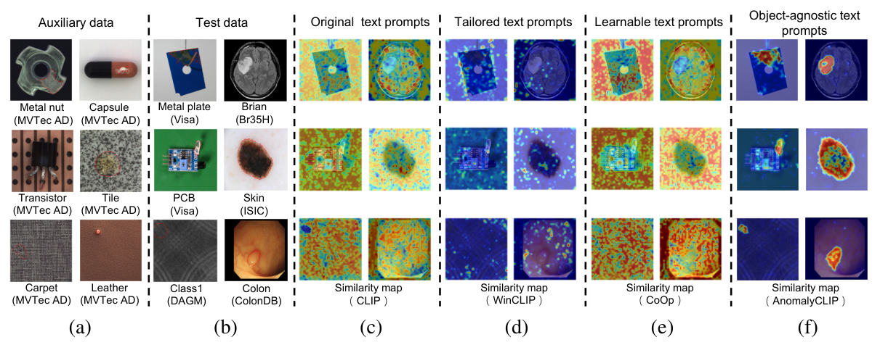
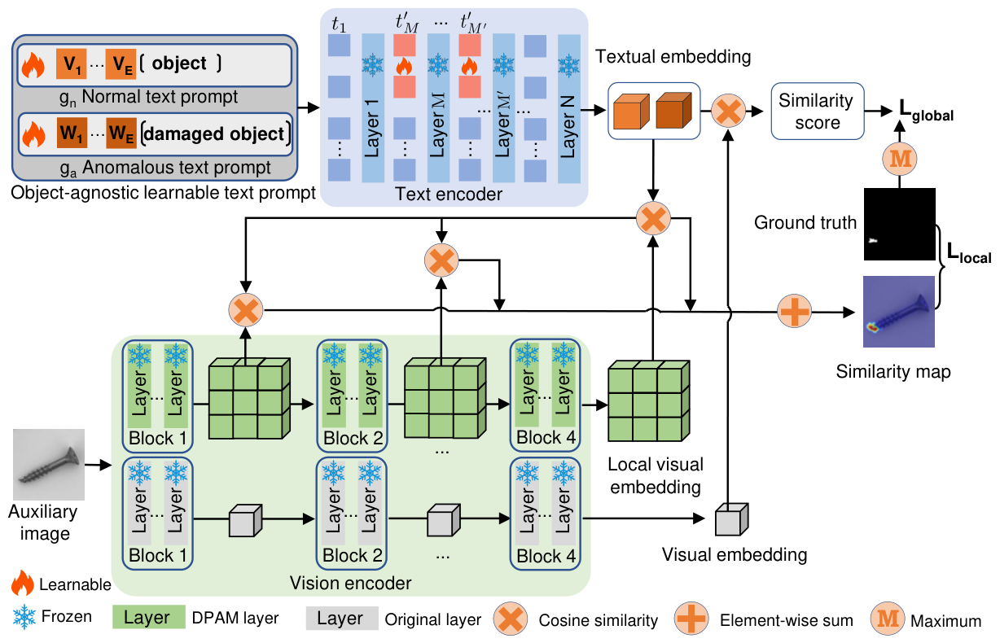

# 精读笔记 · AnomalyCLIP: Object-agnostic Prompt Learning for Zero-shot Anomaly Detection

> arXiv 2310.18961 · ICLR 2024 · 浙大 + 新加坡管理大学 + 哈佛
> 代码：https://github.com/zqhang/AnomalyCLIP（本目录 `code/`，**自带 2 个 checkpoint**）
> 材料：paper.pdf（31 页）/ source/ / paper.tex / figures/ / code/

## 基本情况

- 一句话：给一张图 + 类别名 → 输出异常热力图 + 图像级分数；用辅助数据训练，但 prompt 里**故意不写物体名**，只学"异常"本身。
- 可训练参数只有 **≈43K**（12 个词向量 × 2 类 + 文本塔前 9 层的 4 个 prefix token），主干全冻。
- 视觉塔唯一改动：把 Q-K 注意力换成 V-V（DPAM），**不加任何参数**。
- 开源：代码 ✅、权重 ✅（仓库自带 `9_12_4_multiscale` 与 `..._visa`），四篇里复现最省事。
- 路线：`① 动机（图 1）→ ② 架构（图 2）→ ③ 训练（glocal loss）→ ④ 数据（17 个数据集）→ ⑤ 信息流 → ⑥ 一张图走一遍（code/）`

## 导读地图

行号指 `paper.tex`。

| 站 | 这一站讲清楚什么 | 图 | 原文位置 | 代码 |
|---|---|---|---|---|
| ① 动机 | CLIP 的文本空间按物体组织，不是按异常组织 | 图 1 | §1 L18–60 | — |
| ② 架构 | object-agnostic prompt、文本塔 prefix token、DPAM | 图 2、图 3 | §3.2 L87–105、§3.3 L106–167 | `prompt_ensemble.py:85`、`AnomalyCLIP_lib/AnomalyCLIP.py:58`（Attention）、`:298` |
| ③ 训练 | glocal loss：全局 CE + 局部 focal/dice，λ=4 | 式 (7) | §3.3 L106–167 | `loss.py`、`train.py` |
| ④ 数据 | 17 个数据集、辅助集 = MVTec/VisA 的 test split | 表 1、2 | §4.1 L170–242、附录 B | `dataset.py` |
| ⑤ 信息流 | 518² → 37×37 → 4 层 → 相似度 → 高斯平滑 | 图 2 | §3.3 | `test.py` |
| ⑥ 例子 | 一张 PCB 图走一遍 | — | — | `AnomalyCLIP_lib/AnomalyCLIP.py:298` |
| ⑦ 实验 | MVTec 91.5/91.1、VisA 82.1/95.5；17 个数据集 | 表 1、2 | §4.2 L243–308 | — |

## ① 动机



**图 1 怎么读**：6 列对照。(a) 辅助数据（MVTec 的金属螺母、胶囊、晶体管…，红圈是缺陷）；(b) 测试数据（VisA、Br35H、ISIC、DAGM、ColonDB，**全是没见过的类别和域**）；
(c)~(f) 四种 prompt 算出的相似度图：原始 CLIP / WinCLIP 手写 / CoOp 可学习 / AnomalyCLIP。

只有 (f) 圈出了缺陷；(c)(e) 基本是噪点，(d) 经常糊在整块物体上。

**要解决什么**：用辅助数据训好的模型，去检测从没见过的新类别、甚至新领域（工业 → 医学）。

**以前卡在哪**：

1. **CLIP 的文本编码器编码的是「物体」，不是「异常」**。问它 `a photo of a bottle`，得到的是"瓶子"这个概念；问 `damaged bottle`，也只是把"瓶子"偏了一点。
2. **WinCLIP 的手写 prompt 是领域工程**：7 个状态词 × 22 个模板靠试，换数据集就得重来；而且 prompt 里都带物体名，文本嵌入天然绑定物体语义。
3. **CoOp 那类可学习 prompt 是给通用视觉任务的**，在异常检测上跨域直接崩（图 1(e)）。

**押注的想法**：异常模式跨物体通用（螺母划痕 / PCB 错件 / 器官肿瘤），所以 prompt 应该**去掉物体名**：

```
物体相关：  [V₁]…[V₁₂] [bottle]        /  [W₁]…[W₁₂] [damaged] [bottle]
物体无关：  [V₁]…[V₁₂] [object]        /  [W₁]…[W₁₂] [damaged] [object]
```

**例子**（图 1 第一行）：辅助是 MVTec 金属螺母（缺口），测试是 VisA 金属板（凹坑）。
WinCLIP 的 prompt 是 `damaged metal plate`——CLIP 没见过这个组合，整块板都热；
AnomalyCLIP 的 prompt 是 `[W₁]…[W₁₂] damaged object`——学的是"损坏"这个方向本身，只点亮凹坑。

**为什么不干脆只用一个词 `damaged`**：CLIP 原生的 damaged 是自然图像的损坏（摔碎的手机），和工业缺陷/医学病灶差得远，
所以要先在辅助数据上学一组前缀，把"损坏"重新锚定到目标域。

## ② 架构



**图 2 怎么读**：上=文本支路，下=视觉支路，中间相乘。

- 左上两条 prompt：红块可学习，`[object]` 是字面词。
- 上中：文本塔 12 层，第 M~M' 层（实际 2~9）把输入前 4 个 token 换成可学习 prefix，**一层一换**。
- 左下：视觉塔每层画两条路——绿色 DPAM 层（V-V 注意力）出 local 特征，灰色原始层出 global 特征；**在同一次前向里并行算**。

**接口**

| 项 | 值 |
|---|---|
| 输入 | 518×518 |
| 骨干 | ViT-L/14@336：24 层、width 1024、37×37 = 1369 patch |
| 取特征层 | 6 / 12 / 18 / 24 |
| prompt | E=12 词向量 × 2 类 |
| 文本塔 | 12 层，第 2~9 层各插 Q=4 个 prefix token |
| 高斯平滑 | σ=4 |
| 可训练 | **≈43K**（18,432 + 24,576） |
| 前向 | **1 次** |

**A. 文本侧（43K 参数的全部）**

```python
classnames = ["object"]          # 不是类别名
state_normal_list  = ["{}"]
state_anomaly_list = ["damaged {}"]
n_ctx = 12; text_encoder_n_ctx = 4; depth = 9
```

- 词向量：`2×12×768 = 18,432`
- prefix token：`8×4×768 = 24,576`
- 合计 **43,008**，比 AdaCLIP（10.7M）少 250 倍。

为什么一层一换：文本塔每层都在改表示，一次性插入的 token 传到第 9 层早被稀释；每层重新注入等于每层重新提醒"注意异常"。

**B. 视觉侧：DPAM**

```
原始：  A = softmax(Q Kᵀ / √d) V
DPAM：  A = softmax(V Vᵀ / √d) V
```

- Q-K 注意力是为整图识别服务的，会撒到远处的语义相关区域 → 每个 patch 混进大量全局信息，局部细节被抹平。
- V 是内容本身，两个 patch 的 V 相似 ⇔ 长得像 → 注意力自然集中到同类内容，图更"对角"+块状，远处干扰被切断。
- 代价是全局识别变差 → 所以保留一条原始路专门出 global embedding。

**C. 相似度与推理图**

- 图像级：`P(g_a, f_i)`。
- 像素级：每层得 `S_n`、`S_a`，上采样后算 focal + dice。
- 推理：`Map = Gauss_σ( Σ_l [ (I − Up(S_n))/2 + Up(S_a)/2 ] )`。

| 模块 | 来源 | 参数量 | 训练时更新 | 作用 |
|---|---|---|---|---|
| 视觉塔 ViT-L/14@336 | OpenCLIP | ≈303M | 否（只换注意力，无新参数） | patch + CLS |
| 文本塔 | 同 | ≈123M | 否（只插 prefix） | prompt → 2 个嵌入 |
| 可学习词向量 | 随机 | 18,432 | 是 | 正常/损坏的语义锚点 |
| 文本 prefix token | 随机 | 24,576 | 是 | 每层细化的异常注意力 |

## ③ 训练

**一句话**：用「图文对比」把 12 个词向量拉成「正常 / 异常」两个语义锚点（全局 CE），同时让它们和 4 层的 patch 特征对齐（局部 focal + dice）。

```
L_total = L_global + λ · Σ_{l∈{6,12,18,24}} L_local^l ,      λ = 4

L_global = CE( (f · gᵀ) / 0.07 , y )            # 2 类，temperature 0.07
L_local^l = Focal( Up([S_n^l, S_a^l]), G )
          + Dice( Up(S_a^l), G )
          + Dice( Up(S_n^l), 1 − G )

S_n^l = P(g_n, F^l),   S_a^l = P(g_a, F^l)
```

| 符号 | 是什么 | 形状 / 取值 |
|---|---|---|
| f | 全局视觉嵌入（原始 Q-K 路） | [B, 768] |
| g | 两条 prompt 的文本嵌入 | [2, 768] |
| F^l | 第 l 层 DPAM 路的 patch 特征 | [B, 1369, 768] |
| S_n / S_a | 每层 normal / anomalous 相似度图 | [B, 2, 518, 518] 上采样后 |
| G | GT mask | {0,1}，518² |
| λ | 局部/全局权重 | 4 |
| τ | 温度 | 0.07（CLIP 默认） |

**λ=4 到底有多偏像素**（示意）：若 `L_global ≈ 0.05`，每层 `L_local ≈ 0.08`，4 层合计 0.32，
`λ·Σ = 1.28`，total = 1.33 → **局部损失占 96%**。也就是说训练几乎完全由像素信号驱动，图像级那项只是兜底。

**τ=0.07 的含义**：CLIP 的余弦差通常只有 0.0x。cos 差 0.04 → logits 差 0.04/0.07 ≈ 0.57 → p=0.64 → CE=0.45。
换成 1/0.07 ≈ 14 倍放大，比 AdaCLIP 的 100 倍温和得多——**它不想让概率过早饱和**。

**为什么是 CE + focal + dice**：
- 图像级用普通 CE：只有 2 类、样本相对均衡（MVTec 467:1258），不需要 focal。
- 像素级用 focal + dice：缺陷像素占比极低（focal 治难样本），区域重叠（dice 治不平衡），且**对正常通道也算 dice**（逼两条 prompt 都收敛）。

**训练流程**

| 项 | 值 |
|---|---|
| 数据 | 辅助集 test split（训 MVTec 时用 VisA，反之亦然） |
| 更新 | **只有 prompt_learner**（43K）；CLIP 全程 `eval()` |
| 优化器 | Adam，lr=1e-3，betas=(0.5, 0.999)，batch=8 |
| 轮数 | **15 epoch** |
| 硬件 | 单卡 RTX 3090 24GB |
| 步数 | 1725 / 8 ≈ 216 步/epoch × 15 ≈ **3,240 步** |

**一个代码里的关键事实**：训练时视觉塔是在 `torch.no_grad()` 下跑的——

```python
with torch.no_grad():
    image_features, patch_features = model.encode_image(image, args.features_list, DPAM_layer=20)
```

所以 patch 特征完全 **detach**，梯度只回到文本侧的 43K 参数。这才是它 3090 上 15 epoch 就够、batch 能开到 8 的原因：
**没有一次反向传播穿过 ViT-L**。

**训练 vs 推理**

- 训练：4 层各自算 loss，加总后乘 λ。
- 推理：4 层合成一张图 `Gauss_σ(Σ[(I−S_n)/2 + S_a/2])`，σ=4。
- 图像级不变：`P(g_a, f)`。

**代码 ↔ 论文**

| 论文 | 代码 | 备注 |
|---|---|---|
| λ=4 | `train.py:50 lam = 4` | 一致 |
| 「DPAM 替换 Q-K 注意力」 | `DPAM_layer=20` → 只替换第 **6~24 层**（19 层） | 论文没写替换范围；前 5 层保持原样 |
| 温度 τ 未提 | `text_probs / 0.07` | CLIP 默认值 |
| 「视觉编码器冻结」 | `torch.no_grad()` 跑视觉塔 | 比「冻结参数」更彻底：连梯度图都不建 |
| focal 的 γ、α 未提 | γ=2、α=None | 与 AdaCLIP 用的是同一份 `FocalLoss` 实现 |

## ④ 数据

**一条训练样本**（比 AdaCLIP 少了一个字段）：

| 字段 | 形状 | 单位 / 取值 | 真实例子 |
|---|---|---|---|
| img | [3, 518, 518] | float32，CLIP 归一化 | MVTec `bottle/test/broken_large/000.png` |
| img_mask | [518, 518] | {0,1} | 瓶身破口 |
| anomaly | {0,1} | 图像级标签 | 1 |
| ~~cls_name~~ | — | **不用**：prompt 里固定写 `object` | — |

**最关键的数据差异**：AnomalyCLIP **不需要物体名**。
- WinCLIP：物体名 → 242 条 prompt
- AdaCLIP：物体名 → 48 条 prompt
- AnomalyCLIP：**不要** → 2 条 prompt，`[V…][object]` / `[W…][damaged][object]`

代码里 `test.py:82` 拿 `cls_name` 只用来**按类归档结果**，从不喂进 prompt。

**预处理**（`AnomalyCLIP_lib/model_load.py:83`）

```python
Compose([
    Resize((n_px, n_px), interpolation=InterpolationMode.BICUBIC),   # 直接拉伸
    #CenterCrop(n_px),  # rm center crop to explain whole image
    _convert_image_to_rgb, ToTensor(),
    Normalize((0.48145466, 0.4578275, 0.40821073), (0.26862954, 0.26130258, 0.27577711)),
])
```

和 AdaCLIP 一样：**直接拉伸成正方形，不保长宽比**。SDD 这种 500×1250 的长条图，作者干脆竖着切成两张再处理。

**规模**

| | 内容 |
|---|---|
| 训练池（训 MVTec） | VisA test = **2162** 张（962 正常 + 1200 异常） |
| 训练池（训 VisA） | MVTec test = **1725** 张（467 + 1258） |
| 步数 | 1725/8 ≈ 216 步/epoch × 15 ≈ **3,240 步** |
| 评估 | 17 个数据集（工业 7 + 医学 10） |

**17 个数据集**（附录表 4）

| 域 | 数据集 | 类数 | 正常/异常 |
|---|---|---|---|
| 工业 | MVTec AD | 15 | 467 / 1258 |
| 工业 | VisA | 12 | 962 / 1200 |
| 工业 | MPDD | 6 | 176 / 282 |
| 工业 | BTAD | 3 | 451 / 290 |
| 工业 | SDD | 1 | 181 / 74 |
| 工业 | DAGM | 10 | 6996 / 1054 |
| 工业 | DTD-Synthetic | 12 | 357 / 947 |
| 医学 | ISIC（皮肤） | 1 | 0 / 379 |
| 医学 | CVC-ClinicDB（结肠） | 1 | 0 / 612 |
| 医学 | CVC-ColonDB | 1 | 0 / 380 |
| 医学 | Kvasir | 1 | 0 / 1000 |
| 医学 | Endo | 1 | 0 / 200 |
| 医学 | TN3K（甲状腺超声） | 1 | 0 / 614 |
| 医学 | HeadCT | 1 | 100 / 100 |
| 医学 | BrainMRI | 1 | 98 / 155 |
| 医学 | Br35H | 1 | 1500 / 1500 |
| 医学 | COVID-19（胸片） | 1 | 1341 / 219 |

**协议**：MVTec ↔ VisA 互训。训 MVTec 的模型评其余 16 个；MVTec 自己的结果来自训 VisA 的模型。

**两个作者自己造的细节**：
1. **SDD 预处理**：原图 500×1250，竖着切成两张 500×625 再标注。
2. **医学微调集**：找不到同时有类别标签和分割 GT 的 2D 医学数据集，于是把 ColonDB（提供像素标注）+ Endo 的 test split（提供正常样本）
   拼了一个 **163 正常 + 380 异常** 的新数据集。

## ⑤ 信息流

```
【文本支路｜整个模型只算一次，跨图跨类复用】
"X X … X object." / "X X … X damaged object."   ← 12 个 X
  └ token embedding ─▶ [2, 77, 768]
      └ 文本塔 12 层（第 2~9 层各注入 4 个可学习 token）─▶ [2, 77, 768]
          └ EOT + ln_final + proj ─▶ g [2, 768] ─▶ L2 归一化

【图像支路｜每张图一次】
[1, 3, 518, 518]
  └ conv1 14×14 ─▶ [1, 1024, 37, 37] → [1, 1369, 1024] +CLS ─▶ [1, 1370, 1024]
      └ 位置编码插值 + ln_pre
          └ 24 层，每层同时算两路：
               ├─ DPAM 路 softmax(VVᵀ/√d)·V ─▶ 第 6/12/18/24 层各存一份 [1,1370,1024]
               └─ 原始路 softmax(QKᵀ/√d)·V ─▶ 一直走到第 24 层
      ├─ 4 份 patch → ln_post + proj ─▶ 4×[1, 1370, 768]
      └─ 原始路 CLS ─ proj ─▶ f [1, 768]

【相似度】
4×[1,1369,768] @ gᵀ ─/0.07─ softmax ─▶ 4×[1, 1369, 2]
  └ reshape [1, 37, 37, 2] ─双线性─▶ 4×[1, 518, 518, 2]

【合图】
Σ_l [ (1 − S_n^l) + S_a^l ] / 2 ─高斯 σ=4─▶ [1, 518, 518]

【图像级】
f @ gᵀ / 0.07 ─ softmax ─▶ [1, 2]，取第 1 列
```

| 阶段 | 次数 | 说明 |
|---|---|---|
| 文本编码 | **整个模型 1 次** | 与图无关，`test.py` 在循环外算好，跨 17 个数据集复用 |
| 图像前向（24 层双路） | 每图 1 次 | DPAM 和原始路在同一层里并行 |
| patch 投影 | 每图 4 次 | ln_post + proj |
| 相似度 | 每图 4×1369×2 | 小矩阵乘 |
| 插值到 518² | 每图 4 次 | 显存大头：4×518×518×2 |
| 高斯平滑 σ=4 | 每图 1 次 | CPU/GPU 都行 |

**被丢掉的**：20 层的 patch token（只留 6/12/18/24）；patch 列表里的 CLS（`similarity[:, 1:, :]` 切掉）；
**DPAM 路的 CLS 从来不用**（全局嵌入只走原始路）。

**训练 vs 推理**：只差「4 层是各自算 loss 还是先求和」——训练各层分开监督，推理先加总再高斯平滑。
另外训练时视觉塔在 `torch.no_grad()` 下跑，推理时也是 `no_grad`，两边其实一样。

**耗时**：论文没报。结构上是「一次 ViT-L@518²（1369 token）+ 4 次 518² 插值」，
比 AdaCLIP 少一半（它要两遍），比 WinCLIP 轻很多（它要 366 个窗口）。

## ⑥ 例子走一遍

**场景**：VisA `pcb1`，划痕在 patch 5、6。

**玩具尺寸**（括号真实值）：56²（518²）；patch 14 → **4×4=16**（37×37=1369）；宽度 8/4（1024/768）；
4 层取第 2、4 层（24 层取 6/12/18/24）；"X" 2 个（12）；prefix token 每层 1 个（4 个，插第 2~3 层）；
DPAM 作用在第 2~4 层（真实第 6~24 层）。

| 步 | 手里有什么 | 做了什么 | 变成什么 | 代码 |
|---|---|---|---|---|
| 0 | 字符串 | `"X X object."` → tokenize → 换掉 X 位置 | `[1,77,8]` | `prompt_ensemble.py:160-215` |
| 1 | `[1,77,8]` | 文本塔 4 层，第 2~3 层前插 1 个可学习 token | `[1,77,8]` | `AnomalyCLIP.py:497` |
| 2 | — | 取 EOT + ln_final + proj | `g [2,4]` | `:514` |
| 3 | `[1,3,56,56]` | conv1 → 16 patch + CLS | `[1,17,8]` | `:356` |
| 4 | `[1,17,8]` | 4 层，每层**双路**注意力 | 双路各 `[1,17,8]` | `:58`（Attention） |
| 5 | 第 2、4 层 DPAM 路 patch | ln_post + proj | `2×[1,17,4]` | `:387-392` |
| 6 | `[1,16,4]` @ `gᵀ` | /0.07 → softmax | `2×[1,16,2]` | `model_load.py:230` |
| 7 | `[1,16,2]` | reshape 4×4 → 插值 56² → 两层相加 → 高斯 | `[1,56,56]` | `test.py:99-108` |
| 8 | 原始路 CLS | @ gᵀ /0.07 → softmax | 图像级 `[2]` | `test.py:93-96` |

**第 4 步是全文最关键的一步**（`Attention.forward`）：

```python
q, k, v = qkv(x).chunk(3, dim=-1)
attn_ori = (q @ k.transpose(-2,-1) * scale).softmax(-1)   # 原始
attn     = (v @ v.transpose(-2,-1) * scale).softmax(-1)   # DPAM
x     = (attn     @ v)     # DPAM 路  → 出局部特征
x_ori = (attn_ori @ v)     # 原始路  → 出全局特征
return x, x_ori
```

**同一层里算两遍注意力，一遍给局部、一遍给全局。**

示意地看 patch 5 这一行的注意力权重（16 个 patch）：

```
原始 Q-K： 0.04 0.05 0.06 0.05 | 0.06 0.10 0.08 0.06 | 0.07 0.06 0.09 0.05 | 0.06 0.05 0.06 0.06   ← 摊平
DPAM V-V： 0.01 0.01 0.01 0.01 | 0.02 0.34 0.26 0.02 | 0.03 0.04 0.05 0.02 | 0.02 0.02 0.02 0.02   ← 集中
```

**这一刻发生了什么，用大白话说。** patch 5 的新特征 = 它对所有 patch 的加权平均。
- Q-K 那行是摊平的：它把整块板的 16 个 patch 都混了一点进来，**划痕的细节被 14 个正常 patch 稀释**。
- V-V 那行是集中的：0.34 给自己 + 0.26 给 patch 6 = **60% 来自两块划痕**，剩下 40% 才来自别处。

原因很简单：V-V 用的是**内容本身**做相似度，patch 5 和 patch 6 长得像（都是划痕），权重自然高；Q-K 用的是学出来的 query/key，
在 CLIP 里这是为"整图识别"服务的，所以它会去找语义相关但位置很远的 token。

代价是**全局识别变差**——所以 `x_ori` 那条路被完整保留下来算图像级分数。

**第 6~7 步的数字**（cos 是示意值）：

| patch | cos(normal) | cos(anomalous) | p(anomalous) |
|---|---|---|---|
| 5（划痕） | 0.280 | 0.320 | **0.64** |
| 6 | 0.290 | 0.315 | 0.59 |
| 10 | 0.300 | 0.300 | 0.50 |
| 0 | 0.320 | 0.280 | 0.36 |

两层平均后，patch 5 从 0.58 提到 0.64，再高斯平滑（σ=4）——**平滑会把孤立的单点噪声压掉，也会把细划痕抹宽**，这是 σ 要调的原因。

**一个必须更正的地方（⑤ 留下的）**：论文写 `Map = (I − S_n)/2 + S_a/2`，看起来是"正反两面一起判"。
但因为两条 prompt 是**联合 softmax（只有 2 类）**，`S_n + S_a = 1` 恒成立，所以 `(1−S_n)/2 + S_a/2 = S_a`。
**这个式子等价于直接用 `S_a`**。代码里作者自己写了注释：

```python
anomaly_map = (similarity_map[...,1] + 1 - similarity_map[...,0])/2.0
# The following code is equivalent.
# anomaly_map = similarity_map[...,1]
```

所以"正反两面"是写法上的对称美，不是额外的信息。真正让图变好的是 DPAM 和多层聚合。

**真实规模只是换数字**：4×4→37×37、8→1024、2→4 层、2 个 X→12 个、prefix 1→4、DPAM 2 层→19 层。

## ⑦ 实验与地位

**三个关键结果**

| | WinCLIP | **AnomalyCLIP** | 差 |
|---|---|---|---|
| MVTec 图像 | **91.8** | 91.5 | −0.3（输） |
| MVTec 像素 | 85.1 | **91.1** | **+6.0** |
| VisA 图像 | 78.1 | **82.1** | +4.0 |
| VisA 像素 | 79.6 | **95.5** | **+15.9** |

医学域全面领先：HeadCT 93.4（WinCLIP 81.8）、BrainMRI 90.3（86.6）、Br35H 94.6（80.5）、COVID-19 80.1（66.4）。

**消融里最值钱的三条**（MVTec 像素 / 图像）

| 加什么 | MVTec | VisA | 说明 |
|---|---|---|---|
| Base（物体相关 prompt + 无 DPAM） | 46.8 / 66.3 | 47.9 / 54.4 | 起点 |
| + DPAM（$T_1$） | **68.4** / 66.3 | 54.8 / 54.4 | 只动像素，图像级一点没变——证明它只影响局部 |
| + 物体无关 prompt（$T_2$） | 89.5 / 90.8 | 95.0 / 81.7 | **贡献最大**：像素 +21.1，图像 +24.5 |
| + 文本 prefix token（$T_3$） | 91.1 / 91.5 | 95.5 / 82.1 | +1.6 / +0.7 |

**glocal 消融**（证明两项都不能少）

| 局部 | 全局 | MVTec 像素/图像 | VisA 像素/图像 |
|---|---|---|---|
| ✗ | ✗ | 71.7 / 68.8 | 74.7 / 61.1 |
| ✗ | ✓ | 80.3 / 89.9 | 86.6 / **82.2** |
| ✓ | ✗ | **91.0** / 89.9 | **95.2** / 79.5 |
| ✓ | ✓ | **91.1** / **91.5** | **95.5** / **82.1** |

读法：**局部项管分割、全局项管分类**。只用局部，VisA 图像级掉到 79.5；只用全局，MVTec 像素掉到 80.3。

**局限**

- 作者承认：没有 DPAM 时局部语义被全局注意力破坏；医学上个别数据集（ISIC 89.7）不如 VAND。
- 我看出的：
  1. **DPAM 改的是模型结构**（替换注意力），不是加参数——部署时必须改代码，不能"原版 CLIP + 提示词"直接用；
  2. **固定写死 `object`**，遇到"只有靠物体语义才能判断"的缺陷（如装反、错位）会失效，也没有 few-shot 模式；
  3. **仍需辅助集的像素标注**；
  4. σ=4 是固定超参，细划痕会被抹宽；
  5. 训练虽然有 15 epoch，但视觉塔不反传，所以**本质仍是"只调文本"**。

**地位**（2026-10-22 查，数字取自 [AA-CLIP, CVPR 2025](https://openaccess.thecvf.com/content/CVPR2025/papers/Ma_AA-CLIP_Enhancing_Zero-Shot_Anomaly_Detection_via_Anomaly-Aware_CLIP_CVPR_2025_paper.pdf) 表 1/2）

| 方法 | MVTec AC | MVTec AS | VisA AC | VisA AS | 权重 |
|---|---|---|---|---|---|
| WinCLIP (CVPR'23) | **91.8** | 85.1 | 78.0 | 79.6 | 无 |
| AdaCLIP (ECCV'24) | 90.0 | 89.9 | 84.3 | 95.5 | ✅ |
| **AnomalyCLIP (ICLR'24)** | 90.9 | 91.1 | 82.1 | 95.4 | ✅ |
| AA-CLIP (CVPR'25) | 90.5 | **91.9** | **84.6** | 95.5 | ❌ |

**判断**：AnomalyCLIP 是这条线上**性价比最高**的一篇——43K 参数、一次前向、自带权重，到 2025 年才被 AA-CLIP 小幅超过（像素 91.1 → 91.9）。
"object-agnostic prompts" 这个提法后来成了 ZSAD 的标准词汇，几乎所有后续工作都会引它。
