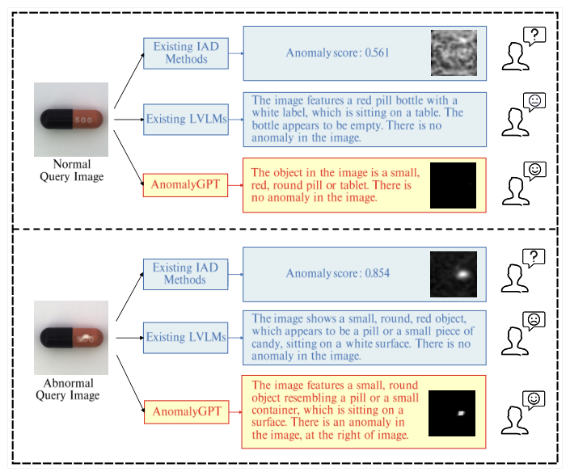
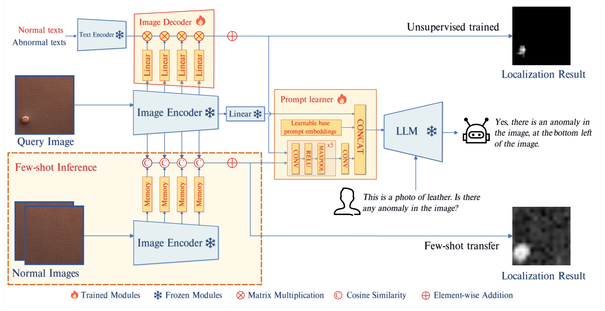

# 精读笔记 · AnomalyGPT: Detecting Industrial Anomalies Using Large Vision-Language Models

> arXiv 2308.15366 · AAAI 2024 · 中科院自动化所 CASIA-IVA-Lab
> 代码：https://github.com/CASIA-IVA-Lab/AnomalyGPT（本目录 `code/`）· 项目页：https://anomalygpt.github.io
> 材料：paper.pdf（19 页）/ source/ / paper.tex / figures/（14 图 4 表）

## 基本情况

- 一句话：给一张工业图 + 一句问题（"Is there any anomaly in the image?"），LVLM **直接回答"有/没有"并说出位置**（3×3 宫格方位），同时输出像素级异常图——**不需要手设阈值**。
- 和前面四篇的根本区别：那四篇输出**分数**，阈值要自己定；AnomalyGPT 输出**判断 + 解释 + 对话**。
- 开源：代码 ✅、权重 ✅（HuggingFace 有 checkpoint）、模拟异常数据生成脚本 ✅。
- 路线：`① 动机（图 1）→ ② 架构（图 2）→ ③ 训练（三段损失 + 交替训练）→ ④ 数据（模拟异常 + Q&A）→ ⑤ 信息流 → ⑥ 例子 → ⑦ 实验`

## 导读地图

行号指 `paper.tex`（正文 L36–411，附录 L412 起）。

| 站 | 这一站讲清楚什么 | 图 | 原文位置 | 代码 |
|---|---|---|---|---|
| ① 动机 | 阈值问题 + LVLM 对细粒度缺陷不敏感 | 图 1 | §1 L36–55、§2 L72–79 | — |
| ② 架构 | 冻结 ImageBind + 线性层 + prompt learner + decoder + Vicuna | 图 2 | §3.1 L84–86、§3.2 L87–107 | `model/` |
| ③ 训练 | 三段损失：文本 CE + 图像描述 CE + decoder 分割 | — | §3.4 L135–354 | `train.py` |
| ④ 数据 | 模拟异常（NSA: cut-paste + Poisson）、Q&A 模板、3×3 宫格 | 图 2、图 3 | §3.3 L108–134、附录 B/C | `data/` |
| ⑤ 信息流 | 图 → 嵌入 + 定位图 → prompt embedding → LLM → 文本 | 图 2 | §3.2 | `model/anomalygpt.py` |
| ⑥ 例子 | 一张裂开的药片走一遍 | — | — | 同上 |
| ⑦ 实验 | MVTec 93.3% acc / 97.4 image AUC / 93.1 pixel AUC | 表 1、2 | §4 L355–392 | — |

## ① 动机



**图 1 怎么读**，上下两组（正常药片 / 裂开的药片），每组三列：

- **左列**：查询图。
- **中列上：现有 IAD 方法**——只给一个分数（正常 0.561 / 异常 0.854）和一张热力图。**分数有了，但"多少算异常"要靠人定阈值。**
- **中列中：现有 LVLM**——描述得很流畅（"a red pill bottle with a white label..."），但**下面那张裂开的药片它照样说 "There is no anomaly in the image."**
- **右列：AnomalyGPT**——正常图说没有异常；异常图说 "There is an anomaly in the image, at the right of image."，还配了热力图。

**要解决什么**：工业异常检测要的不只是分数，而是**"这张图有没有问题、问题在哪儿"这个判断本身**，最好还能追问。

**以前卡在哪**：

1. **阈值问题**（这篇最狠的一刀）：传统 IAD 只输出异常分数，判正常/异常要人为定阈值，而每个类的最优阈值还不一样。
   论文附录给了一个具体数字：**PatchCore 在 MVTec 上 image AUC 99.3%，但用统一阈值时准确率只有 79.76%**。
   AUC 高不等于能用——这正是我在 WinCLIP 笔记里反复提到的那件事。
2. **LVLM 不懂工业缺陷**：它们是在互联网图文上训的，对**局部细节**不敏感（论文原话：*lack sensitivity to local details*）。
   图 1 中间列就是证据：图里明明有裂纹，它说没有。
3. **数据太少**：LLaVA 那种预训练用 16 万张图 + 多轮对话，而 MVTec 只有几千张。**直接微调 = 过拟合 + 灾难性遗忘。**

**押注的关键想法**（三件事一起做）：

> ① 用**模拟异常**造出"异常图文对"（cut-paste + Poisson 融合），让 LVLM 见过缺陷；
> ② **不全参数微调**，只训 prompt embedding，并且和预训练数据交替训练——保住原有能力；
> ③ 加一个**轻量 decoder** 出像素级定位，再把定位图转成 prompt embedding 喂回 LLM，让 LLM「看着定位结果说话」。

**为什么不能更简单**：

- **只靠 LVLM 自己定位**：它只会输出文本，说不出精确的像素位置。所以必须有 decoder。
- **只靠 decoder**：它只能出分数，说不出"为什么"，也没法对话。两者互补才是这篇的贡献。
- **直接微调 LVLM**：数据量差两个数量级，会把它训坏。

**结果**：MVTec 上 **93.3% 分类准确率、97.4 image AUC、93.1 pixel AUC**；
迁移到 VisA（1-shot）是 77.4% / 87.4 / 96.2；反过来 VisA 训、MVTec 测是 86.1% / 94.1 / 95.3。

**它在整个图谱里的位置**：前面四篇都是「**CLIP 双塔 + 相似度**」这条线，输出分数；AnomalyGPT 是「**LVLM + 定位模块**」这条线，
输出判断和对话。两条线的交点在于：**都卡在"分数怎么变成决策"这个问题上**——一个绕开（LLM 直接说），一个硬扛（调阈值）。

## ② 架构



**图 2 怎么读**：五块 + 一条并行支路。

- 左上 Image Encoder（冻结）：ImageBind-Huge，取 8/16/24/32 层的 patch 特征。
- 中上 Image Decoder（可训练）：4 个 Linear → 和 2 个文本向量矩阵乘 → softmax → 4 层相加 → 定位图。
- 中下 Prompt learner（可训练）：定位图过 CNN → 9 个 token；再拼 9 个 base token → 18 个。
- 右 LLM（冻结）：Vicuna-7B，吃「图像嵌入 + 18 token + 用户文字」。
- 左下 Few-shot（虚线）：正常图进 memory bank，余弦相似度算最近邻，**不训练**。

| 项 | 值 |
|---|---|
| 图像塔 | ImageBind-Huge（ViT-H，632M，冻结），取 8/16/24/32 层 |
| 中间维度 | patch 1280 → Linear → 1024（文本空间） |
| 文本侧 | WinCLIP 的 CPE（7 正常 + 5 异常状态词 × 模板）→ 2×1024 |
| LLM | Vicuna-7B（冻结） |
| 图像→LLM | Linear 1024→4096（冻结，来自 PandaGPT） |
| prompt | 9 base + 9 来自定位图 = 18 个 4096 维 token |
| 可训练 | ≈112M（decoder 5.25M + prompt learner **107M**），占 7.3B 的 1.5% |

**A. 为什么只训两个模块**：数据几千张 vs PandaGPT 的 16 万对，全参数微调会灾难遗忘。而且 PandaGPT 已经把 ImageBind 和 Vicuna 对齐好了。

**B. Decoder（式 1）**：`M = Upsample(Σ_i softmax(F̃_patch^i · F_text^T))`——就是 WinCLIP 的多尺度 + softmax，换成 ImageBind 的 patch。
**Few-shot（式 2）**：`M = Upsample(Σ_i (1 - max(F_patch^i · B^i^T)))`——最近邻，零参数。

**C. Prompt learner**：定位图 [1,224,224] → 5 层 CONV-RELU-MAXPOOL（通道 1→4→16→64→256→1024，空间 224→7）→ 5×5 CONV(1024→4096) → reshape 成 9 个 token。
**注意那个最后的卷积是 1.05 亿参数**——比 decoder 大 20 倍，"轻量"说的是 decoder，不是它。

**D. LLM 输入**：` E_img </Img> E_prompt [图像描述] Is there any anomaly?`；位置用 3×3 宫格说（"bottom left"）。

| 模块 | 参数量 | 训练时更新吗 |
|---|---|---|
| ImageBind-Huge | ≈632M | 否 |
| Image Decoder（4×Linear） | 5.25M | ✅ |
| Prompt Learner（CNN + base） | ≈107M | ✅ |
| 1024→4096 Linear | 4.2M | 否 |
| Vicuna-7B | ≈6.7B | 否 |

## ③ 训练

**一句话**：LLM 用标准的逐 token 交叉熵学"怎么答"，decoder 用 focal + dice 学"缺陷在哪儿"——两项相加，只有 decoder 和 prompt learner 收梯度。

```
L_total = L_text + L_pixel

L_text  = CE( ŷ_t | y_<t , 图像嵌入 , prompt )        # LLM 的下一 token 预测
L_pixel = Σ_{i=1..4} [ Focal(M_i, G) + Dice(M_i[ano], G) ]
```

| 符号 | 是什么 | 取值 |
|---|---|---|
| L_text | 答案 token 的交叉熵（prompt 部分 target 设 −100，不回归） | 答案通常 20~40 token |
| M_i | 第 i 个 stage 的定位图 | 4 张，224² |
| G | GT mask | {0,1} |

**为什么文本用普通 CE**：LLM 本来就是 next-token prediction 训出来的，保持一致最稳。
**为什么像素用 focal + dice**：缺陷像素极少（focal），且是区域重叠问题（dice）。
**注意只对异常通道算 dice**——这点和 AdaCLIP / AA-CLIP 不同（它们对正常通道也算）。

**训练配置**

| 项 | 值 |
|---|---|
| 硬件 | **2 × RTX 3090** |
| 轮数 | 50 epoch |
| batch | 16（DeepSpeed） |
| lr | 1e-3，linear warmup + one-cycle cosine |
| 初始化 | PandaGPT 的预训练参数 |
| 关键 trick | **和 PandaGPT 的通用图文数据交替训练**（防遗忘） |
| 更新参数 | 只有 decoder 和 prompt learner |

**交替训练是这篇最关键的一招**：如果只喂工业 Q&A，模型会忘掉怎么正常说话（毕竟还要支持多轮对话）；混入通用数据后，
它在工业任务上不掉点，同时保住了对话能力。

**代码 ↔ 论文**：论文说"三个损失"（CE + focal + dice），代码里其实只有**两项**——`L_text`（LLM 的 CE）+ `L_pixel`（4 张图各 focal+dice）。
"图像描述 CE" 不是单独一项，它和异常 Q&A 共用同一个 `L_text`。

## ④ 数据

**一条训练样本**（注意：这是**对话**样本，不是"图+标签"）：

| 字段 | 内容 | 例子 |
|---|---|---|
| 图像 | 正常图或**模拟异常图** | 一块皮革（上面被贴了一块补丁） |
| mask | 模拟时自动得到 | 贴着的那块区域 |
| 问题 | 描述 + 提问 | "This is a photo of leather... Is there any anomaly in the image?" |
| 答案 | 判断 + 位置（或否定） | "Yes, there is an anomaly in the image, at the bottom left of the image." |

**模拟异常怎么造（这是全篇最省标注的设计）**

1. **cut-paste**：从一张图随机裁一块，贴到另一张图的随机位置 —— 造出"异常"；
2. **Poisson 图像融合**：解 Poisson 方程让补丁的边缘和背景连续 —— 消除拼接痕迹（图 3 的对比）；
3. **mask 免费**：贴上去的那块就是 GT，**零人工标注**。

**为什么必须加 Poisson**：纯 cut-paste 会在边界留下硬缝，模型学的不是"缺陷"而是"拼接缝"。加了 Poisson 之后，
补丁的颜色向背景对齐，看起来像真的长在上面——**这才逼模型去学形状和纹理的异常**。

**Q&A 模板**（三种答案）

```
无异常：  "No, there are no anomalies in the image."
有异常：  "Yes, there is an anomaly in the image, at the bottom left of the image."
多异常：  "Yes, there are 2 anomalies in the image, at the top left and bottom right..."
```

**3×3 宫格**：把图切成九块，让 LLM 说方位（top left / bottom right / center...）。
这个土办法很聪明——**LLM 不擅长输出精确坐标，但很擅长说"左下角"**。

**每个类手写一句描述**（附录 C 的表 6/7，MVTec 15 类 + VisA 12 类）：

| 类 | 描述 |
|---|---|
| bottle | This is a photo of a bottle for anomaly detection, which should be round and without any damage, flaw, defect, scratch, hole or broken part. |
| capsule | ... which should be black and orange, with print '500' and without any damage... |
| cable | This is a photo of three cables..., they are green, blue and grey, which cannot be missed or swapped... |

注意 cable 那句里的 "cannot be missed or swapped"——**它把"缺件"和"换件"这两种异常直接写进了"正常应该是什么样"里**。
这是 prompt 工程在 IAD 上的具体用法，和 AA-CLIP 的 `REAL_NAMES` 是同一个思路。

**规模与成本**

| 项 | 值 |
|---|---|
| 训练数据 | MVTec（或 VisA）的正常图 + 同数量级的模拟异常图；论文未给确切条数 |
| 人工标注 | **0 张 mask**（模拟自动生成）+ 每类 1 句描述 |
| 训练 | 2 × RTX 3090，50 epoch，batch 16 |
| 额外数据 | PandaGPT 的通用图文对话（交替训练） |

**和前四篇的数据对比**

| | WinCLIP | AdaCLIP | AnomalyCLIP | AA-CLIP | **AnomalyGPT** |
|---|---|---|---|---|---|
| 训练图 | 0 | 2337 | 1725 | 30 | 正常图 + **模拟异常** |
| 真实异常 mask | ❌ | ✅ | ✅ | ✅ | **❌（用模拟的）** |
| 人工成本 | 手写 prompt | 收集辅助集 | 收集辅助集 | 手写描述 | **手写描述 + 生成脚本** |
| 输出 | 分数 | 分数 | 分数 | 分数 | **判断 + 位置 + 对话** |

**它最独特的一点**：另外四篇都要**真实的**异常标注（哪怕只有 30 张），AnomalyGPT **一张都不用**——
全部靠 cut-paste 模拟。代价是模拟异常和真实缺陷之间有分布差（真实缺陷可能是凹陷、变色、裂纹，而模拟的是"贴上去的一块"）。

## ⑤ 信息流

```
【文本锚点｜每类一次，可缓存】
7 正常状态词 + 5 异常状态词 × 模板 ─ ImageBind 文本塔 ─▶ 每类平均 ─▶ 2×1024（normal / abnormal）

【图像｜每张图一次】
[1,3,224,224]
  └ ImageBind-Huge（冻结）
      ├─ 第 8/16/24/32 层 patch ─▶ 4×[1,256,1280]
      └─ 整图特征 [1,1024] ─ Linear(1024→4096) ─▶ E_img [1,4096]

【定位图】
4×[1,256,1280] ─ Linear(1280→1024) ─▶ 4×[1,256,1024]
  └ · textᵀ[1024,2] ─ softmax ─▶ 4×[1,256,2] ─ reshape 16×16 ─ 相加 ─ 上采样 ─▶ M [1,224,224]

【定位图 → prompt token】
M [1,1,224,224] ─ CNN（5 次下采样 → 7×7，通道 1→1024）─ 5×5 conv(1024→4096) ─▶ [1,4096,3,3]
  └ reshape ─▶ 9×4096 ─ 拼 9 个 base ─▶ E_prompt [1,18,4096]

【LLM 输入序列】
[BOS]  E_img </Img> E_prompt [用户文字] ─▶ Vicuna-7B ─▶ 回答
        1 个 token      18 个 token      ~50 个 token

【输出】
文本："Yes, there is an anomaly in the image, at the bottom left of the image."
像素：M 本身就是定位结果
```

| 阶段 | 次数 | 说明 |
|---|---|---|
| 文本锚点 | 每类 1 次 | 与图无关，可缓存 |
| ImageBind 前向 | 每图 1 次（冻结） | 同时出 4 层 patch 和整图特征 |
| 4 个 Linear + 相似度 | 每图 4 次 | 1280→1024 |
| CNN（prompt learner） | 每图 1 次 | 107M 参数，是最大的可训练块 |
| LLM 前向 | 每图 1 次 prefill + 自回归 ~20-40 token | 7B 参数 |

**最值得注意的一点：LLM 几乎"看不见"图。** 整张图只压成 **1 个 token**（E_img）。
作为对比：LLaVA 给 576 个视觉 token、MiniGPT-4 给 32 个。AnomalyGPT 只给 1 个 + 18 个"检测器意见"。

**这意味着它的"视觉"其实来自 decoder，不是来自 LLM**——LLM 做的事是：把「检测器说左下角有问题」翻译成一句人话，
并判断"要不要相信这个提示"。这也解释了为什么去掉 decoder 它就瞎了（消融里验证过）。

**训练 vs 推理**

| | 训练 | 推理 |
|---|---|---|
| 走哪条定位路 | **50% 概率随机切换**：监督 decoder / few-shot memory bank | 用户指定 |
| decoder / prompt learner | 更新 | 冻结 |
| GT mask | 需要（模拟的） | 不需要 |

代码里那行 `if random.randint(0,1) == 0` 很关键——**训练时一半的 batch 走 few-shot 路径**，
用同一张图对应的正常图建库。这样两条路都被训到，模型不会只认其中一种输入方式。

## ⑥ 例子走一遍

**场景**：一张裂开的药片（MVTec `pill`）。

**玩具尺寸**（括号真实值）：图像 64²（224²）；patch 8 → **8×8=64**（16×16=256）；2 个 stage（4 个）；
宽度 8 → 文本 4（1280 → 1024）；LLM 维度 8（4096）；prompt token 2+2（9+9）。

| 步 | 手里有什么 | 做了什么 | 变成什么 | 代码 |
|---|---|---|---|---|
| 0 | `pill` 的描述 | CPE → ImageBind 文本塔 | `T_N, T_A` [2,4] | `openllama.py:60-74` |
| 1 | `[1,3,64,64]` | ImageBind（玩具里只跑 2 层） | `2×[1,64,8]` | — |
| 2 | `2×[1,64,8]` | Linear(8→4) | `2×[1,64,4]` | `LinearLayer(1280,1024,4)` |
| 3 | `[1,64,4] @ [4,2]` | softmax → 取异常列 | `2×[1,8,8]` | — |
| 4 | `2×[1,8,8]` | 相加 → 插值 64² | `M [1,64,64]` | — |
| 5 | `M` | CNN → 9 个 token | `[1,9,4096]` | `PromptLearner.meta_net` |
| 6 | 9 个 + 9 个 base | 拼接 | `E_prompt [1,18,4096]` | `:forward` |
| 7 | E_img + E_prompt + 文字 | Vicuna | 回答文本 | `prompt_wrap` |

**第 3~4 步的数字**（cos 是示意值，p 是 softmax 后的异常概率）

| patch | cos(normal) | cos(anomalous) | p(anomaly) |
|---|---|---|---|
| 5（裂纹） | 0.28 | 0.32 | **0.64** |
| 6 | 0.29 | 0.315 | 0.59 |
| 0 | 0.32 | 0.28 | 0.36 |

两个 stage 加起来再插值，裂纹区域的分数会明显高出来——**这就是定位图 M**。

**第 5 步是这一站的关键**（`PromptLearner.meta_net`）：

```
M [1, 1, 224, 224]
  └ CONV 1→4,   3×3, ReLU, MaxPool2 ─▶ [1, 4, 112, 112]
  └ CONV 4→16,  3×3, ReLU, MaxPool2 ─▶ [1, 16, 56, 56]
  └ CONV 16→64, 3×3, ReLU, MaxPool2 ─▶ [1, 64, 28, 28]
  └ CONV 64→256,3×3, ReLU, MaxPool2 ─▶ [1, 256, 14, 14]
  └ CONV 256→1024, ReLU, MaxPool2   ─▶ [1, 1024, 7, 7]
  └ CONV 1024→4096, 5×5            ─▶ [1, 4096, 3, 3]
      └ reshape ─▶ [1, 9, 4096]
```

**"9" 是哪来的**：最后那个 **5×5 卷积**把 7×7 的图变成 3×3，**3×3 = 9 个位置**，每个位置对应一个 4096 维 token。
换句话说，**9 个 token 就是定位图被切成九宫格之后、每格浓缩成的一个向量**——和 LLM 说"bottom left"用的九宫格恰好对应。
（这是个巧合吗？作者没说，但形状上很吻合。）

**第 6~7 步**：9 个图 token + 9 个可学习 base token = 18 个，插在 ` E_img </Img>` 之后、用户文字之前。

**大白话总结这一步**：LLM 拿到的不是一张图，而是**「一句关于这张图的摘要（1 个 token）」+「检测器给的九宫格报告（9 个 token）」+「九条固定的经验（9 个 token）」**。
它要做的就是把这三样拼成一句人话。

**真实规模只是换数字**：64²→224²、8×8→16×16、2→4 个 stage、宽度 8/4→1280/1024、2+2→9+9 个 token。

## ⑦ 实验与地位

**三组数字要先分清（这是读这篇最容易搞混的地方）**

| 设置 | 训练 | 测试 | Accuracy | Image AUC | Pixel AUC |
|---|---|---|---|---|---|
| **同域无监督** | MVTec 正常图 | **MVTec** | 93.3% | **97.4** | 93.1 |
| **跨域 1-shot** | VisA | MVTec | 86.1% | 94.1 | **95.3** |
| **跨域 1-shot** | MVTec | VisA | 77.4% | 87.4 | 96.2 |

**关键提醒**：那个最亮的 97.4 是**同域**结果（在 MVTec 上训、在 MVTec 上测），**不是零样本**。
和 AA-CLIP / AnomalyCLIP 的 91.9 / 91.1（训 VisA、测 MVTec）不可直接比。

真正可比的跨域 1-shot：AnomalyGPT 94.1 / 95.3 / 86.1 vs WinCLIP 93.1 / 95.2。
**图像级 +1.0、像素级 +0.1**——差距很小，它赢的不是精度。

**它真正赢的地方：不需要阈值**

论文附录那个对比是全篇最有说服力的：

| 方法 | Image AUC | 用统一阈值时的 Accuracy |
|---|---|---|
| PatchCore | **99.3** | **79.76** |
| AnomalyGPT | 94.1 | **86.1** |

**AUC 高 5 个点，实际可用性反而低 6 个点**——因为 AUC 只测排序，部署时要的是"这张图判不判异常"。
AnomalyGPT 直接把这一步做进了模型里。

**消融（论文表 4，四个维度）**

| 去掉什么 | 后果 |
|---|---|
| 去掉 decoder | **没法算图像/像素 AUC**——LLM 只会输出文本，没有定位就没有分数 |
| 去掉 prompt learner | 定位图进不了 LLM，判断退化 |
| 不用 LLM，改用"正常样本最大分数"当阈值 | 精度下降——LLM 的判断比手工阈值好 |
| 把 prompt tuning 换成 LoRA | **精度和迁移性都变差** |

最后一条很反直觉：**参数量更大的 LoRA 反而不如 9+9 个 prompt token**。作者的解释是 LoRA 更容易过拟合几千条数据。

**局限（我自己看的）**

1. **只有 2 个数据集**（MVTec + VisA），远不如 AdaCLIP/AA-CLIP 的 11~14 个。泛化结论偏弱。
2. **训练用模拟异常**，和真实缺陷有分布差（凹陷、变色、装反都模拟不出来）。
3. **LLM 只拿到 1 个图像 token**，它的"视觉"其实来自 decoder。
4. **重**：7B + 1.2B，2×3090 训 50 epoch；推理要跑 7B 自回归。
5. **需要每个类手写描述**。
6. **位置只到 3×3 宫格**（虽然 decoder 出像素图，但语言部分只有九宫格粒度）。
7. 对话有幻觉风险——它可能说得很流畅但判断错了。

**地位**

- 它是**"LVLM 做 IAD"这条线的开山之作**，后续有 AnomalyGPT-2、Customizing VLM 等一批工作。
- 但在**纯精度**上，它没有超过 CLIP 双塔路线（跨域 1-shot 的 94.1 和 AdaCLIP 的 89.2/AA-CLIP 的 90.5 各有胜负，
  而且设置不同不能直接比）。
- 它的价值在**交互形态**：能对话、能解释、不用阈值。这是双塔路线给不了的。

**和四篇 CLIP 方法的一句话对比**：
> 那四篇在回答"异常分数是多少"，AnomalyGPT 在回答"这张图有没有问题、在哪儿、为什么"。
> 前者的天花板是 AUC，后者的天花板是**决策质量**。
