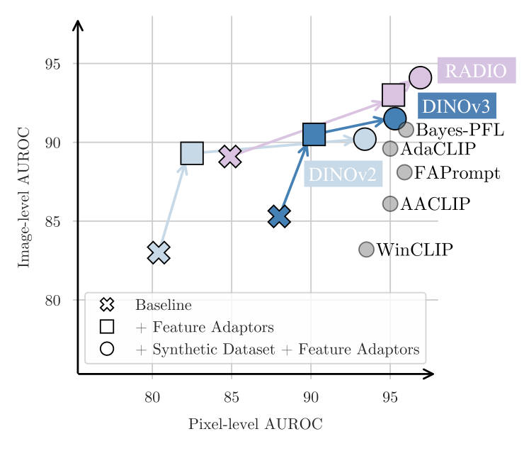
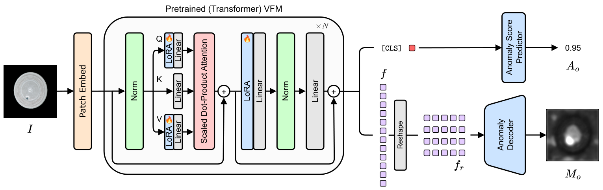
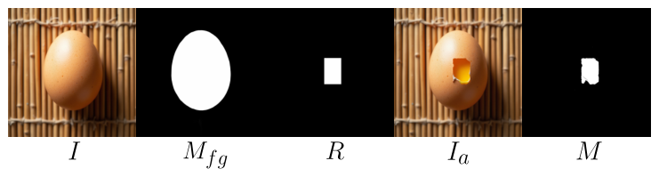

# 精读笔记 · AnomalyVFM: Transforming Vision Foundation Models into Zero-Shot Anomaly Detectors

> arXiv 2601.20524 · CVPR 2026 · 代码：https://github.com/MaticFuc/AnomalyVFM（本目录 `code/`）
> 项目页：https://maticfuc.github.io/anomaly_vfm · 材料：paper.pdf（19 页）/ source/ / paper.tex / figures/ / code/

## 基本情况

- 一句话：**彻底不用 CLIP 文本**，把纯视觉基础模型（RADIO / DINOv2）通过「合成数据 + LoRA 适配」改造成零样本异常检测器。
- 和另外九篇最大的区别：**没有文本分支**。异常概念不是"描述"出来的，是**生成出来的数据**教出来的。
- 可训练：LoRA（rank 64，插在 q/v/out 投影）+ 卷积解码器 + 线性图像头。
- 开源：代码 ✅ / 权重（提供下载脚本）。
- 路线：`① 动机（VFM 落后的两个原因）→ ② 架构（LoRA + 解码器 + 置信度）→ ③ 训练 → ④ 数据（三阶段合成）→ ⑤ 信息流 → ⑥ 例子 → ⑦ 实验`

## 导读地图

行号指 `paper.tex`。

| 站 | 这一站讲清楚什么 | 图 | 原文位置 | 代码 |
|---|---|---|---|---|
| ① 动机 | 辅助数据太单一 + VFM 适配太浅 | 图 1 | §1 L10–35 | — |
| ② 架构 | LoRA 插 q/v/out + 卷积解码器 + 置信度头 | 图 4 | §4 L100–128 | `decoder.py:39` |
| ③ 训练 | focal(图) + L1+5·focal(像素)，置信度加权 | 式 (3)(4) | §4 | `train.py:215-241` |
| ④ 数据 | 三阶段生成（FLUX → inpaint → DINOv2 过滤） | 图 2、3 | §3 L50–99 | `generate_dataset.py`、`flux/` |
| ⑤ 信息流 | 图 → VFM+LoRA → 解码器 → 掩码 + 置信度 | 图 4 | §4 | `train.py` |
| ⑥ 例子 | 合成一张"裂开的胶囊"走一遍 | 图 3 | §3 | `foreground_segmentor.py` |
| ⑦ 实验 | 9 数据集平均 94.1（+3.3），MVTec 94.9/92.7 | 表 1、2 | §5 | — |

## ① 动机



**图 1 讲什么**：VLM（CLIP）在零样本 AD 上强，是因为它在 4 亿图文对上见过"高级概念"；
纯视觉基础模型（VFM，如 DINOv2）有很强的表示，却在 ZSAD 上一直落后。这篇要解开这个"未兑现的潜力"。

诊断有两条，都很实在：

1. **训练集太单一**。现有方法都在 MVTec / VisA 的几千张图上训，物体种类、缺陷形态极其有限。
   CLIP 靠的是 4 亿对图文的世界知识，而 AD 辅助集只有它的**百万分之一**。
2. **适配太浅**。已有工作（如 AdaCLIP 里试用 VFM 的部分）只是在 VFM 上接一个 MLP 出掩码，
   **没改内部层、没设计解码器、没针对噪声标签设计损失**。

于是这篇的核心不是"怎么用 VFM"，而是**"怎么造出足够多、足够多样的数据来教 VFM"**。
贡献排序也很清楚：**合成数据管线 > 适配机制 > 损失设计**。

## ② 架构



**图 4 怎么读**：左是输入图和 patch embed；中间是 VFM 的 transformer block，
**LoRA 插在 Q、V 和输出投影上**（标 🔥 的部分）；右边分两路——
`[CLS]` → 线性层 → 图像级分数 `A_o`；patch 特征 `f` → reshape → **Anomaly Decoder** → 掩码 `M_o`（同时出置信度图 `c`）。

**A. 特征适配**

```
每个 transformer block：
   Q   ← Q   + LoRA_Q(x)      （rank 64）
   V   ← V   + LoRA_V(x)
   out ← out + LoRA_out(x)
```

**为什么插 q/v/out 三个而不是全部**：q 决定"看哪儿"、v 决定"取什么内容"、out 决定"怎么输出"，
这三处对异常定位最敏感；k 只影响注意力分布的归一化，收益低。

**B. 解码器（`code/decoder.py:39`）**

```
输入 [B, 1024, 32, 32]（518/16 = 32）
  └ BottleNeck
      └ 上采样块 ×2（Conv + GroupNorm + ReLU + 双线性）
          ├ 1×1 Conv → mask
          └ 1×1 Conv → conf        ← 同一条特征分出两个头
```

**两个头共享特征**是关键：置信度 `c` 和掩码 `M_o` 来自同一层，所以"哪里不确定"和"哪里是异常"天然对齐。

| 模块 | 来源 / 初始化 | 训练时更新吗 | 作用 |
|---|---|---|---|
| VFM 主干（RADIO / DINOv2） | 预训练，**冻结** | 否 | patch + CLS |
| LoRA（q/v/out，r=64） | 随机 | ✅ | 内部层适配 |
| 解码器（2 个上采样块 + 2 个 1×1 Conv） | 随机 | ✅ | 掩码 + 置信度 |
| 图像级线性头 | 随机 | ✅ | CLS → 分数 |

## ③ 训练

```
L_base = L1(M_o, M_GT) + 5 · Focal(M_o, M_GT)
C      = 1 + exp(c)                          ← 置信度
L_seg  = L_base · C − 0.1 · log(C)
L_img  = Focal(A_o, y)
L      = L_seg + L_img
```

| 符号 | 是什么 | 取值 |
|---|---|---|
| c | 解码器输出的置信度图（log 空间） | [B,1,H,W] |
| C | 置信度权重 | 1 + exp(c) > 1 |
| α | 自信惩罚系数 | 0.1 |
| β | focal 权重 | 5 |

**这个损失在做什么**：`L_base · C` 让"越自信的地方权重越大"，`−α·log C` 惩罚过度自信（防止 C 无限增大），
两项合起来是**自适应的不确定性加权**。它借自 3D 重建里的不确定性建模（DUSt3R、Kendall 的多任务不确定性）。

**为什么要它**：合成数据的 mask 本身有噪声（生成异常和 mask 不完全对齐），硬按 GT 罚会让模型学到噪声。
让模型自己给"不确定区域"降权，是更稳的做法。

| 项 | 值 |
|---|---|
| LoRA rank | 64 |
| 优化器 / lr | 未在正文给出（附录 D） |
| 训练数据 | 自建合成集；评 MVTec 时额外用 VisA test 做辅助 |

## ④ 数据（这篇的真正贡献）



**图 3 怎么读**：整条生成管线，四步。

```
① 正常图 I：FLUX 文生图
   prompt: "A close-up photo of [Object] for industrial visual inspection.
            Top-down view. Centered. [Texture] background."
   [Object] 来自 100 个物体、[Texture] 来自 50 种背景（GPT-4o 生成列表）

② 异常图 I_a：
   - IS-Net 分割前景 M_fg
   - 在 M_fg 内随机取中心，采样矩形 R（宽高均匀分布）
   - FLUX + RePaint 只在 R 内重生成，prompt 加 [Anomaly]（cracked / damaged / smudged…）

③ mask：
   - DINOv2 提 I 与 I_a 的特征，算余弦距离图 M_d
   - 阈值 T 二值化 → mask M

④ 过滤：
   - 若 max(M_d) < T → 判为"异常没生成出来" → 丢弃
```

**第 ④ 步是这篇最值得学的工程细节**：文生图对 prompt 的遵从度不稳定，有些图根本没生成异常。
用"DINOv2 特征差异"来检测——**没生成异常的区域和原图几乎一样，距离就低**。这是一个**无需人工的自检器**。

| 项 | 值 |
|---|---|
| 物体 / 背景类数 | 100 / 50 |
| 生成模型 | FLUX（flow matching） |
| 前景分割 | IS-Net |
| inpaint 方式 | RePaint（不用专门的 inpaint 模型） |
| 过滤依据 | DINOv2 特征余弦距离的最大值 |

## ⑤ 信息流

```
【合成数据阶段｜离线，一次性】
GPT-4o → 物体/背景/异常词表
  └ FLUX 出正常图 I → IS-Net 前景 → 采样 R → RePaint 内生成 → DINOv2 差异 → mask + 过滤

【训练/推理阶段】
[1,3,H,W]
  └ VFM（RADIO/DINOv2）+ LoRA(q/v/out, r=64)
      ├ 最后一块特征 → reshape [B,1024,32,32]
      │    └ 解码器 → 上采样×2 → [mask, conf]
      └ CLS → Linear → A_o
```

| 阶段 | 次数 | 说明 |
|---|---|---|
| 合成数据生成 | **离线一次** | FLUX + IS-Net + RePaint + DINOv2 过滤，成本最高 |
| VFM 前向 | 每图 1 次 | 只有视觉，没有文本塔 |
| 解码器 | 每图 1 次 | 2 个上采样块 |
| 文本编码 | **没有** | 这是它和另外九篇最大的差别 |

**推理比所有 CLIP 方法都轻**：没有文本塔、没有 prompt、没有多尺度后处理，一次前向同时出图和分。

## ⑥ 例子走一遍

**合成一张"裂开的胶囊"**：

1. **正常图**：FLUX 按 `A close-up photo of a capsule for industrial visual inspection. Top-down view. Centered. ...` 出图 I。
2. **前景**：IS-Net 圈出胶囊 M_fg（排除背景）。
3. **异常区域**：在 M_fg 内随机取一点作中心，采样矩形 R。
4. **内生成**：同一个 FLUX，只在 R 内用 `... a cracked capsule ...` 重生成，区域外保持 I → I_a。
5. **出 mask + 过滤**：DINOv2 提 I 与 I_a 的特征，算余弦距离图 M_d。
   - 真裂了 → 距离大（如 0.62 > 阈值 0.35）→ 保留，mask = M_d > T
   - 生成失败 → 距离小（如 0.12 < 0.35）→ **丢弃这张样本**

**如果没有第 5 步**：训练集里会混进大量"标了异常但其实没异常"的样本，模型会学歪。
**用 DINOv2 特征差异做质检，等于给生成管线加了一个自动断言。**

**训练时的一个"隐藏设定"**（代码里才看得到）：

```python
# train.py:229-231
inner_mask_loss = 5 * focal(mask, mask_gt) + l1(mask.sigmoid().clip(0.1, 0.9), mask_gt)
c = 1 + conf.exp()
l_mask = c * inner_mask_loss - 0.1 * c.log()
```

`sigmoid().clip(0.1, 0.9)` —— 把预测概率**截断到 0.1~0.9** 再算 L1。
代码注释：*The clipping makes the training extremely more stable, it should be kept for general use.
It will be detailed in a follow-up extension paper.*
**论文正文完全没提这一步**，但没有它训练会不稳。

## ⑦ 实验与地位

| 指标 | AnomalyVFM | 此前最强 |
|---|---|---|
| 9 数据集图像平均 | **94.1** | 比 SOTA 高 **3.3** |
| MVTec 图像 | **94.9** | Bayes-PFL 92.3 |
| MVTec 像素 | **92.7** | MoECLIP 92.5 |
| VisA 图像 | **93.6** | FB-CLIP 89.5 |
| VisA 像素 | 96.2 | FB-CLIP 96.3 |

**VisA 图像 93.6 尤其惊人**——比第二名高 4 个点。VisA 有 12 个子集、背景复杂，
这说明**合成数据的多样性确实补上了辅助集的短板**（MVTec + VisA 加起来才 2 万张，而合成集规模与多样性高一个量级）。

**代价**

- 生成管线极重（FLUX 出图 + IS-Net + RePaint + DINOv2 过滤），复现成本十篇里最高；
- **没有文本分支**，放弃了"用一句话解释为什么异常"的能力；
- 结果较新，尚无第三方复现。

**定位**：十篇里**唯一完全抛弃文本**的方法。它给出的结论很尖锐：

> 在 ZSAD 里，"文本"的作用可能被高估了——**只要有足够多、足够多样的合成数据，纯视觉模型也能学会"异常"**。

这也解释了 2026 年三篇新工作的共同方向：**两篇（Dual Anchors、AnomalyVFM）都在往"少用文本"走**。

## 代码 ↔ 论文

| 论文说 | 代码做 | 影响 |
|---|---|---|
| 式 (3)：`L_base = L1(M_o, M_GT) + β·Focal(...)` | L1 算在 `sigmoid().clip(0.1, 0.9)` 上 | 论文未写这个截断，但它是稳定训练的关键 |
| 置信度加权 | `C = 1 + exp(c)`，`L = C·L_base − 0.1·log C` | 与论文一致 |
| LoRA 插在 q/v/out | 模型封装中可见 | 一致 |
| 三阶段生成 | `generate_dataset.py` + `flux/` + `foreground_segmentor.py` | 过滤阈值 T 在代码里是超参 |
