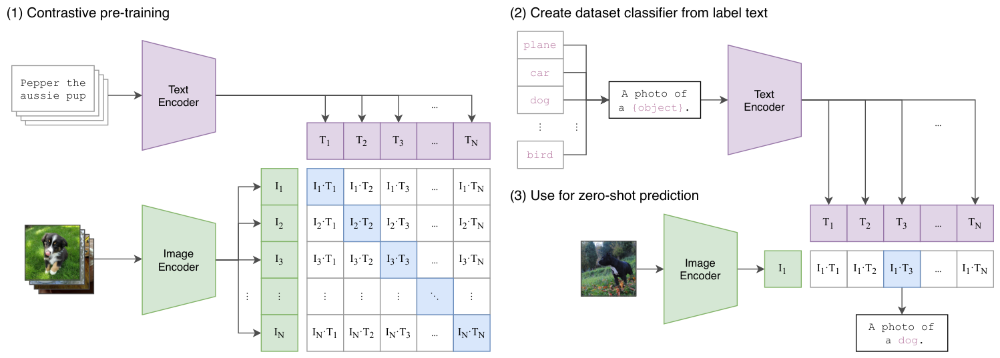
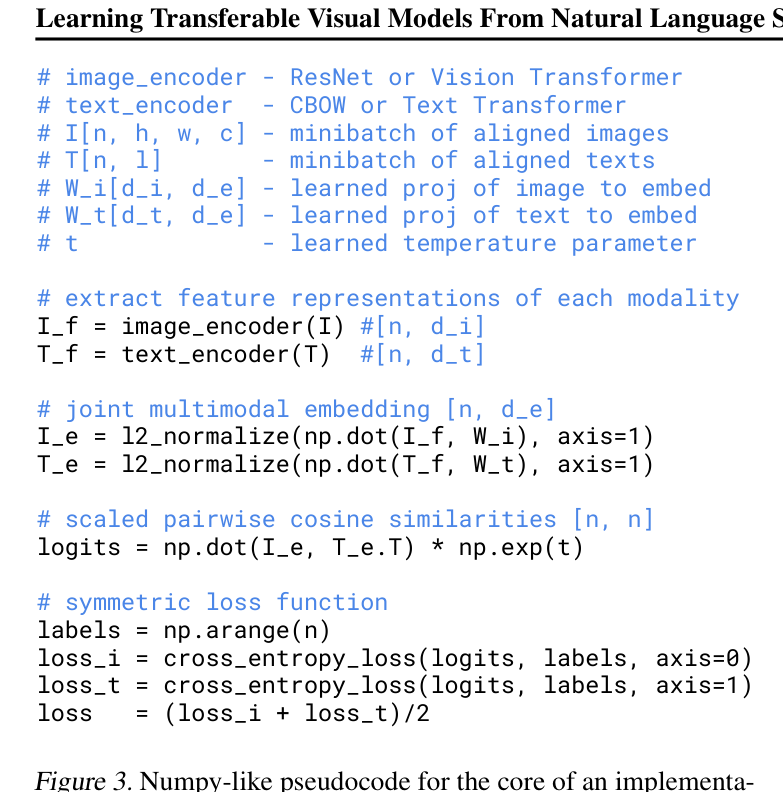

# 精读笔记 · CLIP: Learning Transferable Visual Models From Natural Language Supervision

> arXiv 2103.00020 · ICML 2021 · OpenAI
> 代码：https://github.com/OpenAI/CLIP（本目录 `code/`，权重公开）
> 材料：paper.pdf（48 页）/ source/ / paper.tex / figures/（22 图 20 表）

## 基本情况

- 一句话：用 **4 亿对（图，文）** 做对比预训练，让图像编码器和文本编码器进同一个空间；之后**任何分类任务都能用一句文本当分类器**，不用训练。
- 地位：本项目另外四篇（WinCLIP / AdaCLIP / AnomalyCLIP / AA-CLIP）全部建立在它之上，**冻结的 CLIP 就是它们的"世界知识"**。
- 开源：代码 ✅、权重 ✅（8 个模型）、数据 **❌**（WIT 400M 未公开）。
- 路线：`① 动机（图 1）→ ② 架构（双塔 + 对比矩阵）→ ③ 训练（InfoNCE + 32768 batch）→ ④ 数据（WIT）→ ⑤ 信息流（一张图怎么变成零样本分类）→ ⑥ 例子（"a photo of a dog"）`

## 导读地图

| 站 | 这一站讲清楚什么 | 图 | 原文位置 | 代码 |
|---|---|---|---|---|
| ① 动机 | 固定类别监督的限制；为什么是"对比"而不是"生成" | 图 1、图 2 | §1 L41–72、§2.3 L89–110 | — |
| ② 架构 | 双塔、N×N 相似度矩阵、线性投影、温度 | 图 1 | §2.4 L111–118 | `model.py` |
| ③ 训练 | 对称交叉熵、batch 32768、τ 可学习、32 epoch | 伪代码 | §2.3、§2.5 L119–122 | `train.py` |
| ④ 数据 | WIT 4 亿对、50 万 query、每 query 2 万上限 | — | §2.2 L83–88 | — |
| ⑤ 信息流 | 一张图 → 一个向量 → 和 K 个文本向量比 → 分类 | 图 1 | §3.1.2 L136–139 | `clip/clip.py` |
| ⑥ 例子 | "a photo of a dog" 走一遍；prompt ensemble 80 条 | 图 1 | §3.1.4 L163–183 | `clip/clip.py:prompt` |
| ⑦ 实验 | 30+ 数据集、ImageNet 76.2 零样本、鲁棒性 | 图 5、表 | §3 | — |

## ① 动机



**图 1 怎么读**，三块：

- **(1) 对比预训练**：左上是文本编码器（把 "Pepper the aussie pup" 变成 T₁…T_N），左下是图像编码器（把狗图变成 I₁…I_N），
  中间那个 N×N 的矩阵是**所有图文两两的余弦相似度**，对角线（蓝）是真实配对。训练目标就是**把对角线抬高、其余压下去**。
- **(2) 用标签文本造分类器**：把类名列表 `plane / car / dog / bird` 填进模板 `A photo of a {object}.`，送进文本编码器，得到 T₁…T_N——**这 N 个向量就是一个分类器的权重**。
- **(3) 零样本预测**：一张图 → I₁ → 和 N 个文本向量比 → 取最大的 → "A photo of a dog."。

**要解决什么**：让视觉模型能从**自然语言**里学概念，从而在**没见过的任务**上直接工作。

**以前卡在哪**：

1. **固定类别集的监督预训练**（ImageNet 1000 类）：想要新概念就得重新标数据。这是"限制"的根源。
2. **弱监督**（Instagram hashtag、JFT-300M）：数据大了，但监督仍被限制在 1000 / 18291 个类里，而且是**静态 softmax 分类器**，没有零样本能力。
3. **从文本预测**（VirTex、ICMLM、ConVIRT）：方向对，但**规模太小**（10~20 万图），ImageNet 零样本只有 **11.5%**——远低于当时监督 SOTA 的 88.4%，甚至低于 50% 的经典方法。

**押注的关键想法**（两条，都关于"效率"）：

> ① **数据要够大**：4 亿对图文（WIT），比之前大 3 个数量级。
> ② **目标函数要够快**：不预测句子的每个词，只预测"哪段文本配哪张图"。

第 ② 条是论文里最容易被忽略的一步。作者做了两个对照（图 2）：

| 目标函数 | 相对效率 |
|---|---|
| 预测 caption 的每个词（Transformer LM，63M） | 1× |
| 预测 bag-of-words | **3×**（快 3 倍） |
| 换成对比目标（CLIP） | **再 4×**（共 12×） |

**为什么"不预测具体词"反而更好**：一张图配的文本五花八门（"a dog"、"Pepper"、"my puppy on the grass"），逐词预测等于在学这些噪声；
而"哪段文本配哪张图"是个**更简单但更有用**的代理任务——它只要求抓住"整体语义"。

**一个具体例子**：ImageNet 零样本 **76.2%**，追平了 ResNet-50 的全监督结果（用 128 万张标注图训练）。
代价是在某些任务上很弱：MNIST 只有 88%（手写数字对 CLIP 来说太抽象）、计数和空间关系也差。

**CLIP 和后面四篇的关系**：CLIP 提供的是"**图和文在同一个空间里**"这个前提。WinCLIP 问"这像不像 damaged"、
AdaCLIP 学 prompt、AnomalyCLIP 换注意力、AA-CLIP 加 adapter——**全都是站在这个空间上做文章**。
所以理解 CLIP 的两个点最关键：**① 对齐只发生在全局（CLS / EOS）向量上；② 对齐是在自然图文上学的，不是工业缺陷上学的。**
这两点直接导致了 WinCLIP 的"patch token 不对齐（22.4 pAUROC）"和后面所有方法的动机。

## ② 架构



伪代码就是完整的接口声明（`I[n,h,w,c]`、`T[n,l]`、两个投影、一个温度）。

| 项 | 值 |
|---|---|
| batch | **32768** |
| 图像 | 224²（ViT-B/32 → 49 patch + CLS） |
| 文本 | BPE 49152 词表，最长 77 token（`[SOS]…[EOS]`） |
| 文本塔 | **63M** Transformer（12 层、512 宽、8 头） |
| 图像塔 | ResNet（attention pooling）或 ViT |
| 输出 | 两个 L2 归一化向量 → 点积 |
| 训练成本 | ViT-L/14：12 天 × 256 V100；RN50x64：18 天 × 592 V100 |

**五个设计选择**

1. **双塔而不是早融合**：文本侧可以完全离线算好，推理时只跑图像塔——这就是"零样本分类器"能成立的前提。
2. **线性投影**：试过非线性 MLP projector，没差别，去掉。
3. **τ 可学习**：init 0.07，clip 到 logits 不超过 100 倍（不设这个上限会训崩）。
4. **attention pooling（ResNet 版）**：GAP 对所有位置一视同仁；用全局均值当 query 去加权，让模型自己决定看哪儿。ViT 版的 CLS token 天然有这个作用。
5. **文本取 `[EOS]`**：因果注意力下唯一"看过整句"的位置。

模块表：图像塔 38M~304M + 文本塔 63M + 投影 + τ，**全部从零训**（不用 ImageNet 预训练）。

## ③ 训练

**一句话**：一个 batch 里 N 张图和 N 段文本两两点积成 N×N 矩阵，让对角线（真配对）的概率最大、其余 3 万多个负样本被压下去。

```
logits[i,j] = (I_e[i] · T_e[j]) * exp(t)          exp(t) = 1/τ ≈ 14.3
L = ½ [ CE(logits, labels, axis=0) + CE(logits, labels, axis=1) ]
```

| 符号 | 是什么 | 取值 |
|---|---|---|
| I_e / T_e | L2 归一化后的图/文向量 | [N, 512] |
| t | 对数温度，可学习 | init: exp(t)=1/0.07≈14.3；clip: logits ≤ 100 |
| labels | `arange(N)` | 对角线是正样本 |
| axis=0/1 | 行方向（图找文）+ 列方向（文找图） | 取平均 |

**代一组数字**：N=32768 → 矩阵 **10.7 亿** 格，其中只有 **32768 个正样本（0.003%）**，其余 99.997% 是负样本。
正样本 cos≈0.4 → logit 5.7；负样本 cos≈0.1 → logit 1.43。softmax 之后正样本的概率要压过 3 万多个 1.43。

**为什么对称**：只做行方向时，文本塔永远只当"负样本"，梯度弱；对称之后**每个模态都当过 anchor**，两个塔被同等训练。

**为什么 batch 要 32768**：对比学习的负样本全部来自 batch 内部。batch=256 时只有 255 个负样本，
任务太容易（模型只要区分"狗 vs 完全无关的东西"），学不到细粒度；32768 个负样本才逼它去分辨"狗 vs 狼 vs 狐狸"。

**为什么 clamp 到 100**：τ 是学出来的，若它一路变小，logits 会爆炸 → softmax 饱和 → 梯度消失甚至发散。
clamp 等价于给温度一个下限 τ ≥ 0.01。

**训练配置**

| 项 | 值 |
|---|---|
| 数据 | 4 亿对，**32 epoch**（≈ 128 亿次样本） |
| batch | 32768 |
| 步数 | 400M / 32768 ≈ 12207 步/epoch × 32 ≈ **39 万步** |
| 优化器 | Adam + decoupled weight decay，cosine 学习率 |
| 精度 | 混合精度 + 梯度 checkpointing + 半精度 Adam 统计量 |
| 增强 | **只有随机方形裁剪** |
| 初始化 | 全部从零 |

**训练和推理完全不是一回事**：训练要同时跑两个塔、算 10.7 亿个相似度；推理**只跑一个塔**（图像），文本是查表。
这个不对称是 CLIP 全部工程价值的来源。

**代码 ↔ 论文**：仓库里 `model.py` 的 `forward` 返回 `logits_per_image, logits_per_text`，正是伪代码里的两个 CE；
`clip/clip.py` 里 80 条 prompt 的 ensemble 是推理侧的东西，和训练无关。

## ④ 数据

**一条预训练样本**（这是全篇最"轻"的样本——没有标签、没有 mask）：

| 字段 | 形状 | 取值 | 真实例子 |
|---|---|---|---|
| 图像 | [3, 224, 224] | 从原图随机方形裁剪 | 网上抓的一张狗的照片 |
| 文本 | [77] token | 网页 alt-text / 标题，BPE 编码 | "Pepper the aussie pup" |
| 标签 | — | **没有**。唯一的监督是"这两者配对" | — |

**WIT 怎么凑出来的**

1. **50 万个 query**：英文维基里出现 ≥100 次的所有词 + 高 PMI 的二元组 + 维基条目名 + 全部 WordNet synset。
2. **每个 query 最多 2 万对**，做粗略的类别平衡。
3. 结果 **4 亿对**，总词数和 GPT-2 的 WebText 相当。

**一个可以算出来的观察**：50 万 × 2 万 = **100 亿** 是理论上限，实际只有 4 亿——平均每个 query 只拿到 **800 对**。
说明那个 2 万的上限**只是用来压制"dog""cat"这种高频词的**，长尾词根本凑不够。

**规模对比**

| 数据集 | 规模 | 监督形式 | 类别数 |
|---|---|---|---|
| ImageNet | 128 万 | 人工标注 | 1000（固定） |
| JFT-300M | 3 亿 | 噪声标签 | 18291（固定） |
| Instagram | 35 亿图 | hashtag | 固定 |
| **WIT** | **4 亿对** | **自然语言** | **开放词表** |

关键不在"4 亿"这个数，而在最后一列：**前三个都是"固定分类头"，只有 WIT 是开放词表**——这才是零样本能力的数据来源。

**训练用量**：4 亿对 × 32 epoch = **128 亿次样本**。

**三个关于数据的坑（论文自己处理过的）**

1. **文本噪声大**：网页上的 alt-text 常常是 `20160716_113957.JPG` 或者相机参数。作者在 YFCC 上试过过滤，6 倍缩小后只剩 1500 万；WIT 则干脆不做精细过滤，**靠量淹没噪声**。
2. **测试集污染**：用重复检测器在 35 个评测集上查，**中位数重叠 2.2%、平均 3.2%**；只有 9 个数据集完全无重叠。
   精度影响最大的是 Birdsnap（重叠 12.1%，+0.6%）；重叠最大的是 Country211（21.5%，但只 +0.2%，因为那段文本没提地点）。
3. **数据不公开**：只放代码和权重。这意味着**没人能完整复现 CLIP**，后来的复现（OpenCLIP / LAION）都换了数据集。

**数据侧没有的东西**：没有数据增强（只有随机裁剪）、没有人工清洗、没有去重（只做事后分析）、没有多语言（英文为主）。

## ⑤ 信息流

```
【文本支路｜每个类一次，可缓存】
K 个类名
  └ 每个类套 80 个模板 ─▶ 80K 条句子
      └ tokenize [80K, 77] ─ 文本塔 ─▶ [80K, D]
          └ 按类平均 80 条 ─▶ [K, D] ─ L2 ─▶ 分类器权重

【图像支路｜每张图一次】
[1,3,224,224]
  └ patch 分割 ─▶ [1, N+1, C]
      └ ViT/ResNet ─▶ CLS
          └ proj ─▶ [1, D] ─ L2 ─▶ 图像向量

【打分】
[1,D] @ [D,K] ─▶ [1,K] ─ softmax ─▶ argmax ─▶ "a photo of a dog."
```

| 阶段 | 次数 | 说明 |
|---|---|---|
| 文本编码 80K 条 | **每套类别一次** | 可缓存；摊销到 100 万张图上几乎为零 |
| 图像前向 | 每张图一次 | ViT-B/32：49 patch；ViT-L/14：256 patch |
| 点积 | 每张图 K 次 | 可以忽略 |

**被丢掉的**：所有 patch token（只留 CLS）、文本的所有 token 激活（只留 EOS）。

**prompt engineering 的量化收益（ImageNet）**

| 做法 | 提升 |
|---|---|
| 裸类名（`dog`） | 0 |
| `a photo of a {label}.` | **+1.3%** |
| 80 个模板 ensemble | **再 +3.5%** |
| 合计 | **≈ +5%** |

**为什么 ensemble 是"免费"的**：作者在**嵌入空间**做平均，不在概率空间。所以不管用 1 个还是 80 个模板，
最后都只是一组 K×D 的向量——**推理成本完全一样**。这一点被 WinCLIP 直接继承了（它的 242 条 CPE）。

**per-dataset 的 prompt 定制**（论文里的例子）：
- 宠物数据集用 `a photo of a {label}, a type of pet.`
- 食物用 `a type of food`，飞机用 `a type of aircraft`
- OCR 数据集给数字加引号
- 卫星图用 `a satellite photo of a {label}.`

这就是"prompt 工程"这个概念的出处——**后来 WinCLIP 的 CPE、AnomalyCLIP 的可学习 prompt、AA-CLIP 的手写描述，全在这条线上**。

**训练 vs 推理**：训练要跑两个塔（batch 32768）；推理只跑图像塔。文本侧的训练成本在推理时完全被摊销掉。

## ⑥ 例子走一遍

**场景**：一张狗的照片，5 个候选类（dog / wolf / fox / cat / car）。

**玩具尺寸**（括号真实值）：32²（224²）；patch 8 → **4×4=16**（49 或 256）；宽度 8（768/1024）；2 层（12/24）；
2 个模板（80）；嵌入 4 维（512/768）。

| 步 | 手里有什么 | 做了什么 | 变成什么 | 代码 |
|---|---|---|---|---|
| 0 | 5 个类名 × 2 模板 | 拼句子 → BPE | 10×77 token | `simple_tokenizer.py` |
| 1 | 10×77 | 文本塔 | 10×4 | `model.py:343` |
| 2 | 10×4 | 按类平均 2 条 → L2 | **5×4 分类器权重** | — |
| 3 | [1,3,32,32] | patch + CLS → 2 层 → proj | 1×4 | `model.py:340` |
| 4 | 1×4 和 5×4 | 点积 ×14.3 | 5 个 logits | `model.py:364` |
| 5 | 5 个 logits | softmax → argmax | "a photo of a dog." | — |

**核心 4 行**（`clip/model.py:358`）：

```python
image_features = image_features / image_features.norm(dim=1, keepdim=True)
text_features  = text_features  / text_features.norm(dim=1, keepdim=True)
logit_scale = self.logit_scale.exp()                 # = 1/τ ≈ 14.3
logits_per_image = logit_scale * image_features @ text_features.t()
```

**数字（cos 为示意值）**

| 类 | cos | logit ×14.3 | softmax |
|---|---|---|---|
| dog | 0.42 | 6.01 | **0.473** |
| wolf | 0.38 | 5.43 | 0.265 |
| fox | 0.35 | 5.01 | 0.174 |
| cat | 0.30 | 4.29 | 0.085 |
| car | 0.05 | 0.72 | 0.002 |

**温度那一步的大白话**：如果不乘 14.3，直接用 cos 做 logits，五个分数是 0.42/0.38/0.35/0.30/0.05——
**softmax 之后是 0.224 / 0.215 / 0.209 / 0.198 / 0.154，几乎均匀**，等于没有判断。
乘 14.3 之后最高分 0.473、最低 0.002，差距被拉开 200 倍。**温度就是"敢不敢下判断"的旋钮。**

注意 dog 只有 0.473，不是 0.99——因为 wolf/fox/cat 和它都很像。**CLIP 的零样本置信度在细粒度类别上天然偏低**，
这也是后来 AD 方法里"分数能不能直接卡阈值"问题的影子。

**模板的作用（示意）**：如果把模板去掉、只送 `dog` 一个词，cos 可能从 0.42 掉到 0.30，而 `wolf` 恰好 0.31——**排名就翻了**。
这就是论文里 +1.3% 的来源：**把单词伪装成句子，缩小训练/推理的分布差**。

**真实规模**：4×4→7×7（B/32）或 16×16（L/14）、宽度 8→768/1024、2 层→12/24、2 模板→80、5 类→1000。

## ⑦ 实验与地位

**三个关键结果**

1. **ImageNet 零样本 76.2%**（ViT-L/14@336），追平原版 ResNet-50 的全监督结果（76.1%）——而且**没用那 128 万张标注图**。
   top-5 是 95%，和 Inception-V4 持平。
2. **27 个数据集上，零样本 CLIP 赢过 ResNet-50 的线性探针 16 个**。
   赢最多的是 Stanford Cars / Food101（+20%）、Kinetics700（+14.5%）；输最多的是 Flowers102 / FGVC-Aircraft（−10%）。
3. **零样本约等于别人的 16-shot**：和 BiT-M ResNet-152x2（ImageNet-21K 预训练）的 16-shot 线性分类打平。

**更重要的一个发现：鲁棒性**

- 零样本 CLIP 把"ImageNet 精度 vs 分布偏移下精度"的差距**缩小了最多 75%**（effective robustness）。
- 反过来，**在 ImageNet 上微调能涨 9.2% 精度（≈3 年的 SOTA 进步），但平均鲁棒性一点没涨**，
  而且在 ImageNet-R（−4.7%）、ObjectNet（−3.8%）、Sketch（−2.8%）、ImageNet-A（−1.9%）上**变差了**。
- 结论：**"在一个分布上训得更好"不等于"更通用"**。这条结论后来影响了整个 zero-shot 研究的风向。

**输在哪**

- MNIST 只有 **88%**（SOTA 99.8%）——手写数字这种抽象符号，自然语言描述帮不上忙。
- 低分辨率数据集（CIFAR）略输给 EfficientNet，作者归因于"没有 scale-based 数据增强"。
- 计数、空间关系、专业领域（卫星、病理）都弱。

**地位**

- CLIP 本身**不是 SOTA**：ImageNet 上 76.2 vs 当时监督 SOTA 88.4。它的价值在**通用性**，不在单项精度。
- 它真正的遗产是**"图像和文本在同一个空间"这个接口**。本项目另外四篇全部建立在这个接口上：
  WinCLIP 问"像不像 damaged"、AdaCLIP 学 prompt、AnomalyCLIP 改注意力、AA-CLIP 加 adapter——**都是在用这个空间**。
- 工程上更该记住的是：**WIT 没公开**，所以大家用的其实都是 OpenCLIP 在 LAION 上复现的版本。
  "CLIP" 现在指的是一类模型，不是一个确定的东西。
