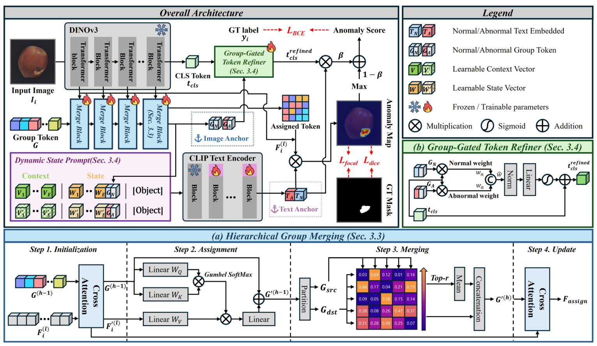

# 精读笔记 · Dual Anchors: Hierarchical Group Merging for Zero-Shot Anomaly Detection

> arXiv 2608.11933 · CVPR 2026 Findings · 韩国（Jimin Roh, DongKyu Kim, Suk-Ju Kang）
> 代码：**未找到官方实现**（GitHub 搜不到）
> 材料：paper.pdf（10 页）/ source/ / paper.tex / figures/

## 基本情况

- 一句话：除了文本锚点，再用**图像自己造一组锚点**（正常/异常的分组 token），让文本和视觉**双向**对齐。
- 和前五篇最大的不同：**主干换成 DINOv3**（不是 CLIP），文本侧仍用 CLIP。
- 开源：**代码 ❌**。这是它最大的短板。
- 路线：`① 动机 → ② 架构（层级分组 + 门控 + 动态 prompt）→ ③ 训练（4 个损失）→ ④ 数据（14 个数据集）→ ⑤ 信息流 → ⑥ 例子 → ⑦ 实验`

## 导读地图

| 站 | 讲什么 | 图 | 原文 |
|---|---|---|---|
| ① 动机 | 只靠文本锚点太脆、视觉落点弱 | 图 1 | §1 |
| ② 架构 | HGM 四步、GGTR 门控、把 G_N/G_A 当词插进 prompt | 图 2 | §3.2–3.5 |
| ③ 训练 | L_cls + L_seg + L_ortho + L_group | 式 (17)(18)(19) | §3.5 |
| ④ 数据 | 14 个数据集（8 工业 + 6 医学） | 表 1、2 | §4.1 |
| ⑤ 信息流 | 1024 patch → 分组 → 双锚点 → 图 | 图 2 | §3.5 |
| ⑥ 例子 | 一张 PCB 走一遍 | — | — |
| ⑦ 实验 | 14 集平均 92.9 / 92.9，MVTec 图像 92.7 破 WinCLIP 记录 | 表 1、2、3 | §4 |

## ① 动机

前五篇的共同假设：**用文本描述异常**（手写 prompt / 可学习 prompt / 物体无关 prompt）。

Dual Anchors 说这个假设有两个毛病：

1. **对 prompt 设计极其敏感**——文本锚点换几个词，分数就变；
2. **视觉落点弱**——文本说"损坏"，但图像特征该往哪个方向靠？没人管。

所以它加了一路**图像锚点**：用层级分组把 patch 特征聚成「正常组 token G_N」和「异常组 token G_A」，
这两个 token 既能**当词插进文本 prompt**（式 12），又能**门控整图 CLS**（式 10-11）。

**为什么敢换掉 CLIP**：作者说得很直白——*DINOv3 的视觉表示更强，但文本对齐更弱；我们宁可要好的视觉特征，再用图像锚点补上对齐*。
这是六篇里**第一次把主干从 CLIP 换掉**。

## ② 架构



**图 2 怎么读**，三大块 + 一个放大镜：

- **左上 DINOv3（冻结）**：输入图 → 4 个 block 的 patch 特征 + CLS。
- **左中 Merge Block ×4（可训练）**：可学习的 group token G 逐层和 patch 交互，最后吐出 **G_N、G_A** 和 assigned token。
- **右上 Group-Gated Token Refiner（可训练）**：CLS 用 G_N/G_A 做门控，refine 成 t_cls。
- **左下 Dynamic State Prompt**：`[V₁…V_E][W₁][G_N][Object]` / `[V'₁…V'E][W'₁][G_A][Object]`——**G_N/G_A 被当成一个词插进句子**。
- **中间**：`[各层 patch 平均, assigned token] × [T_N,T_A] → softmax → 异常图`。
- **下方放大镜 (a)**：Merge Block 的四步（初始化→分配→合并→更新）。

**接口**

| 项 | 值 |
|---|---|
| 图像塔 | **DINOv3 ViT-L/16**（冻结），patch 16 → 518² 下 **32×32 = 1024** 个 patch，1024 维 |
| 取特征层 | 6 / 12 / 18 / 24 |
| 文本塔 | **CLIP ViT-L/14@336**（部分 block 可训练），768 维 |
| group token | K 个可学习 token（最终取前两个作 G_N / G_A） |
| prompt | `[V×E][W][G][Object]`，G 是图像锚点 |
| 参数量 | **论文没给** |

**A. Merge Block 的四步**

1. **初始化**：上一层 group token 和本层 patch 做 cross-attention → `F' = CrossAttn(F, G')`。
2. **分配**：用 **Gumbel-Softmax** 把每个 patch 分给某个 group（可微的硬分配）。
3. **合并**：group token 分成两半，按余弦相似度两两匹配，**top-r 的对平均合并**（无参数的 token 剪枝）。
4. **更新**：只在最后一个 block，把 group 分配给 patch，得到 `F_assign`。

**为什么要 Gumbel**：分组本质是离散决策，普通 softmax 会让每个 patch 都"沾一点"所有组，最后组之间没有区分度。
Gumbel-Softmax 允许训练时随机采样、前向离散、反向可微——**逼模型做出明确的分组**。

**B. GGTR：让图像锚点门控 CLS**

```
w_n = cos(t_cls, G_N),  w_a = cos(t_cls, G_A)
ŵ = Concat(w_n, w_a)
t_cls_refined = t_cls + Sigmoid(Linear(Norm(ŵ)))
```

两个标量（两个余弦）决定 CLS 该往"正常"还是"异常"偏多少。**这比加法/拼接轻得多——只用 2 个数字做门控。**

**C. Dynamic State Prompt：把图像锚点当"词"用**

```
p_n = [V₁]…[V_E] [W₁] [G_N] [class]
p_a = [V'₁]…[V'E] [W'₁] [G_A] [class]
```

这是全篇最巧的一步：**G_N / G_A 是 1024 维图像特征，但在这里被当成一个"词"塞进文本 prompt**，由 CLIP 文本塔编码。
等于让文本塔"读到"这张图的正常/异常长什么样，从而生成**逐图不同**的文本锚点。

对比：
- AnomalyCLIP：`[V…][object]`——纯文本，与图无关；
- AdaCLIP：dynamic prompt 由 CLS 生成——但只是一组向量，不经过文本塔；
- **Dual Anchors：图像锚点直接变成 prompt 里的 token，走完整的文本塔**——这是最"深"的图像→文本注入。

**D. 异常图（式 13）**

```
A = Softmax( Up( [ (1/L)Σ_l F^(l) , F_assign ] · T^T ) )
```

各层 patch 先平均，再和 assigned token 拼起来，和两个文本锚点点积。**assigned token 也参与打分**——这是和前面几篇都不一样的地方。

| 模块 | 训练时更新 | 作用 |
|---|---|---|
| DINOv3 ViT-L/16 | ❌ | patch + CLS |
| Merge Block ×4 | ✅ | 层级分组 → G_N/G_A |
| Group-Gated Token Refiner | ✅ | 用锚点 refine CLS |
| 可学习 prompt token (V, W) | ✅ | 动态 state prompt |
| CLIP 文本塔 | **部分**（图里部分 block 有 🔥） | 编码带图像锚点的 prompt |

## ③ 训练

**一句话**：四个损失各管一件事——分类（BCE）、分割（dice+focal）、两个锚点别重合（正交）、以及**哪个锚点是正常、哪个是异常**（分组对比）。

```
L_total = L_cls + L_seg + L_ortho + L_group

L_cls   = BCE(p_cls, y)
L_seg   = Dice(A, S) + Focal(A, S)
L_ortho = |⟨G_N, G_A⟩|²
L_group = 1 − ½ [ cos(G_N, Z_N) + cos(G_A, Z_A) ]
```

| 符号 | 是什么 | 形状 / 取值 |
|---|---|---|
| p_cls | 图像级预测（异常图的 max 与 t_cls 打分的加权和） | [B, 2] |
| A | 异常图（2 通道 softmax） | [B, 2, H, W] |
| S | GT mask | {0,1} |
| G_N / G_A | 正常 / 异常图像锚点 | [1024] |
| Z_N / Z_A | **用 GT mask 切出来的**正常/异常 assigned token 的均值特征 | [1024] |

**两条损失值得单独说：**

**L_ortho（正交）**：和 AA-CLIP 的 Disentangle Loss 一模一样。两个锚点余弦 0.9 → 惩罚 0.81；推到 0.1 → 0.01。
作用是**防止两个锚点塌成一个**。

**L_group（分组对比）——这条才是关键**：

```python
Z_N = mean(assigned tokens where mask == 0)
Z_A = mean(assigned tokens where mask == 1)
L_group = 1 - 0.5*(cos(G_N, Z_N) + cos(G_A, Z_A))
```

为什么必须有它：**G_N 和 G_A 是完全对称的两个可学习 token**。如果只靠 L_ortho 推正交，模型完全可以把"正常"和"异常"**反过来**——
反正两个都是正交的。L_group 用 GT mask 明确告诉它：**G_N 该靠近 mask=0 的那堆 token，G_A 该靠近 mask=1 的那堆**。

**没有 L_group，这个模型学出来的锚点可能整体反色。**

**训练数据协议**（和其他几篇一致）：评工业+医学时用 MVTec 训；评 MVTec 时用 VisA 训。

**一个明显的短板**：arXiv 版**完全没给超参**（epoch、lr、batch、优化器都在 Supplementary A 里，而 supplementary 没随 arXiv 发布）。
加上**没有代码**，这篇**基本不可复现**——只能当方法论读。

**训练 vs 推理**

| | 训练 | 推理 |
|---|---|---|
| GT mask | 需要（L_seg + L_group） | 不需要 |
| 走哪条路 | 全部模块都训 | 只前向 |
| 文本塔 | 部分 block 微调 | 冻结使用 |

**和 AA-CLIP 的损失对照很有意思**：

| | AA-CLIP | Dual Anchors |
|---|---|---|
| 分类 | CE（无温度，marginal） | **BCE** |
| 分割 | Dice + Focal | Dice + Focal |
| 解耦 | `\|⟨T_N,T_A⟩\|²`（文本锚点） | `\|⟨G_N,G_A⟩\|²`（**图像锚点**） |
| 额外项 | 无 | **`L_group`：用 mask 约束哪个是正常** |

**AA-CLIP 不需要 L_group，因为它的锚点来自 prompt（写死的 `normal` / `anomaly` 顺序，不会反）；
Dual Anchors 的锚点是自己学出来的两个 token，必须额外告诉它哪个是哪个。** 这是"从文本锚点换成图像锚点"付出的代价。

## ④ 数据

**一条训练样本**

| 字段 | 形状 | 取值 | 用处 |
|---|---|---|---|
| img | [3, 518, 518] | 归一化后 | 图像塔 |
| mask | [518, 518] | {0,1} | **L_seg + L_group 都要** |
| label | {0,1} | 图像级 | L_cls |
| class | str | 类名 | 拼进 prompt 的 `[class]` |

**它比 AnomalyGPT 更"费标注"**：需要**像素级 mask 两次**——一次监督分割（L_seg），一次切 token 算 Z_N/Z_A（L_group）。

**14 个数据集**

| 域 | 数据集 |
|---|---|
| 工业（8） | MVTec AD、VisA、MPDD、BTAD、**RSDD**、**KSDD2**、DAGM、DTD-Synthetic |
| 医学（6） | ISIC、ClinicDB、ColonDB、TN3K、**Endo**、**Kvasir** |

**协议**：评工业+医学时用 **MVTec** 训；评 MVTec 时用 **VisA** 训。和前面几篇完全一致。

**一个值得注意的信号**：论文写 *All datasets follow the same configurations as used in Qu et al. [22]*——[22] 是 **Bayes-PFL (CVPR 2025)**。
也就是说 **ZSAD 领域开始出现"标准基准"**：14 个数据集 + 固定的辅助/测试配对。这比各家自选数据集要进步。
Dual Anchors 的表格里也把 Bayes-PFL 列为竞争对手，说明它们在同一套协议下比。

**论文没给的（复现障碍）**：

- 每个数据集的样本数、类别数；
- 训练集规模、增强方式；
- 所有超参（epoch / lr / batch / 优化器）。

**和前面几篇的数据需求对比**

| | WinCLIP | AdaCLIP | AnomalyCLIP | AA-CLIP | AnomalyGPT | **Dual Anchors** |
|---|---|---|---|---|---|---|
| 训练图 | 0 | ~2337 | ~1725 | 30 | 正常 + 模拟异常 | 未给（估计 1~2k） |
| 像素 mask | ❌ | ✅ | ✅ | ✅ | 模拟生成 | ✅ **（用两次）** |
| 物体名 | ✅ | ✅ | ❌ | ✅ | ✅ | ✅（`[class]`） |
| 换新类要准备 | 类名 | 类名 | **无** | 一句描述 | 一句描述 | 类名 |

## ⑤ 信息流

```
【文本支路｜每张图都要重算（因为 prompt 里有图像锚点）】
[V]×E + [W] + G_N + [class]   → p_n
[V']×E + [W'] + G_A + [class] → p_a
  └ CLIP 文本塔（部分 block 可训练）─▶ T_N, T_A [2, 768]

【图像支路｜每张图一次】
[1,3,518,518]
  └ DINOv3 ViT-L/16（冻结）─▶ patch [1024, 1024] + CLS [1024]
      ├─ 第 6/12/18/24 层 patch ─▶ 4×[1024, 1024]
      ├─ G [K,1024] ─ 4×MergeBlock ─▶ G_N, G_A [1024] + F_assign
      └─ CLS [1024] ─ GGTR（用 2 个余弦门控）─▶ t_cls [1024]

【异常图】
[ (1/L)Σ_l F^(l) , F_assign ] ─投影到 768─▶ [M, 768]
  └ @ [T_N, T_A]ᵀ ─▶ [M, 2] ─ softmax ─ reshape 32×32 ─ 上采样 ─▶ A [518, 518]

【图像级】
max(A) 与 t_cls·T 的加权和 ─▶ p_cls ─▶ BCE
```

| 阶段 | 次数 | 说明 |
|---|---|---|
| DINOv3 前向 | 每图 1 次（冻结） | 1024 个 patch + CLS |
| Merge Block ×4 | 每图 1 次 | 分组 + 合并 |
| GGTR | 每图 1 次 | 只用 2 个余弦 |
| **CLIP 文本塔** | **每图 1 次** | ⚠️ 见下 |
| 异常图 | 每图 1 次 | 1024×2 点积 + 上采样 |

**最值得注意的一点：文本塔不能再缓存了。**

因为 prompt 里含 `G_N / G_A`（**每张图不同**），所以每张图都要重新编码一遍文本。

对比：

| 方法 | 文本塔运行次数 | 原因 |
|---|---|---|
| AnomalyCLIP | **每类 1 次** | prompt 是 `[V…][object]`，与图无关 |
| AdaCLIP | 每图 1 次 | dynamic prompt 依赖图 |
| **Dual Anchors** | **每图 1 次** | 图像锚点直接进了 prompt |

**这是"把图像锚点当词用"的代价**：文本侧从"一次性开销"变成"每图开销"。
CLIP 文本塔是 12 层 × ~20 token，比图像塔（24 层 × 1024 token）便宜得多，所以整体还能接受——但这也意味着
**如果部署时追求极致吞吐，这一块是可以优化的**（论文没讨论）。

**一个论文没交代的细节**：DINOv3 的 patch 是 **1024 维**，CLIP 的文本是 **768 维**，式 (13) 直接点积是维度对不上的。
中间必然有一个线性投影，但正文和图 2 都没标。这是复现时的一个空白点。

**被丢掉的**：20 层的 patch（只留 4 层）、被合并掉的 group token（bipartite matching 每层减半）、
大部分 patch token（只通过 group 汇总）。

## ⑥ 例子走一遍

**场景**：VisA `pcb1`，一条划痕在 patch 5、6。

**玩具尺寸**（括号真实值）：64²（518²）；patch 16 → **4×4=16**（32×32=1024）；宽度 8（1024）；
2 个 Merge Block（4 个）；K=4 个 group（未给，估计 8~16）；2 层 patch（4 层）；文本维度 4（768）。

| 步 | 手里有什么 | 做了什么 | 变成什么 |
|---|---|---|---|
| 0 | `[1,3,64,64]` | DINOv3（玩具里 2 层） | patch `[16,8]` + CLS `[8]` |
| 1 | patch + G `[4,8]` | Merge Block 1：交叉注意力初始化 | `F' [16,8]` |
| 2 | `F'` + `G` | Gumbel-Softmax 分配 | `Π [16,4]`（每 patch 一个组） |
| 3 | `G` 分两半 | 余弦匹配 + top-r 合并 | `G [3,8]` |
| 4 | `G [3,8]` | Merge Block 2 再来一遍 | `G [2,8]` → **G_N, G_A** |
| 5 | CLS + G_N/G_A | GGTR（2 个余弦门控） | `t_cls [8]` |
| 6 | G_N/G_A + 可学习词 | 拼 prompt → CLIP 文本塔 | `T_N, T_A [2,4]` |
| 7 | patch 平均 + F_assign | @ `[T_N,T_A]ᵀ` → softmax | `A [4,4]` |

**第 2 步：Gumbel 分配长什么样**

16 个 patch 被硬分到 4 个组，假设结果是这样：

```
组 0 组 0 组 1 组 1
组 0 组 0 组 1 组 1
组 2 组 2 组 3 组 3
组 2 组 2 组 3 组 3
```

每个 patch **只属于一个组**（hard assignment）。这就是 Gumbel-Softmax 的作用：前向是 0/1，反向有梯度。

**第 3~4 步：合并**

- Block 1：组 2 和组 3 最像 → 平均合并 → 剩 3 个组。
- Block 2：再合一次 → 剩 **2 个组**：`G_N`（对应 mask=0 的区域）和 `G_A`（对应划痕）。

**L_group 在这一步起作用**：如果模型把两个组学反了，`cos(G_N, Z_N)` 会很低、`cos(G_A, Z_A)` 也很低，
loss 就会把顺序掰回来。**没有它，`G_N` 和 `G_A` 谁是谁完全随机。**

**第 6 步：prompt 长什么样**

```
正常：  [V₁][V₂] [W₁] [G_N] [pcb1]
异常：  [V'₁][V'₂] [W'₁] [G_A] [pcb1]
```

`G_N` 是一个 8 维（真实 1024 维）的图像锚点，**被当成一个词**送进 CLIP 文本塔。
于是 `T_N` 不再只是"正常"这个词的编码，而是"**这张图的正常区域 + 正常**"的联合编码。

**第 7 步的数字**（cos 示意）

| patch | cos(T_N) | cos(T_A) | p(anomaly) |
|---|---|---|---|
| 5（划痕） | 0.29 | 0.36 | **0.85** |
| 6 | 0.30 | 0.35 | 0.79 |
| 0 | 0.34 | 0.30 | 0.21 |

**大白话**：`G_A` 里已经装了"这张图上划痕的样子"，所以 `T_A` 天然更贴近 patch 5——
**这是文本锚点做不到的，因为它不知道这张图长什么样。**

**真实规模只是换数字**：4×4→32×32、8→1024、2→4 个 block、K 4→8~16、2 层→4 层、文本 4→768。

## ⑦ 实验与地位

**三个关键结果**

1. **MVTec 图像级 92.7**——六篇里第一个超过 WinCLIP（91.8）的方法。
2. **14 个数据集平均：图像 92.9 / 像素 92.9**（Bayes-PFL 是 91.2 / 92.3，AA-CLIP 是 86.6 / 90.6）。
3. **MVTec 像素 92.4**（AA-CLIP 91.9，Bayes-PFL 91.8）。

**逐数据集的高光**：BTAD 97.5、DTD-Synthetic 98.9、KSDD2 99.5（像素）。

**消融：分组模块贡献了一切**

| 去掉 | 图像（AUROC/F1/AP） | 像素（AUROC/AP） |
|---|---|---|
| w/o Hierarchical Group Merging | 88.3 / 90.8 / 93.2 | **82.8** / 44.1 |
| w/o Group-Gated Token Refiner | 88.4 / 90.9 / 93.5 | 80.6 / 46.1 |
| w/o Dynamic State Prompt | 90.6 / 92.2 / 95.5 | 84.6 / 44.8 |
| **完整** | **92.7 / 94.0 / 97.1** | **92.4 / 50.4** |

**去掉 HGM，像素从 92.4 掉到 82.8——9.6 个点。** 这就是"图像锚点"的全部价值，也是它和前面五篇最本质的差别。

**可信度评估（要打个折）**

1. **基线是重跑的**：AdaCLIP 在它表里 MVTec 图像是 **92.0**，而 AdaCLIP 自己论文写的是 89.2。差 2.8 个点。
   所以"我们比 AdaCLIP 高 0.7"这句话，实际含义是"在我们这套评测下高 0.7"。
2. **没有代码、没有权重、没有超参**（全在没发布的 Supplementary A 里）。
3. **1024 vs 768 维的投影没交代**，复现时会卡住。
4. 但反过来：**它把 Bayes-PFL 也列入同一个表比较**，说明至少在同一套 14 数据集协议下自洽。

**局限**

- 文本塔每图都要重跑（图像锚点进了 prompt）；
- 需要像素 mask，且用两次；
- 分组模块（4 个 Merge Block）的复杂度没给；
- 只在 14 个数据集上评，没有真机/产线证据。

**地位**

- **CVPR 2026 Findings**，是目前（2026-10）这条线上**公开数字最好**的一篇。
- 它的方向意义大于数字意义：**第一次把主干从 CLIP 换掉，而且赢了**。这暗示 CLIP 的文本对齐优势可能已经不如 DINOv3 的视觉优势。
- 但它**不可复现**（无代码/无超参），所以短期内不会成为标准 baseline——除非作者放代码。

**七篇的最终排序（按 MVTec 像素 AUROC）**

| 排名 | 方法 | 像素 | 图像 |
|---|---|---|---|
| 1 | **Dual Anchors** | **92.4** | **92.7** |
| 2 | AA-CLIP | 91.9 | 90.5 |
| 3 | AnomalyCLIP | 91.1 | 91.5 |
| 4 | AdaCLIP | 88.7 | 89.2 |
| 5 | WinCLIP | 85.1 | 91.8 |
| — | AnomalyGPT（跨域 1-shot） | 95.3 | 94.1 |

（AnomalyGPT 单独一行，因为它的协议不同。）
