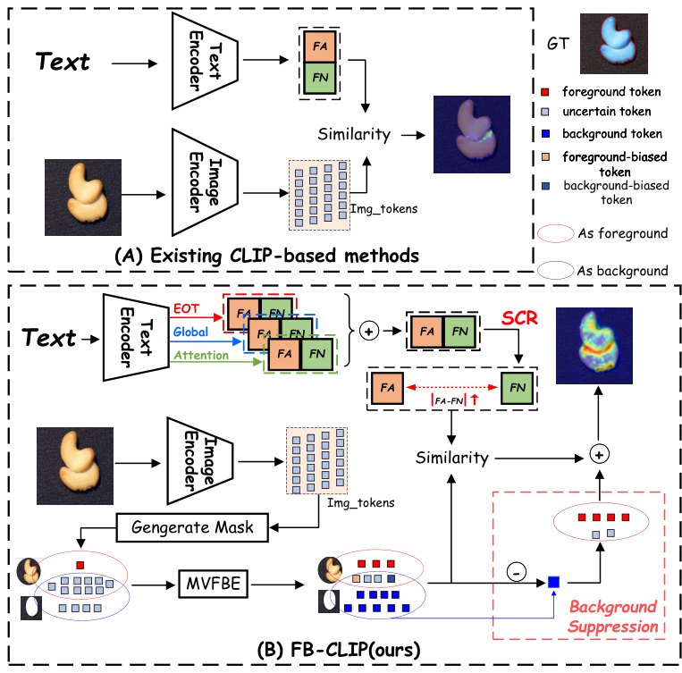
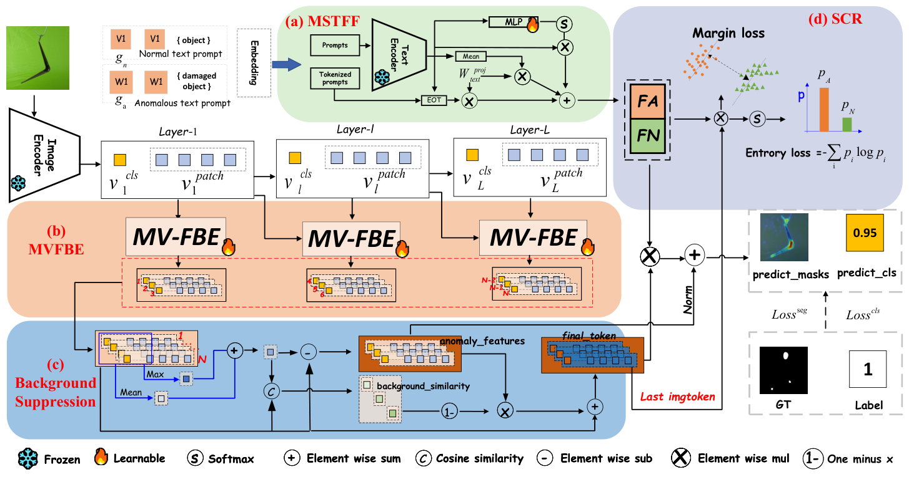

# 精读笔记 · FB-CLIP: Fine-Grained Zero-Shot Anomaly Detection with Foreground-Background Disentanglement

> arXiv 2603.19608 · CVPR 2026 · 代码：https://github.com/Xi-Mu-Yu/FB-CLIP（本目录 `code/`）
> 材料：paper.pdf（20 页）/ source/ / paper.tex / figures/（9 图 13 表）/ code/

## 基本情况

- 一句话：把「前景缺陷」和「背景干扰」在**文本侧与视觉侧同时**解耦，提升细粒度定位。
- 四个模块：**MSTFF**（文本多策略融合）+ **MVFBE**（视觉前景背景分离）+ **BS**（背景抑制）+ **SCR**（语义一致性正则）。
- 可训练：可学习 prompt、三路融合权重、门控网络、文本塔部分层；CLIP 图像塔冻结。
- 开源：代码 ✅ / 权重（未确认）。
- 路线：`① 动机（前景背景纠缠）→ ② 架构（四模块）→ ③ 训练 → ④ 数据 → ⑤ 信息流 → ⑥ 例子 → ⑦ 实验`

## 导读地图

行号指 `paper.tex`。

| 站 | 这一站讲清楚什么 | 图 | 原文位置 | 代码 |
|---|---|---|---|---|
| ① 动机 | 前景背景特征纠缠 + 文本语义粗糙 | 图 1、2 | §1 L16–54 | — |
| ② 架构 | MSTFF / MVFBE / BS / SCR | 图 3 | §3.1–3.4 L77–350 | `FBCLIP_lib/FBCLIP.py:13/325/441` |
| ③ 训练 | focal + dice + BCE + SCR（熵 + margin） | — | §3.4 L300–350 | `FBCLIP.py:520-549` |
| ④ 数据 | 工业 + 医学，VisA 训练 | 表 1 | §4.1 L354–416 | `dataset.py` |
| ⑤ 信息流 | patch → 软前景掩码 → 三视角 → 相似度 | 图 3 | §3.2–3.3 | `FBCLIP.py:729` |
| ⑥ 例子 | 一块织物走一遍（背景木纹 vs 破洞） | — | — | `FBCLIP.py:441`（门控） |
| ⑦ 实验 | MVTec 92.4/91.9；VisA 89.5/96.3 | 表 1、3 | §4.2–4.3 | — |

## ① 动机



**图 1 怎么读**，两栏对比：

- **(a) 现有方法**：**一个文本特征**（EOT）和所有视觉特征做统一对齐 → 语义粗糙。
- **(b) FB-CLIP**：**三个文本特征**融合 + SCR；视觉侧**前景/背景分离** + 背景抑制。

**问题一：前景背景纠缠。** 工业图里背景（桌面、夹具、光照纹路）的局部对比度常常比缺陷本身还高。
CLIP 的 patch 特征没有"这是前景还是背景"的概念，于是**桌面木纹会被判成缺陷**。

论文图 2 给了直接证据：把前景、背景、异常三类 patch 画在同一个特征空间里，**背景和异常混在一起**；
把背景分离出去之后，异常点才和正常点分开。

**问题二：文本语义粗糙。** 只取 EOT 向量，等于用"整句摘要"代表"异常"。
但异常往往只和少数几个词相关（damaged、scratch），EOT 把这些细节平均掉了。

**对应两个解法**：视觉侧显式分离前景背景（MVFBE + BS），文本侧融合多种池化（MSTFF），
再加一个 SCR 把"模棱两可的匹配"压掉。

## ② 架构



**图 3 怎么读**，四块，颜色对应：

- **(a) 绿框 MSTFF**：两条物体无关 prompt → 文本塔 → **三路**（EOT / Mean / MLP 加权）→ 加权求和。
- **(b) 橙框 MVFBE**：第 L1…LL 层各接一个 MV-FBE，输出按组聚好的 patch。
- **(c) 蓝框 Background Suppression**：组内做 max/mean、算余弦 c、用 `1 − bg_similarity` 抑制背景。
- **(d) 灰框 SCR**：margin loss + entropy loss，出 predict_masks 与 predict_cls。

**A. MSTFF（文本侧，式 3–6）**

```
F_eot    = EOT 位置的投影                  ← 保持与 CLIP 兼容
F_global = 所有 token 的平均               ← 上下文
F_attn   = Σ softmax(S(x_i)) · x_i         ← 轻量 MLP 打分后加权
F_text   = λ1·F_global + λ2·F_attn + λ3·F_eot
```

| 符号 | 是什么 | 取值 |
|---|---|---|
| S(·) | 两层 MLP 的 token 选择器 | — |
| λ1..λ3 | 融合权重 | 代码里是**可学习**的 `fusion_weights`，初始化为 1/3 |

**为什么有效**：EOT 是"整句摘要"，但异常往往只和少数几个词相关。注意力池化能把权重压到 `damaged`、`scratch` 上。

**B. MVFBE（视觉侧）**

核心假设：**前景 token 信息更丰富（与全局上下文差异大），背景 token 更稳定（与正常模式一致）**。

四个互补线索：

| 线索 | 含义 | 直觉 |
|---|---|---|
| 局部显著性 | 该 patch 与邻域的差异 | 缺陷通常局部突出 |
| 离中心距离 | 距离图像中心多远 | 物体通常居中，背景在边缘 |
| 与 CLS 的不一致性 | 与整图语义的偏离 | 背景与主体语义不一致 |
| 时序变化 | 跨增强/多视图的稳定性 | 背景更稳定 |

合成**软前景掩码**（0.5 / 1.0 两档），再沿三视角增强：identity、semantic、spatial。

**C. BS（背景抑制）**

把背景 token 单独做一次注意力，再按 `1 − bg_similarity` 从主分支减掉。
代码里 `bg_weight = 0.1`——背景分支只占 10%，**只用来"减"，不用来"加"**。

**D. SCR（语义一致性正则）**

```
similarity = img · textᵀ / τ
probs = softmax(similarity)
entropy = −Σ p log p                    ← 熵最小化：让判断更果断
diff = |sim_ano − sim_norm|
margin_loss = ReLU(margin − diff)        ← 间隔约束：让两者差得够开
L_scr = semantic_weight · (1.0·entropy + 0.5·margin_loss)
```

**两项作用不同**：熵最小化治"犹豫"，margin 治"分不开"。只做熵最小化会让模型在错的地方也更自信，所以必须配 margin。

**模块表**

| 模块 | 来源 / 初始化 | 训练时更新吗 | 作用 |
|---|---|---|---|
| 可学习 prompt（物体无关） | 随机 | ✅ | 两条状态 prompt |
| CLIP 文本塔 | 预训练 | **部分层** | 编码 prompt |
| MSTFF 融合权重 | 1/3 初始化 | ✅ | 三路加权 |
| MVFBE 门控网络 | 随机 | ✅ | Linear(768×3→768→2) + Sigmoid |
| CLIP 视觉塔 | 预训练 | 否 | patch 特征 |
| SCR 温度 / 权重 | 超参 | — | 正则强度 |

## ③ 训练

```
L_total = L_cls(BCE) + L_seg(Focal + Dice) + L_scr(熵 + margin)
```

| 项 | 值 |
|---|---|
| 优化器 | Adam，**lr 5e-5** |
| batch | 4 |
| 硬件 | 单卡 RTX 3090 |
| 框架 | PyTorch 2.0 |
| 训练数据 | VisA 的 test split（评 VisA 时用 MVTec 训） |

**lr 只有 5e-5**——比 AA-CLIP 的 5e-4 低一个数量级。要在冻结的 CLIP 上做小幅调整，步子大了会崩。

## ④ 数据

**一条样本**：图 + 像素 mask + 图像级标签。文本侧走物体无关 prompt，**不需要物体名**。

**数据集**：工业 MVTec、VisA、MPDD、BTAD、DAGM、DTD、**Real-IAD**；医学若干（ISIC、结肠、甲状腺等）。
Real-IAD 是较大的工业集（多相机、多样本），FB-CLIP 专门报了这一项，是它的卖点。

## ⑤ 信息流

```
【文本支路｜每类一次，可缓存】
[V₁…V_E][object] / [W₁…W_E][damaged][object]
  └ CLIP 文本塔 ─▶ token 序列 [B, 77, 768]
      ├ F_eot    = EOT 位投影        → [768]
      ├ F_global = 全 token 平均      → [768]
      └ F_attn   = MLP 打分后加权     → [768]
          └ 加权融合 ─▶ T_N, T_A [2, 768]

【图像支路｜每张图一次】
[1,3,H,W] ─ CLIP ViT-L/14 ─▶ patch [1369, 1024] + CLS
  └ MVFBE × L 层：
      ├ 四线索 → 软前景概率 P_fg ∈ {0.5, 1.0}
      ├ identity / semantic / spatial 三视角增强
      └ 背景抑制（bg 分支权重 0.1，按 1 − bg_sim 减掉）
          └ patch @ [T_N,T_A]ᵀ ─▶ 相似度
              └ SCR（熵最小化 + margin）─▶ 异常图
```

| 阶段 | 次数 | 说明 |
|---|---|---|
| 文本塔（三路池化） | 每类 1 次 | 可缓存 |
| 图像塔 | 每图 1 次 | |
| 前景掩码 | 每图 1 次 | 四线索，几乎无参数 |
| 三视角增强 | 每图 3 次注意力 | 主要额外开销 |
| SCR | 每图 1 次 | 对相似度做正则 |

## ⑥ 例子走一遍

**场景**：一块棕色织物放在木纹桌面上，织物中央有一个破洞。背景木纹的局部对比度比破洞还高。

**没有 MVFBE 时**：木纹的 patch 与"异常"文本相似度偏高，异常图会在桌面亮一片。

**MVFBE 的四条线索**（示意值）：

| patch 位置 | 局部显著性 | 离中心距离 | 与 CLS 不一致 | 软前景概率 |
|---|---|---|---|---|
| 织物中央（破洞） | 0.9 | 0.1 | 0.8 | **1.0** |
| 织物边缘 | 0.5 | 0.4 | 0.4 | 1.0 |
| 桌面木纹 | 0.8 | 0.9 | 0.2 | **0.5** |

**木纹的局部显著性也有 0.8**——单看这一条会误判；但"离中心远 + 与 CLS 不一致低"把它压到 0.5。
**四条线索互补，缺一条就会误检。**

**背景抑制的效果**：软掩码 0.5 的 token 进背景分支（权重 0.1），主分支按 `1 − bg_sim` 减掉，
异常图上桌面区域从 0.6 降到 0.2，破洞仍是 0.9。

**SCR 的效果**：原本"破洞 patch"对正常/异常原型的相似度是 0.31 / 0.34（差 0.03、熵高），
margin（=1）把差距拉到 0.26 / 0.41，**决策边界更清楚**。

**代码位置**：

```python
# FBCLIP_lib/FBCLIP.py:441  前景/背景门控
self.gate_network = nn.Sequential(
    nn.Linear(embed_dim * 3, embed_dim), nn.ReLU(),
    nn.Linear(embed_dim, 2), nn.Sigmoid())

# :84  背景分支只取"非前景"的部分
bg_tokens = tokens * (1 - gate_weight)

# :535-549  SCR
entropy = -(probs * torch.log(probs + eps)).sum(dim=-1).mean()
diff = (similarity[:, 1] - similarity[:, 0]).abs()
margin_loss = F.relu(margin - diff).mean()
loss = 1.0 * entropy + 0.5 * margin_loss
```

## ⑦ 实验与地位

| 数据集 | FB-CLIP | 同表最强对手 |
|---|---|---|
| MVTec 图像 | 92.4 | AF-CLIP 92.9 |
| MVTec 像素 | 91.9 | AF-CLIP 92.3 |
| VisA 图像 | **89.5** | AF-CLIP 88.5 |
| VisA 像素 | **96.3** | AF-CLIP 96.2 |
| Real-IAD 图像 | **80.6** | FAPrompt 77.3 |

- 18 项指标中 14 项进前二，超过 FAPrompt（10 项）。
- **VisA 是主场**：背景复杂、物体多样，前景背景分离收益最大。
- **MVTec 不占优**（92.4 vs AF-CLIP 92.9）——MVTec 背景干净，解耦模块派不上用场。
- Real-IAD 上 +3.3 图像 AUROC，是"大规模真实场景"的卖点。

**局限**

- 模块多（四个），三个融合权重 + 门控 + SCR 温度都要调；
- 软掩码的 0.5/1.0 两档是硬编码；
- 指标口径混用 AP / PRO，跨表比较需注意。

## 代码 ↔ 论文

| 论文说 | 代码做 | 影响 |
|---|---|---|
| 三路文本特征加权融合 | `fusion_weights` 是**可学习参数**（初始 1/3），不是固定超参 | 论文未说明 λ 是学出来的 |
| 软前景掩码（0.5 / 1.0） | 由 `gate_network` 的 sigmoid 输出映射而来，阈值在 `generate_soft_mask` 里 | 阈值未在论文给出 |
| 背景抑制是独立模块 | 实现为**第二个注意力分支**（`bg_attention`），权重 0.1 | 是"再算一次注意力"，不是后处理 |
| SCR 的 margin | `margin = 1`、`w_entropy = 1.0`、`w_margin = 0.5` | 论文没给这三个数 |
