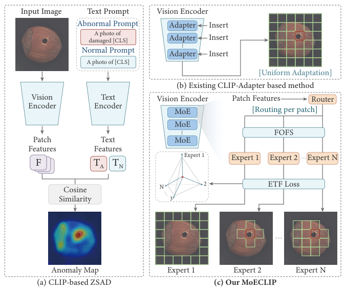
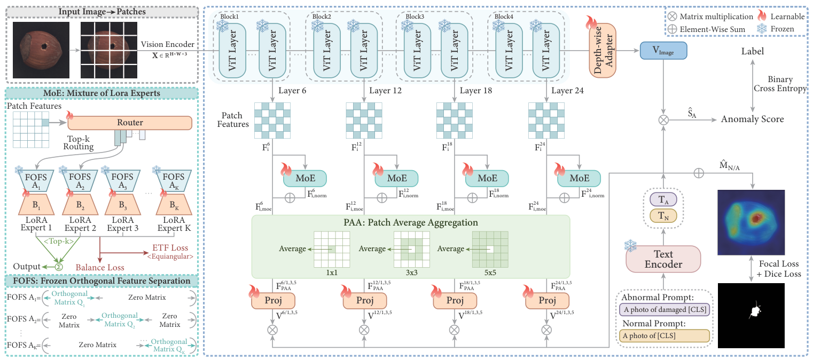

# 精读笔记 · MoECLIP: Patch-Specialized Experts for Zero-shot Anomaly Detection

> arXiv 2603.03101 · CVPR 2026 · 代码：https://github.com/CoCoRessa/MoECLIP（本目录 `code/`）
> 材料：paper.pdf（29 页）/ source/ / paper.tex / figures/（35 图 15 表）/ code/

## 基本情况

- 一句话：给 CLIP 的**每个 patch 动态路由到专门的 LoRA 专家**，把「一套 adapter 调所有 patch」换成 patch 级适配。
- 和前面几篇最大的不同：不再是类别级/全局级的统一适配，而是**按 patch 内容分派专家**。
- 可训练：4 个专家 × 4 层（LoRA rank 8）+ 路由器 + 4 个投影 + depth-wise adapter；CLIP 主干全冻。
- 开源：代码 ✅ / 权重（未确认）。
- 路线：`① 动机（patch 不该被一视同仁）→ ② 架构（MoE + FOFS + ETF + PAA）→ ③ 训练（4 个损失）→ ④ 数据（14 集）→ ⑤ 信息流 → ⑥ 例子 → ⑦ 实验`

## 导读地图

行号指 `paper.tex`。

| 站 | 这一站讲清楚什么 | 图 | 原文位置 | 代码 |
|---|---|---|---|---|
| ① 动机 | 现有方法 patch-agnostic，所有 patch 用同一套适配 | 图 1 | §1 L10–34 | — |
| ② 架构 | MoE 模块、FOFS 正交子空间、ETF、PAA | 图 2 | §4.2–4.5 L92–162 | `model/moe_adapter.py:38/109/243` |
| ③ 训练 | seg + ac + 0.01·ETF + 0.01·balance | — | §4.7 L198–278 | `moe_adapter.py:9`（etf）、`:199`（balance） |
| ④ 数据 | 14 个数据集（5 工业 + 9 医学） | 表 1 | §5.1 | — |
| ⑤ 信息流 | 518² → 1369 patch → 4 层 MoE → PAA → 相似度 | 图 2 | §4.6 L163–197 | `moe_adapter.py:388` |
| ⑥ 例子 | 一张 PCB 走一遍：路由、FOFS、ETF 各在算什么 | — | — | `:194`（topk）、`:152`（QR） |
| ⑦ 实验 | MVTec 93.9/92.5；14 集平均 89.6/94.3 | 表 1、2 | §5.2–5.4 | — |

## ① 动机



**图 1 怎么读**，三块并排：

- **(a) 通用框架**：CLIP 出 patch 特征 → 一套 adapter → 和文本比对。所有方法都长这样。
- **(b) 现有做法**：**同一套 adapter 无差别地作用在所有 patch 上**（图里用统一颜色表示）。
- **(c) MoECLIP**：patch 先经过 router，被分派到不同专家（不同颜色），每个专家只处理一类 patch。

**问题在哪**：一张图里，缺陷 patch 和背景 patch 的统计性质完全不同——前者高频、边缘强，后者平滑、低频。
用同一组 LoRA 去调它们，等于**让一个专家同时学两件事**，结果两边都不够专。

**作者的赌注**：既然 ViT 的 patch 本来就"各有各的性格"，那就**让每个 patch 自己选专家**。
这比"给整类训练一个 adapter"更细，也比"给每层训练一个 adapter"更细。

**但 MoE 有个老毛病**：专家会塌缩——router 总是选同一个专家，其余专家白拿参数。三个约束就是为它准备的：

1. **FOFS**（输入侧）：强制每个专家只看一个正交子空间，物理上就看不到别人的信息；
2. **ETF loss**（输出侧）：强制 K 个专家的输出两两成最大等角；
3. **balance loss**：强制路由分布均匀。

**MoE 负责「分工」，FOFS + ETF + balance 负责「保证真的分了工」。**

## ② 架构



**图 2 怎么读**，从左到右：

- **左上**：输入图切 patch → ViT（冻结，24 层）。
- **左中虚线框**：MoE 内部——Router（top-k）→ K 个专家，每个专家 = **FOFS 的 A 矩阵（冻结正交块）+ LoRA 的 B 矩阵（可训练）**；右下两个箭头分别指向 ETF loss 和 balance loss。
- **左下**：FOFS 结构示意——A₁ 只在第 1 个块有正交矩阵 Q₁，其余全零。
- **中间**：第 6/12/18/24 层各接一个 MoE，输出再过 **Proj**（可训练）。
- **中部绿框**：PAA——patch 特征按 1×1 / 3×3 / 5×5 滑窗平均。
- **右边**：多尺度特征与 T_N / T_A 点积 → 异常图（focal + dice）；CLS 经 **depth-wise adapter** → V_image → 二分类 CE。

**A. MoE 模块（式 1、2）**

```
F_i^l ─ router ─▶ top-2 权重 w（归一化）
  └ F_expert = Σ_{n∈top2} w_n · (B_n A_n F_i^l) · scaling
      └ 模长对齐：F_norm = F_expert · ‖F_i‖ / (‖F_expert‖ + ε)
          └ F_MoE = λ·F_norm + (1−λ)·F_i        λ_MoE = 0.1
```

| 符号 | 是什么 | 取值 |
|---|---|---|
| K | 专家数 | 4 |
| top_k | 每个 patch 激活的专家数 | 2 |
| r | LoRA rank | 8 |
| λ_MoE | 残差混合权重 | 0.1 |

**模长对齐和 AA-CLIP 完全一样**（论文明确引用 AA-CLIP）。原因相同：直接相加会让模长逐层漂移，破坏 CLIP 泛化。

**B. FOFS：把输入空间切成 K 块（式 3）**

```
A_n = [0 … 0 | Q_n | 0 … 0]，  Q_n = qr(高斯随机矩阵)ᵀ
约束：A_n A_mᵀ = 0 (n ≠ m)，Σ d_n = d
```

第 n 个专家只能看到第 n 个子空间（d_n 维）。**A 冻结不训**——论文引用近期 LoRA 研究：随机正交的 A 已够好，学它反而过拟合。

**C. ETF loss：让专家输出互为最大等角（式 5–8）**

```
G_i = Ê_i Ê_iᵀ        （K×K，专家输出 L2 归一化后的 Gram 矩阵）
L_etf = Σ_l (1/(L·K²)) Σ_i Σ_{n,m} ( (G_i)_{n,m} − G_ideal_{n,m} )²
```

K=4 时 G_ideal 对角为 1、非对角为 **−1/3**——四个专家输出两两夹角 109.47°（正四面体）。
**FOFS 管输入不重叠，ETF 管输出不重合。**

**D. balance loss（式 9）**：`L_bal = Σ_l CV²(Σ_i R(F_i^l))`，对每个专家的总路由概率算平方变异系数，逼分布均匀。

**E. PAA：训练期就做多尺度（式 10）**

```
F_MoE [L, d] → reshape [√L, √L, d] → 每个 s∈{1,3,5} 做 s×s 滑窗平均 → 3 组 [L, d]
```

前人的 patch aggregation 只在测试期做，MoECLIP 放进训练，让模型**训练时就有多尺度意识**。

**模块表**

| 模块 | 来源 / 初始化 | 参数量 | 训练时更新吗 | 作用 |
|---|---|---|---|---|
| CLIP ViT-L/14-336 | OpenCLIP（冻结） | ≈300M | 否 | patch + CLS |
| 专家 LoRA A（FOFS） | 随机正交块，**冻结** | 4×4 层×(8×1024) | **否** | 正交子空间投影 |
| 专家 LoRA B | 零初始化 | 4×4 层×(1024×8) | ✅ | 各专家的变换 |
| Router | 线性层 | 4 层×1024×4 | ✅ | 每 patch 的专家权重 |
| Proj ×4 | 线性 | 4×1024×1024 | ✅ | 投到文本空间 |
| Depth-wise Adapter | — | 小 | ✅ | 图像级特征适配 |
| CLIP 文本塔 | 冻结 | — | 否 | 出 T_N / T_A |

## ③ 训练

```
L_total = L_seg + L_ac + λ_etf·L_etf + λ_bal·L_bal

L_seg = Σ_l Σ_s [ Focal(M̂^l,s, M) + Dice(M̂^l,s, M) ]     # 4 层 × 3 尺度
L_ac  = BCE(Ŝ_A, S)
λ_etf = λ_bal = 0.01
```

| 项 | 值 |
|---|---|
| 轮数 | 20 epoch |
| 优化器 | Adam，lr 5e-4 |
| 硬件 | **2 × V100 16GB** |
| PAA 尺度 | {1, 3, 5} |
| 训练数据 | VisA（评 VisA 时改用 MVTec 训） |

**为什么两个辅助损失权重只有 0.01**：它们只起"塑形"作用，真正干活的是分割损失。权重给大会让模型为了"让专家散开"而牺牲定位精度。

## ④ 数据

**一条样本**：

| 字段 | 形状 | 取值 | 用处 |
|---|---|---|---|
| img | [3, 518, 518] | 归一化 | 图像塔 |
| mask | [518, 518] | {0,1} | L_seg |
| label | {0,1} | 图像级 | L_ac |

**14 个数据集**：

| 域 | 数据集 |
|---|---|
| 工业（5） | MVTec-AD、VisA、BTAD、RSDD、DTD-Synthetic |
| 医学（9） | Head CT、BrainMRI、Liver CT、Retina OCT、ColonDB、ClinicDB、CVC-300、Endo、Kvasir |

**协议**：VisA 作辅助训练集；评 VisA 时用 MVTec 训。与 Bayes-PFL 的 14 集基准一致。

## ⑤ 信息流

```
【图像支路｜每张图一次】
[1,3,518,518]
  └ CLIP ViT-L/14-336（冻结）─▶ patch [1369, 1024] + CLS [1024]
      ├ 第 6/12/18/24 层输出 ─ 各过一个 MoE：
      │    router: [1369,1024] → [1369,4] → softmax → top-2 → 归一化
      │    expert: 2 个专家的 B·A·F → 加权和
      │    norm-match + 0.1 混合 → [1369,1024]
      └ PAA: s=1,3,5 滑窗平均 ─▶ 3 组 [1369,1024]

【文本支路｜每类一次，可缓存】
prompt 平均 ─▶ T_N, T_A [2,1024]

【打分】
3 组 patch @ [T_N,T_A]ᵀ → softmax → 3 张 [37,37,2] → 上采样 → 平均 → 异常图
CLS ─ depth-wise adapter ─▶ V_image ─▶ 图像级分数
```

| 阶段 | 次数 | 说明 |
|---|---|---|
| ViT 前向 | 每图 1 次（冻结） | 1369 个 patch |
| MoE | 每图 4 次 | 每次 1369×4 路由 + 2 个专家 |
| PAA | 每图 3 次 | 零参数 |
| 文本编码 | **每类 1 次** | 与图无关，可缓存 |

**MoE 的额外开销**：top-2 意味着每个 patch 算 2 个专家（rank 8），约为单专家的 2 倍；但只在 4 层上做，相对 24 层主干仍很小。

## ⑥ 例子走一遍

**玩具设定**：4×4=16 个 patch，K=4 专家，LoRA rank r=2，patch 维度 8。

**第 1 步：路由**

```
某 patch 的 router 输出：[0.60, 0.30, 0.08, 0.02]
  └ top-2 = 专家 0、1 → 权重归一化：[0.667, 0.333]
```

**第 2 步：两个专家各算一遍**

```
专家 0：B_0(A_0 F) → [0.3, 0.9, 0.1, 0.0, 0.2, 0.1, 0.0, 0.4]
专家 1：B_1(A_1 F) → [0.1, 0.2, 0.8, 0.6, 0.0, 0.3, 0.1, 0.2]
  └ 加权 0.667 / 0.333 → F_expert
```

**第 3 步：模长对齐 + 混合**

```
F_norm = F_expert · ‖F‖/‖F_expert‖      ← 只改方向
F_MoE  = 0.1·F_norm + 0.9·F           ← 只掺 10%
```

**FOFS 长什么样**（d=8，K=4，每块 2 维）：

```
A_0 = [ Q_0(2×2) |   0     |   0     |   0    ]   ← 专家 0 只看第 1~2 维
A_1 = [   0     | Q_1(2×2) |   0     |   0    ]   ← 专家 1 只看第 3~4 维
A_2 = [   0     |   0     | Q_2(2×2) |   0    ]
A_3 = [   0     |   0     |   0     | Q_3(2×2) ]
```

**ETF 的"理想矩阵"**（K=4）：

```
      [ 1    -1/3  -1/3  -1/3 ]
G_id =[-1/3    1   -1/3  -1/3 ]
      [-1/3  -1/3    1   -1/3 ]
      [-1/3  -1/3  -1/3    1  ]
```

四个专家输出两两夹角 109.47°。

**为什么两个都要**：只做 FOFS，B 矩阵仍可能把不同输入映射到相似输出；只做 ETF，输入重叠会让专家争抢同样的信息。

**代码位置**：

```python
# model/moe_adapter.py:152-157  FOFS 构造
q, _ = torch.linalg.qr(temp_matrix)
q_ortho = q.T
A_matrix[:, start_idx:end_idx] = q_ortho          # 只填自己那块，其余为 0

# :194-196  top-k 路由
routing_weights, selected_experts = torch.topk(router_probs, top_k, dim=-1)
routing_weights /= routing_weights.sum(dim=-1, keepdim=True)

# :427-431  模长对齐 + 混合
moe_output_normalized = moe_output * x.norm(...) / (moe_output.norm(...) + 1e-6)
x = self.i_w * moe_output_normalized + (1 - self.i_w) * x
```

## ⑦ 实验与地位

**主结果（14 个数据集）**

| 指标 | MoECLIP | 第二名 | 差 |
|---|---|---|---|
| 图像平均 AUROC | **89.6** | Bayes-PFL 86.6 | +3.0 |
| 像素平均 AUROC | **94.3** | — | +1.1 |
| MVTec 图像 | **93.9** | Bayes-PFL 92.2 | +1.7 |
| MVTec 像素 | **92.5** | Bayes-PFL 91.9 | +0.6 |

**消融（4 个数据集的平均，像素 / 图像）**

| 配置 | 像素 | 图像 |
|---|---|---|
| Vanilla CLIP | 40.6 | 67.4 |
| w/o FOFS & ETF | 91.2 | 93.1 |
| w/o FOFS | 91.9 | 93.9 |
| w/o PAA | 90.7 | 93.5 |
| w/o Depth-wise Adapter | 91.7 | 93.6 |
| **完整** | **92.2** | **95.3** |

读法：**去掉 PAA 掉 1.5（像素），去掉两个正交约束掉 1.0**——多尺度和专家分化都实打实贡献了。

**两个反常**

- **VisA 图像只有 83.6**，输给 Bayes-PFL 的 86.8；
- **BTAD 图像 93.1**，输给 AA-CLIP 的 94.8。

说明 MoE 的收益在"类别多、形态杂"的集合（MVTec 15 类、医学各集）上明显，在"单一物体、背景简单"的集合上不占优。

**局限**

- 专家数、top-k、rank 都要调；MoE 增加推理开销；
- 训练时是 **dense 计算所有专家**，没有真正省算力；
- 只在 14 个数据集上评，没有真机证据。

## 代码 ↔ 论文

| 论文说 | 代码做 | 影响 |
|---|---|---|
| 「动态路由，每个 patch 只激活 top-k 专家」 | 训练时 `all_expert_outputs = torch.stack([expert(x) for expert in experts])`——**全部 K 个专家对全部 token 都算**，再按 top-k gather（`moe_adapter.py:212-218`） | 训练没有省算力；只有推理用 `expert_mask` 稀疏化 |
| ETF loss 是训练目标之一 | `if self.training and all_expert_outputs is not None` 才算 | 推理不算，符合预期 |
| 图像级用 CLS | `det_token = det_proj(tokens[-3])` 后 `mean(1)`——**用 patch 平均，且只取第 3 个尺度** | 和 AA-CLIP 一样绕过了 CLS |
| 4 层各自一个 Proj | `seg_proj[i // 3]`——**3 个尺度共享一个 proj** | proj 是 4 个不是 12 个 |
