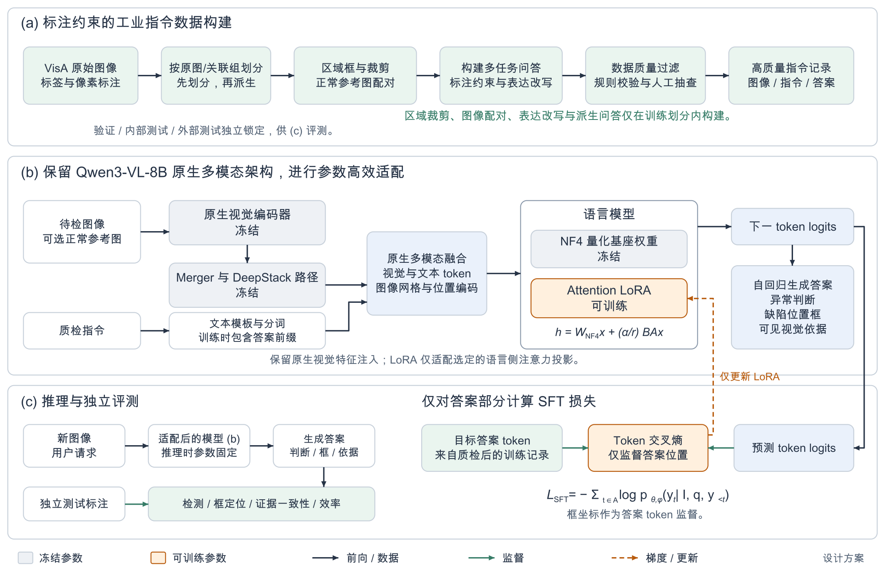

# 工业 VLM 指令微调：框架图与岗位能力说明

设计日期：2026-10-23。本文描述待实现的全新项目，不代表已经训练完成或取得指标。约束是单张 RTX 4090D 24GB，Qwen3-VL-8B-Instruct；数据盘可扩容。本文未沿用既有项目的模型或训练实现。

## 1. 可直接使用的图稿

- 英文论文版：[矢量 PDF](figures/industrial_vlm_framework_en.pdf)、[可编辑 SVG](figures/industrial_vlm_framework_en.svg)、[300 dpi PNG](figures/industrial_vlm_framework_en.png)。
- 中文阅读版：[矢量 PDF](figures/industrial_vlm_framework_zh.pdf)、[可编辑 SVG](figures/industrial_vlm_framework_zh.svg)、[300 dpi PNG](figures/industrial_vlm_framework_zh.png)。
- [绘图源文件](figures/draw_framework.py)：SVG 与 PDF 来自同一组绘图操作。PDF 宽 180 mm，字体嵌入；PNG 按该宽度以 300 dpi 输出。

图稿采用三分区：离线数据构建、原生 VLM 的参数高效训练、独立推理与评测。灰色表示冻结参数，橙色表示可训练参数；黑色、绿色、橙色虚线分别表示前向/数据、监督、梯度更新。论文版为双栏通栏图设计，投稿时仍需按目标模板检查最终字号与图注。

## 2. 论文英文图注

**Figure 1. Proposed framework for industrial visual instruction tuning.**
(a) Images and annotations are partitioned before any derived training samples are constructed. The training partition is used to create region-grounded and normal-reference instruction records, followed by rule-based validation and human auditing.
(b) We retain the native visual encoder, merger, DeepStack feature injection, and multimodal positional inputs of Qwen3-VL-8B. The visual modules and NF4-quantized language backbone remain frozen, while LoRA adapters in selected language attention projections are optimized. The model autoregressively produces an anomaly decision, bounding-box coordinates, and concise visible evidence.
(c) Supervised fine-tuning applies token cross-entropy only to assistant answer positions; coordinate tokens are trained with the same objective. Ground-truth annotations are used for offline supervision and independent evaluation, and are not supplied as inference inputs. This figure depicts a proposed design; no experimental performance is implied.

## 3. 模型与训练的准确含义

令 `I` 表示查询图及可选正常参考图，`q` 表示指令，`y` 表示目标答案。训练采用 teacher forcing：输入中包含先前答案 token，用当前 logits 预测下一个答案 token。用户提示、图像占位和 padding 位置不计算答案损失。

\[
\mathcal{L}_{\mathrm{SFT}}
=-\sum_{t\in\mathcal{A}}\log p_{\theta,\phi}(y_t\mid I,q,y_{<t}),
\]

其中 `θ` 为冻结基座，`φ` 为可训练 LoRA 参数，`A` 为有效答案位置。位置框以统一坐标规范序列化为答案 token；首版没有独立框回归损失或像素分割损失。

LoRA 对选定线性层引入：

\[
h=\widehat W_{\mathrm{NF4}}x+\frac{\alpha}{r}BAx.
\]

`A/B` 为低秩可训练矩阵；NF4 是基座的存储量化，计算精度与可训练参数精度另行配置。实际量化范围需检查所用框架，视觉模块首版保持冻结并保留适当计算精度。图中 NF4 标签指量化语言线性层，不意味着 embedding、归一化和输出头全部以 4-bit 运行。

原生视觉路径在图中做了模块级归并：DeepStack 的多层特征注入仍按原模型执行，不表示它只是额外拼接一串 token，也不表示新增了独立的可训练融合器。图像网格、位置输入、多图顺序和聊天模板均应使用原生 processor 正确生成。

冻结参数不等于所有计算都在 `no_grad` 中。语言基座权重冻结，但损失仍须通过语言计算图传到 LoRA。首版视觉模块不更新，正常参考与查询共同通过其原生路径处理。推理阶段以生成前缀替代目标答案，并保持所有模型参数固定。

## 4. 数据与信息权限

首版拟选 VisA 作监督训练源，按类别、正常/异常及可用的关联组重划 train/val/internal test。MVTec AD 官方 test 作为外部测试。使用 VisA 的异常图和 mask 训练属于监督重划分设置，不再沿用原官方 normal-only 测试名义。

训练数据包含单图判别、区域定位、局部描述和受控正常参考比较。mask 可以派生几何框与位置，缺陷类型、原因、严重程度不能仅由 mask 推导。参考池、teacher 生成、图像增强和同图多条 QA 必须服从原始 split。评测数据可在锁定后生成固定问题与几何评分目标，但不进入训练扩写、teacher 数据构建或模型选择。

外部评测分别报告无参考与 k-normal-shot：后者只允许按固定规则使用外部数据集官方训练正常图。GT mask/box 不用于选择端到端测试 crop；若评价给定 ROI 的识别，单独标明该输入权限。

## 5. 哪些工作体现大模型基座算法岗位能力

该项目属于**多模态后训练与领域适配**，与基座算法岗位的数据、训练和评测工作相关。首版尚不包含从零预训练、分布式大规模预训练、RLHF 或新基座架构研发。

| 工作 | 实际算法/工程问题 | 必须保留的交付物或证据 |
|---|---|---|
| 数据治理 | 定义正常/异常、区域监督权限；隔离近重复与派生样本；追踪生成来源 | manifest、分组 split、去重统计、来源与版本；源图数和指令数分别统计 |
| 高质量指令构建 | 将真实标签与区域变为可靠语言监督，避免错误极性、伪造描述、模板与类别捷径 | 样本 schema、构造脚本、质检规则、人工审计集、失败类型和过滤有效率 |
| 区域与语言任务对齐 | 将指定区域、框坐标与描述绑定，使模型随图像和请求改变输出 | 坐标变换验证、同图不同请求测试、目标不存在样本、描述—框一致性评测 |
| QLoRA/PEFT | 限定量化范围、LoRA注入范围和冻结策略，解决24GB约束 | 实际可训练参数、模块清单、dtype/量化配置、稳定反向及adapter保存重载记录 |
| 多模态SFT | 正确构造多图输入、image grids、位置输入、assistant loss mask与teacher forcing | 单样本审计、有效答案token数、梯度检查、训练曲线、任务配比和可复现配置 |
| 多任务与采样 | 平衡正常/异常、整图/区域任务、小缺陷与困难负例，避免重复源图主导更新 | 采样器、配额统计；同数据/计算预算下的配比或核心数据消融 |
| 多图参考 | 建立reference/query身份、顺序和参考规则，检验模型是否消费参考证据 | 无参考/正确参考/替换参考、交换顺序测试，以及底座和SFT的同条件比较 |
| 效率与训练稳定性 | 管理视觉token、序列长度、checkpoint、累积梯度与数据加载 | 显存/吞吐/延迟测量、OOM边界、同质量下的资源对照 |
| 独立评测 | 区分格式学习、视觉判别、grounding与描述真实性，检验迁移 | 固定内外部测试、原始预测、宏平均/误报/漏报、框指标与人工证据审计 |

“区域对齐”在此指监督任务对齐，尚无额外图文对比损失，也不宣称重新预训练了整个图文表征空间。若后续加入区域投影或 `<SEG>` 分割接口，应另画结构与梯度路径，并对新增模块做消融。

## 6. 最小证据链

1. **底座对照**：原始 Qwen 与 QLoRA-SFT 使用相同测试图、提示、参考规则、视觉token和解码预算。
2. **数据质量**：等量基础数据与质检数据比较；若同时改变数据类型与数量，只能归因于整体配方。
3. **数据设计**：从完整数据中去除困难负例或最核心的一类区域指令，验证该设计的独立价值。
4. **真实视觉利用**：换图、换参考、交换图像顺序、同图换请求，记录答案是否合理变化。
5. **泛化与成本**：分别报告内部留出和 MVTec 外部测试，以及峰值显存、吞吐和延迟。跨数据集不等于所有语义类别均未见。

首版输出位置框，因此报告框定位指标。AUROC需预先定义连续异常分数；只有Yes/No生成结果时，优先报告宏平均F1、平衡准确率、误报与漏报。格式成功率与判别能力分别统计。

## 7. 面试展示与范围

完成后可据实介绍为：“围绕工业异常任务构建可追溯的区域指令数据，使用NF4 QLoRA在单卡24GB上适配Qwen3-VL-8B，验证数据过滤、正常参考和区域指令对判别与grounding的影响，并报告跨数据集结果和资源成本。”真实指标与数据规模应在实验完成后填写。

面试时最值得讲清的细节是：为什么选择这些训练参数；loss到底监督哪些token；哪些样本修复了底座的什么错误；怎样排除位置/模板/类别捷径；新增参考和视觉token换来了什么质量与成本变化。

## 8. 引用依据与验证状态

- Qwen3-VL 官方架构/接口说明：<https://github.com/QwenLM/Qwen3-VL>；训练实现应保留原生多模态路径。
- AnomalyGPT：工业异常、正常参考、异常问答与数据构造的任务参考。
- GLaMM：区域与语言片段绑定、grounded监督的思路参考。
- LISA：后续语言隐藏表示驱动mask解码的接口参考；未包含在首版图中。

本次只完成图稿与设计说明，没有下载训练数据、运行模型或测量24GB显存。图稿中的NF4、LoRA范围和模块冻结均为拟实施配置。
