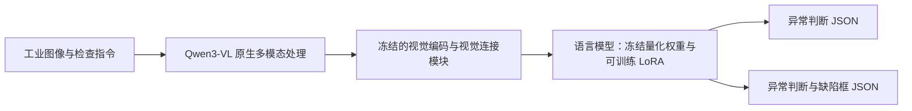
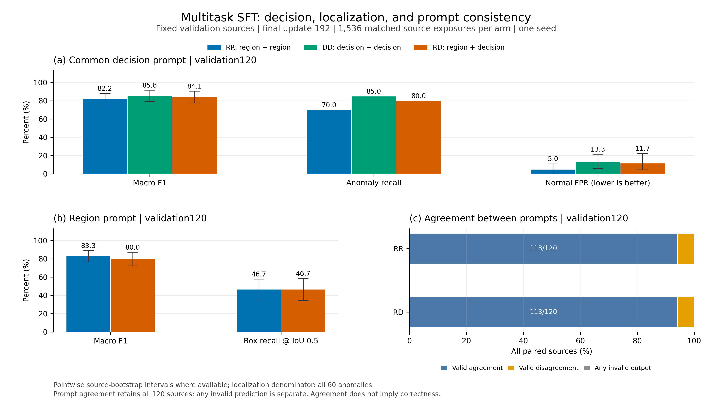
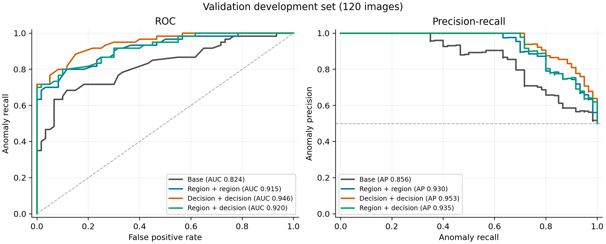
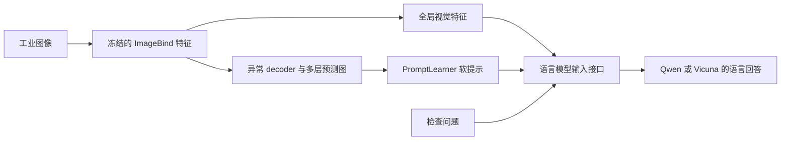
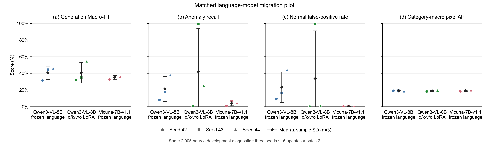

# 工业异常检测多模态项目：工作总结、实验数据与简历详解

整理日期：2026-11-02  
用途：梳理项目经历、修改算法岗位简历、准备技术面试。  
数据依据：项目内已保存的实验报告、运行配置和评测汇总；本次整理没有新增训练或模型评测。

LoRA专项阅读：[Qwen LoRA 项目实现步骤详解](Qwen_LoRA_项目实现步骤详解.md)，包含实际注入位置、参数形状、量化与冻结、数据编码、梯度累计、非零梯度证据和适配器保存重载。

## 1. 这个项目应该怎样定位

推荐项目名称：**工业异常检测多模态大模型领域适配与定位**。

项目围绕工业图像中的两个实际问题展开：图片是否存在缺陷，以及缺陷位于什么位置。前期通过纯视觉分割与语言方法建立基线，随后完成原生 Qwen3-VL 的工业领域微调，并进一步探索 AnomalyGPT 的视觉提示接口向 Qwen 语言模型迁移。

适合简历的一句话概括是：

> 面向工业异常判断与缺陷定位，完成标注清洗、指令数据构建、8B 视觉语言模型的参数高效微调、连续异常评分和受控实验评估，并通过跨模型迁移诊断分析训练不稳定问题。

这个项目的核心价值包括：多模态数据处理、低显存训练、判断与定位任务设计、生成模型的连续评分、实验控制，以及能够追溯到逐图预测的结果分析。

### 1.1 三个阶段及其关系

| 阶段 | 主要模型与方法 | 解决的问题 | 已完成的代表工作 |
|---|---|---|---|
| 前期基线 | DINOv2、CLIP 文本锚点等 | 未见零件类别的异常定位是否退化，语言信息是否有帮助 | Real-IAD 数据整理、四折整类留出评估、语言分支探索 |
| 原生 VLM 领域适配 | Qwen3-VL-8B-Instruct + QLoRA | 如何让已有 VLM 输出工业异常判断与缺陷框 | 真实 mask 转指令、单卡微调、任务消融、连续评分与阈值分析 |
| AnomalyGPT 接口迁移 | ImageBind + decoder/PromptLearner + Qwen/Vicuna | 异常定位提示能否被不同语言骨干有效利用 | 三模型三种子对照、真实异常评测、热图交换诊断、指标修订 |

**简历主线建议采用第二阶段。** 这一阶段有清楚的训练链路和同协议性能对照。第三阶段适合作为研究深化，展示跨模型适配、实验设计和问题定位能力。

两个 VLM 路线的训练数据、视觉输入路径和预算不同。后文分别报告结果，不能将原生 Qwen 的 85.83% F1 与迁移实验约 40% 的 F1 当作同条件比较。

## 2. 前面具体完成了哪些工作

### 2.1 论文与代码调研

阅读并整理了 CLIP、WinCLIP、AnomalyCLIP、AdaCLIP、AA-CLIP、AnomalyGPT、Dual Anchors 等论文及可获得的代码。调研重点包括：

- 图像级判断、像素级定位和语言回答分别由什么模块产生。
- 方法是否需要训练，训练时是否使用真实异常标注或模拟异常。
- 视觉 patch 与文本概念如何连接，提示学习和适配器改变哪些参数。
- 正常参考图是否在推理时可用。
- AUROC、AP、AUPRO、F1 的统计对象和平均方式是否一致。
- 实际代码与论文设置有哪些差异。

这部分工作的产出是方法对照和实验设计依据。描述为“调研并核对论文与实现”较准确；完整复现需要逐项满足原论文的数据、模型和训练协议。当前项目的成果分级和证据边界见[项目成果与创新总结][S1]。

### 2.2 数据、训练、评估与交付

| 环节 | 完成内容 | 可以体现的能力 |
|---|---|---|
| 数据处理 | 图像及 mask 校验、来源记录、哈希去重、分区隔离 | 数据可靠性与多模态标注处理 |
| 指令构造 | 同一源图派生判断、定位任务；mask 转全图归一化框 | 多模态 SFT 数据设计 |
| 模型训练 | 原生 Qwen3-VL 图像处理、NF4 量化、语言侧 LoRA、assistant-only CE | 大模型领域后训练 |
| 对照实验 | 固定源图、初始化和实际图片曝光顺序，比较任务配方 | 实验设计与优化分析 |
| 模型评估 | 生成判断、候选似然评分、误报漏报、框召回、像素指标 | 生成与判别评估 |
| 诊断分析 | 热图交换、log-odds 分析、预测塌缩检查、指标实现修订 | 跨模块故障定位 |
| 工程交付 | 保存并重载适配器、单图推理、源码快照、结果哈希与归档 | 可复现实验工程 |

## 3. 前期工作：跨零件异常分割基线

这一阶段主要回答：在旧类别上能定位缺陷的视觉模型，遇到整类未见过的零件时，性能会怎样变化？

### 3.1 数据与划分

| 项目 | 规模或设置 |
|---|---|
| 数据 | Real-IAD Variety 子集 |
| 类别数 | 24 类 |
| 图像视角数 | 29,855 张 |
| 零件采集组 | 5,971 组 |
| 近重复视觉组 | 4,231 组 |
| 已见类评估 | 同类别中的新零件组 |
| 未见类评估 | 四折整类留出，每折 18 类训练、6 类测试 |

同一零件有多个视角，如果按单张图片随机划分，可能把高度相似的视角分到训练与测试两边。因此该阶段采用零件组、近重复视觉组约束划分，降低同一零件跨分区造成的泄漏风险。[S2][S3]

### 3.2 模型和结果

基线使用冻结的 DINOv2 提取多层 patch 特征，训练分割解码器预测异常图。DINOv2 本身提供特征，像素级异常定位能力还依赖后接解码器和监督训练。

采用历史记录中修订后的统一指标口径，结果如下：

| 指标 | 已见类别、新实例 | 未见类别四折均值 ± 标准差 |
|---|---:|---:|
| AUPRO@0.3 | 82.58% | 65.87% ± 5.63% |
| Pixel AUPR | 83.01% | 33.86% ± 15.63% |
| Pixel AUROC | 95.33% | 84.30% ± 4.52% |
| Image AUROC | 92.15% | 71.21% ± 8.70% |

四个未见类测试折的 AUPRO 分别约为 70.64%、68.22%、66.88%、57.76%。已见类与未见类均值相差约 16.71 个百分点；由于测试类别及分布发生变化，这一差距用于描述泛化难度，不作为某个模块的单因素因果效应。

后续尝试了随机锚点、CLIP 文本锚点及语言调制。在 fold0 中，CLIP 文本锚点方案的 AUPRO 为 70.20%，纯视觉基线为 70.64%；该探索没有形成语言分支稳定改善定位的证据。[S3]

这阶段可以作为面试中的研究背景：项目先建立基线、发现跨类退化，再用对照实验检验语言信息的作用。四折变化反映的是测试类别组成差异，和后续三随机种子的训练波动是两种不同的不确定性。

## 4. 主线工作：构建工业多模态指令数据

### 4.1 数据总量与实际实验用量

原生 Qwen 路线采用 VisA 的真实异常标注，重新建立有监督训练与评估协议。

| 数据项 | 数量 | 用途 |
|---|---:|---|
| VisA 原始图像 | 10,821 | 全量数据整理与自定义分区 |
| 训练分区 | 7,575 | 训练样本候选池 |
| 验证分区 | 1,624 | 开发验证来源池 |
| 测试分区 | 1,622 | 留出评估来源池 |
| 第二轮实际训练来源 | 768 | 12 类，每类 32 正常、32 异常 |
| 第二轮验证子集 | 120 | 每类 5 正常、5 异常 |
| 旧测试开发回归子集 | 120 | 第一轮已查看，第二轮作为开发回归 |
| 封存确认子集 | 240 | 每类 10 正常、10 异常，现有交付记录未运行模型推理 |
| MVTec 外部 pilot | 150 | 第一轮外部评估；第二轮没有新增外部评分 |

**“处理 10,821 张图像”和“用 768 个独立来源训练”是不同概念。** 简历可以同时写清全量数据处理规模与本轮训练规模。[S4][S5]

这一协议使用真实缺陷标注进行训练，属于有监督工业领域适配。它与只使用正常训练图、再生成模拟异常的标准异常检测设置不同。

### 4.2 从 mask 到结构化答案

VisA 的 mask 使用缺陷类别索引：0 是背景，所有大于 0 的值都视为异常前景。处理时需要保留原始索引语义，尤其不能把调色板显示颜色直接当成缺陷类别。

转换步骤如下：

1. 检查图像和 mask 能否解码，尺寸是否一致。
2. 将 `mask > 0` 转成二值前景。
3. 计算覆盖所有前景的一个外接矩形。
4. 将坐标映射到完整图像的 `[0,1000]` 范围。
5. 正常图片使用空框 `[]`。
6. 从同一源图构建判断任务和区域任务。

示意答案如下，坐标仅用于解释格式，并非某张真实图片的预测：

```json
{"is_anomalous": true, "boxes": [[100, 200, 350, 600]]}
```

判断任务的示意答案：

```json
{"is_anomalous": true}
```

该框覆盖整张图中所有标注缺陷，可能包含多个不连通区域之间的背景。因此框评价是外接矩形定位，不等同于像素分割或逐实例目标检测。

### 4.3 数据可靠性检查

- 检查异常图是否具有有效且非空的 mask，正常图是否被错误标注前景。
- 检查 EXIF 方向，保持图片、mask 和框位于同一坐标系。
- 对原始图像字节计算 SHA256，避免完全相同的图片跨分区。
- 将源图及其所有派生指令固定在同一分区。
- 记录来源 ID、类别、标签、标注路径及文件哈希。
- 训练目标可使用标签和框；实际推理仅输入图像与问题。

VisA 的精确字节去重能够识别相同文件，但不能自动识别重新压缩的近重复图或同一物理零件的不同拍摄。其来源隔离能力与 Real-IAD 的零件组划分分别说明。[S4]

## 5. 在单张 24GB GPU 上微调 8B VLM

### 5.1 模型路径与更新范围

原生 Qwen 路线保留 Qwen3-VL 的视觉输入方式、视觉 token、图像网格及位置编码。在已有视觉语言表示的基础上，通过语言侧 LoRA 学习工业检查任务。



视觉编码器、merger 与 DeepStack 保持冻结，训练主要更新语言 attention 的 q/k/v/o LoRA。因而可以描述为“基于原生 VLM 的领域 SFT 与空间 grounding 适配”。[S5][S6]

### 5.2 为什么采用 QLoRA

8B 模型的全参数训练需要存储模型权重、梯度、优化器状态及中间激活。项目采用 NF4 双重量化降低冻结语言权重的存储开销，用低秩矩阵表示需要学习的权重更新。

LoRA 的简化表达是：

```text
W_effective = W_frozen + (alpha / r) · B · A
```

底座权重保持冻结，训练矩阵 A、B；同时使用梯度累计减少一次放入显存的样本数，并用梯度检查点在计算与激活存储之间取舍。

| 设置 | 实际配置 |
|---|---|
| 底座 | Qwen3-VL-8B-Instruct |
| GPU | RTX 4090D，24GB |
| 语言 Linear 权重 | NF4 双重量化 |
| 冻结视觉模块精度 | BF16 |
| LoRA 目标 | q_proj、k_proj、v_proj、o_proj |
| LoRA 参数 | r=16，alpha=32，dropout=0.05 |
| 实际可训练参数 | 15,335,424 |
| microbatch / 梯度累计 | 1 / 8 |
| 最大图像像素预算 | 524,288 |
| 最大序列长度 | 2,048 |
| 学习率 / warmup | 1e-4 / 10 次更新 |
| 第二轮每臂更新次数 | 192 |

### 5.3 损失为什么只覆盖 assistant 答案

输入由图片、用户指令和 assistant 目标组成。训练对 assistant 目标计算 causal cross-entropy，提示词等位置不参与监督：

```text
L = - Σ log p(目标 token | 图像、指令、此前 token) / 监督 token 总数
```

这使训练目标聚焦于根据图像生成正确的布尔值和坐标。梯度累计中按照监督 token 总数归一化，避免把长答案与短答案的 batch 均值简单平均后改变实际权重。

不过，区域答案比纯判断答案更长，所以同样数量的图片并不意味着同样数量的监督 token。任务配方的解释需要同时报告图片预算与 token 预算。

### 5.4 实际训练成本

| 训练臂 | 输入 token | 监督 token | 训练循环时间 | PyTorch allocated 峰值 |
|---|---:|---:|---:|---:|
| RR：纯区域 | 906,996 | 33,012 | 836.00 秒 | 8.39 GiB |
| DD：纯判断 | 807,936 | 15,360 | 833.20 秒 | 8.23 GiB |
| RD：混合任务 | 857,466 | 24,186 | 849.90 秒 | 8.39 GiB |

上述每臂约 14 分钟，包含训练循环内诊断验证，不含首次模型加载与最终适配器重载。显存是给定分辨率及序列预算下的 PyTorch allocated 峰值，和整机 GPU 占用、驱动开销或更高分辨率下的需求不同。[S6][S7]

## 6. 固定图片预算的任务消融

### 6.1 三个训练臂分别检验什么

| 训练臂 | 每张源图的任务安排 | 独立来源 | 实际图片曝光 | 更新次数 |
|---|---|---:|---:|---:|
| RR | 两次区域任务 | 768 | 1,536 | 192 |
| DD | 两次判断任务 | 768 | 1,536 | 192 |
| RD | 一次区域、一次判断 | 768 | 1,536 | 192 |

三臂匹配初始 LoRA 权重、实际源图曝光顺序、优化器及输入预算，训练随机种子为 42。最终比较固定在第 192 次更新。

这样可以研究固定图片曝光预算下的任务分配效果。由于提示、目标长度和监督 token 总量仍有差异，结果需要作为“任务配方的整体效果”解释。

### 6.2 生成式判断与定位结果

以下均使用同一组 120 张验证图，其中正常、异常各 60 张。

| 模型／推理提示 | 二类 Macro-F1 | 异常召回 | 正常误报率 FPR | 框召回，IoU≥0.5 |
|---|---:|---:|---:|---:|
| RR／区域 | 83.26% | 76.67% | 10.00% | 46.67% |
| RR／判断 | 82.22% | 70.00% | 5.00% | — |
| DD／判断 | **85.83%** | **85.00%** | 13.33% | — |
| RD／区域 | 80.00% | 80.00% | 20.00% | 46.67% |
| RD／判断 | 84.14% | 80.00% | 11.67% | — |

DD 的计数是：51 张异常判断正确、9 张异常漏检、52 张正常判断正确、8 张正常误报。因此异常召回为 `51/60=85%`，正常误报率为 `8/60=13.33%`。

这里的 Macro-F1 平均正常、异常两个标签的 F1；它不表示 12 个产品类别 F1 的宏平均。框召回以全部 60 张异常图为分母，46.67% 对应 28 张图达到 IoU≥0.5，漏检、无框和格式失败都留在分母内。[S8]



### 6.3 如何解释结果

纯判断 DD 在本次验证中的判断 F1 点估计最高；纯区域 RR 同时提供缺陷框。混合 RD 没有形成整体优势。

例如，RD 判断相对 DD 判断的 F1 差值为 −1.69 个百分点，配对 bootstrap 的 95% 区间为 `[−6.46, +2.54]`；区间覆盖零。RR 与 RD 在区域／判断两种提示下的判断一致率均为 94.17%，混合任务也未提高整体提示一致性。

这些结果说明需要依据实际任务选择训练配方。当前结果是单训练种子的开发实验；配对 bootstrap 反映固定模型在样本重采样下的不确定性，不包含重新训练造成的波动。[S6]

## 7. 把语言答案转换为连续异常分数

### 7.1 为什么生成 true/false 还不够

自由生成便于展示模型最终判断，但工业检查还需要对风险排序、选择阈值，并分析召回与误报之间的关系。

项目在相同图像、问题与 JSON 前缀下，分别计算候选答案 `true`、`false` 的条件对数似然：

```text
s(x) = log P(true | 图像、问题、共同前缀)
     - log P(false | 图像、问题、共同前缀)

当 s(x) > threshold 时，判为异常。
```

分数越大，表示在这两个候选之间模型越倾向异常。使用 log-odds 计算排序指标，可以避免 sigmoid 饱和增加并列值；候选之间的归一分数还不能直接解释为经过校准的真实缺陷概率。

实现中检查了原生 processor、候选 token 边界、共同前缀、图像网格和 causal 对齐，模型 forward 不接收真实标签。[S9]

### 7.2 同协议 AUROC 与 AP

| 模型 | 验证 AUROC | 验证 AP | 旧测试开发回归 AUROC | 旧测试开发回归 AP |
|---|---:|---:|---:|---:|
| 原始量化底座 | 82.39% | 85.58% | 83.39% | 86.95% |
| RR | 91.49% | 93.01% | 92.83% | 94.17% |
| DD | **94.56%** | **95.26%** | 95.26% | 95.65% |
| RD | 92.01% | 93.54% | 94.10% | 94.82% |

适合简历使用的同协议变化是：

> 在 120 张同域验证图上，纯判断 SFT 的连续评分 AUROC 从量化底座的 82.39% 提升至 94.56%，提高约 12.17 个百分点。

AUROC 衡量异常分数的排序能力，94.56% 不能写成“准确率 94.56%”。上节的 85.83% F1来自自由生成判断，本节的 AUROC来自候选似然评分，两者评价的是不同输出方式。[S8][S9]

#### 7.2.1 “量化底座”和“纯判断模型”分别是什么

这组比较采用同一个 Qwen3-VL-8B-Instruct：量化底座保留已有通用预训练及指令能力，没有本项目的工业领域适配器；纯判断 DD 则在同一量化加载策略下，增加并训练语言侧 LoRA，使其学习根据工业图片输出异常布尔判断。

“纯判断”指训练目标只有是否异常，模型仍然输入图片和文字指令。“量化”指语言 Linear 冻结权重采用 NF4 双重量化，视觉编码器与连接模块保持冻结 BF16。四组共用原生视觉路径、输入预算、判断提示及候选评分规则。

| 模型 | 工业领域训练目标 | 独立训练来源 | 图片曝光次数 | 更新次数 | 实际更新参数 |
|---|---|---:|---:|---:|---|
| 量化底座 Base | 无本项目领域训练 | 0 | 0 | 0 | 无新增参数更新 |
| RR：纯区域 | 每张图两次“异常判断＋缺陷框” | 768 | 1,536 | 192 | 语言 attention q/k/v/o LoRA |
| DD：纯判断 | 每张图两次“是否异常” | 768 | 1,536 | 192 | 同上 |
| RD：混合任务 | 每张图一次区域、一次判断 | 768 | 1,536 | 192 | 同上 |

三个适配器均更新 15,335,424 个参数，匹配初始化、源图顺序和图片曝光预算，seed=42。RR 在这组 AUROC 评测时也使用共同的判断提示，不通过预测框大小计算异常分数。

#### 7.2.2 120 张“同域验证图”是什么意思

这些图来自 VisA 自定义验证分区，共 12 类，每类 5 张正常图、5 张真实异常图，总计 60 正常＋60 异常。它们与本轮训练来源隔离，但来自同一数据集和同一批产品类别，所以是同域新图片验证，不是未见类别或其他工厂分布的验证。

四组模型评估完全相同的 120 个来源。此处 AUROC 汇总全部图片的分数与二类标签计算，不是逐产品类算 AUROC 后再平均。

| 模型 | 验证 AUROC | 验证 AP | 相对 Base 的 AUROC 变化 |
|---|---:|---:|---:|
| Base：量化底座 | 82.39% | 85.58% | — |
| RR：纯区域 | 91.49% | 93.01% | +9.10 个百分点 |
| DD：纯判断 | **94.56%** | **95.26%** | **+12.17 个百分点** |
| RD：混合任务 | 92.01% | 93.54% | +9.62 个百分点 |

这里的 AP 是非插值 average precision，概括按分数排序时精确率与召回率的表现，也不是准确率。本组 DD 的 AUROC、AP 点估计均最高；这是当前种子、验证集和训练配方下的观察。

#### 7.2.3 AUROC 怎样从原始分数计算出来

对一张图，评分器比较共同前缀下 `true` 与 `false` 候选的条件对数似然。分数为二者之差，越大越倾向异常。对所有图得到连续分数后，可以不断改变阈值，在 ROC 图上画出：

- 横轴 FPR：正常图片中被误报异常的比例。
- 纵轴 TPR／Recall：异常图片中被检出的比例。

AUROC 是 ROC 曲线下面积。对于这里的经验 AUROC，它也等价于：从这组数据取一张异常图和一张正常图，异常分数更高计 1 分，分数相同计 0.5 分，最后对全部配对求平均。

```text
AUROC = (异常分数更高的配对数 + 0.5 × 同分配对数)
        / (异常图数量 × 正常图数量)
```

60 张异常图与 60 张正常图共有 `60×60=3,600` 个配对。2026-11-02 直接读取两组本地 `scores.jsonl` 的逐图 log-odds，复算结果如下：

| 配对统计 | Base | DD |
|---|---:|---:|
| 异常分数严格高于正常分数 | 2,947 对 | 3,397 对 |
| 两图分数相同 | 38 对 | 14 对 |
| 异常分数严格低于正常分数 | 615 对 | 189 对 |
| 等价正确排序分数：高于＋0.5×同分 | 2,966 | 3,404 |
| 总配对数 | 3,600 | 3,600 |
| AUROC | 2,966/3,600 = 82.3889% | 3,404/3,600 = 94.5556% |

因此，DD 在这组图片上的正常／异常排序更清楚。两者相差 438 个等价配对得分，并不表示多判对了 438 张图；3,600 个配对也不是 3,600 个独立样本，因为它们重复使用同一组 120 张图片。

按未舍入值计算，AUROC 相差 12.1667 个百分点，四舍五入为 **12.17 个百分点**。这是百分点变化，若计算相对增长则约为 14.77%；简历采用前一种表述更直观。

#### 7.2.4 排序更好，具体能检出多少异常

AUROC 本身不指定某一个部署阈值。为同时查看离散判断，这里让四组使用相同的 `log-odds > 0` 规则，即 true 候选似然高于 false 才判异常：

| 模型 | 检出异常／60 | 正常误报／60 | 异常召回 | 正常 FPR | 二类 Macro-F1 |
|---|---:|---:|---:|---:|---:|
| Base | 18 | 0 | 30.00% | 0.00% | 60.11% |
| RR | 42 | 3 | 70.00% | 5.00% | 82.22% |
| DD | 49 | 7 | 81.67% | 11.67% | 84.98% |
| RD | 47 | 6 | 78.33% | 10.00% | 84.11% |

在相同阈值下，DD 比底座多检出 31 张异常，也增加 7 张正常误报。实际使用需要按业务误报和漏报成本选择阈值，不能仅由 AUROC 最高推出所有工作点都更优。

**本表 DD 的 84.98% F1 与前文 85.83% F1 来自两种推理方式。** 本表计算共同 JSON 前缀下候选似然，再套固定阈值；前文是模型自由生成完整答案后解析。前者检出 49 张异常、误报 7 张正常，后者检出 51 张异常、误报 8 张正常。两组原始记录分别保留，不能将某一组的召回与另一组的 F1 拼成同一个结果。[S8][S9]

这组结论支持“领域微调改善了当前同域验证集上的异常排序”。目前还是 120 图、单训练种子的开发结果，尚未包含多种子重复、封存确认集或新增外部数据的独立确认。



### 7.3 阈值固定与误报、漏报取舍

项目只用 60 张验证正常图确定阈值，使验证正常图上的经验误报率为 5%，再将阈值固定应用于来源不相交的旧测试开发回归集。

以 DD 为例：

| 同一 scorer 的决策规则 | 回归异常召回 | 回归正常 FPR | 回归 Macro-F1 |
|---|---:|---:|---:|
| log-odds 阈值 0 | 83.33% | 10.00% | 86.65% |
| 验证正常图固定阈值 0.5 | 78.33% | 6.67% | 85.75% |

提高阈值后，60 张正常图中的误报由 6 张降至 4 张，同时 60 张异常图中的检出由 50 张降至 47 张。这个例子展示了减少误报的代价。

验证集上的 5% 经验误报率也没有在回归集上原样保持。因此项目能够说明阈值选择及迁移限制，现有数据还不足以给出生产误报率保证。

## 8. 进阶研究：AnomalyGPT 向 Qwen 语言模型迁移

### 8.1 与原生 Qwen 路线有什么区别

原生 Qwen 路线使用 Qwen 自身的视觉输入路径和真实 mask／框监督。迁移路线则沿用 AnomalyGPT 的 ImageBind 特征、发布的异常 decoder 和 PromptLearner，再连接语言模型。



本次迁移使用 Qwen3-VL-8B 的语言部分，未使用其原生视觉塔。初始化来自已训练的发布 VisA decoder／PromptLearner，完整上游训练来源清单未知；实验统一省略正常参考分支和 PandaGPT 混训，Vicuna 使用 7B-v1.1。因此这一阶段定位为迁移试验。[S10]

### 8.2 训练与评测规模

| 项目 | 设置 |
|---|---|
| 对照模型 | 冻结 Qwen 语言模型、Qwen LoRA、冻结 Vicuna 语言模型 |
| 训练随机种子 | 42、43、44 |
| 匹配训练数量 | 3 组 × 3 种子 = 9 次 |
| 每次更新 | 16 步，batch=2 |
| 缓存规模 | 48 个源图、96 个变体 |
| 实际曝光 | 每种子 32 次变体曝光；涉及独立源图数为 27／28／25 |
| 真实评测集合 | 12 类、2,005 张，925 正常、1,080 异常 |
| 主流程 | 7 项修订合成评测 + 16 项真实评测 + 9 项训练 = 32 项 |

三组在同一种子内共享 bridge 初始化、明确保存的图片顺序和缓存。冻结 Qwen／Vicuna 指语言骨干冻结，其余 bridge 仍按训练设置更新；两者与“完全不训练”的初始化模型不同。

实际曝光少于缓存总量，所以这是一轮小预算迁移诊断。三个种子用于观察训练随机性，仍共用同一真实评测集合。[S10][S11]

### 8.3 三随机种子结果

下表单位均为百分比，报告三随机种子均值 ± 样本标准差。生成 F1 是正常／异常二类 Macro-F1，Pixel AP 是各产品类内计算后对 12 类等权平均。

| 匹配组 | 生成 F1 | 异常召回 | 正常 FPR | 无效回答率 | Pixel AP |
|---|---:|---:|---:|---:|---:|
| 冻结 Qwen | 40.63 ± 8.02 | 21.20 ± 15.19 | 23.28 ± 18.29 | 10.56 ± 11.57 | 18.90 ± 0.29 |
| Qwen LoRA | 40.52 ± 12.26 | 41.85 ± 51.86 | 33.66 ± 57.46 | 0.00 ± 0.00 | 18.89 ± 0.60 |
| 冻结 Vicuna | 35.14 ± 2.29 | 3.89 ± 2.80 | 0.22 ± 0.11 | 4.32 ± 4.67 | 19.04 ± 0.65 |

LoRA 的平均召回较高，但种子间差异极大：seed42 在 2,005 张图中有 2,001 次回答 No，seed43 全部回答 Yes；seed44 的 F1 为 54.56%。单独选取 seed44 会掩盖训练稳定性问题。

发布 decoder 初始化的 Pixel AP 为 20.99%，高于三组训练后的均值。整体结论是：当前配方尚未形成稳定的语言判断或定位收益，下一步需要先排查对齐与联合更新的影响。[S11]



### 8.4 如何验证模型有没有使用定位提示

诊断固定每类 2 正常、2 异常，共 48 张已经查看的图片，在 seed42 三组模型中，将送入 PromptLearner 的预测热图与同类、相反标签图片的预测热图交换。自身全局视觉特征和问题保持固定，标签和 GT mask 仅用于离线配对与评价。

| 模型 | adaptive 提示发生变化 | log-odds 绝对变化均值 | 候选标签翻转 | 有效 Yes／No 回答翻转 |
|---|---:|---:|---:|---:|
| 冻结 Qwen | 36/48 | 0.1172 | 0/48 | 0/41 |
| Qwen LoRA | 32/48 | 0.6745 | 0/48 | 0/48 |
| Vicuna | 32/48 | 0.6419 | 0/48 | 0/48 |

交换热图能够改变部分软提示和语言分数，说明定位信号能够传入语言侧；本次诊断中，它尚未带来有效 Yes／No 决策翻转。冻结 Qwen 另有 4 个解析标签变化，涉及 No 与无效回答之间的变化。

这比仅看最终回答更有信息：问题可能同时涉及软提示对齐、答案先验和决策边界。当前小样本诊断支持继续排查这些因素，还不能将某一种因素确定为全部种子失败的原因。

诊断 batch=4，主评测 batch=64，两者部分分数与生成结果存在差异，干预比较使用的是同一 batch=4 内的成对结果。提示差异依据运行时 hook 记录，原始 prompt tensor 未保存；独立下载的 144 个诊断 NPZ 支持重算热图统计和相关图像／像素指标。[S11][S12]

### 8.5 评测实现修订与数据敏感性分析

审计发现旧像素评测将四层预测图拼成更多样本，修订后先对四层求平均，再评价最终预测图。同一 frozen42 的合成数据 Pixel AUROC 从 80.8770% 变为 99.3631%。模型权重没有因此改善，这属于评价对象与计分口径的修正。

另发现真实评测集保留了早期 8 张正常图，随后剔除这 8 张图，在 1,997 张来源上重算图像／分类指标。16 项评测的 F1 最大变化为 0.1847 个百分点，异常召回不变；该分析未重算像素指标。

2,005 张真实图已经被用于开发诊断，后续最终确认需要另设未查看来源。原生项目封存的 240 张确认图仍独立保留，本次迁移评测已排除其中与官方 test 重叠的 133 张来源。[S11]

## 9. 工程实现与可追溯性

项目保存了逐图预测、来源 ID、运行配置、源码快照及文件哈希，支持从汇总结果回查到具体输入和模型产物。

| 工程工作 | 可核对的数据或产物 |
|---|---|
| 原生微调训练／生成审计 | 101/101 项通过 |
| 连续评分审计 | 256/256 项通过 |
| 原图字节核验 | 1,008 张：768 训练 + 120 验证 + 120 开发回归 |
| 适配器保存与重载 | 三臂均通过首样本提示末位置 logits 比对，最大绝对差为 0 |
| 独立单图推理 | 输入图片和任务指令，加载底座及可选适配器，输出 JSON |
| 迁移实验调度 | 32/32 主流程完成，另完成三臂热图诊断 |
| 任务级恢复 | 校验已完成产物，保留中断产物，避免覆盖有效结果 |
| 归档核验 | 最终交付归档清单 375 个文件的大小与 SHA256 全部匹配 |

重载检查范围是指定首样本的提示末位置，不能扩展成所有输入完全等价。原生训练没有保存优化器状态，任务级恢复也不同于逐步精确恢复优化器状态。单图推理入口属于实验交付，现有记录尚不包含生产服务部署和线上效果。[S6][S7][S13]

## 10. 适合写进简历的版本

### 10.1 大模型／多模态算法岗位：推荐版

**工业异常检测多模态大模型领域适配与定位｜2026.10**  
技术栈：Python、PyTorch、Transformers、PEFT、bitsandbytes、Qwen3-VL、QLoRA。

- **多模态数据构建**：基于 VisA 10,821 张工业图像建立数据处理与校验流程，将真实缺陷 mask 转换为全图归一化边界框，构建判断与定位指令，并通过源图划分、SHA256 去重和来源审计控制数据重叠。
- **低显存领域微调**：基于 Qwen3-VL-8B 实现 NF4 量化与语言侧 LoRA 微调，结合梯度累计、梯度检查点及 assistant-only SFT，在单张 24GB GPU 上更新约 1,534 万参数，完成训练、适配器重载及单图推理。
- **任务消融与效果评估**：在 768 个训练来源、1,536 次图像曝光的匹配预算下比较判断、定位和混合监督；实现候选答案条件似然评分，在 120 张同域验证图上将 AUROC 从量化底座的 82.39% 提升至 94.56%（+12.17 个百分点），生成判断 Macro-F1 达到 85.83%。
- **模型迁移与诊断**：适配 AnomalyGPT 视觉提示接口与 Qwen 语言模型，对冻结 Qwen、Qwen LoRA、Vicuna 开展三随机种子对照，在 12 类、2,005 张真实图像上评估，通过热图交换与答案概率分析识别预测偏置和训练不稳定现象。

指标说明：原生 Qwen 的 AUROC、F1 均为单训练种子下的开发验证结果；AnomalyGPT 迁移部分采用独立实验协议，当前贡献体现在接口适配、受控对照和诊断。

### 10.2 简历空间有限：三条精简版

**工业异常检测多模态大模型领域适配｜Qwen3-VL / QLoRA / PyTorch**

- 构建 VisA 工业多模态指令流程，处理 10,821 张图像，实现真实 mask 到归一化框的转换、源图隔离与 SHA256 去重，支持异常判断和区域定位任务。
- 在单张 24GB GPU 上完成 Qwen3-VL-8B 的 QLoRA 微调，更新约 1,534 万参数；开展三组匹配图片预算的任务消融，打通训练、评测、适配器重载和单图推理。
- 实现候选似然异常评分，在 120 张同域验证图上将 AUROC 从 82.39% 提升至 94.56%，生成判断 Macro-F1 为 85.83%（单 seed 开发实验）；另完成 AnomalyGPT 向 Qwen 迁移及三种子稳定性诊断。

### 10.3 视觉／异常检测岗位：可以替换的侧重点

如果岗位更重视密集预测，可以将迁移条目替换为：

> 基于 Real-IAD 24 类、29,855 张视角图像建立按零件组与近重复视觉组隔离的数据协议，完成冻结 DINOv2 与分割解码器的四折整类留出评估；未见类别 AUPRO@0.3 为 65.87%±5.63%，并通过文本锚点对照分析语言信息与跨类定位的关系。

这条体现分割、数据隔离和泛化评估经验。AUPRO 是该协议下的基线结果，简历正文不必同时堆入所有阶段的指标。

## 11. 面试时如何解释关键技术点

### 11.1 一分钟介绍

> 我做的是工业异常检测的多模态领域适配，目标是让模型判断图片是否有缺陷，并给出缺陷位置。先完成了异常分割基线和论文代码调研，之后把 VisA 的真实 mask 转换成判断与框定位指令，在单张 24GB GPU 上做 Qwen3-VL-8B 的 QLoRA 微调。为了分析监督方式，我固定 768 个源图及实际曝光顺序，比较纯判断、纯区域和混合任务。纯判断模型在 120 张同域验证图上的候选评分 AUROC 从 82.39% 提升到 94.56%，生成判断 F1 达到 85.83%，这些是单 seed 的开发结果。进一步迁移 AnomalyGPT 时，我通过三种子对照与热图交换发现预测偏置和训练不稳定，据此设计了后续 decoder 冻结对照。

### 11.2 “你的多模态对齐具体做在哪里？”

原生 Qwen 路线继承已有的视觉语言连接结构，重点保证图像、视觉 token、指令、assistant 标签与框坐标一一对应，通过语言侧 LoRA 适配工业检查任务。没有从头训练视觉语言对比空间。

AnomalyGPT 迁移路线则需要把 ImageBind 全局特征及 PromptLearner 输出接入另一语言骨干。维度可连接只说明接口能运行，共享原始软提示权重也不保证对 Qwen 具有同样的语义对齐效果，这正是后续对照与诊断研究的问题。

### 11.3 “为什么不用完整 8B 模型全参数微调？”

项目有单卡 24GB 的资源约束，且希望先用可控的小规模实验验证任务和数据流程。NF4 降低冻结语言权重存储，LoRA 减少需要训练的参数，梯度累计与检查点控制激活开销。报告中实际更新 15,335,424 个参数，并记录每臂的 token 和显存预算。

### 11.4 “85.83% F1 和 94.56% AUROC 是一回事吗？”

不是。F1 来自最终生成的布尔判断，取决于离散决策与生成方式；AUROC 来自 true／false 候选条件似然差，衡量连续分数的排序能力。模型可能排序较好，但默认生成或阈值下仍有较多误报、漏报，因此项目分别评估这两种输出。

### 11.5 “加入定位任务是否帮助判断？”

本次同图片预算下没有得到混合任务整体更优的证据。DD 判断 F1 为 85.83%，RD 判断为 84.14%；两者配对差异区间覆盖零。区域任务提供定位输出，但目标更长，监督 token 更多，图片预算匹配仍不能消除全部任务差异。当前结论用于选择后续配方，而不是宣称坐标监督必然有利或有害。

### 11.6 “LoRA 迁移效果不稳定，怎么证明不是只看平均值？”

保留三个训练种子的逐图预测。LoRA seed42 几乎全部答 No，seed43 全部答 Yes，seed44 表现相对较好；因此同时报告 F1、召回、FPR 和标准差，并对照恒答基线。热图干预进一步显示分数会变化，但本次有效二类回答没有翻转，支持继续检查软提示对齐和决策偏置。

### 11.7 “怎么保证结果能够复查？”

保存源图 ID 与哈希、分区、训练配置、运行源码、实际曝光顺序、适配器和逐图预测，并从这些产物重算指标。原生项目的 101 项训练／生成检查和 256 项评分检查均通过；已查看数据明确标记为开发验证或回归，240 张封存确认来源继续保留。

### 11.8 “下一步为什么先冻结 decoder？”

因为发布 decoder 初始化 Pixel AP 为 20.99%，高于当前三组训练后的均值。下一步固定 Qwen 语言底座，对比更新 decoder 与冻结 decoder，匹配三种子、初值、数据顺序和 16 步预算，检验联合更新是否存在不利权衡。保住初始化定位能力本身还不算训练提升；若回答仍不改善，再单独研究 Yes／No 判别监督与长文本 CE。该对照目前只有方案，尚未启动。[S11]

## 12. 数字、表述与证据如何对应

| 可使用的数字或工作 | 适合怎样表述 | 使用条件 |
|---|---|---|
| 10,821 张 VisA 图像 | 全量数据处理与协议构建规模 | 第二轮训练实际使用 768 个独立来源 |
| 29,855 张 Real-IAD 视角 | 前期分割数据与泛化评估 | 与 VisA 原生微调分开报告 |
| 15,335,424 个可训练参数 | 语言侧参数高效微调规模 | 不是 8B 全参数更新 |
| 82.39%→94.56% AUROC | 同域验证连续评分提高 12.17 个百分点 | 120 图、单 seed、同协议量化底座对照 |
| 85.83% Macro-F1 | 生成式正常／异常判断结果 | 120 张验证图，正常异常二类宏平均 |
| 46.67% 框召回 | 区域任务提供外接框定位能力 | IoU≥0.5，以全部 60 张异常图为分母 |
| 8.23–8.39 GiB | 该训练设置的 PyTorch allocated 峰值 | 输入预算固定，不能代表全部 GPU 占用 |
| 三模型、三种子、2,005 图 | 迁移稳定性评估规模 | 共享真实评测集，属于开发诊断 |
| 80.8770%→99.3631% | 修订多层图聚合的评测口径 | 同权重，属于指标修订 |
| 单图推理入口 | 实验代码与模型交付 | 尚无生产部署或线上收益记录 |

简历优先呈现能够由代码、配置和预测直接核对的个人工作。实际使用时，应按本人承担的部分选择“实现”“负责”或“参与”，论文调研、自动化工具辅助和他人已有代码的贡献也应能在面试中解释清楚。

## 13. 证据与继续阅读

| 编号 | 文件 | 用途 |
|---|---|---|
| S1 | [项目成果与创新总结][S1] | 核对项目成果、创新分级和证据边界 |
| S2 | [早期跨零件分割项目说明][S2] | 核对 Real-IAD 规模和分组划分 |
| S3 | [历史实验进度与版本记录][S3] | 核对修订后的四折基线、语言分支探索；使用后续修订记录 |
| S4 | [原生 VLM 数据协议][S4] | 核对去重、mask、框及数据使用规则 |
| S5 | [原生 VLM 项目卡片][S5] | 快速了解模型、任务和交付范围 |
| S6 | [原生 Qwen 第二轮实验报告][S6] | 核对训练预算、性能及阈值分析 |
| S7 | [训练与生成审计 JSON][S7] | 核对 101 项检查及训练参数、成本 |
| S8 | [验证集生成结果 JSON][S8] | 核对 F1、召回、误报和框召回 |
| S9 | [连续评分结果 JSON][S9] | 核对 AUROC、AP、阈值及 256 项检查 |
| S10 | [AnomalyGPT 迁移实验说明][S10] | 核对视觉路径、训练与模型设置 |
| S11 | [迁移实验最终结论][S11] | 核对三种子结果、指标修订及后续方案 |
| S12 | [热图交换诊断 JSON][S12] | 核对软提示、候选分数和回答变化 |
| S13 | [最终交付归档清单][S13] | 核对 375 个归档文件条目及哈希 |

[S1]: 项目成果与创新总结.md
[S2]: 项目说明.md
[S3]: 实验进度与版本记录.md
[S4]: ../industrial_vlm/DATA_PROTOCOL.md
[S5]: ../industrial_vlm/PROJECT_CARD_ZH.md
[S6]: ../industrial_vlm/reports/multitask_v2/实验报告.md
[S7]: ../industrial_vlm/experiments/multitask_v2/verification.json
[S8]: ../industrial_vlm/reports/multitask_v2/validation_matrix.json
[S9]: ../industrial_vlm/reports/multitask_v2/scoring_matrix.json
[S10]: ../AnomalyGPT/followup_20261026/README.md
[S11]: strict_qwen_followup_20261026/最终实验结论.md
[S12]: ../AnomalyGPT/followup_20261026/final_results/map_prompt_diagnostic/summary.json
[S13]: ../AnomalyGPT/followup_20261026/delivered_remote_20261026.manifest.json
