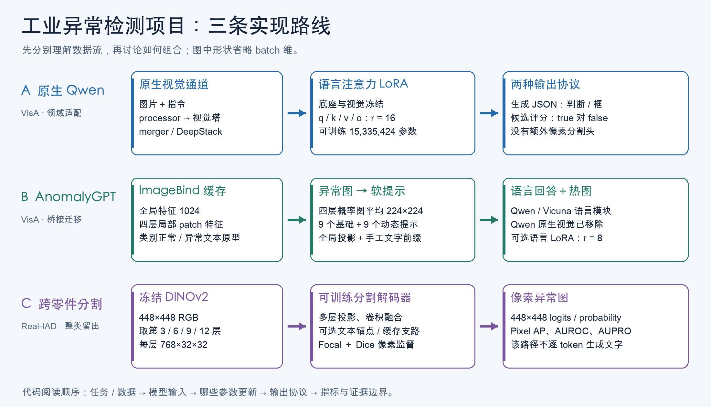

# 项目精读：从问题到代码、从样本到结论

> 阅读快照：2026-11-02；代码基线 `146748a`。本套材料按本地 `kelip-paper-reading-main/SKILL.md` 的六站方法组织。证据来自当前源码、冻结配置和已有实验文件；未重新训练、推理或连接服务器。新文档尚未提交到 GitHub。

## 先把项目说清楚

这是一个工业异常检测研究与领域适配项目：输入零件或产品图像，判断是否有异常，进一步定位异常。项目已经做过三类实现，它们的输入通道、监督方式和输出形式不同。

| 路线 | 输入 | 核心实现 | 输出 | 当前证据 |
|---|---|---|---|---|
| A：原生 Qwen3-VL QLoRA | 一张图＋统一指令 | 原生视觉塔＋语言模型；语言注意力 LoRA | JSON 判断，或判断＋一个外接框；另有候选答案连续评分 | 同域开发验证 120 图，DD AUROC 94.56% |
| B：AnomalyGPT 语言迁移 | ImageBind 特征＋问题 | 局部特征→异常图→软提示→Qwen/Vicuna | 224×224 异常图＋语言回答 | 2,005 图诊断，三种子 LoRA 未显示稳定收益 |
| C：跨零件分割 | 一张图，可选文本锚点/缓存视觉特征 | 冻结 DINOv2＋分割解码器及对照分支 | 448×448 像素异常图 | 按零件组划分，四折未见类别评估 |

图从左向右读。三行共用“检查异常”的任务，但中间表示和右侧输出不同。学习时先分别理解，再讨论能否组合。旧设计文档中的 DINOv3 等模块属于方案，不代表已经进入原生 Qwen 的生产调用链。

## 六站学习地图

| 顺序 | 阅读章节 | 学完能回答的问题 |
|---|---|---|
| ① 动机＋② 架构 | [01：概念与架构](01_概念基础与三条架构.md) | 图像、token、attention、视觉语言对齐是什么？三条路线为什么存在？ |
| ③ 训练＋④ 数据＋⑤ 信息流＋⑥ 例子 | [02：原生 Qwen](02_原生Qwen_数据训练与推理.md) | 一条样本怎么生成？LoRA 改哪？CE 监督什么？一张图如何生成 JSON？ |
| 同样六站 | [03：AnomalyGPT](03_AnomalyGPT_视觉语言桥接.md) | 热图如何变成软提示？桥接为什么不等于替换整个 VLM？ |
| 同样六站 | [04：跨零件分割](04_跨零件分割与历史探索.md) | DINO patch、解码器、Focal/Dice、文本锚点如何工作？ |
| ⑦ 实验＋研究判断 | [05：评测与研究](05_评测_实验证据与研究建议.md) | 94.56% 究竟是什么？哪些结论成立？下一步如何设计实验？ |
| 按函数查代码 | [06：代码索引](06_逐函数代码索引.md) | 每个脚本负责什么，概念落在哪个函数？ |
| 复习与练习 | [07：术语及自测](07_术语速查与学习练习.md) | 能否自己解释、手算，并找到代码？ |

用户要求完整梳理，因此这里把各站一起整理。实际学习建议一次读一站；不用先记住所有术语。

## 本套文档的证据约定

- **代码事实**：直接从函数、默认参数、配置和调用链得到。例如 LoRA 精确匹配语言层路径。
- **实验记录**：来自现有 JSON/JSONL，不代表本次重新跑了模型。例如 DD 192 次更新、AUROC 94.56%。
- **教学示意**：为了手算而缩小的矩阵、概率和划痕坐标，明确标注“示意”。
- **研究建议**：未来可以做的实验，不能读成已经完成的工作。

文中的代码链接采用“仓库相对路径＋`#L行号`”，便于 GitHub 查看。行号以本次读取的源码为准，后续改代码可能移动；函数名是第二个定位依据。冻结运行时快照用于追溯历史，不建议同时修改多份相同源码。

## 先记住这十句话

1. 工业异常检测至少包含图像判断、区域定位、像素分割三个不同层级。
2. VLM 是“能联合处理视觉与语言的模型”；一个目录名字带 Qwen，不代表使用了 Qwen 的原生视觉塔。
3. 预训练底座已经学过通用知识；本项目主要做领域后训练和控制实验。
4. LoRA 训练的是低秩增量矩阵，底座权重通常冻结。
5. QLoRA 同时使用量化底座与 LoRA；量化本身并不自动产生领域学习。
6. `answer` 是训练目标和评估真值，部署推理只需要图片与指令。
7. JSON 里的框是坐标文本；模型没有因此自动增加一个像素分割头。
8. AUROC 衡量异常分数排序；94.56% 不是“120 张里判对了 94.56%”。
9. 相同图片和步数不等于相同 token、损失权重或计算量。
10. 热图改变语言分数，和热图让语言判断更正确，是两种不同证据。

## 文件夹怎么读

| 目录 | 你应该把它当什么 |
|---|---|
| `industrial_vlm/src/industrial_vlm/` | 原生 Qwen 当前主要源码 |
| `industrial_vlm/configs/multitask_v2/` | 第二轮 RR/DD/RD 实验配置 |
| `industrial_vlm/runs/.../*.json` | 当时训练预算、参数和重载证据；非完整模型 |
| `industrial_vlm/evaluations/` | 逐图预测、分数和评估配置 |
| `industrial_vlm/reports/` | 面向阅读的报告与图 |
| `industrial_vlm/experiments/multitask_v2/*runtime_src/` | 训练/评分时冻结的源码身份 |
| `AnomalyGPT/followup_20261026/` | 迁移实验脚本 |
| `AnomalyGPT/followup_20261026/server_snapshot/code/` | 迁移依赖的 AnomalyGPT 实现及修改 |
| `AnomalyGPT/followup_20261026/final_results/` | 迁移结果；同目录其他阶段快照保留历史时点 |
| `seg_cross_part/` | 较早跨零件分割、语言锚点、融合和对齐探索 |
| `docs/` | 当前文档、历史实验台账和阅读核对 |
| `*/code/`、`*/paper.tex` | 本地上游论文代码和论文材料，不等于项目主线 |

不需要从所有上游仓库的第一行读起。先完成本套六站，再沿代码索引按问题深入。
