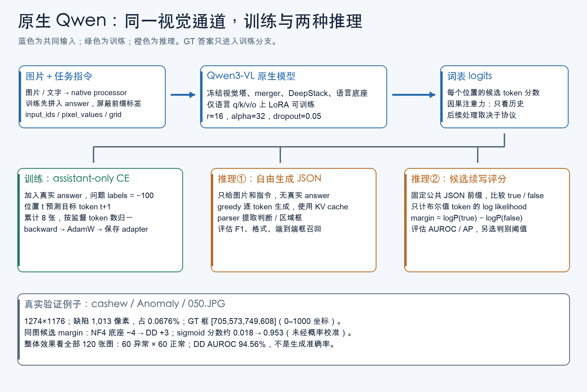

# 原生 Qwen：③训练、④数据、⑤信息流、⑥实例走读

## 1. 本路线验证什么

输入一张完整工业产品图和短指令，让 Qwen3-VL-8B-Instruct 生成异常判断，或判断加一个包住全部缺陷的框。保留预训练视觉路径，使用少量领域数据微调语言层，比较只学判断、只学区域、混合任务。

本路线没有独立 mask decoder。框坐标是语言模型预测的文本 token，训练仍是 token 交叉熵，未额外计算预测框的可微 IoU 损失。

入口：[train.py · main](../../industrial_vlm/src/industrial_vlm/train.py#L202)；[infer.py · main](../../industrial_vlm/src/industrial_vlm/infer.py#L12)。

## 2. 第④站：先看一条真实数据

以下来自已有 VisA 清单，未重新打开图片或运行模型。

| 字段 | 实际记录 | 含义 |
|---|---|---|
| image_relative | cashew/Data/Images/Anomaly/050.JPG | 腰果异常图片 |
| width, height | 1274, 1176 | 原始像素宽、高 |
| category | cashew | 产品类别，不是正常/异常标签 |
| is_anomalous | true | 图像级异常真值 |
| mask_values | [0,8] | 0 背景，8 是缺陷索引；前景判断为 >0 |
| mask_area_pixels | 1013 | 真正标为缺陷的像素数 |
| mask_area_fraction | 0.0006761339，约 0.0676% | 缺陷占全图面积 |
| boxes | [[705,573,749,608]] | 缩放到 0–1000 的全图外接框 |
| official_split | test | 原官方 CSV 划分 |
| 本项目 split | val | 定制有监督协议中的验证来源 |

最后两行说明为什么本结果不能标成官方 normal-only 基准。此图只用于本章验证案例，不能因此拿去训练。

完整教学证据：[真实样本与评分证据.json](真实样本与评分证据.json)。

### 2.1 mask 到框

`_mask_info()` 保留 VisA 的调色板索引，将正索引视为异常，寻找覆盖全部异常像素的最小外接矩形。

```text
原像素框：(x1,y1,x2,y2)，右/下边界为 exclusive
归一化左/上：floor(像素边界 × 1000 / 对应宽或高)
归一化右/下：ceil(像素边界 × 1000 / 对应宽或高)
```

**示意**：1000×500 图片中，像素框 [100,100,300,200] 变为 [100,200,300,400]。下界向下、上界向上取整，让单像素缺陷仍有正宽高。

若两块缺陷相距很远，当前任务仍提供一个大外接框，没有两个实例标签。因此不是实例检测 mAP 的评估对象。

代码：[data.py · _mask_info](../../industrial_vlm/src/industrial_vlm/data.py#L80)。

### 2.2 指令记录与模型实际收到什么

```json
{
  "source_id": "visa_02118dfc...",
  "image": ".../cashew/Data/Images/Anomaly/050.JPG",
  "category": "cashew",
  "is_anomalous": true,
  "boxes": [[705,573,749,608]],
  "prompt": "Inspect this industrial image for defects. Return JSON only: {\"is_anomalous\": true or false}.",
  "answer": "{\"is_anomalous\":true}"
}
```

ID/路径作了缩写。区域任务会在 prompt 和 answer 中加入框要求。

- source_id 标记原图；同图的判断、区域任务共享它。
- id 标记具体任务/曝光；第二轮含 arm、epoch、task 后缀。
- answer 是 JSON **字符串**，作为语言监督，不是直接输入模型的布尔张量。
- boxes、category、is_anomalous 是真值元数据，推理只传图片和 prompt。

代码：[data.py · instruction](../../industrial_vlm/src/industrial_vlm/data.py#L327)；[prepare_multitask_v2.py · _instruction](../../industrial_vlm/ops/prepare_multitask_v2.py#L79)；[train.py · _read_rows](../../industrial_vlm/src/industrial_vlm/train.py#L107)。

### 2.3 去重、划分与监督边界

```text
官方 CSV
 → 图片/mask 可读性、尺寸、标签、EXIF 检查
 → 原图 SHA256，精确重复归组
 → 冲突标注拒收；一致重复保留 canonical 来源
 → 按 (产品类别,正常/异常) 分层
 → 70%/15%/15% 训练、验证、测试
 → 训练来源构建 SFT；holdout 来源构建评估题
```

实际接受 10,821 张来源：训练 7,575、验证 1,624、测试 1,622。训练预算选其中 768 张，主验证为 120 张均衡子集，不能把 120 说成完整验证集规模。

**SHA256** 是内容指纹；精确重复可以隔离。它不能识别重压缩图片，也不能证明不同角度不属于同一物理零件。

**分层抽样**：12 产品×2 标签共 24 个层，尽量均衡分配名额，容量不足时重新分配。第一轮 quality 是异常面积分位覆盖，不是“标注更干净”；random 组也使用有效真值。

**EXIF**：数据准备拒绝非平凡旋转/翻转；make_inputs 使用 exif_transpose。对接受的 orientation=1 图片保持一致；任意新上传旋转图需特别核对坐标方向。

代码：[data.py · _validate_record](../../industrial_vlm/src/industrial_vlm/data.py#L128)；[data.py · _deduplicate](../../industrial_vlm/src/industrial_vlm/data.py#L157)；[data.py · split_records](../../industrial_vlm/src/industrial_vlm/data.py#L224)；[data.py · training_subsets](../../industrial_vlm/src/industrial_vlm/data.py#L264)。

## 3. 底座加载：NF4、BF16、FP32、QLoRA

| 名称 | 用途 | 本项目位置 |
|---|---|---|
| NF4 | 16 个非均匀量化级别近似权重，压缩存储 | 语言 Linear 的冻结权重 |
| double quantization | 对比例等量化元数据进一步压缩 | bnb_4bit_use_double_quant=True |
| BF16 | 16 位浮点，动态范围较大，精度有限 | 计算 dtype；视觉等模块保留 BF16 |
| FP32 | 32 位浮点，存储/计算增量与统计 | 实际 LoRA A/B 审计为 FP32；logits 常转 float |
| QLoRA | 量化冻结底座＋LoRA 训练 | 加载和微调策略的组合 |

**示意**：原权重 0.123 存到邻近量化级别，计算时恢复近似值。真实 NF4 有分块比例，不能理解为统一四舍五入到 0.1。“4-bit”不代表激活、梯度、优化器和所有模块都是 4 位。

loader 先在 meta device 创建空架构，只保留形状而不分配完整权重，然后精确枚举：

```text
...language_model.layers.<层号>.self_attn.(q_proj|k_proj|v_proj|o_proj)
```

36 层×4=144 个模块。避免全局匹配 q_proj 时误选视觉层；加载后还审计所有 Linear4bit 属于语言模块、所有可训练参数属于语言 LoRA。

代码：[modeling.py · load_model](../../industrial_vlm/src/industrial_vlm/modeling.py#L75)；[modeling.py · audit_trainable_parameters](../../industrial_vlm/src/industrial_vlm/modeling.py#L44)。

## 4. 第③站：LoRA 改了什么

### 4.1 公式与小例子

```text
W_eff = W0 + (α/r)BA
y = W0x + (α/r)B(Ax)
A:[r,d_in]，B:[d_out,r]
```

W0 是冻结原矩阵，A 压到 r 维，B 映回输出，α/r 为缩放。

**示意**：W0 为 4×4 单位矩阵，r=α=1，A=[1,0,0,0]，B=[0,2,0,0]ᵀ，x=[3,4,0,0]ᵀ。

```text
W0x=[3,4,0,0]；Ax=[3]；BAx=[0,6,0,0]
y=[3,10,0,0]
```

8 个增量参数改变一个 16 参数映射。真实秩 r=16。

### 4.2 参数账

单个 Linear 的 LoRA 参数数为 r×(d_in+d_out)，不训练 bias。

| 投影 | 原矩阵 [out,in] | A | B | 一层增量参数 |
|---|---|---|---|---:|
| q | [4096,4096] | [16,4096] | [4096,16] | 131,072 |
| k | [1024,4096] | [16,4096] | [1024,16] | 81,920 |
| v | [1024,4096] | [16,4096] | [1024,16] | 81,920 |
| o | [4096,4096] | [16,4096] | [4096,16] | 131,072 |
| 一层合计 | | | | 425,984 |
| 36 层合计 | | | | **15,335,424** |

共 288 个 A/B 张量。α=32、r=16，缩放为 2；dropout=0.05 作用于 LoRA 支路。k/v 比 q 小与 GQA 结构有关。

证据：[DD 参数审计](../../industrial_vlm/runs/multitask_v2/decision_decision/parameter_audit.json)、[配置](../../industrial_vlm/configs/multitask_v2/decision_decision.json)。

### 4.3 首步 A 梯度为零不代表失败

常见初始化 A 随机、B=0，使初始 BA=0。A 梯度含 B，所以首步可能为零；B 可以有非零梯度。已有审计确认首步 144 个 B 获得非零梯度，保存后的 B 非零。requires_grad=True、实际梯度、实际权重更新和重载是不同证据层级。

代码：[train.py · main](../../industrial_vlm/src/industrial_vlm/train.py#L202) 中 gradient_audit。

## 5. assistant-only CE 学什么

### 5.1 chat template 与 -100

processor 把用户图片、指令和助手答案编码成统一序列。训练要求完整序列以 prompt 序列精确开头，图像 grid 相同。

```text
input_ids: [图像位置,用户指令,Assistant开始,{,is_anomalous,:,true,},结束]
labels:    [-100,   -100,   -100,        {,is_anomalous,:,true,},结束]
```

-100 表示该目标位置不计交叉熵，不是删除输入。视觉与问题仍可影响答案。

**实际首样本**：DD 正常 PCB 共 516 token、prefix 屏蔽 506、目标 10，监督文本为 `{"is_anomalous":false}<|im_end|>\n`；RR 同图为 572 token、目标 13、屏蔽 559。

代码：[modeling.py · make_inputs](../../industrial_vlm/src/industrial_vlm/modeling.py#L207)；[首样本审计](../../industrial_vlm/runs/multitask_v2/decision_decision/first_sample_audit.json)。

### 5.2 因果交叉熵与 teacher forcing

```text
L = −(1/N) Σ_t log Pθ(y_t | 图片,指令,y_<t)
```

N 为未屏蔽目标 token 数。训练给正确历史答案，预测下一个 token，叫 teacher forcing。

**示意**：三个正确 token 概率 0.8、0.5、0.25，损失约 0.223、0.693、1.386，平均 0.768。

logits 是词表未归一化分数；softmax 变概率，log_softmax 算对数概率。位置 t 的 logits 预测位置 t+1，因此需要 causal shift。原生模型内部处理，迁移代码显式写出。

output.loss 包括助手完整 JSON 和结束标记，不只 true/false。推理时用自己生成的历史 token，和 teacher forcing 条件不同。

代码：[train.py · _validate](../../industrial_vlm/src/industrial_vlm/train.py#L176)；[train_qwen_matched.py · QwenCachedModel._forward_lm](../../AnomalyGPT/followup_20261026/train_qwen_matched.py#L115)。

### 5.3 梯度累计、AdamW、裁剪与学习率

每 microbatch=1，累计 8 张再更新。回答长度不同，代码先累计 token 损失和，最后按总监督 token 归一化：

```python
(loss * n_targets).backward()
# 处理完一个累计窗口后
parameter.grad.div_(target_tokens)
```

**示意**：10 token 平均损失 1，30 token 平均损失 3，按样本平均为 2，按 token 平均为 (10×1+30×3)/40=2.5；这里用后者。

梯度表示损失对参数变化的局部方向；backward 累积它，optimizer.step 真正改参数。AdamW 使用一/二阶梯度统计，weight decay 为权重衰减；第二轮配置继承默认 weight_decay=0。

梯度裁剪把过大范数整体缩小：示意 [3,4] 范数 5，裁到 1 后为 [0.6,0.8]。warmup 前 10 更新逐步提高学习率，随后线性衰减。1e-4 是更新尺度，不是准确率增长速度。

代码：[train.py · main](../../industrial_vlm/src/industrial_vlm/train.py#L202)。

### 5.4 两种 cache 别混淆

gradient checkpointing：训练少存激活，反向重算，省显存、多计算。本项目在语言模块开启 non-reentrant checkpointing。

enable_input_require_grads：让 embedding 输出参与梯度链，不是解冻 embedding 矩阵。

KV cache：推理保存已有序列的 key/value，加速后续 token 生成。训练 use_cache=False，推理 generate 使用 True。

代码：[modeling.py · load_model](../../industrial_vlm/src/industrial_vlm/modeling.py#L75)；[infer.py · main](../../industrial_vlm/src/industrial_vlm/infer.py#L12)。

## 6. RR/DD/RD 到底控制了什么

| arm | 每来源两次任务 | 来源 | 曝光 | 更新 | 监督 token |
|---|---|---:|---:|---:|---:|
| RR | region/region | 768 | 1,536 | 192 | 33,012 |
| DD | decision/decision | 768 | 1,536 | 192 | 15,360 |
| RD | 两任务各一次，顺序分层均衡 | 768 | 1,536 | 192 | 24,186 |

768×2/8=192。清单已经展开两遍来源，训练器内部 epoch 计数不一定等于原始来源覆盖次数，应看 source_epoch/exposure trace。

三组来源曝光顺序、LoRA 初始参数哈希一致。RD 不是一半图片永远只做区域、另一半永远只做判断。未控制 prompt 长度、token 预算和任务梯度难度，所以它测试固定来源曝光预算的任务分配，不能隔离等计算下框监督的纯因果效应。

代码：[prepare_multitask_v2.py · build_artifacts](../../industrial_vlm/ops/prepare_multitask_v2.py#L105)。

## 7. 第⑤站：真实张量信息流



训练分支需要 answer；两种推理分支只接图片和指令。

实际首样本：

```text
input_ids/attention_mask/labels: [1,516]
pixel_values: [1900,1536]
image_grid_thw: [1,3]
```

pixel_values 是 processor 打包后的 patch 表，不是 1900×1536 分辨率。常见该模型配置下，1536 可解释为 3通道×2时间patch×16×16，但具体须核对 vision_config。

image_grid_thw 的 [1,3] 是张量形状，不是网格数值。该审计没有记录三个实际值，不能凭空补出具体格子。max_pixels=524288 是面积预算，不是固定512×512或token数。

代码：[modeling.py · make_inputs](../../industrial_vlm/src/industrial_vlm/modeling.py#L207)。

## 8. 第⑥站 A：生成式判断

用腰果验证图说明调用顺序，本次不重新推理。

1. infer.main 选 decision prompt，不读标签或 mask。
2. load_model 加载量化底座及 DD adapter，冻结参数、eval。
3. make_inputs 构造原生输入，不含目标 labels。
4. generate(do_sample=False,num_beams=1,use_cache=True) 做 greedy 解码。
5. 每步取当前概率最大 token，接回历史再生成下一步。
6. 截掉 prompt，只 decode 新 token，调用 JSON parser。
7. 合法输出成为离散判断，非法 JSON 记录失败。

**玩具两步示意**：第一步选出“{”，第二步基于已有“{”继续预测字段相关 token。真实 tokenizer 不保证恰好按单词/字符切分，因此不能由这个示意推断真实 token 数。

greedy 不保证正确，也不保证跨平台每次逐位一致。格式正确率和异常判断正确率是两项指标。

代码：[infer.py · main](../../industrial_vlm/src/industrial_vlm/infer.py#L12)；[metrics.py · parse_prediction](../../industrial_vlm/src/industrial_vlm/metrics.py#L45)。

## 9. 第⑥站 B：同图连续评分

固定两个候选：

```jsonl
{"is_anomalous":true}
{"is_anomalous":false}
```

两次都条件于同一图片、问题和公共 JSON 前缀，只累计布尔值 token 对数似然，公共前缀、闭合括号和结束标记不计入。

真实 DD：true ID=1866、false ID=3849，该版本恰好各一个 token。代码支持多 token，并用 offset 验证边界。

```text
logP(true) = −0.0487165451
logP(false)= −3.0487165451
margin = 3
二选一分数 = sigmoid(3) = 0.952574
```

同图底座 margin=−4，RR=−0.5，RD≈1.625。例子说明候选倾向改变；整体效果必须看全部样本。

_score_image 没有 label 参数，两个候选均计算，所以不是把真值喂给推理器。序列中放入候选 token 进行似然计算，也不会让先前因果位置偷看未来。

0.952574 是候选归一化相对似然，没有概率校准，不能说成真实异常概率；也与整批 AP=95.26% 无关。

代码：[score.py · candidate_plan](../../industrial_vlm/src/industrial_vlm/score.py#L78)；[score.py · _score_image](../../industrial_vlm/src/industrial_vlm/score.py#L226)；[score.py · normalized_score](../../industrial_vlm/src/industrial_vlm/score.py#L31)。

## 10. 保存、重载与身份

adapter 保存增量，加载仍需同一底座。当前未保存 optimizer/scheduler 状态，所以初始化自 adapter 不等于精确恢复训练。

记录用 fresh base+adapter 比较第一样本 prompt 最后 token 的 logits，最大差值为 0。这验证一个受检输入/接口，不代表任意输入与平台的完整轨迹等价。

哈希清单记录模型、源码、图片和配置身份；评分 resume 拒绝条件不一致的旧文件，避免混入不同模型的结果。

代码：[train.py · _save](../../industrial_vlm/src/industrial_vlm/train.py#L163)；[train.py · _last_logits](../../industrial_vlm/src/industrial_vlm/train.py#L194)；[score.py · _run](../../industrial_vlm/src/industrial_vlm/score.py#L328)。
