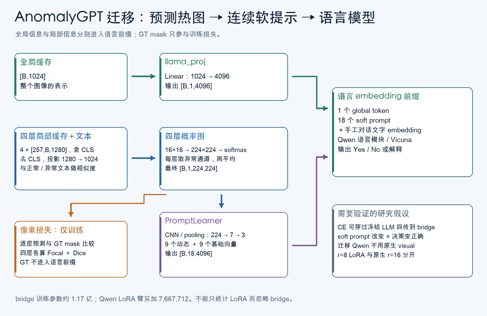

# AnomalyGPT：异常图如何变成语言模型的输入

> 本章讲迁移实验路线 B；与原生 Qwen QLoRA 分开。依据当前迁移脚本、运行时快照和已有结果，不重新运行模型。

## ① 动机：为什么先做热图再让语言模型回答

通用 VLM 可能认出“这是一颗腰果”，却忽略只占很少像素的缺口。AnomalyGPT 的思路是增加专门的局部异常通道：先把局部视觉特征与正常/异常文本特征比较，得到异常图，再把异常图编码为语言模型可用的向量。

**教学例子**：224×224 图里只有一个 5×5 缺口。整图表示可能主要反映腰果的形状、颜色；局部图把“哪里可疑”保留下来。随后语言模型同时收到全局视觉信息、异常图提示和问题。这个设计提供额外信息通道，是否真正改善回答仍需实验。

本项目研究的是：保留相同 ImageBind 特征、异常解码器和 PromptLearner，把语言端换成冻结 Qwen、Qwen LoRA 或冻结 Vicuna，比较迁移是否有效。它是小预算迁移实验，不是从头复现论文全部训练。

## ② 架构：两条视觉支路在语言模型前汇合



图的上半部分把全局特征投影为一个视觉 token，下半部分把四层局部特征变为异常图，再生成软提示。右边语言模型接收二者和文字问题；GT 掩码只进入训练损失。

```text
缓存 global [B,1024] → Linear → [B,1,4096] ───────────────┐
缓存 4×patch [257,B,1280]                               │
 → 去 CLS → 4×[B,256,1280] → 四个 Linear                 │
 → 4×[B,256,1024] → 与 text [B,2,1024] 匹配              │
 → 4×[B,2,16,16] → 上采样、softmax                      │
 → 四层异常概率图平均 [B,1,224,224]                     │
 → PromptLearner → [B,18,4096] ─────────────────────────┤
问题 token → embedding ────────────────────────────────┤
                          拼成 embedding 序列 → LLM → 回答
```

257 是该缓存路径的 1 个 CLS 加 256 个 patch，不是所有视觉模型通用的 token 数。`LinearLayer` 的三维输入按 token-first 约定转置，再丢掉 CLS。`collate` 因而沿 dim=1 拼 batch，不能误用 dim=0 把序列长度拼长。

代码：[train_vicuna_matched.py · collate](../../AnomalyGPT/followup_20261026/train_vicuna_matched.py#L357)；[AnomalyGPT_models.py · LinearLayer.forward](../../AnomalyGPT/followup_20261026/server_snapshot/code/model/AnomalyGPT_models.py#L22)。

### 全局、局部和文本特征各是什么

- **全局特征**：整个图像的 1024 维表示，提供整体内容。
- **局部特征**：四层每个 patch 的 1280 维表示，保留 16×16 空间位置；不同层体现不同层次的视觉变换，但不能给每一层随意命名成“纹理层/缺陷层”。
- **文本原型**：正常、异常描述经文本编码得到的向量。本迁移协议使用类别相关原型；它们不同于每张图的答案和 GT。
- **缓存 cache**：把冻结编码器的输出存到文件，训练时重复读取。节省编码开销，但缓存必须记录模型、预处理、来源和标签约定，不能把另一种裁剪的缓存当作当前图片特征。

迁移训练类直接读取缓存，并不在每一步重新加载 ImageBind。缓存过期、顺序错误或源图隔离失效仍会使实验失真。

### 相似度、L2 归一化与温度

局部特征先投影到 1024 维，再按最后一维归一化。文本原型在缓存构建时应符合相同的归一化约定；前向直接使用缓存文本。

```text
z = patch / ‖patch‖₂
similarity = 100 × z · textᵀ
P(normal), P(anomaly) = softmax(similarity_normal, similarity_anomaly)
```

| 符号 | 作用 |
|---|---|
| ‖x‖₂ | 向量长度，例如 [3,4] 的长度是 5 |
| z | 单位向量 [0.6,0.8]，只比较方向 |
| 点积 | 单位向量间等于余弦相似度 |
| 100 | 放大相似度差，相当于温度 T=0.01 |
| softmax | 把两个匹配分数变成总和为 1 的数 |

**教学例子**：正常余弦 0.20、异常余弦 0.22，乘 100 后为 [20,22]，异常 softmax 约 0.881；不乘时只有约 0.505。因此该数受温度强烈影响，不能直接理解为真实缺陷概率已经校准。

每层先把双通道 logits 双线性插值到 224×224，再做 softmax。最后平均四层异常概率图。先平均 logits 再 softmax 是另一个运算，通常不等价。

代码：[train_vicuna_matched.py · VicunaCachedModel.forward_cached](../../AnomalyGPT/followup_20261026/train_vicuna_matched.py#L317)；评测对应 [evaluate_models.py · map_and_prefix](../../AnomalyGPT/followup_20261026/evaluate_models.py#L180)。

### PromptLearner：18 个向量从哪来

`PromptLearner` 的输入是 [B,1,224,224]。五次卷积＋ReLU＋2 倍最大池化后，空间尺寸变为：

```text
224 → 112 → 56 → 28 → 14 → 7
通道：1 → 4 → 16 → 64 → 256 → 1024
最后 5×5 valid 卷积：7 → 3，输出 [B,4096,3,3]
reshape / transpose → [B,9,4096]
与 base_prompts [B,9,4096] 拼接 → [B,18,4096]
```

**卷积**用同一组局部权重扫过整图；**ReLU** 把负值置零，加入非线性；**MaxPool** 把局部最大响应保留并降采样；**valid 卷积**没有 padding，边长按 7−5+1=3 计算。

动态的 9 个向量随预测热图变化；另外 9 个基础向量是可训练参数，所有图共用。实际拼接顺序是基础在前、动态在后。这里的“软提示”不是可以直接打印出来的 18 个汉字，而是 18×4096 个连续数，直接作为 embedding 输入。

代码：[AnomalyGPT_models.py · PromptLearner.__init__](../../AnomalyGPT/followup_20261026/server_snapshot/code/model/AnomalyGPT_models.py#L33)、[AnomalyGPT_models.py · PromptLearner.forward](../../AnomalyGPT/followup_20261026/server_snapshot/code/model/AnomalyGPT_models.py#L67)。

### 参数量：桥接本身并不小

| 模块 | 参数量 | 匹配训练中更新 |
|---|---:|---|
| 四层 image_decoder | 5,246,976 | 是 |
| PromptLearner | 107,416,504 | 是 |
| 全局 llama_proj | 4,198,400 | 是 |
| bridge 合计 | 116,861,880 | 是 |
| Qwen 语言 LoRA，r=8 | 7,667,712 | 仅 LoRA 臂 |
| bridge＋LoRA | 124,529,592 | LoRA 臂总计 |
| 量化语言底座 | 预训练主体 | 冻结 |

例如全局投影参数为 1024×4096+4096=4,198,400。PromptLearner 的最后一层卷积为 1024×4096×5×5+4096=104,861,696，占了大部分 bridge 参数。因此不能把整个实验说成“只训练了约 767 万参数”。

原生路线是 r=16、alpha=32、15,335,424 个 LoRA 参数；迁移路线是 r=8、alpha=16。二者的更新范围和总训练参数不同。

代码：[train_qwen_matched.py · main](../../AnomalyGPT/followup_20261026/train_qwen_matched.py#L157)；[train_qwen_matched.py · QwenCachedModel.__init__](../../AnomalyGPT/followup_20261026/train_qwen_matched.py#L39)。

## ③ 训练：同时约束回答与像素

```text
L_total = L_assistant_CE
        + pixel_weight × Σₗ₌₁⁴ [L_Focal(Pₗ, GT) + L_Dice(Pₗ,anomaly, GT)]
pixel_weight = 1
```

语言 CE 约束回答 token；Focal 约束像素分类并降低容易像素的权重；Dice 约束前景重叠。注意像素损失是四层各自计算后**求和**，而提示热图是四层平均。它们不是同一个聚合操作。

**教学数字**：CE=0.8，每层 Focal=0.1、Dice=0.3，则总损失为 0.8+4×0.4=2.4。若改成四层平均，变成 1.2，已经改变损失配比。损失数值下降还不等于图像级判断正确率提高。

这份 Focal 实现默认 gamma=2、alpha 为全 1，并有 1e−5 平滑；Dice 对每张图计算，smooth=1，然后在 batch 中平均。分割路线的 Focal/Dice 则为 0.5/0.5、全 batch 聚合、eps=1e−6，不能因同名就当作相同实现。

代码：[loss.py · FocalLoss.forward](../../AnomalyGPT/followup_20261026/server_snapshot/code/utils/loss.py#L34)；[loss.py · BinaryDiceLoss.forward](../../AnomalyGPT/followup_20261026/server_snapshot/code/utils/loss.py#L103)。

### 冻结语言模型，梯度怎么回到热图

```text
CE → 语言模型运算 → 软提示 → PromptLearner → 异常图 → image_decoder
                 └→ 全局视觉 token → llama_proj
像素损失 ───────────────────────────────────────→ image_decoder
```

冻结参数意味着这些权重不更新，不意味着切断对输入的梯度。若在语言模型整段前向外加 `no_grad()`，CE 就无法教 PromptLearner 应该怎样输出。当前训练前向保留这条梯度链。

LoRA 臂额外训练语言层 q/k/v/o 上的低秩增量。AdamW 使用 lr=1e−3、betas=(0.9,0.95)、weight_decay=0.001；这些属于该迁移配置，不能套到原生 lr=1e−4 的实验上。

### 手工对话格式与位置

迁移版本使用旧式 `### Assistant:` 对话，而非原生 Qwen chat template：

```text
BOS 或 EOS fallback
＋ PROMPT_START 文本 embedding
＋ 1 个 global 视觉 token
＋ </Img> 文本 embedding
＋ 18 个 soft prompt
＋ question / ### Assistant:
＋ 训练时的 answer / 换行###
```

前缀和问题 labels=-100，只有 assistant 目标参与 CE。`process_batch_instance` 中名为 `max_tgt_len` 的上限实际裁剪**手工文字序列整体**，并非只限制答案 token；软提示等额外前缀在后面拼接。匹配实验把该上限设为 128，并审计已调度文本没有截断。

代码没有在训练答案尾部额外插入 tokenizer 的真实 EOS，而是监督 `\n###`；生成端要同时处理 EOS 与分隔符停止条件。这与原生 Qwen 的 `<|im_end|>` 不同。

Qwen 桥接用 [3,B,S] 的三轴 position_ids，三轴填相同顺序位置。这是为手工 embedding 序列提供位置；没有恢复 Qwen 原生图片 grid、多尺度视觉注入或完整图像位置处理。

代码：[train_vicuna_matched.py · build_one_instance](../../AnomalyGPT/followup_20261026/train_vicuna_matched.py#L97)；[train_vicuna_matched.py · process_batch_instance](../../AnomalyGPT/followup_20261026/train_vicuna_matched.py#L121)；[train_qwen_matched.py · QwenCachedModel.prompt_wrap](../../AnomalyGPT/followup_20261026/train_qwen_matched.py#L87)；[train_qwen_matched.py · QwenCachedModel._forward_lm](../../AnomalyGPT/followup_20261026/train_qwen_matched.py#L115)。

## ④ 数据：一条缓存样本要包含什么

| 字段 | 批处理形状 / 内容 | 用途 |
|---|---|---|
| global_features | [B,1024] | 全局视觉 token |
| patch_features | 四个 [257,B,1280] | 局部异常检测 |
| text_features | [B,2,1024] | 正常/异常原型 |
| masks | 224×224 空间掩码，批维按缓存整理 | 像素监督，前向 >0.3 二值化 |
| texts | 人类问题、assistant 答案的对话列表 | 文本 CE |
| class_names / source 标识 | 类别与原图身份 | 审计、分组、隔离 |

**教学样本**：一张 synthetic 腰果变体的缓存包含全局特征、四层 patch、类别文本原型、合成 mask，以及“是否异常”的问答。GT 决定损失，模型前缀来自预测 map，二者应区分。合成过程可能没有留下有效前景，所以“名义异常 variant 数”和“正 mask 数”需分别记录。

匹配训练缓存有 48 个来源、96 个 variant；每个种子每臂 16 步×batch2=32 次 variant 曝光，**没有把 96 个全用完**。seed42/43/44 分别涉及 27/28/25 个源图。三臂同种子共享 bridge 初值、缓存、显式 schedule，并在模型构建和审计后重置随机状态。

真实诊断使用 2,005 图：925 正常、1,080 异常、12 类，来自官方 VisA test 来源。全图缩放到 224²、无正常参考分支。它已被多次查看，用于开发诊断，不能继续叫完全未查看的最终测试集。

证据：[最终结论](../strict_qwen_followup_20261026/最终实验结论.md)。

## ⑤ 信息流与⑥例子：一张图怎样得到两个输出

以下数值为**教学示意**，不冒充某条真实缓存：

1. 缓存送入 batch：B=1，global 为 [1,1024]，四个局部序列为 [257,1,1280]。
2. 四层投影并与文本匹配。在缺口格子，某层 normal/anomaly logits=[20,22]，异常概率约 0.881。
3. 插值到 224²。若四层某像素概率为 [0.88,0.80,0.76,0.84]，平均为 0.82；最终异常图仍有完整空间位置。
4. PromptLearner 把整张图压成 9 个动态向量，与 9 个基础向量拼接；这些向量不能反向逐个解释成一个确定的缺陷坐标。
5. 全局投影生成 1 个向量。把它、18 个软提示和文字拼接，语言模型输出词表 logits。
6. 第一次生成选择 `Yes`，把它加入历史；第二次根据已有前缀和 `Yes` 继续生成逗号或解释。评测使用 KV cache 避免每次重算全部历史。
7. 生成文本通过以 Yes/No 开头的解析器得到类别；无法解析记为 invalid。连续候选分数则比较候选续写的 log likelihood，两者输出协议不同。

因此一次前向提供两个可评对象：像素异常图、语言回答。语言回答对了不保证热图定位对；热图不错也不保证语言模型利用了它。

代码：[evaluate_models.py · decode_prediction](../../AnomalyGPT/followup_20261026/evaluate_models.py#L170)；[evaluate_models.py · language_predictions](../../AnomalyGPT/followup_20261026/evaluate_models.py#L278)。候选 token 边界有专门审计，不能直接把首字母概率当完整答案概率。


### 对照真实前向的五行核心代码

下列为`forward_cached`中的原句，省略设备搬运和其他步骤：

```python
token = token / token.norm(dim=-1, keepdim=True)
similarity = 100.0 * (token @ text.transpose(-2, -1))
maps.append(probabilities[:, 1])
anomaly = torch.stack(maps).mean(0).unsqueeze(1)
soft = self.prompt_learner(anomaly)
```

第一行只保留局部向量方向；第二行和两个文本原型匹配。第三行收集各层异常通道；第四行把“层”这个新增轴平均掉，并补回单通道轴。第五行才把最终预测图编码成软提示。`probabilities`在第二、三行之间由reshape、插值、softmax产生，不能省掉这些真实步骤实现自己的复现。


## ⑦ 现有实验：模块连通，收益尚不稳定

单位为 %，均值±样本标准差，三个训练随机种子：

| 匹配臂 | 生成 Macro F1 | Pixel AP |
|---|---:|---:|
| 冻结 Qwen＋可训练 bridge | 40.63±8.02 | 18.90±0.29 |
| Qwen LoRA＋可训练 bridge | 40.52±12.26 | 18.89±0.60 |
| 冻结 Vicuna＋可训练 bridge | 35.14±2.29 | 19.04±0.65 |
| 发布 decoder 初始化 | — | 20.99 |

LoRA seed42 在 2,005 图中 2,001 次回答 No；seed43 全部 Yes。不能只挑 seed44 的 54.56% 来宣布 LoRA 稳定有效。

### 为什么还做 map swap

只交换同类、相反标签来源的**预测热图**，固定自己的 global 和问题，可以检查热图通道是否影响语言端。`SwapPromptLearner` 接收 donor map，GT 不进入 prefix。

48 张 seed42 诊断中，LoRA 的候选 log odds 绝对变化均值 0.6745，但候选标签和有效 Yes/No 均为 0 次翻转。原 margin 全在 −9.75 至 −1.875，分数变了仍可能没有跨过 0。

**教学例子**：margin 从 −4 变为 −3.3，变化 0.7，但类别仍为 No。由此可以说通道影响了分数，不能说决策更准确；也不能说语言模型完全忽略热图。

代码：[prompt_map_ablation.py · SwapPromptLearner](../../AnomalyGPT/followup_20261026/prompt_map_ablation.py#L190)；[诊断与控制证据](../strict_qwen_followup_20261026/最终实验结论.md)。

下一轮最小实验应固定冻结 Qwen，单独比较 decoder 冻结/更新，其余 bridge、schedule、三种子和损失保持一致。先判断联合训练是否损害已有定位，再考虑扩大数据。这里只提出研究设计，没有启动新增训练。
