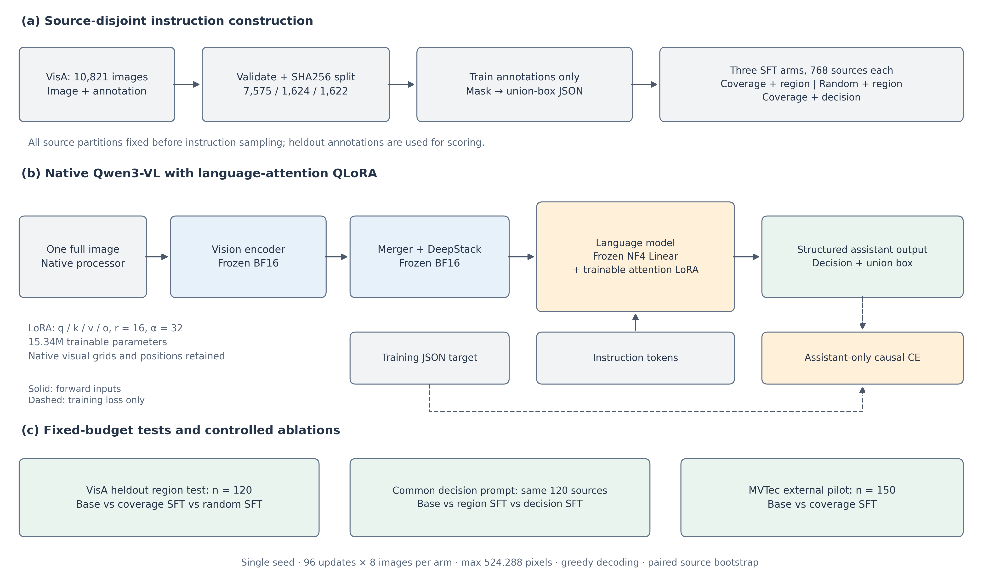
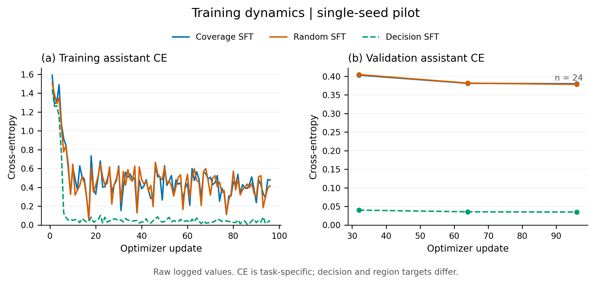
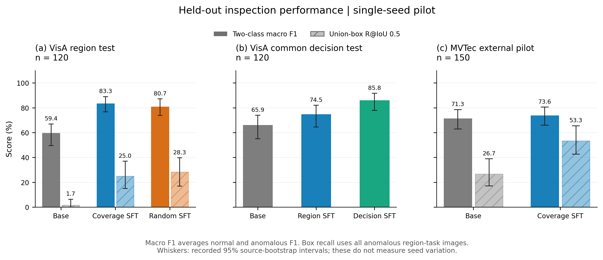
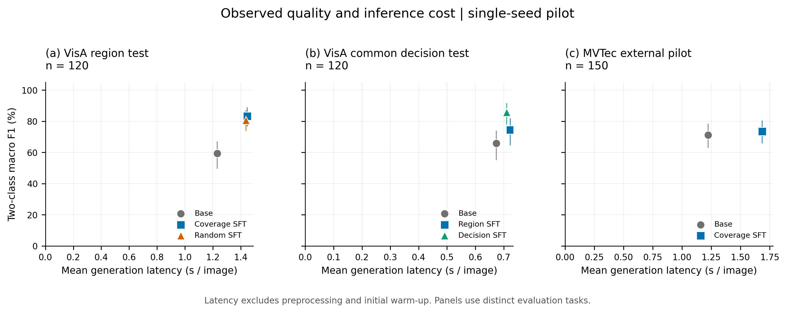

# 工业异常检测 VLM 领域后训练：实验报告

生成时间：2026-10-23T11:31:35.756401+00:00。本报告读取已完成的 9 项评估、3 组训练、数据审计、配对差值与完成验证产物；不补齐缺失指标。

## 实测结论

- **域内区域 SFT 相对底座**：二类 macro F1 从 59.43% 到 83.26%，差值 +23.83 pp，95% CI [+13.78, +34.27] pp；点估计上升；区间支持本次 pilot 上的正向差异。 Union-box R@0.5 差值 +23.33 pp，95% CI [+12.00, +35.09] pp；点估计上升；区间支持本次 pilot 上的正向差异。 误报/漏报差值：FPR +8.33 pp（95% CI [+0.00, +17.46] pp），FNR -46.67 pp（95% CI [-60.94, -32.20] pp）；两项均以负值为改善。
- **面积覆盖采样相对随机采样**：二类 macro F1 从 80.72% 到 83.26%，差值 +2.53 pp，95% CI [-1.64, +6.70] pp；点估计上升；95% 区间覆盖 0，本次 pilot 未确定差异方向。 Union-box R@0.5 差值 -3.33 pp，95% CI [-10.21, +3.12] pp；点估计下降；95% 区间覆盖 0，本次 pilot 未确定差异方向。 误报/漏报差值：FPR -1.67 pp（95% CI [-8.48, +5.88] pp），FNR -3.33 pp（95% CI [-8.62, +0.00] pp）；两项均以负值为改善。
- **区域训练相对判断训练（共同判断提示）**：二类 macro F1 从 85.81% 到 74.54%，差值 -11.26 pp，95% CI [-19.29, -3.36] pp；点估计下降；区间支持本次 pilot 上的不利差异。 误报/漏报差值：FPR -8.33 pp（95% CI [-16.39, +0.00] pp），FNR +28.33 pp（95% CI [+17.46, +40.30] pp）；两项均以负值为改善。
- **外部 MVTec 区域迁移**：二类 macro F1 从 71.28% 到 73.58%，差值 +2.30 pp，95% CI [-6.62, +11.10] pp；点估计上升；95% 区间覆盖 0，本次 pilot 未确定差异方向。 Union-box R@0.5 差值 +26.67 pp，95% CI [+12.79, +40.01] pp；点估计上升；区间支持本次 pilot 上的正向差异。 误报/漏报差值：FPR +33.33 pp（95% CI [+22.78, +44.19] pp），FNR -36.00 pp（95% CI [-47.44, -24.71] pp）；两项均以负值为改善。

上述差异均以左侧方法减右侧方法计算。正向区间仅支持这轮已训练模型在固定 pilot 上的对比，不能外推为跨随机种子、跨场景的稳定优势或 SOTA。

## 部署、环境与模型实现

实验使用单张 **NVIDIA GeForce RTX 4090 D**，显存 23.55 GiB；Python 3.12.3，CUDA 12.4，驱动 560.35.03，BF16 支持状态为 `True`。

| 组件 | 实际版本 |
|---|---|
| torch | 2.5.1 |
| transformers | 5.14.1 |
| peft | 0.21.2 |
| accelerate | 1.14.0 |
| bitsandbytes | 0.48.2 |
| Pillow | 10.4.0 |
| safetensors | 0.8.0 |

部署时按已完成清单清理 63 个服务器路径，清单字节数合计 **48,326,258,398 bytes = 45.01 GiB（48.33 GB）**；该值是清单中的路径大小之和，文件系统 `df` 前后结果一并留档。保留 Qwen3-VL-8B-Instruct 权重及运行虚拟环境。证据：ops/cleanup_manifest.json（本地 `ops/cleanup_manifest.json`）、[ops/runtime_audit.json](../ops/runtime_audit.json)、[ops/environment_full_freeze.txt](../ops/environment_full_freeze.txt)。

输入为一张完整原始图像及统一短英文指令，沿用 Qwen3-VL 原生 processor、视觉 token、image grid 与位置编码。视觉编码器、merger 和 DeepStack 保持冻结 BF16；语言 Linear 使用 NF4 双重量化与 BF16 计算；仅语言 attention 的 q/k/v/o 投影加入 LoRA。

LoRA r=16、alpha=32、dropout=0.05；每组可训练参数 **15,335,424**，参数审计记录 252 个量化模块、144 个 LoRA 目标模块。使用梯度 checkpointing、单卡单进程 AdamW 与 assistant-only causal CE；图像、用户指令及前缀标签均屏蔽，累计梯度按实际监督 token 总数归一化。

原生输入与监督位置见 [runs/quality_region/first_sample_audit.json](../runs/quality_region/first_sample_audit.json)，参数边界见 [runs/quality_region/parameter_audit.json](../runs/quality_region/parameter_audit.json)，实现见 [src/industrial_vlm/modeling.py](../src/industrial_vlm/modeling.py)、[src/industrial_vlm/train.py](../src/industrial_vlm/train.py)。



## 数据、标注和受控对照

VisA 官方压缩包产生 **10,821** 张有效唯一图像；拒绝 0 条、移除重复图 0 张。按类别×正常/异常、源图 SHA256 隔离的 70/15/15 自定义有监督划分为 **7,575/1,624/1,622**。训练分区真实异常及 mask 用于构造训练目标；验证、测试也有真实异常与 mask，供验证和评分使用。该信息条件不同于 AnomalyGPT 原始 normal-only 合成异常训练协议，论文分数不宜直接并表比较。

VisA 原始 mask 的 0 为背景、所有非零类别索引为异常前景；MVTec mask 按二值语义验证。每张 mask 转为覆盖全部前景的一个外接矩形，xyxy 坐标以全图归一化至整数 [0,1000]。同时检查图像解码、mask 尺寸、EXIF、标签与框边界；先划分源图，再构造指令。推理仅接收图像与 prompt，不读取答案、类别、标签、mask 或 GT 框。

| 训练组 | 实际源图数 | 正常/异常 | 抽样与监督 |
|---|---:|---:|---|
| quality_region | 768 | 384/384 | 训练异常 mask 面积三分位覆盖；判断＋区域框 |
| random_region | 768 | 384/384 | 同类别×标签配额内均匀随机；判断＋区域框 |
| quality_decision | 768 | 384/384 | 与面积覆盖区域组相同源图及顺序；只监督判断 |

面积覆盖与随机组固定全部 **384** 张正常源图、类别×标签配额、每个训练位置的类别标签序列及下游随机种子；两组共重叠 **557** 张源图。面积阈值只由训练异常计算。这里检验的是 **area coverage（缺陷面积覆盖采样）**；两组标签均有效，不应把该对照解释成标注清洗或推理链质量提升。

主测试固定为 **120** 张 VisA 留出图（60 正常＋60 异常），每类别每标签 5 张；验证另有独立120张均衡子集，完整 holdout manifest 仍保留。共同判断提示面板与区域面板使用相同源图；前者固定判断 prompt，比较底座、区域训练适配器、判断训练适配器。

外部评估是 **150** 张 MVTec 官方 test 图像的公开镜像选择，15 类×2 标签×5 张；抽样 seed=31415，镜像 `foersben/mvtec-ad`，revision `c75b39616f84db43677bcc8228caaafaf5096d7f`。抽样在模型评测前固定，不按图像内容或模型结果选图；这只是外部 pilot，并非完整1,725张官方测试。VisA 与外部图像原始字节 SHA256 无交集。证据：[prepared/visa/audit_report.json](../prepared/visa/audit_report.json)、[prepared/mvtec/audit_report.json](../prepared/mvtec/audit_report.json)、[ops/mvtec_subset_provenance.json](../ops/mvtec_subset_provenance.json)、[ops/cross_dataset_isolation.json](../ops/cross_dataset_isolation.json)、[DATA_PROTOCOL.md](../DATA_PROTOCOL.md)。

## 训练预算、损失与成本

每组 micro-batch=1、梯度累计=8，96 次 optimizer update 共768次源图曝光，每张训练图恰好一遍。学习率 0.0001，warmup 5 步，weight decay=0.0，梯度范数裁剪 1.0；max_pixels=524,288、max_length=2,048。固定使用最后96步适配器，验证损失只作审计，不据测试选择 checkpoint。每32步的 teacher-forced assistant CE 仅计算验证 manifest 前24条，不是完整120张验证评分。

| 训练组 | 更新/曝光 | 输入 token 总数 | 监督 token 总数 | 训练循环秒 | 加载秒 | 峰值 allocated/reserved GiB | 最后训练 CE | 最后验证 CE（n=24） |
|---|---:|---:|---:|---:|---:|---:|---:|---:|
| quality_region | 96/768 | 453,498 | 16,506 | 430.85 | 13.52 | 8.39/8.51 | 0.477260 | 0.379896 |
| random_region | 96/768 | 453,494 | 16,502 | 440.09 | 13.45 | 8.39/8.51 | 0.415839 | 0.378252 |
| quality_decision | 96/768 | 403,968 | 7,680 | 432.57 | 13.44 | 8.23/8.33 | 0.046358 | 0.034821 |

三组训练循环合计 **1303.51 秒（21.73 分钟）**。循环时间包含验证及中间 checkpoint 保存，排除初始模型加载、最终保存与重载核验；输入 token 计数含视觉 token 和文本目标，监督 token 仅计 assistant 目标（含结束标记）。相同更新数和图像曝光不等于相同监督 token 或 FLOP 预算；判断目标较短，因此不能用不同任务 CE 高低证明方法优劣。本次未记录 GPU 小时单价、电费或 FLOP 测量，不推算货币成本。

三组保存后的适配器均以新底座重载，第一样本 prompt 最后一个位置 logits 校验通过；最大绝对差分别为 quality_region=0, random_region=0, quality_decision=0。该检查范围是单个提示位置，不能替代任意输入下的完整数值等价证明。



## 留出评估：三个匹配面板

表中比率单位均为%。二类 macro F1 为正常、异常两类 F1 的平均，不是12个产品类别的宏平均。格式失败保留在分母：异常无效输出计入漏报，正常无效输出降低正常类 F1 与 recall；FPR 仅统计明确异常预测/全部正常图，正常失败率额外计入格式失败。Union-box recall 要求异常判断正确且外接矩形 IoU 达阈值，分母包含所有异常区域任务图；格式失败、空框和错误判断均为定位失败。

### VisA 区域任务（n=120）

| 方法 | n | 格式有效 | 二类 macro F1 | 平衡准确率 | 异常召回 | 正常 FPR | 异常 FNR | 正常失败率 | Union R@0.5 |
|---|---:|---:|---:|---:|---:|---:|---:|---:|---:|
| 底座 · 区域提示 | 120 | 100.00 | 59.43 | 64.17 | 30.00 | 1.67 | 70.00 | 1.67 | 1.67 |
| 面积覆盖 SFT · 区域提示 | 120 | 100.00 | 83.26 | 83.33 | 76.67 | 10.00 | 23.33 | 10.00 | 25.00 |
| 随机采样 SFT · 区域提示 | 120 | 100.00 | 80.72 | 80.83 | 73.33 | 11.67 | 26.67 | 11.67 | 28.33 |

### VisA 共同判断提示（n=120）

| 方法 | n | 格式有效 | 二类 macro F1 | 平衡准确率 | 异常召回 | 正常 FPR | 异常 FNR | 正常失败率 | Union R@0.5 |
|---|---:|---:|---:|---:|---:|---:|---:|---:|---:|
| 底座 · 判断提示 | 120 | 100.00 | 65.93 | 69.17 | 38.33 | 0.00 | 61.67 | 0.00 | 不适用 |
| 区域 SFT · 判断提示 | 120 | 100.00 | 74.54 | 75.83 | 53.33 | 1.67 | 46.67 | 1.67 | 不适用 |
| 判断 SFT · 判断提示 | 120 | 100.00 | 85.81 | 85.83 | 81.67 | 10.00 | 18.33 | 10.00 | 不适用 |

### MVTec 外部区域任务 pilot（n=150）

| 方法 | n | 格式有效 | 二类 macro F1 | 平衡准确率 | 异常召回 | 正常 FPR | 异常 FNR | 正常失败率 | Union R@0.5 |
|---|---:|---:|---:|---:|---:|---:|---:|---:|---:|
| 底座 · 外部区域提示 | 150 | 100.00 | 71.28 | 72.67 | 50.67 | 5.33 | 49.33 | 5.33 | 26.67 |
| 面积覆盖 SFT · 外部区域提示 | 150 | 100.00 | 73.58 | 74.00 | 86.67 | 38.67 | 13.33 | 38.67 | 53.33 |

共同判断提示比较控制了测试图片、prompt 与解码任务；区域训练和判断训练仍有目标格式及监督长度差别，应解释为加入区域任务的整体效果。判断任务不要求框，定位指标不适用。



### VisA 主测试异常面积分层

面积来自原始前景 mask 像素占比，以下仅统计异常图；base 与面积覆盖区域 SFT 使用相同测试源图。

| 异常面积组 | n | 底座异常召回 % | SFT 异常召回 % | 底座 Union R@0.5 % | SFT Union R@0.5 % |
|---|---:|---:|---:|---:|---:|
| mask 面积 <1% | 48 | 22.92 | 75.00 | 0.00 | 25.00 |
| mask 面积 1%–<5% | 10 | 60.00 | 90.00 | 0.00 | 30.00 |
| mask 面积 ≥5% | 2 | 50.00 | 50.00 | 50.00 | 0.00 |

各组尤其较大面积组样本很少，分层结果仅用于描述失败模式，不能据此确认面积相关的稳定优势。本次训练参数、提示和最终步数按预定方案冻结，不依据这张测试分层表改参。

## 四组配对差值与95%区间

按 `source_id` 做配对 cluster bootstrap，**2,000 次**重采样，seed=17；同一轮两模型使用相同抽中源图及任务次数。报告左减右的百分点差值及 percentile 95% 区间（线性插值）。FPR/FNR 越低越好，其余指标越高越好；单模型图上的区间来自各评估的源图 bootstrap，不能用两个单模型区间是否重叠替代配对差值检验。

| 对比（左−右） | 指标 | 差值 pp | 95% CI pp | 有定义的重采样次数 |
|---|---|---:|---:|---:|
| 域内区域 SFT 相对底座 | 二类 macro F1 | +23.83 | [+13.78, +34.27] | 2000 |
| 域内区域 SFT 相对底座 | 平衡准确率 | +19.17 | [+11.01, +27.20] | 2000 |
| 域内区域 SFT 相对底座 | 正常 FPR | +8.33 | [+0.00, +17.46] | 2000 |
| 域内区域 SFT 相对底座 | 异常 FNR | -46.67 | [-60.94, -32.20] | 2000 |
| 域内区域 SFT 相对底座 | Union-box R@IoU 0.5 | +23.33 | [+12.00, +35.09] | 2000 |
| 面积覆盖采样相对随机采样 | 二类 macro F1 | +2.53 | [-1.64, +6.70] | 2000 |
| 面积覆盖采样相对随机采样 | 平衡准确率 | +2.50 | [-1.67, +6.70] | 2000 |
| 面积覆盖采样相对随机采样 | 正常 FPR | -1.67 | [-8.48, +5.88] | 2000 |
| 面积覆盖采样相对随机采样 | 异常 FNR | -3.33 | [-8.62, +0.00] | 2000 |
| 面积覆盖采样相对随机采样 | Union-box R@IoU 0.5 | -3.33 | [-10.21, +3.12] | 2000 |
| 区域训练相对判断训练（共同判断提示） | 二类 macro F1 | -11.26 | [-19.29, -3.36] | 2000 |
| 区域训练相对判断训练（共同判断提示） | 平衡准确率 | -10.00 | [-17.17, -2.91] | 2000 |
| 区域训练相对判断训练（共同判断提示） | 正常 FPR | -8.33 | [-16.39, +0.00] | 2000 |
| 区域训练相对判断训练（共同判断提示） | 异常 FNR | +28.33 | [+17.46, +40.30] | 2000 |
| 区域训练相对判断训练（共同判断提示） | Union-box R@IoU 0.5 | 不适用（判断任务） | 不适用 | 0 |
| 外部 MVTec 区域迁移 | 二类 macro F1 | +2.30 | [-6.62, +11.10] | 2000 |
| 外部 MVTec 区域迁移 | 平衡准确率 | +1.33 | [-6.28, +8.45] | 2000 |
| 外部 MVTec 区域迁移 | 正常 FPR | +33.33 | [+22.78, +44.19] | 2000 |
| 外部 MVTec 区域迁移 | 异常 FNR | -36.00 | [-47.44, -24.71] | 2000 |
| 外部 MVTec 区域迁移 | Union-box R@IoU 0.5 | +26.67 | [+12.79, +40.01] | 2000 |

区间条件于本轮固定训练模型和小规模 pilot，未覆盖训练种子波动、域偏移或预训练污染。四组预定比较和多个指标均为描述性分析，未做多重比较校正；区间覆盖0时应保留不确定性。完整结果见 [reports/paired_difference.json](paired_difference.json) 与 [reports/paired_difference.md](paired_difference.md)。

## 推理成本与训练拟合诊断

所有测试均使用相同 NF4 加载策略、全图 max_pixels=524,288、max_length=2,048、max_new_tokens=128、贪心解码（do_sample=false、num_beams=1）。

| 评估 | 平均生成延迟 秒/图 | 峰值 allocated GiB | 平均输入 token | 平均生成 token |
|---|---:|---:|---:|---:|
| 底座 · 区域提示 | 1.2315 | 6.99 | 569.00 | 23.07 |
| 面积覆盖 SFT · 区域提示 | 1.4464 | 7.05 | 569.00 | 19.37 |
| 随机采样 SFT · 区域提示 | 1.4376 | 7.05 | 569.00 | 19.23 |
| 底座 · 判断提示 | 0.6741 | 6.98 | 516.00 | 12.00 |
| 区域 SFT · 判断提示 | 0.7234 | 7.04 | 516.00 | 9.00 |
| 判断 SFT · 判断提示 | 0.7102 | 7.04 | 516.00 | 9.00 |
| 底座 · 外部区域提示 | 1.2239 | 6.99 | 568.00 | 23.59 |
| 面积覆盖 SFT · 外部区域提示 | 1.6857 | 7.04 | 568.00 | 22.63 |

延迟测量排除图片预处理与首次 warm-up，包含张量迁移、模型生成、同步和解码；它不等于端到端服务延迟、并发吞吐或可直接外推的线上 QPS。显存为 PyTorch allocated 峰值，不是整卡占用。



单独的32张训练源图诊断：实际 n=32，格式有效率 100.00%，二类 macro F1 84.24%，异常召回 75.00%，Union R@0.5 68.75%。这些图用于训练拟合检查，与留出测试面板分开，不能当作泛化或领域适配收益证据。

## 结论适用范围

- 仅一个训练随机种子、每组768张训练图；主测试120张、外部150张，每类别只有5正常＋5异常，类别级指标不稳定。均衡标签比例不同于生产异常率，precision/F1 不能直接作为实际产线估计。
- VisA 为本项目的真实异常有监督重新划分；与原始 normal-only/zero-shot/few-shot 协议的信息条件不同。外部 MVTec 只验证一个固定 mirror pilot，不能代替完整官方测试或广泛跨域结论。
- SHA256 隔离排除完全相同原始文件，缺少物理零件身份信息，不能证明同一零件、相邻拍摄或近重复内容完全隔离；公开基准是否进入底座预训练未知。
- 面积覆盖与随机组可能共享异常源图，配额和正常成员已匹配；此对照只检验抽样策略。共同判断提示控制了评估任务，但训练 prompt、答案长度和监督 token 数不同，FLOP 也未测量。
- 格式有效率接受可选 JSON code fence、有限数值坐标和多个框；多个框先归并为外接矩形。因此该指标不代表严格整数、单框输出遵从率。正常标签却给出非空框等语义一致性另在 metrics 中记录。
- 定位是包含所有缺陷的外接矩形 IoU；无法证明像素级分割、每个缺陷实例识别或精细边界质量。离散布尔生成未转换为异常分数，未计算 AUROC。
- 本次目标仅为判断与框，没有逐图专家解释、教师推理链或解释质量验证；单图训练也不能支持多视角、参考正常图条件化的能力结论。
- 固定最终96步，验证 CE 仅来自前24条；32图诊断与测试分开。重载检查是一个提示位置的 logits 检查；完成验证核对产物、身份及指标一致性，并非独立重新训练。训练只保存适配器及配置，未实现优化器状态断点恢复。
- 报告依据四组配对差值，不从较小的正向点估计推导稳定方法优势；跨0区间保留不确定性。结果不构成 SOTA 或跨训练种子结论。

## 对应的大模型后训练工程能力

这份实验体现的是可核查的多模态领域后训练工程：将工业图像、真实 mask 和判断标签转成可追溯的结构化 SFT 数据；控制源图隔离、面积配额与实验信息条件；继承原生 VLM 的图文连接结构，核对视觉 token、坐标、assistant 标签 mask 的一致性；在24GB单卡上完成语言侧 QLoRA、变长目标 token 加权、梯度累计及适配器保存重载；用保留格式失败的留出评估、共同提示消融、外部 pilot、配对区间和逐图输出约束结论。视觉连接模块没有更新，相关经验应表述为基于原生 VLM 的多模态 SFT 与空间 grounding 领域适配。

## 可核查产物与复现

完成核验时间 `2026-10-23T11:31:15.212186+00:00`，通过 **64** 项检查。核验范围：产物、数据、身份及指标一致性；详见 [ops/completion_verification.json](../ops/completion_verification.json)。

| 评估 | 指标 | 元数据 | 逐图输出 |
|---|---|---|---|
| base_region | [metrics](../evaluations/base_region/metrics.json) | [meta](../evaluations/base_region/meta.json) | [predictions](../evaluations/base_region/predictions.jsonl) |
| quality_region | [metrics](../evaluations/quality_region/metrics.json) | [meta](../evaluations/quality_region/meta.json) | [predictions](../evaluations/quality_region/predictions.jsonl) |
| random_region | [metrics](../evaluations/random_region/metrics.json) | [meta](../evaluations/random_region/meta.json) | [predictions](../evaluations/random_region/predictions.jsonl) |
| base_decision | [metrics](../evaluations/base_decision/metrics.json) | [meta](../evaluations/base_decision/meta.json) | [predictions](../evaluations/base_decision/predictions.jsonl) |
| quality_region_decision_prompt | [metrics](../evaluations/quality_region_decision_prompt/metrics.json) | [meta](../evaluations/quality_region_decision_prompt/meta.json) | [predictions](../evaluations/quality_region_decision_prompt/predictions.jsonl) |
| quality_decision | [metrics](../evaluations/quality_decision/metrics.json) | [meta](../evaluations/quality_decision/meta.json) | [predictions](../evaluations/quality_decision/predictions.jsonl) |
| external_base_region | [metrics](../evaluations/external_base_region/metrics.json) | [meta](../evaluations/external_base_region/meta.json) | [predictions](../evaluations/external_base_region/predictions.jsonl) |
| external_quality_region | [metrics](../evaluations/external_quality_region/metrics.json) | [meta](../evaluations/external_quality_region/meta.json) | [predictions](../evaluations/external_quality_region/predictions.jsonl) |
| overfit32_training_diagnostic | [metrics](../evaluations/overfit32_training_diagnostic/metrics.json) | [meta](../evaluations/overfit32_training_diagnostic/meta.json) | [predictions](../evaluations/overfit32_training_diagnostic/predictions.jsonl) |

| 训练组 | 摘要 | 配置 | 日志 | 参数审计 |
|---|---|---|---|---|
| quality_region | [summary](../runs/quality_region/summary.json) | [config](../runs/quality_region/run_config.json) | [events](../runs/quality_region/metrics.jsonl) | [parameters](../runs/quality_region/parameter_audit.json) |
| random_region | [summary](../runs/random_region/summary.json) | [config](../runs/random_region/run_config.json) | [events](../runs/random_region/metrics.jsonl) | [parameters](../runs/random_region/parameter_audit.json) |
| quality_decision | [summary](../runs/quality_decision/summary.json) | [config](../runs/quality_decision/run_config.json) | [events](../runs/quality_decision/metrics.jsonl) | [parameters](../runs/quality_decision/parameter_audit.json) |

其他入口：[预定方案](../configs/experiment_plan.json)、[项目卡](../PROJECT_CARD_ZH.md)、[README](../README.md)、[实验矩阵](matrix.md)、[绘图源数据](figures/figure_data.json)、[数据核验](../ops/prepared_validation.json)、[VisA 来源](../ops/visa_download_provenance.json)。

- 方法图：[PNG](figures/method.png) / [PDF](figures/method.pdf)。
- 训练曲线：[PNG](figures/training_curves.png) / [PDF](figures/training_curves.pdf)。
- 评估柱状图：[PNG](figures/evaluation_bars.png) / [PDF](figures/evaluation_bars.pdf)。
- 延迟图：[PNG](figures/latency_macro_f1.png) / [PDF](figures/latency_macro_f1.pdf)。

在已准备相同模型权重、原始数据与固定配置的服务器项目目录执行：

```bash
cd /root/autodl-tmp/industrial_vlm
export PYTHONPATH="$PWD/src"
export OMP_NUM_THREADS=8
export TOKENIZERS_PARALLELISM=false
PY=/root/autodl-tmp/vlm/.venv/bin/python
$PY ops/run_pipeline.py
$PY -m industrial_vlm.compare --evaluations evaluations --output reports --bootstrap-samples 2000 --seed 17
$PY ops/plot_results.py --root "$PWD" --output reports/figures
$PY ops/verify_completion.py --root "$PWD"
$PY ops/write_report_zh.py --root "$PWD"
```

流水线会复用完成的训练标记，并用原数据、配置和适配器身份检查恢复评估。重新训练或改变预算应使用独立实验目录及重新生成的配置；未完成训练不能用适配器冒充优化器 checkpoint 续接。单图推理示例：

```bash
$PY -m industrial_vlm.infer --model models/Qwen3-VL-8B-Instruct \
  --adapter runs/quality_region/adapter --image /absolute/path/to/image.png \
  --task region --output prediction.json
```
