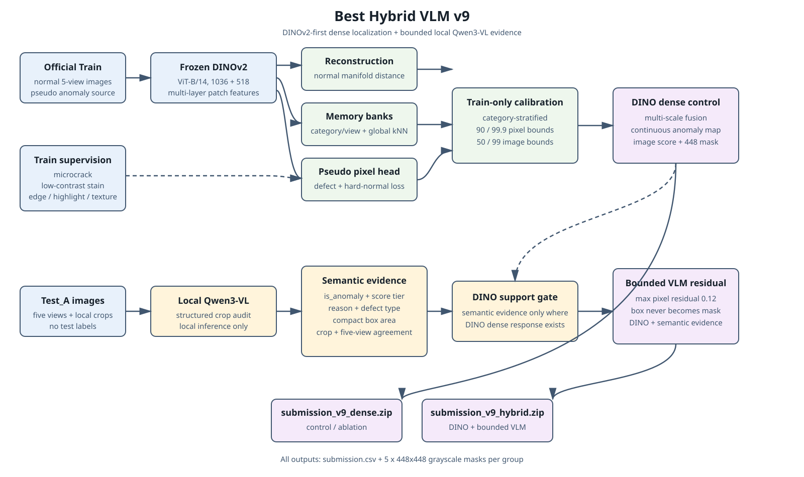

# VLM_Ali

Real-IAD Variety 复杂工业场景异常检测算法挑战赛项目。

本项目面向多类别、多视角工业异常检测，输入每个零件的 5 个相机视角图像，输出图像级异常分数和像素级异常 mask。项目重点探索冻结视觉基础模型、正常样本建模、伪异常训练和视觉语言模型（VLM）零样本异常检测。

## 任务概览

- Train：仅包含 50 个已见类别的正常样本。
- Test A：已见类别的正常与异常样本。
- Test B：包含已见类别和完全未见类别，用于零样本泛化评估。
- 每个样本包含 `0.png` 至 `4.png` 五个视角。
- 输出 mask 要求为单通道灰度图，尺寸为 `448×448`。

## 合规说明

本项目遵循赛事公告：

- 只使用赛事官方数据进行训练、校准和调参；
- 允许使用公开、通用的 ImageNet、DINO/DINOv2、CLIP 等预训练权重；
- 不使用 MVTec、VisA 等异常数据集专项训练得到的 Prompt、Adapter、检测头或模型权重；
- 不调用外部在线 LLM/VLM 服务生成标签、伪标签或结果修正；
- 不访问或利用测试集标签；
- 伪异常只由官方 Train 正常图片通过 CutPaste、纹理、颜色和几何扰动构造。

完整约束见 [COMPETITION_RULES.md](COMPETITION_RULES.md)。

## 主要代码

| 文件 | 说明 |
|---|---|
| `baseline_infer.py` | 冻结 ImageNet ViT 基线 |
| `multiscale_vit_infer.py` | 多尺度 ViT 异常检测 |
| `paper_adapt_infer.py` | INP-Former / Dinomaly 思路适配 |
| `pseudo_anomaly_head.py` | 基于官方正常样本构造伪异常并训练轻量 patch head |
| `clip_vlm_fusion.py` | 通用 CLIP 零样本语义分数融合 |
| `vlm_patch_prototype_infer.py` | CLIP 语义分数 + ViT patch 正常原型模型 |
| `dinov2_vlm_multiview_v2.py` | DINOv2 多层 patch memory bank + 多类型伪异常 head + 局部 CLIP + 五视角一致性 |
| `dinov2_vlm_multiview_v3.py` | 去除逐测试图拉伸的 DINOv2 Train 校准版，使用 category/view memory bank、五视角伪异常 head 和局部 CLIP gate |
| `build_model_fusion_v3.py` | 将已验证 CLIP/ensemble 分支与 DINOv2 v3 高置信局部证据做保守融合 |
| `build_object_aware_segmentation_v1.py` | 前景零件区域估计 + 背景清黑 + 低频轮廓响应抑制 |
| `build_object_aware_segmentation_v2.py` | Train 正常图像残差校准，生成更稀疏的局部缺陷候选 |
| `build_object_aware_segmentation_v3.py` | v1/v2 平衡版：背景清黑、压制整件零件泛亮，同时保留局部异常召回 |
| `build_ensemble_submission.py` | 多模型融合和提交包生成 |
| `build_pseudo_fusion.py` | 伪异常结果融合 |
| `validate_submission.py` | 提交文件格式校验 |
| `v8_vlm_guided_residual_v6/` | DINOv2 主定位 + 有界 VLM 语义残差 + hard-normal 抑制的独立 v6 训练与推理流水线 |
| `v9_best_hybrid_vlm/` | 从最佳 Hybrid v2 独立复制的 DINOv2 三分支 + 分层 Train 校准 + 困难正常监督 + 有界 Qwen3-VL 局部残差流水线 |
| `COMPETITION_RULES.md` | 固定比赛规则和开发约束 |
| `VLM_PAPERS_AND_COMPLIANCE.md` | VLM 论文方向和合规边界 |

## 当前模型架构

当前新版本的完整架构图见 [`V9_ARCHITECTURE.md`](V9_ARCHITECTURE.md)，方法与结果说明见
[`V9_METHOD_AND_RESULTS.md`](V9_METHOD_AND_RESULTS.md)。核心链路为：



图中上半部分是只使用官方 Train 正常样本的 DINOv2 dense 定位分支，下半部分是本地
Qwen3-VL crop 语义分支。两者在 DINO support gate 处汇合，最终同时输出 dense control
和 hybrid 两个提交版本。

```text
Train normal -> DINOv2 multi-layer features -> reconstruction / memory / pseudo head
             -> Train-only calibration -> dense control mask
Test crop audit -> Qwen3-VL local evidence -> DINO support gate -> bounded residual
             -> dense ZIP + hybrid ZIP
```

V9 不把 Qwen 的 box 直接栅格化为 mask。Qwen 只能在 DINO 已经响应的候选像素上提供
局部语义增量，避免把整个零件的语义区域误当成异常区域。

## 运行示例

以下命令在已配置好 PyTorch、TorchVision、CLIP 和相应通用权重的环境中运行。路径请根据服务器实际目录调整。

### VLM + Patch Prototype

```bash
python vlm_patch_prototype_infer.py \
  --data-root /path/to/Dataset \
  --clip-weight /path/to/ViT-B-32.pt \
  --output /path/to/submission_vlm_proto_v1 \
  --zip /path/to/submission_vlm_proto_v1.zip \
  --batch-size 20
```

### 校验提交包

```bash
python validate_submission.py \
  --root /path/to/submission_vlm_proto_v1 \
  --zip /path/to/submission_vlm_proto_v1.zip
```

校验内容包括：750 条 CSV 记录、3750 张 mask、目录结构、灰度模式、448×448 尺寸和 ZIP 完整性。

### DINOv2 VLM v3

v2 的 A 榜结果低于最佳融合包，主要原因是 mask 虽然更亮，但异常区域扩散到大量正常纹理和背景：本地统计中 v2 的 `area>0.5` 约为 `10.3%`，而最佳 CLIP/ensemble 包约为 `5.7%`。像素级 AP 和 F1max 关注异常像素排序、误报面积和阈值下的 precision/recall 平衡，整体更亮并不等价于定位更准。

v3 针对这个问题做了模型侧修正：

- 去掉测试图逐图 percentile 拉伸；
- 用 Train 正常样本建立类别/视角像素分数校准；
- 用 farthest-point sampling 构建 DINOv2 patch prototypes；
- 伪异常 head 使用所有五视角正常图训练；
- CLIP 只作为局部语义 gate，避免把全局文本分数直接当作像素 mask。

服务器运行示例：

```bash
python dinov2_vlm_multiview_v3.py \
  --data-root /root/autodl-tmp/Dataset \
  --clip-weight /root/.cache/clip/ViT-B-32.pt \
  --output /root/autodl-tmp/submission_dinov2_vlm_v3 \
  --zip /root/autodl-tmp/submission_dinov2_vlm_v3.zip \
  --batch-size 10

python build_model_fusion_v3.py \
  --base /root/autodl-tmp/submission_clip_vlm_v1 \
  --candidate /root/autodl-tmp/submission_dinov2_vlm_v3 \
  --output /root/autodl-tmp/submission_fusion_v3 \
  --zip /root/autodl-tmp/submission_fusion_v3.zip
```

### Object-Aware Segmentation

如果观察到 mask 把整个零件轮廓都高亮，而不是只高亮异常区域，可以使用 object-aware refinement。当前推荐先试 v3，它保留 `submission.csv` 图像级分数，只重建像素级 mask：

```bash
python build_object_aware_segmentation_v3.py \
  --data-root /root/autodl-tmp/Dataset \
  --base /root/autodl-tmp/submission_clip_vlm_v1 \
  --output /root/autodl-tmp/submission_object_aware_v3 \
  --zip /root/autodl-tmp/submission_object_aware_v3.zip \
  --workers 12
```

本地可视化统计中，`submission_clip_vlm_v1` 的 `mask>0.5` 面积约为 `5.6%`，v3 降到约 `1.0%`；背景区域被压黑，零件整体泛亮明显减轻。

## 提交格式

压缩包根目录必须包含：

```text
submission.csv
predicted_masks/
└── <category>/<sample>/
    ├── 0_mask.png
    ├── 1_mask.png
    ├── 2_mask.png
    ├── 3_mask.png
    └── 4_mask.png
```

`submission.csv` 格式：

```csv
group_folder,anomaly_score
3_adapter/S0001,0.0321
```

`anomaly_score` 越大表示样本越可能异常；mask 像素值越大表示该像素越可能属于异常区域。

## 已验证结果

全部已测评提交、官方指标和对应方法见
[`SUBMISSION_RESULTS_AND_METHODS.md`](SUBMISSION_RESULTS_AND_METHODS.md)。当前正在训练的
DINO-primary / VLM-guided residual v6 和新 v9 的状态也在该表中单独标注。

当前重要版本结果：

| 方法 | 总分 | I-AUROC | I-AP | P-AUROC | P-AP | P-F1max | 状态 |
|---|---:|---:|---:|---:|---:|---:|---|
| Frozen ImageNet ViT baseline | 41.9916 | 0.7562 | 0.8579 | 0.5958 | 0.0469 | 0.1193 | 已测评 |
| DINOv2 Dense v1 Stream | 70.0925 | 0.9008 | 0.9524 | 0.8542 | 0.4499 | 0.5085 | 已测评 |
| Qwen3-VL + DINOv2 Hybrid v1 | 70.1399 | 0.8984 | 0.9521 | 0.8542 | 0.4524 | 0.5097 | 已测评 |
| DINOv2 Dense v2 | 70.4787 | 0.9084 | 0.9563 | 0.8537 | 0.4556 | 0.5124 | 已测评 |
| **Qwen3-VL + DINOv2 Hybrid v2** | **70.5793** | **0.9092** | **0.9564** | 0.8537 | **0.4579** | **0.5139** | 当前最佳 |
| VLM-Primary v5 | 51.8962 | 0.8499 | 0.8976 | 0.8539 | 0.0846 | 0.1622 | 已测评 |
| **Best Hybrid VLM v9** | - | - | - | - | - | - | **训练中，尚未提交** |

完整的 21 个历史提交及算法说明继续保留在
[`SUBMISSION_RESULTS_AND_METHODS.md`](SUBMISSION_RESULTS_AND_METHODS.md)；v9 的详细设计、
训练链路和合规说明见 [`V9_METHOD_AND_RESULTS.md`](V9_METHOD_AND_RESULTS.md)。

当前最佳 A 榜结果来自 `DINOv2 dense v2 + Qwen3-VL conservative proposal fusion`：

```text
提交文件：submission_qwen_dinov2_hybrid_v2.zip
提交时间：2026-08-21 01:46:17
总分：70.5793
图像级 AUROC：0.9092
图像级 AP：0.9564
像素级 AUROC：0.8537
像素级 AP：0.4579
像素级 F1max：0.5139
```

对应的纯 DINOv2 dense v2 版本也已验证：

```text
提交文件：submission_qwen_dinov2_dense_v2.zip
提交时间：2026-08-21 01:46:09
总分：70.4787
图像级 AUROC：0.9084
图像级 AP：0.9563
像素级 AUROC：0.8537
像素级 AP：0.4556
像素级 F1max：0.5124
```

提交结果 ZIP、数据集和模型权重不纳入 Git 仓库，请在本地或服务器单独保存。

## v2 训练链路（2026-08-21）

在不覆盖 v1 的前提下，`v4_hybrid_v2/` 保存了独立的 v2 实现。该版本针对像素级 AP/F1max 偏低和零件轮廓误检问题进行了模型侧改进：

- 使用更偏向细小划痕、污渍、凹陷和破损的多尺度伪异常构造；
- 训练 pseudo-anomaly pixel head，并增加背景 BCE 与零件轮廓 hard-negative 约束；
- 通过 DINOv2 高分辨率 patch、类别/视角 memory bank 和重建分支生成 dense anomaly map；
- 使用 Train-only 校准面积先验、图像门控和 Qwen3-VL 局部 proposal 融合；
- 对 Qwen 审计结果启用完整性校验，避免不完整审计参与融合。

对应运行脚本和参数说明见 [`v4_hybrid_v2/README.md`](v4_hybrid_v2/README.md)。该目录只包含代码和文档，不包含数据、权重、checkpoint 或提交 ZIP。

## V9 独立升级

V9 在 `qwen_dinov2_hybrid_v2` 基础上创建独立目录，不覆盖原有代码和结果。它保留
DINOv2 reconstruction、category/view memory bank 和 pseudo-anomaly head，并新增：

- 类别分层 Train-normal 校准；
- `microcrack`、`low_contrast_stain` 等弱对比伪异常；
- 对轮廓、反光、高光和强纹理的困难正常监督；
- 联合 Qwen `is_anomaly`、五档 score、reason 关键词、box 面积、crop 一致性和五视角证据；
- DINO support gate 约束的局部 VLM residual，最大幅值为 0.12；
- 同时生成 dense control 和 VLM hybrid 两个提交 ZIP。

运行和当前服务器状态见 [`v9_best_hybrid_vlm/README.md`](v9_best_hybrid_vlm/README.md)。

## 论文方向

项目参考了以下公开研究方向：

- WinCLIP：局部窗口图文匹配；
- AnomalyCLIP：异常语义提示；
- AdaCLIP：类别自适应视觉语言提示；
- Dinomaly：视觉基础模型异常检测；
- INP-Former：正常 patch 原型与多类别异常检测。

论文笔记和权重使用边界见 [VLM_PAPERS_AND_COMPLIANCE.md](VLM_PAPERS_AND_COMPLIANCE.md)。
