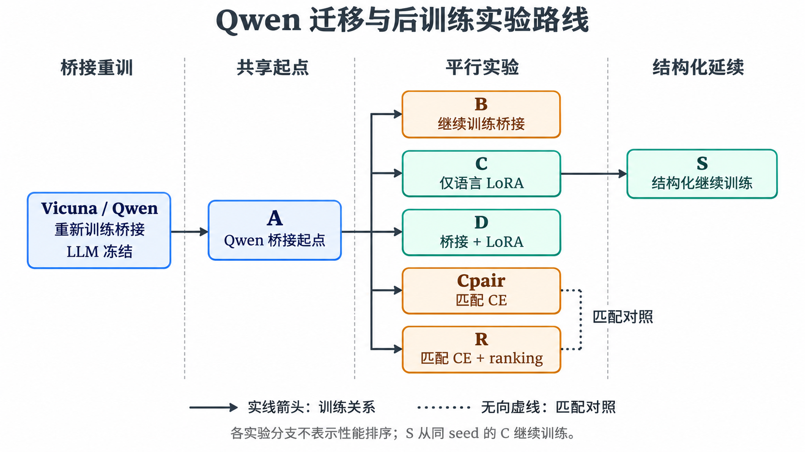
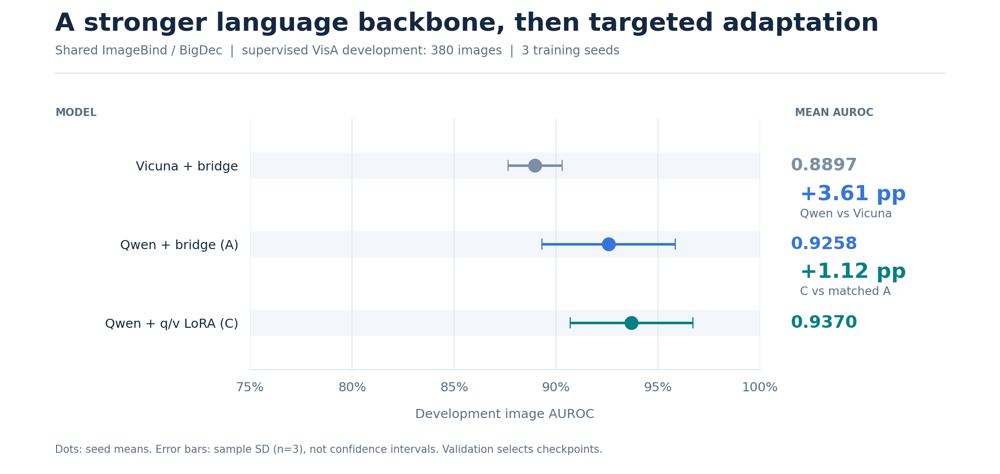
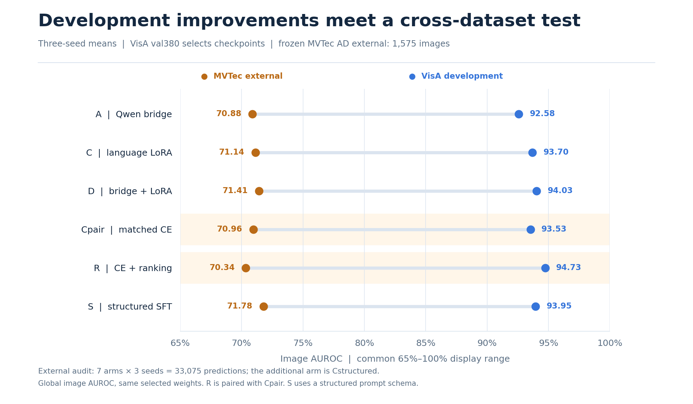
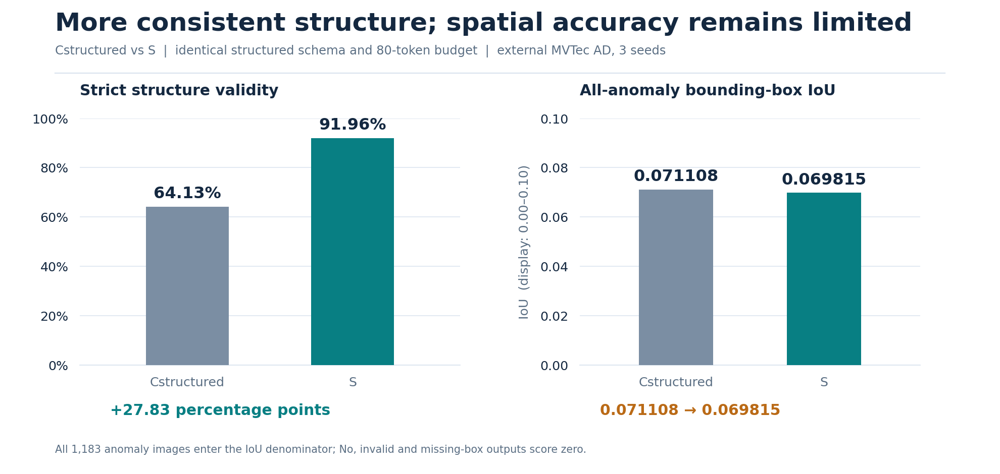
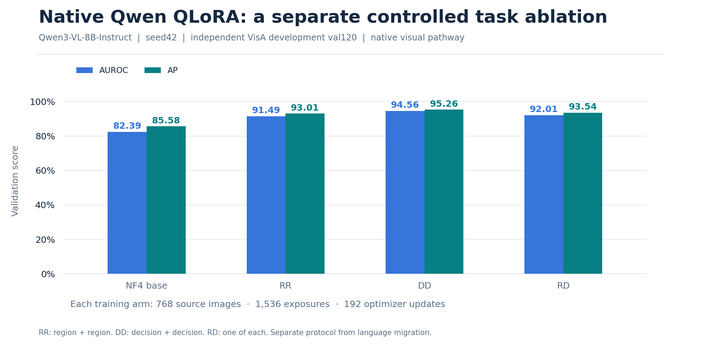
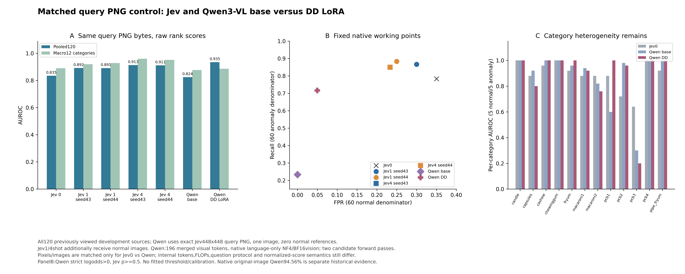

<div align="center">

# Qwen-VLM

### 工业异常检测 · 多模态迁移 · 参数高效后训练

将 **Qwen3-VL-8B** 的语言能力引入 AnomalyGPT，研究从视觉语言桥接、LoRA 到结构化输出与跨域评测的完整流程。

[](industrial_vlm/pyproject.toml)
[](https://huggingface.co/Qwen/Qwen3-VL-8B-Instruct)
[](migration_20261103/lora_20261104/PROTOCOL.md)
[](migration_20261103/PHASE1_RESULTS.md)
[](migration_20261103/advanced_20261104/EXTERNAL_RESULTS.md)

[工作亮点](#highlights) · [架构与路线](#architecture) · [性能结果](#results) · [快速开始](#quickstart) · [代码地图](#code-map) · [深度阅读](#reading)

</div>

> **核心结果：** 在共同 ImageBind/BigDec 视觉前端、重新训练桥接的受控实验中，Qwen 相对 Vicuna 的开发 AUROC 提高 **3.61 个百分点**；语言 q/v LoRA 进一步提高 **1.12 个百分点**。两项 AUROC 配对增量在三个 seed 上均为正。跨域外评仍有高误报，下面同时展示收益与限制。
>
> **附加对照：** 在不改变主线的条件下引入 Jev 通用判别基线；同 120 图、448 输入下 0/4-shot AUROC 为 **83.46% / 91.33%**，低于 Qwen DD 的 **93.49%**。详见 [Jev 研究索引](docs/Jev/README.md)。

<a id="highlights"></a>
## ✨ 工作亮点

| 研究环节 | 完成的工作 | 可以复核的证据 |
|---|---|---|
| **视觉管线修复** | 修正异常 mask 语义、图像/标注几何对齐和特征轴布局，重建可靠训练起点 | [修复报告](repair_20261103/REPAIR_REPORT.md) |
| **语言骨干迁移** | 保持共同视觉前端，重新初始化桥接；在同 seed、同数据与曝光预算下比较 Vicuna / Qwen | [Phase1 配对结果](migration_20261103/PHASE1_RESULTS.md) |
| **参数高效后训练** | q/v LoRA、桥接联合适配、匹配 CE / ranking、结构化 SFT；核验 dtype、梯度、参数组与保存重载 | [LoRA 分析](migration_20261103/lora_20261104/ANALYSIS.md) · [进阶协议](migration_20261103/advanced_20261104/PROTOCOL.md) |
| **独立原生 QLoRA** | 保留 Qwen 原生视觉，语言侧 NF4 + LoRA；控制来源、曝光与更新数，比较判断/区域任务 | [原生分支实验报告](industrial_vlm/reports/multitask_v2/实验报告.md) |
| **冻结外部验证** | 7 模型 × 3 seed × 1,575 张 MVTec 图，保存并复算 33,075 条预测；保留负结果 | [最终证据审计](migration_20261103/advanced_20261104/FINAL_EVIDENCE_AUDIT.md) |
| **Jev 判别式基线** | 引入 TypeSafe Jev（System One）作为通用判别基线与决策层对照；同 120 图、448 输入比较 0/1/4-shot 与 Qwen 底座/DD，并完成 ROI 复核与真实路由 pilot | [Jev 研究索引](docs/Jev/README.md) |

这些工作体现多模态接口适配、领域后训练、优化目标设计和评测工程能力。LoRA、QLoRA、ImageBind 与 Qwen 均采用已有方法和底座；个人贡献与上游边界见 [THIRD_PARTY.md](THIRD_PARTY.md)。

<a id="architecture"></a>
## 🧩 架构与实验路线


**主线：AnomalyGPT 视觉前端 + Qwen 语言骨干。** ImageBind/BigDec 提供图像全局表示与异常图，经 CLS 投影和 PromptLearner 转成语言侧输入。先重新训练桥接，再比较语言 LoRA、联合适配与新训练目标。主线不调用 Qwen 原生视觉 tower。

**独立分支：原生 Qwen3-VL + QLoRA。** 保留原生图像处理和视觉 token 路径，冻结视觉模块，研究判断任务与区域任务对领域适配的影响。该分支的划分、预算和评分方式与主线不同。



C、D、Cpair/R 是从 A 出发的不同实验，**R 的归因对照是 Cpair**；S 从同 seed 的 C 继续。图中分支代表训练关系，不代表性能必然递增。完整配置见 [迁移演进与训练清单](docs/Qwen迁移实验演进与训练清单.md)。

<a id="results"></a>
## 📊 性能结果

### 1 · 语言迁移与 LoRA：同域提升可以复核



共同视觉前端，自定义有监督 VisA **train 9,985 / val 380**；验证集含 172 正常、208 异常。下表为 seed **42 / 43 / 44** 的均值，AUROC 后的 ± 为样本标准差。

| 方案 | 开发 AUROC ↑ | 开发 AP ↑ | 生成 Macro-F1 ↑ | 异常召回 ↑ | 正常 FPR ↓ |
|---|---:|---:|---:|---:|---:|
| Vicuna，桥接训练、LLM 冻结 | 0.889684 ± 0.013285 | 0.919143 | 0.816122 | 0.666667 | 0.000000 |
| A：Qwen，桥接训练、LLM 冻结 | 0.925779 ± 0.032698 | 0.941595 | 0.845672 | 0.719551 | 0.000000 |
| C：语言 q/v LoRA | **0.936983 ± 0.030098** | **0.951534** | **0.861732** | **0.764423** | 0.019380 |

C 使用 `r=8 / alpha=16`，只训练 **3,833,856** 个语言 LoRA 参数。相对 A，AUROC **+1.1204 pp**、生成 F1 **+1.6060 pp**，召回提高伴随误报增加。C 还增加了训练预算；同预算的 B 桥接延续对照、固定终点结果和逐 seed 差异见 [B/C 完整报告](migration_20261103/lora_20261104/RESULTS.md)。

### 2 · 进阶后训练：开发收益与跨域表现



外部集来自 MVTec 官方 test，扣除项目历史 150 图 pilot 后保留 **1,575 图 / 15 类**。所有权重、提示与规则冻结后统一评测。三 seed 为同一批图片上的训练随机性重复。

| 方案 | 开发 AUROC ↑ | 外部 AUROC ↑ | 外部生成 Macro-F1 ↑ | 外部正常 FPR ↓ |
|---|---:|---:|---:|---:|
| A：Qwen 桥接起点 | 0.925779 | 0.708834 | 0.671986 | **0.612245** |
| C：语言 LoRA | 0.936983 | 0.711363 | 0.657848 | 0.650510 |
| D：桥接 + LoRA | 0.940258 | 0.714118 | 0.651824 | 0.668367 |
| Cpair：匹配 CE | 0.935334 | 0.709581 | 0.653811 | 0.659014 |
| R：CE + ranking | **0.947348** | 0.703438 | 0.636020 | 0.715986 |
| S：结构化继续训练 | 0.939489 | **0.717814** | 0.670401 | 0.614796 |

**D** 的开发 AUROC/F1/误报取舍较好，但增加了桥接更新参数；**R** 相对 Cpair 的开发排序收益没有跨域复现。外部正常图误报约 **61%–72%**，目前尚不能据此支持部署。S 使用不同的回答 schema 与生成预算，跨行差异不能单独归因于某一个训练因素。

来源：[最终报告](migration_20261103/advanced_20261104/FINAL_REPORT.md) · [外部分析](migration_20261103/advanced_20261104/EXTERNAL_ANALYSIS.md) · [逐 seed 原始汇总](migration_20261103/advanced_20261104/external_summary.json)。

### 3 · 结构化输出：结构遵循与空间定位分别衡量



同一结构化提示下，S 相对 Cstructured 的外部严格结构有效率从 **64.13% → 91.96%**；全异常分母的框 IoU 从 **0.071108 → 0.069815**。结构一致性提升，空间定位尚未改善。无效回答、缺框和 No 回答在全异常框指标中计为 0。

工具方向完成原生 Qwen 的 **380 图 × 5 臂** 实验，planner 全部选择 `answer`、`crop=0`；目前没有自主裁剪收益，也未做工具 SFT/RL。详见 [结构诊断](migration_20261103/advanced_20261104/EXTERNAL_STRUCTURED_DIAGNOSTICS.md) 与 [工具结果](migration_20261103/advanced_20261104/TOOL_RESULTS.md)。

### 4 · 原生 QLoRA：独立路线的任务消融



**独立协议：** 768 张训练来源、1,536 次曝光、192 更新，seed42；同域 val120（60 正常 / 60 异常）。语言注意力 q/k/v/o LoRA：`r=16 / alpha=32 / dropout=0.05`，可训练参数 **15,335,424**。

| 模型 / 训练任务 | AUROC ↑ | AP ↑ |
|---|---:|---:|
| NF4 量化底座 | 82.39% | 85.58% |
| RR：两次区域任务 | 91.49% | 93.01% |
| DD：两次判断任务 | **94.56%** | **95.26%** |
| RD：区域与判断各一次 | 92.01% | 93.54% |

DD 相对同量化底座的开发 AUROC 提高 **12.17 pp**；其自由生成判断 Macro-F1 为 **85.83%**。该结论限于单 seed、定制有监督协议；不能与主线指标直接相减，也不能标作官方 normal-only 基准。详见 [实验协议](industrial_vlm/reports/multitask_v2/实验协议.md) 和 [结果报告](industrial_vlm/reports/multitask_v2/实验报告.md)。

<details>
<summary><b>指标与比较口径</b></summary>

- 主线 AUROC/AP 来自首答案 `logit(Yes) − logit(No)`；生成 F1、Recall、FPR 来自实际生成答案。
- 原生分支连续分数为 `logP(true) − logP(false)`，与主线评分接口不同。
- F1 为正常/异常两标签的 Macro-F1；类别等权结果单独报告。
- 主线 val380 已多轮用于开发与选点，历史 test456 也已用于开发；原生分支 val120 同样属于开发验证。
- 外部集含 392 正常 / 1,183 异常，AP 受类别比例影响。三 seed 标准差不等同于跨数据集不确定性。
- 所有曲线均由已保存报告绘制；本次仓库整理没有新增训练、推理或外评。

</details>

### 5 · 附加对照：Jev 通用判别基线



在不改变主线的条件下，引入 TypeSafe Jev（System One 判别模型）作为另一条基线：它不是检测主干，而是“通用判别器 + 类型化决策”的对照。同一批 120 张图、同一 448 输入下：

| 系统 | 训练方式 | AUROC ↑ | 默认阈值下 Recall | 默认阈值下 FPR |
|---|---|---:|---:|---:|
| Jev 0-shot | 无训练，仅提示 | 83.46% | 78.33% | 35.00% |
| Jev 4-shot（seed43 / 44） | 4 张正常参考 | **91.33% / 91.13%** | 85.00% | 23.33% |
| Qwen 量化底座 | 无领域训练 | 82.44% | 23.33% | 0.00% |
| Qwen DD LoRA | 领域 SFT | **93.49%** | 71.67% | **5.00%** |

- **通用零样本接近**：Jev 0-shot 83.46% 与 Qwen 底座 82.44% 只差约 1 个百分点。
- **领域后训练仍最强**：DD 比底座高 **11.05 个百分点**。
- **few-shot 回收大部分差距**：Jev 4-shot 比 0-shot 高约 **7.7–7.9 个百分点**，但仍比 DD 低 **2.16 个百分点**。
- **ROI 复核未证明净收益**：240 个配对判断中，ROI/重复原图的 mean IoU 为 **0.069719 / 0.068542**，配对区间跨 0；**60/120** 候选是整图框，上游几何是瓶颈。
- **在线路由未证明净收益**：24 图、**61 次**真实请求；Jev gate AUROC **77.08%**，低于新 duplicate **82.99%** 和同 K 随机 **77.78%**。
- **校准是部署层**：heldout FPR **18.33%→10.00%**、Brier **0.12423→0.10774**，但 AUROC/Recall 不变。

这些结果支持“Jev 作为通用基线/决策层对照”的定位，不支持“Jev 替代检测主干”或“路由已获得净收益”。完整协议、负结果和复现入口见 [Jev 研究索引](docs/Jev/README.md)。


<a id="quickstart"></a>
## 🚀 快速开始

### 先选择路线

| 你的目标 | 建议入口 | 运行前需要准备 |
|---|---|---|
| 理解项目和研究结论 | [全程精读](docs/Qwen3-VL多模态适配与后训练优化_项目全程精读.md) | 直接阅读，无需 GPU |
| 了解 Jev 通用判别基线 | [Jev 研究索引](docs/Jev/README.md) | 直接阅读，无需 GPU/API |
| 核对已有代码和结果文件 | 下方文件校验、[证据审计](migration_20261103/advanced_20261104/FINAL_EVIDENCE_AUDIT.md) | Python 标准库；指标复算另需对应依赖 |
| 运行原生 Qwen 单图推理 / QLoRA | [industrial_vlm](industrial_vlm/README.md) | CUDA、Qwen 底座；领域推理另需对应 adapter |
| 复现语言骨干迁移和 q/v LoRA | [Phase1](migration_20261103/PHASE1_PROTOCOL.md) → [B/C](migration_20261103/lora_20261104/PROTOCOL.md) | 数据、ImageBind、BigDec、语言底座及阶段权重 |
| 检查结构化训练 / 跨域评测 | [进阶实验](migration_20261103/advanced_20261104/README.md) | 对应协议、缓存、模型与独立输出目录 |

### ① 克隆并核对文件

```bash
git clone https://github.com/Qhf7/Qwen-VLM.git
cd Qwen-VLM

# 只读 SHA256 校验：不加载模型，不需要 GPU
python3 - <<'PY'
import csv, hashlib
from pathlib import Path
rows = list(csv.DictReader(Path('DELIVERY_MANIFEST.tsv').open(), delimiter='\t'))
bad = [r['path'] for r in rows if not Path(r['path']).is_file()
       or hashlib.sha256(Path(r['path']).read_bytes()).hexdigest() != r['sha256']]
assert not bad, bad
print(f'PASS: {len(rows)} files verified')
PY
```

> `DELIVERY_MANIFEST.tsv` 保持原交付范围；Jev 附录新增文件的逐文件 SHA256 见 [Jev 清单](docs/Jev/MANIFEST.tsv)。

### ② 配置原生 Qwen 环境

在支持 BF16 的 CUDA 环境中，为原生分支建立独立环境：

```bash
python3 -m venv .venv-native
source .venv-native/bin/activate
python -m pip install --upgrade pip
python -m pip install -e ./industrial_vlm

# 验证已有评分实现；不加载模型权重
(cd industrial_vlm && PYTHONPATH=src python ops/test_score.py)
```

依赖声明见 [pyproject.toml](industrial_vlm/pyproject.toml)，历史服务器实际版本见 [requirements-runtime.txt](industrial_vlm/requirements-runtime.txt)。`pip install -e` 便于使用当前代码；精确复现实验须匹配对应历史环境。AnomalyGPT / BF16 迁移 / 原生 QLoRA 的依赖分别记录，不混作同一环境。

### ③ 单张图片推理

准备 [Qwen3-VL-8B-Instruct](https://huggingface.co/Qwen/Qwen3-VL-8B-Instruct) 底座和图片，将命令中的路径替换为实际绝对路径：

```bash
python -m industrial_vlm.infer \
  --model /absolute/path/to/Qwen3-VL-8B-Instruct \
  --image /absolute/path/to/image.png \
  --task decision \
  --output /absolute/path/to/new_prediction.json
```

上述命令运行原生量化底座。已有训练 adapter 时添加 `--adapter /absolute/path/to/adapter`；需要区域输出时使用 `--task region`。输出包含原始回答、解析结果、模型身份和 token 数；输出文件必须使用新路径。**仓库不包含模型与 adapter 权重、原始数据集或 tensor cache**，准备方式见 [ASSETS.md](ASSETS.md)。

主线迁移使用不同加载接口，请按 [语言单图推理说明](migration_20261103/INFERENCE_USAGE.md) 或 [student ROI 说明](migration_20261103/student_roi_20261104/INFERENCE_USAGE.md) 准备结构匹配的 checkpoint。历史命令中的 `/root/autodl-tmp/...` 需按运行环境映射。

<a id="code-map"></a>
## 🗂️ 代码地图

```text
Qwen-VLM/                           ← 仓库根目录
├── README.md                       项目概览、结果图、使用入口
├── ASSETS.md / THIRD_PARTY.md       资产准备与上游许可
├── DELIVERY_MANIFEST.tsv            逐文件大小与 SHA256
├── DELIVERY_AUDIT.json              布局、源码身份和交付核验
├── docs/                           全程精读、成果与图表
│   └── assets/readme/              本页可视化、源数据与绘图脚本
├── industrial_vlm/                 独立原生 Qwen NF4 QLoRA 工程
│   ├── src/industrial_vlm/          数据 / 模型 / 训练 / 推理 / 评分
│   ├── experiments/jev_*            Jev 基线、ROI 复核与路由 pilot
│   └── configs/ · reports/
├── repair_20261103/                 定位管线修复、BigDec 训练与复评
├── migration_20261103/              共同视觉前端上的迁移主线
│   ├── code/                       桥接、语言模型、缓存与推理
│   ├── lora_20261104/               B/C q/v LoRA 与独立回载
│   ├── student_roi_20261104/        学生异常图与 ROI 推理
│   └── advanced_20261104/           D/Cpair/R/S、工具与冻结外评
├── AnomalyGPT/                     必要派生运行时、早期迁移和诊断
├── seg_cross_part/                 早期 Real-IAD 跨零件分割与对照
└── artifacts/ · data/              轻量划分、指令、预测与统计
```

当前开发代码与冻结运行时快照分别保留：阅读实现看当前源码，追溯历史结果看当次 source manifest 和权重身份。完整函数说明见 [代码与文件索引](docs/项目精读附录_代码与文件索引.md)。

<a id="reading"></a>
## 📚 深度阅读与复核

| 想了解什么 | 文档 |
|---|---|
| 从头理解项目 | [全程精读：问题 → 架构 → 训练 → 结果 → 代码](docs/Qwen3-VL多模态适配与后训练优化_项目全程精读.md) |
| 具体成果与创新边界 | [项目成果与创新总结](docs/项目成果与创新总结.md) |
| Jev 通用判别基线：结果、边界与复现 | [Jev 研究索引](docs/Jev/README.md) · [阶段总报告](industrial_vlm/experiments/jev_followup_20261111/CONTINUOUS_RESEARCH_COMPLETION.md) |
| 为什么早期替换失败、后来提高 | [迁移演进与训练清单](docs/Qwen迁移实验演进与训练清单.md) |
| LoRA 如何实现和检查 | [实现步骤详解](docs/Qwen_LoRA_项目实现步骤详解.md) · [保存重载证据](migration_20261103/lora_20261104/verify_status.json) |
| 最终的正结果与负结果 | [进阶最终报告](migration_20261103/advanced_20261104/FINAL_REPORT.md) · [最终证据审计](migration_20261103/advanced_20261104/FINAL_EVIDENCE_AUDIT.md) |
| 文件来源与发布范围 | [源码配置清单](docs/项目源码与配置清单.tsv) · [同步说明](docs/仓库同步说明.md) |

本页图表提供 [机器可读数据及来源](docs/assets/readme/evidence.json)、SVG/PNG 和 [生成脚本](docs/assets/readme/render_figures.py)，便于核对与复用。上游代码、模型和数据遵循各自许可；AnomalyGPT/ImageBind 随附许可保留。详见 [THIRD_PARTY.md](THIRD_PARTY.md)。

## License

本仓库中由本项目编写的代码与文档采用 [Apache License 2.0](LICENSE)。第三方组件（AnomalyGPT、ImageBind、Qwen3-VL 等）继续遵循各自上游许可证；范围说明见 [NOTICE](NOTICE) 和 [THIRD_PARTY.md](THIRD_PARTY.md)。仓库不包含模型权重或数据集，本许可不改变第三方资产的许可条件。
