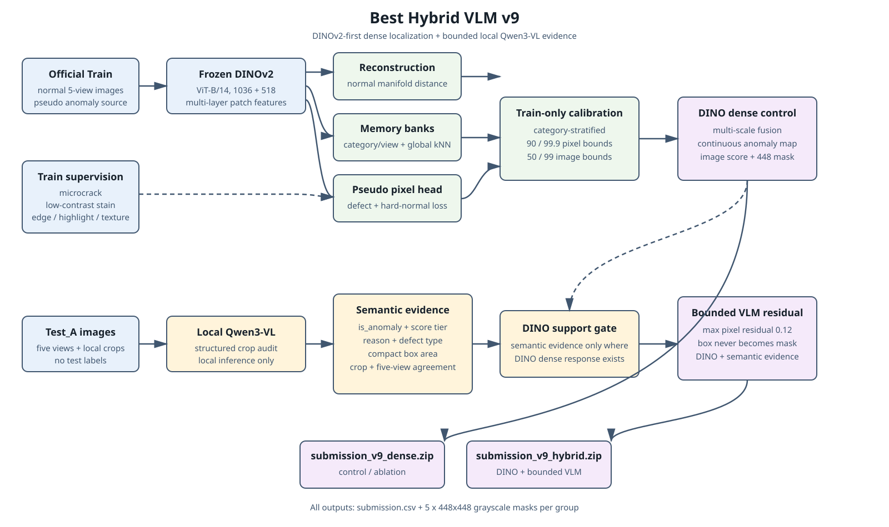
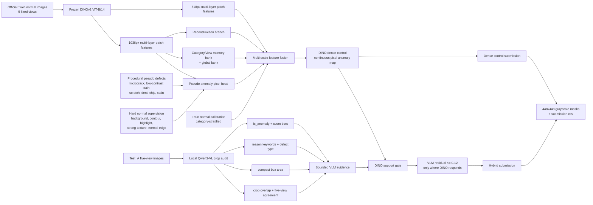

# V9 Architecture

GitHub renders the following Mermaid diagram directly. The model is a dense
DINOv2-first anomaly detector with a bounded local Qwen3-VL semantic branch.

Editable draw.io source: [v9_best_hybrid_vlm_architecture.drawio](docs/v9_best_hybrid_vlm_architecture.drawio)

Static SVG preview: [v9_architecture.svg](docs/v9_architecture.svg)

Publication-style SVG: [v9_best_hybrid_vlm_architecture.svg](docs/v9_best_hybrid_vlm_architecture.svg)

## Data and supervision

The trainable reconstruction and pseudo-head modules receive only official
normal Train images. Defect masks come from procedural transformations of those
images. Hard normal regions are explicitly supervised as non-anomalous so that
silhouettes, reflections, highlights, and repeated textures are not learned as
defects.

## VLM role

Qwen3-VL does not generate the final pixel mask. It supplies local structured
evidence from crop-level audits. The proposal is converted to a bounded
semantic residual and multiplied by a DINO support gate. Therefore a VLM box
cannot paint a region where the dense visual model has no anomaly response.

## Outputs

The pipeline produces two independently validated archives:

- `submission_v9_dense.zip`: DINO dense-control ablation;
- `submission_v9_hybrid.zip`: dense control plus bounded Qwen3-VL residual.

The v9 run is still in training and has no official leaderboard score yet.
