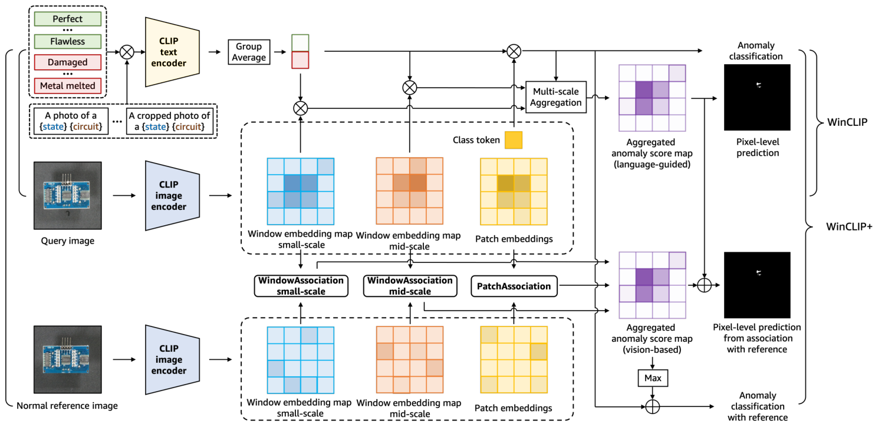
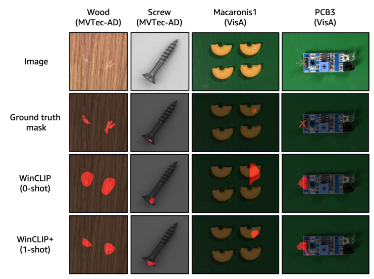

# 精读笔记 · WinCLIP: Zero-/Few-Shot Anomaly Classification and Segmentation

> arXiv 2303.14814v1 · CVPR 2023 · AWS AI Labs + KAIST · 2023-03
> 论文无官方代码；本目录 `code/` 是社区复现 caoyunkang/WinClip（*unofficial*）
> 材料都在本目录（paper.pdf / source/ 原始 LaTeX / paper.tex / figures/ / code/）

## 基本情况

- 一句话：给一张工业产品图 + 这个物体的名字（可选缺陷词）→ 输出「这张图有没有缺陷」的分数 + 一张缺陷位置热力图；**不训练、不要异常样本**，1~4 张正常图还能再涨点。
- 做法：冻结的 CLIP（ViT-B/16+，240²）当唯一模型，靠「造 prompt」定义 normal/anomalous，靠「滑窗抠局部」拿到和文字对齐的稠密特征。
- 开源：**代码没开源**（论文里只给了 OpenCLIP 和 PatchCore 的链接）。权重是 CLIP 公开权重（LAION-400M 的 ViT-B/16+），数据是公开的 MVTec-AD / VisA。
- 和读过的哪篇最像、差在哪：和 PatchCore（同一批作者体系里的 full-shot SOTA）最像——都是「正常特征库 + 最近邻距离」；差别是 WinCLIP+ 在这之上还叠了一路**语言**分数（zero-shot 那一路），PatchCore 只有视觉。
- 本目录路线：`① 动机（图 2）→ ② 架构（图 3、图 4）→ ③ "训练"=没有训练，只有 prompt 库和参考库（式 1–4）→ ④ 数据（MVTec-AD/VisA，0/1/2/4-shot）→ ⑤ 信息流 → ⑥ 一张 screw 图对着 code/ 走一遍`

## 导读地图

行号指 `paper.tex`（arXiv 源码拍平版，正文 L13–496，附录 L517 起）。

| 站 | 这一站讲清楚什么（一句话） | 图 | 原文位置 | 代码 |
|---|---|---|---|---|
| ① 动机 | 工业质检是长尾、缺陷样本稀缺，CLIP 零样本直接套「normal/anomalous」又不够准 | 图 2 | §1 L33–74 | — |
| ② 架构 | 一条文本支路造 2 个类原型，一条图像支路滑窗出 3 个尺度的特征图，点积出热力图；WinCLIP+ 再并一路参考库 | 图 3、图 4 | §4 L117–202 | `code/WinCLIP/model.py:18`、`code/WinCLIP/CLIPAD/transformer.py:585`、`:707` |
| ③ 训练 | **没有梯度、没有训练**；"学习"发生在两处：prompt 组合（式 1）+ 参考特征库（式 3、4） | 式 1–4 | §4.1 L122–149、§4.2 L169–177、§4.3 L179–201 | `code/WinCLIP/ad_prompts.py`、`model.py:90`、`:143` |
| ④ 数据 | 一条「样本」= 1 张待测图 + 1 张（或 4 张）正常参考图；物体名当 prompt 的 [o] | 图 1 | §5 L300–310、附录 A L592–604 | `code/datasets/mvtec.py`、`datasets/dataset.py:16` |
| ⑤ 信息流 | 240² 图 → 225 个 patch → 365 个窗口各过一遍 ViT → 每个窗口 1 个向量 → 和 2 个文本原型算相似度 → 窗口分数摊回像素 → 调和平均 → 上采样 | 图 3、图 4 | §4.2 L153–177 | `model.py:157`、`:246` |
| ⑥ 例子 | 一张 MVTec screw 图，从 15×15 网格一路算到 256² 热力图 | — | — | `model.py:157`、`:246` |
| ⑦ 实验 | 0-shot 91.8/85.1，1-shot+ 93.1/95.2（MVTec，AC/AS）；4-shot+ 追平 full-shot 的 CutPaste，但离 PatchCore 99.6/98.2 还远 | 表 1、表 4、表 2 | §5 L312–493 | — |

## ① 动机

**任务**：工业质检里的两件事——异常分类（AC，「这个零件有没有缺陷」）和异常分割（AS，「缺陷在哪个像素」）。
原文用电路板举例：一块 PCB 出厂前，要判它有没有「虚焊 / 缺件 / 划伤」，并且把缺陷那块圈出来。

**以前怎么做、卡在哪**（三条，都是作者自己列的）：

1. **异常样本几乎没有，所以只能训 one-class**：PaDiM、PatchCore、CutPaste 这类方法只用正常图拟合一个「正常的样子」，偏离就算异常。正常图有成百上千张时它们很强（Table 2：PatchCore full-shot 在 MVTec 上 AC 99.6 / AS 98.2）。
2. **但「每个零件训一个模型」不可扩展**：MVTec 15 类、VisA 12 类，真实产线是成百上千种零件。每换一种就要重采数据、重训、重调阈值。
3. **1~4 张正常图时性能掉得厉害**：PatchCore 1-shot 只剩 83.4/92.0（AC/AS），离 full-shot 的 99.6/98.2 差一大截。

**作者押注的关键想法**（一句话）：
> 正常/异常本质上是物体的两个**状态**（state），而状态是可以用语言描述的；CLIP 的图文对齐里已经存着这份知识，只要 prompt 造得对，再把 CLIP 的「整图判断」拆成「一小块一小块判断」，就能零样本做分类和分割。

三个支撑观察（对应图 2 三块）：

- **(a) 语言能说清什么叫正常**：图 2(a) 的 PCB，GT 是「引脚虚焊」= 异常；但「板面上的轻微划痕、背景上的脏点」是**可接受的**、不算异常。只靠正常图拟合的方法分不清这两者——它只知道「和正常图不一样」，不知道「哪种不一样才算缺陷」。语言能把这条界线说出来。
- **(b) 只看整图不够，要看多个尺度**：图 2(b)，整图看只能知道「这块板有问题」，2×2 patch 的窗口看能定位到「右边这排引脚」，3×3 的窗口看能知道「引脚周围焊盘的状态」。缺陷大小从几个像素到半个物体都有，单一尺度必然漏。
- **(c) 光靠语言也不够，有些缺陷只能用图比**：图 2(c)，MVTec 的 metal_nut 有一类缺陷叫「flipped upside-down（螺母装反了）」——它不脏、不破、不缺，只是**朝向不同**。任何形容词都描述不了，只能拿一张正常图对照。所以要有 WinCLIP+（1~4 张正常参考图）。

**为什么不能直接把 CLIP 拿来用**（这是全文的技术起点，也是 ③ 站位要回答的）：

- 直接二分类 prompt `"normal bottle"` vs `"anomalous bottle"`：MVTec AC 只有 74.0（Table 3 第一行）。加上 CLIP 官方那套 ImageNet 的 80 条模板，只涨到 74.1 —— 几乎没用。作者的诊断：那套模板是给「物体类别」用的（`a photo of a cat`），而这里要分的是同一个物体的两个**状态**，模板里得出现 `flawless` / `damaged` 这类状态词，还得有 `for visual inspection` 这种场景词。换成组合式 prompt 后到 90.8，加多裁剪到 91.8。
- 直接拿 ViT 最后一层的 patch token 当稠密特征：pAUROC 只有 22.4，基本是噪声（Table 8（第 8 页）「Patch-token」行）。原因：patch token 从来没被语言信号直接监督过，和文本不在一个空间；而且它经过 12 层 self-attention，每个 token 已经混进了全图信息，反而不够「局部」。
- 那把图切成小块分别送进 CLIP（image tiling）：pAUROC 77.9，能用，但一张图要 1442 ms（Table 8 「Image tiling」行）。WinCLIP 用「滑窗 + 丢掉窗口外的 patch」把时间压到 389 ms，还更准（85.1）。

**一个具体例子**：MVTec 的 `screw`（螺丝）。正常螺丝是一根带螺纹的杆加一个头。缺陷类型有 `manipulated_front`（头部被削/被改）、`scratch_head`、`scratch_neck`、`thread_side` 等。
- one-class 方法：拿几张正常螺丝图建特征库，测试图里哪个 patch 离库最远就报异常。问题：光照变了、螺丝在画面里转了个角度，patch 距离也会变大 → 误报。
- WinCLIP：问 CLIP「这一小块更像 `a photo of a damaged screw for visual inspection`，还是更像 `a photo of a flawless screw for visual inspection`？」。它不需要知道正常螺丝长什么样，只需要知道 CLIP 心里的「damaged」长什么样。图 1 第 2 列就是 screw：0-shot 也能把头部那块点亮。
- WinCLIP+：再并上正常螺丝的特征库分数。两种证据取调和平均——语言说「像缺陷」、参考图说「和正常的不一样」，两边都点头才给高分。

一句话回顾：**工业质检是长尾 + 缺陷样本稀缺，WinCLIP 赌的是「CLIP 里已经存着 damaged/flawless 这两个状态的知识」，把它从整图判断拆成滑窗局部判断，就能零样本分出缺陷并定位；再并一路正常参考图，补上语言说不出的缺陷。**

## ② 架构



**图 4 怎么读**：两条支路 + 两种模式。左上绿色框=正常状态词、红色框=异常状态词，⊗ 表示把状态词填进模板，
送 CLIP **文本**编码器，全部向量取平均（Group Average）→ 一绿一红两个**类原型**。中间大虚线框是**图像**支路：
查询图过 CLIP 图像编码器，得到三张彩色图（蓝=2×2 小窗口、橙=3×3 中窗口、黄=patch token）。右边上半是 WinCLIP（只用语言），
下半是 WinCLIP+（再并一路正常参考图）。**注意两个 CLIP image encoder 框和三种颜色的特征图都是同一个冻结 ViT**，
只是换了窗口划分、跑了不同次。

**接口（真实数值）**

| 项 | 值 |
|---|---|
| 输入 | 1 张 240×240 RGB（MVTec 原图 700²–1024²，短边 resize 到 240） |
| ViT | ViT-B/16+：patch 16 → 15×15 = 225 个 patch token + 1 CLS；width 896、12 层 |
| 窗口 | 2×2 stride 1 → 196 个；3×3 → 169 个；整图 1 个 = **366 次前向** |
| 输出 | 15×15 分数图 → 双线性上采样到原图尺寸（论文没写；复现代码用 400×400） |
| 耗时 | 389 ms/张（EC2 G4dn，T4） |
| 训练 | **0 步，梯度不出现** |
| WinCLIP+ 参考库 | K≤4 张正常图 × 590 个 640 维向量 |

**A. 文本支路：242 条 prompt → 2 个原型**

- 7 个正常状态词 × 22 个模板 = 154 条；4 个异常状态词 × 22 = 88 条。比如 bottle 的 `a photo of a flawless bottle for visual inspection`。
- 为什么要「状态词 × 模板」的笛卡尔积：一句 `normal bottle` vs `anomalous bottle` 只有 74.0；换 ImageNet 那套模板 74.1（几乎没涨）。
  加上状态层 89.8（+15.8），模板层 90.8（+1.0），multi-crop 91.8（+1.0）——增益几乎全在「状态词」这一层。
- 状态词表见附录图 6：正常 `[o]` / `flawless [o]` / `perfect [o]` / `unblemished [o]` / `[o] without flaw|defect|damage`；
  异常 `damaged [o]` / `[o] with flaw|defect|damage`。VisA/MVTec 的缺陷类型名还能额外加（PCB2 +5.3）。

**B. 图像支路：滑窗 + 丢 patch**

- 对每个窗口 w_ij：取出窗口内 patch（2×2=4 个、3×3=9 个），**把窗口外的 patch 直接删掉**（不是填零），加 CLS 过 12 层 ViT，取 CLS 向量（896 维，投影到 640 维后和文本同空间）。
- 为什么不用 ViT 最后一层 patch token：pAUROC 22.4（表 8）。patch token 没被语言直接监督，且已混入全局信息。
- 为什么不做 image tiling：1442 ms/张、pAUROC 77.9。丢 patch 后总 token 数 196×5 + 169×10 + 226 = 2896，
  而 366 次整图前向要 366×226 ≈ 8.3 万 token——这是 389 ms 能跑完的原因。

**C. 打分与聚合**

- 窗口向量与 2 个原型算余弦 → softmax → p(anomalous)；分数摊给窗口覆盖的像素（每个 patch = 16×16 像素）。
- 重叠窗口用**调和平均**（式 2）：偏向低分（正常），只保留「一致认为异常」的区域，边界更紧。换成算术平均 pAUROC 掉到 81.5。
- 多尺度再用调和平均合并：去掉 image-scale 82.0、去掉 mid 84.0、去掉 small 84.7，全用 85.1。
- 注意：**代码里窗口内是调和、跨尺度是算术平均**，和论文写的不完全一致。

**D. WinCLIP+：参考库**

- 三张特征图（patch / small / mid）各建一个参考库 R；查询特征与库里最近的一个算 M_ij = ½(1 − max cos)。
- 三张 M 平均 → M^W；再与语言图 M̄^W_0 融合。**融合公式论文没写**，代码里是调和平均 `1/(1/M_text + 1/M_vis)`。
- AC：ascore = ½(ascore₀ + max M^W)（式 4）。表 5 显示两路缺一不可：只用视觉 1/2/4-shot 87.9/91.0/92.6，只用语言一直是 91.8，合用 93.1/94.4/95.2。

| 模块 | 来源 / 初始化 | 参数量 | 训练时更新吗 | 作用 |
|---|---|---|---|---|
| CLIP 图像塔 ViT-B/16+ | LAION-400M 预训练（OpenCLIP） | ≈117M（按 config 算） | 否 | 每个窗口 → 1 个 640 维向量（投影后） |
| CLIP 文本塔 | 同上 | ≈91M（按 config 算） | 否 | prompt → 640 维向量 |
| 窗口生成器 | 规则，`transformer.py:585` | 0 | — | 生成 2×2 / 3×3 / 整图的 patch 下标集 |
| 文本原型平均 | 无参数，`model.py:90` | 0 | — | 154 / 88 条 prompt → 2 个类原型 |
| 多尺度调和聚合 | 无参数，`model.py:157` | 0 | — | 窗口分数 → 像素分数 |
| 参考库 R（仅 +） | K 张正常图前向得到，`model.py:143` | 0（存特征） | 否 | 最近邻定义「正常长什么样」 |
| **合计** | — | ≈208M，**可训练参数 0** | — | — |

> 维度订正：ViT 内部宽度是 896，但 `encode_image` 最后乘了 896×640 的 `proj`，所以**窗口向量和文本向量都是 640 维**（联合空间）。590 = 196 + 169 + 225。

## ③ "训练"

**这篇没有训练**：没有损失函数、没有梯度、没有 epoch。全篇的"学习"只在两处，都不是反向传播：
① 人工写 242 条 prompt（离线，一次性，所有类别共用一套，只换物体名词）；
② 把 K 张正常图前向一遍存成特征库。所以这一站的四个公式全是**推理时的打分规则**。

```
式(1)  p(anomalous | x) = exp(⟨f(x), g_ano⟩ / τ) / Σ_{s∈{normal,ano}} exp(⟨f(x), g_s⟩ / τ)

式(2)  M̄_0,ij = ( (1/Σ_uv w_uv) · Σ_uv w_uv / M_0,uv )^{-1}

式(3)  M_ij = min_{r∈R} ½ (1 − ⟨F_ij, r⟩)

式(4)  M^W = ⅓ (M^P + M^W_s + M^W_m)
       ascore(x) = ½ ( ascore_0(f(x)) + max_ij M^W_ij )
```

| 符号 | 是什么 | 形状 / 取值 |
|---|---|---|
| f(x) | 一个窗口的 CLS 向量（已 L2 归一化） | 640 维 |
| g_normal / g_ano | 154 条 / 88 条 prompt 的平均文本向量 | 640 维 |
| τ | 温度 | 论文没给；代码等价 τ=0.01（logits ×100） |
| w_uv | 第 (u,v) 个窗口的二值掩码 | {0,1}，窗口重叠处多个 1 |
| M_0,uv | 该窗口的异常分 | [0,1] |
| R | 参考特征库 | K×590 个 640 维向量 |
| M^P / M^W_s / M^W_m | patch / 小窗 / 中窗 三个尺度的视觉异常图 | 15×15 |

**式 (1) 代数字**：某窗口和正常原型 cos=0.25、和异常原型 cos=0.30。τ=0.01 时 p=1/(1+e^{-5})=0.993；
τ=0.07（CLIP 默认）时 p=0.67；τ=1 时 p=0.51。CLIP 的余弦差通常只有 0.05 量级，不用小 τ 就分不开。

**式 (2) 代数字**：同一像素被 4 个窗口盖住，异常分 0.9 / 0.8 / 0.2 / 0.1。
算术平均 = 0.50；调和平均 = 4/(1/0.9+1/0.8+1/0.2+1/0.1) = 4/17.36 = **0.23**。
真缺陷内部四个窗口都接近 0.9，调和仍是 0.9——所以它压掉的只是「边界上有一半窗口说正常」的那些像素。

**式 (3) 代数字**：F 与库里最像的一条 cos=0.98 → M=0.01；cos=0.80 → M=0.10。用 min 而不是 mean：
异常的定义是「和**任何**一张正常图都不像」，mean 会被 K 张参考图彼此之间的差异带偏。

**式 (4) 代数字**：ascore_0=0.62、max M^W=0.78 → ascore=0.70。

**阶段表**

| 阶段 | 数据 | 动参数 | 成本 |
|---|---|---|---|
| 0 造 prompt | 人工 + 数据集给的类别名/缺陷名 | 无 | 一次性 |
| 1 建库（仅 WinCLIP+） | K=1~4 张正常图 | 无 | K 次前向 |
| 2 推理 | 1 张测试图 | 无 | 389 ms |
| 3 定阈值 | 验证集 / 测试集 | — | 见下 |

**阈值从哪来**：AUROC/AUPR 只看排序，不需要阈值；$F_1$-max 需要，而论文的 $F_1$-max 是在测试集上扫最优阈值得到的，
是**上限**而非可部署的数。附录自己也承认：AS 的 pAUROC 有 96.2 但 $F_1$-max 只有 59.5，说明排序对、绝对分不准。

**代码 ↔ 论文（这一站的重点）**：`model.py:179/190` 窗口内是调和（累加 1/p 再除权重），
但 `model.py:194` 跨尺度是**算术**平均；`model.py:172` 用 `1/p_normal` 而非 `1−p_anom`；
`model.py:260` 语言图与视觉图按调和融合（论文没给公式）；`model.py:246` **没有**式 (4) 里 `ascore_0 + max` 的融合，AC 直接取 map 的 max；
`model.py:163` 温度写死 100。

## ④ 数据

没有训练，所以这里说的"样本"不是训练样本，而是一次**查询**：1 张待测图 + 0~4 张同类的正常图 + 物体名。



（图 1 前两行就是数据本身：MVTec 的 wood / screw，VisA 的 macaroni1 / pcb3，以及 GT mask。）

| 字段 | 形状 | 单位 / 取值 | 真实例子 |
|---|---|---|---|
| 测试图 x | H×W×3 | uint8；MVTec 700²–1024²，VisA ~1.5K×1K | `screw/test/scratch_head/000.png`，1024×1024 |
| 参考图（仅 WinCLIP+） | K×H×W×3 | K ∈ {1,2,4} | `screw/train/good/013.png` |
| 物体名 [o] | str | 数据集类别名 | `"screw"` |
| 缺陷词（可选） | str | 数据集缺陷类型 | `"scratch_head"` → 取 `"scratch"` |
| 图像级标签 | {0,1} | 0 正常 / 1 异常 | 1 |
| GT mask | H×W | {0,1}；只有测试异常图有 | 头部一小块 |

**怎么变成模型输入**

1. 短边 bicubic resize 到 **240**；MVTec 本来就是方图（1024² → 240²）。
2. 归一化：CLIP 的 mean `[0.4815, 0.4578, 0.4082]` / std `[0.2686, 0.2613, 0.2758]`。
3. ViT 要求正方形。VisA 的 1500×1000 不能直接裁（裁掉半边可能改变"有没有缺陷"）→ 用边长为短边的方块 tile 沿长边滑，
   stride ≤ 0.8·L_s，各 tile 的预测平均（附录 A）。注意这和表 8 里那个粗糙的 "Image tiling" baseline 不是一回事。
4. patch 16 → 15×15 网格，**每个格子 = 16×16 像素**。
5. 输出上采样回原图尺寸再和 GT 比；复现代码统一到 **400×400**（240 是 ViT 定的、400 是评测定的，论文没规定）。

**规模**（数据集本身的公开统计，论文没列）

- MVTec-AD：15 类 = 5 纹理（carpet/grid/leather/tile/wood）+ 10 物体（bottle/cable/capsule/hazelnut/metal_nut/pill/screw/toothbrush/transistor/zipper）；
  5354 张，训练 3629 张全正常，测试 1725 张（467 正常 + 1258 异常），73 种缺陷。
- VisA：12 子集（candle/capsules/cashew/chewinggum/fryum/macaroni1/2/pcb1-4/pipe_fryum），10821 张（9621 正常 + 1200 异常）。
- 采样：论文是 K = 0/1/2/4、5 个随机种子；复现代码是 K ∈ {0,1,5,10}、3 个 seed index，
  且从 `datasets/seeds_mvtec/<类>/selected_samples_per_run.txt` 读预先挑好的文件名 —— 沿用 PaDiM/PatchCore 的协议。

**数据侧没有的东西**：没有数据增强（不训练就没有增强）、没有合成异常（后来 AdaCLIP 那类才加）、没有多视角/多光照。

**论文没写、代码里看得出的坑**：prompt 里的物体名是直接拿类别字符串拼的，`metal_nut` 会变成
"a photo of a flawless metal_nut"。代码里还留着注释掉的改名 `grid → chain-link fence`、`toothbrush → brush`，
说明作者知道名字影响大但没系统处理。自己用时把类别名换成自然语言短语是最便宜的一步。

## ⑤ 输入输出信息流

```
【文本支路 —— 每个类别只算一次，可缓存】
242 条 prompt 字符串
  └─ tokenizer ─▶ 242×77 token ids
      └─ CLIP 文本塔（12 层，width 640）─▶ 242×640
          └─ 按类平均（154 条 / 88 条）─▶ 2×640 ─▶ L2 归一化 ─▶ g_normal, g_ano

【图像支路 —— 每张图一次】
1×3×240×240
  └─ patch embed 16×16 ─▶ 1×225×896 ─(+CLS, +绝对位置编码)─▶ 1×226×896
      ├─ 2×2 窗口 196 个：各取 4 个 patch token ─▶ batch 196×5×896 ─ViT×12─▶ 196×640
      ├─ 3×3 窗口 169 个：各取 9 个 patch token ─▶ batch 169×10×896 ─ViT×12─▶ 169×640
      └─ 整图 1 个：226 个 token ─▶ 1×640
  └─ 每个窗口向量 × 2 个原型 ─softmax(100·)─▶ 每窗口 1 个 p(anomalous)
      └─ 摊回 15×15（每格 = 16×16 像素），重叠处调和平均 ─▶ 3 张 15×15
          └─ 三尺度合并 ─▶ M̄_0 (15×15) ─双线性上采样─▶ 240×240 / 400×400
```

```
【WinCLIP+ 额外的一路】
K 张正常图（走上面同一套窗口流程）─▶ 196+169+225 = 590 个 640 维向量 ─▶ 参考库 R (K×590)
查询图的 590 个向量 ── 每个与 R 最近一条算 ½(1−cos) ──▶ M^P, M^W_s, M^W_m (各 15×15)
    └─ 平均 ─▶ M^W (15×15)
        ├─ 与 M̄_0 调和融合 ─▶ 最终热力图 ─▶ max ─┐
        └──────────────────────── max ───────────┴─ ½(ascore_0 + max M^W) ─▶ 图像级分数
```

| 阶段 | 次数 | 说明 |
|---|---|---|
| 文本编码 242 条 | 每类 1 次 | 跨图复用，可缓存 |
| patch embed | 每图 1 次 | 240→15×15 |
| 窗口 ViT 前向 | **3 个 batch**（196 / 169 / 1） | 不是 366 次单独调用，每个尺度合成一个 batch |
| 窗口打分 | 366 次点积 | 366×640×2，可忽略 |
| 参考库 | 每任务 1 次（K 张） | 跨测试图复用 |
| 上采样 | 每图 1 次 | 15×15 → 目标分辨率 |

**被丢掉的**：窗口外的 221 或 216 个 patch（不参与计算）；ViT 每层的 patch token（只留 CLS）；
参考图自己的异常图（只存特征）；242 个单独文本向量（平均成一个）。

**一个容易忽略的设计**：窗口内的 patch 保留它**原来的绝对位置编码**（`transformer.py:700` 先加位置再 gather），
所以同一块纹理出现在角落和在画面中心，得到的窗口向量不同——窗口编码的是「这个地点上这一块长什么样」。

**时间**：T4 上 389 ms/张（≈2.6 张/秒）；对比 image tiling 1442 ms、patch token 95.5 ms。

## ⑥ 例子走一遍

**场景**：MVTec `screw`，1024² 测试图，缺陷 `scratch_head`（螺丝头被划），落在画面偏上。要判异常 + 圈出来。

**玩具尺寸**（括号是真实值）：输入 64²（240²）；patch 16×16 → 4×4 = 16 个（15×15 = 225）；
特征维度 D=8（640）；窗口 2×2 共 9 个、3×3 共 4 个、整图 1 个（196 / 169 / 1）；prompt 每类 2 条（154 / 88）。

```
 0  1  2  3
 4  5  6  7      ← 划痕落在 5 和 6
 8  9 10 11
12 13 14 15
```

| 步 | 手里有什么 | 做了什么 | 变成什么 | 代码 |
|---|---|---|---|---|
| 0 | `"screw"` | 模板 × 状态词，tokenize，文本塔，平均 | 2 个 8 维原型 | `model.py:90` |
| 1 | 1×3×64×64 | conv16 + 位置编码 | 1×16×8 | `transformer.py:695` |
| 2 | 1×16×8 | 按窗口下标 gather | 9 个 1×4×8 | `transformer.py:585/709` |
| 3 | 9×5×8（+CLS） | ViT×12，取 CLS，投影 | 9×8 | `transformer.py:740` |
| 4 | 9×8 | ×2 原型 → softmax(100·) | 9 个 p(anomalous) | `model.py:163` |
| 5 | 9 个窗口分 | 摊回 4×4，重叠处调和 | 1 张 4×4 | `model.py:172/190` |
| 6 | 3 张 4×4 | 跨尺度合并 | 1 张 4×4 | `model.py:194` |
| 7 | 4×4 | 双线性上采样 | 64×64 / 400×400 | `model.py:262` |
| 8 | 590 个向量 | 与参考库最近邻 → 融合 | 最终图 | `model.py:143/200/260` |

**窗口 p(anomalous)**（cos 是示意值，p 按 1/(1+exp(100·(cos_norm−cos_ano))) 算）：

| 窗口 | cos(normal) | cos(anomalous) | p |
|---|---|---|---|
| w01 = {1,2,5,6} 完整包住缺陷 | 0.25 | 0.31 | 0.998 |
| w11 = {5,6,9,10} | 0.26 | 0.30 | 0.982 |
| w00 = {0,1,4,5} | 0.27 | 0.29 | 0.881 |
| w21 = {9,10,13,14} 贴边 | 0.30 | 0.30 | 0.500 |
| w22 = {10,11,14,15} 干净 | 0.31 | 0.25 | 0.003 |

**像素 10**：被 w11(0.982) / w12(0.97) / w21(0.50) / w22(0.003) 盖住。
算术平均 0.614（像缺陷）；调和平均 **0.012**（判正常）。
→ 一个「看着完全正常」的窗口就能把这个像素压下去，所以边界收紧；缺陷内部的像素 5 最低也有 0.88，调和后 0.95，不受影响。

**跨尺度**（像素 10）：2×2 尺度 0.012、3×3 尺度 0.727、整图 0.600。
论文调和 → 0.034；代码算术 → 0.446，**差 13 倍**。小尺度的边界抑制被大尺度冲掉，这正是 PRO/F1-max 偏低的一个来源。

**WinCLIP+**：1 张正常螺丝图 → 14 个（真实 590 个）向量入库；查询向量算 ½(1−cos)：
像素 5 cos=0.60 → M=0.200；像素 10 cos=0.96 → M=0.020。融合后 0.165 vs 0.012，差 14 倍。

**真实规模只是换数字**：4×4→15×15、D 8→640、14→590 个向量、2→242 条 prompt，流程不变。

## ⑦ 实验与地位

**三个最关键的结果**

1. **零样本对之前的 CLIP 用法**：AC 从 74.0（naïve CLIP-AC）→ 91.8；AS 从 22.4（patch token）/ 77.9（image tiling）→ 85.1。
   同样是 MVTec-AD，同样是冻结 CLIP，只是换了「怎么问」和「怎么看」。
2. **1-shot 对当时 SOTA**：WinCLIP+ 93.1 / 95.2，PatchCore 83.4 / 92.0（AC/AS）→ AC +9.7，AS +3.2。
   而且 **0-shot 的 WinCLIP（91.8）就已经超过 PatchCore 1-shot（83.4）**。
3. **4-shot 对 full-shot**：95.2 / 96.2，与 CutPaste（full-shot 95.2 / 96.0）打平，但离 PatchCore（99.6 / 98.2）还差 3~4 个点。

**按类的分数暴露了它的软肋**（论文表 10/16，0-shot）

- MVTec AC：carpet 100 / leather 100 / tile 100 / wood 99.4（纹理类几乎满分），但 capsule 72.9、pill 79.1、screw 83.3。
- VisA AC：candle 95.4、chewinggum 96.5，但 **pcb2 51.2**、macaroni2 63.7。
  → 和「纹理是否均匀」高度相关；小物体、多品种 PCB 上「用一句话定义正常」就失效了。

**局限**

- 作者承认：AS 的 $F_1$-max 最好只有 59.5，远未解决；未来工作是工业域数据的 VLM 预训练。
- 我看出的：① 需要物体名（严格说不是 open-set）；② prompt 是手写且脆（`metal_nut` 这种名字直接进 prompt）；
  ③ 240² 输入会吃掉小缺陷（1024² 图缩 4 倍，2×2 像素的划痕直接消失）；④ 没有任何域适应能力，换灯/换相机会整体漂移；
  ⑤ 三个尺度是写死的（2、3、整图），不随缺陷大小自适应；⑥ F1-max 用的是测试集上的最优阈值，**不是可部署的数**。

**资源**：一张 T4、389 ms/张、208M 参数全部冻结、**训练成本 0**。这是它到今天还被当 baseline 的原因之一。

**它现在的地位**（2026-10-22 查，数字取自 [AA-CLIP, CVPR 2025](https://openaccess.thecvf.com/content/CVPR2025/papers/Ma_AA-CLIP_Enhancing_Zero-Shot_Anomaly_Detection_via_Anomaly-Aware_CLIP_CVPR_2025_paper.pdf) 的表 1/表 2）

| 方法 | MVTec AC | MVTec AS | VisA AC | VisA AS | 目标类训练量 |
|---|---|---|---|---|---|
| **WinCLIP** (CVPR'23) | **91.8** | 85.1 | 78.0 | 79.6 | **无（真·零训练）** |
| MVFA-AD (CVPR'24) | 86.6 | 84.9 | 76.5 | 93.4 | 辅助数据 full |
| AnomalyCLIP (ICLR'24) | 90.9 | 91.1 | 82.1 | 95.4 | 辅助数据 full |
| AdaCLIP (ECCV'24) | 90.0 | 89.9 | 84.3 | 95.5 | 辅助数据 full |
| AA-CLIP (CVPR'25) | 90.5 | 91.9 | 84.6 | 95.5 | 辅助数据 full |

注意最后一列：这张表里**只有 WinCLIP 的训练量是「-」**，其余都先在辅助数据（VisA 等）上训过 prompt/adapter，
只是对目标类零样本。所以严格说，WinCLIP 是唯一完全免训练的那个。

读法：**图像级它还没被甩开**（91.8 仍是最高的那一档），**像素级已经被甩开 6~10 个点**（85.1 → 91~95）。
原因很清楚：后来的工作都在「让 CLIP 的 patch 特征和文本对齐」上做文章（可学习 prompt、adapter、注意力图），
而 WinCLIP 的窗口法只是绕过了这个问题，没有解决它——它拿到的 CLS 是对齐的，但代价是 15×15 的分辨率。

**定位一句话**：WinCLIP 是零样本工业异常检测的**开山 baseline**——它把「用 CLIP 定义正常/异常」这件事做成了标准范式，
此后的工作基本都在它的框架里换文本端或视觉端；但它的分割精度、分辨率和对手写 prompt 的依赖，注定了它只能当起点。

## 问答

- **Q（第 0 步）**：这篇有没有官方代码？
  **A**：没有。论文里只链接了 OpenCLIP 和 amazon-science/patchcore-inspection。社区有两个常用复现：
  `caoyunkang/WinClip`（本目录 `code/`，MVTec+VisA，脚本一键跑）和 `mala-lab/WinCLIP`（你工作区 `third_party/WinCLIP` 里那个，基于 InCTRL 的代码框架）。
  注意 caoyunkang 版 README 自己报的数是 MVTec 0-shot i-AUROC 70.17 / p-AUROC 80.67，和论文的 91.81 / 85.12 差很远——细节见「代码 ↔ 论文」。

## 代码 ↔ 论文

| 论文里 | 代码位置 | 备注（对不上的地方写这里） |
|---|---|---|
| 无官方实现 | `code/` = caoyunkang/WinClip | 社区复现，README 明写 unofficial；复现指标明显低于论文 |
| 三个尺度：small 2×2 / mid 3×3 / image-scale（整图 CLS） | `CLIPAD/model.py:80` 默认 `scales=(2,3,15)`；但 `eval_WinCLIP.py:150` 默认传 `--scales 2 3` | **发布的脚本把 image-scale 关掉了**，只剩两个窗口尺度；这是复现指标偏低的原因之一 |
| 式 (2) 调和平均：窗口内 + 跨尺度都调和 | `model.py:157` `calculate_textual_anomaly_score` | 窗口内确实是调和平均（累加 `1/p_normal` 再取倒数），但**跨尺度是算术平均**（`torch.mean(dim=0)`） |
| 异常分数 = 1 − p(anomalous) | `model.py:176` 用的是 `1 / p(normal)` | 单调但非线性，对排序（AUROC）影响不大，对固定阈值影响大 |
| AC 分数 = ½(ascore₀ + max M)（式 4） | `model.py:246` `forward` 只吐 anomaly map | 复现里 AC 直接取 map 的 max，**没有**和整图 ascore₀ 融合 |
| 非正方形图（VisA）做 tiling，stride ≤ 0.8·L | `model.py:41` `transforms.Resize(240,240)` | 直接拉伸到正方形，没做 tiling |
| 文本分数用 2 类 softmax（式 1，带温度 τ） | `model.py:165` `(100.0 * feat @ text.T).softmax()` | 温度固定 100，论文没说这个数 |
