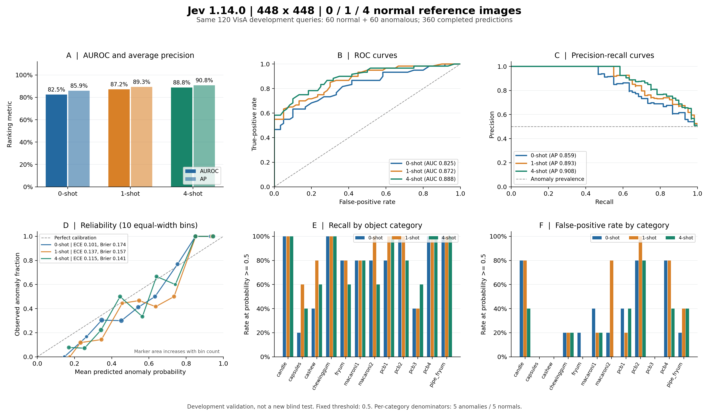

# Jev 图像判断基线实验报告

日期：2026-11-10（Asia/Shanghai）。状态：**正式完成，360/360 个唯一目标判断；独立最终审计通过。**

## 1. 结论先读

在同一批 120 张 VisA 同域开发验证图上，固定问题、448×448 输入和正常支持集，比较 0、1、4 张参考图。

- pooled AUROC 分别为 **82.54%、87.19%、88.85%**；4-shot 相对 0-shot 增加 **6.31 个百分点**。
- 这些是上下文正常参考推理，没有训练或更新 Jev 权重，不是 LoRA。
- 1-shot 在阈值 0.5 下召回最高，4-shot 误报最低；不能说所有指标随参考数单调提高。
- 补充的类别宏 AUROC/AP 点估计也提高，但三个配对比较的类别宏区间均跨零。
- Brier 改善，ECE 不单调；不能宣称模型已在工业域充分校准或达到部署要求。
- 结论只覆盖固定开发集、单支持集和网关接受响应，不是新盲测、定位或 Agent 收益证据。

## 2. 研究问题与固定条件

研究问题：保持查询图、问题与处理不变，增加同类正常参考图，能否改善图像级异常排序、工作点表现和概率误差？

| 项目 | 固定设置 |
|---|---|
| 请求模型 | jev-1.14.0；不使用 latest |
| 接口 | https://api.modelgo.ai/v1/systemone |
| Query | 同一批 120 张 VisA 图，12 类各 5 正常 + 5 异常 |
| 数据角色 | 已被历史开发查看的同域验证集，不是新盲测 |
| Support | 每类固定 4 张训练正常图，共 48 张；1-shot 取 4-shot 首张 |
| 参数更新 | 无训练、无微调、无 LoRA |
| 输入处理 | EXIF 转正、RGB、LANCZOS 等比缩放、居中白色填充至 448×448、PNG compress_level=6 |
| 输出 | answers.anomaly.noul，有限且在 [0,1] 内的概率 |
| 工作点 | 预先固定 p≥0.5 判异常；无事后挑阈值 |
| 目标数 | 120 query × 3 条件 = 360；每臂完整 120 张 |

三个实验臂逐图使用完全相同的处理后 query PNG 字节，仅正常参考图数量不同。类别名在三臂均提供，具体缺陷类型标签不提供。

### 冻结问题原文

```text
Does the image in state field query show at least one visible industrial anomaly (surface damage, contamination, missing material or component, or structural irregularity)? Treat normal_references, if provided, as normal examples of the same object category. Judge query, not the references. Ordinary differences in viewpoint, lighting, background, or object identity alone are not defects.
```

冻结 criteria 原文：

```json
{
  "true": "At least one visible industrial defect is present in query.",
  "false": "No visible industrial defect is present in query."
}
```

问题明确只判断 query，normal_references 作为已知正常外观示例。普通视角、光照、背景或物体个体差异本身不视作缺陷。

## 3. 数据恢复、参考选择与泄漏隔离

原始 manifest 在外层工程的 industrial_vlm/prepared/multitask_v2 中，发布目录自身不含完整原始数据集。

训练清单有 1536 行，但按 source_id 去重后为 768 来源；其中 384 张正常图，每类 32 张。

每类训练正常候选按 SHA256("jev-support-v1|42|" + source_id) 升序取 4 张，1-shot 使用同组首张。没有根据结果调整支持图或其顺序。

本次按需从公开 Hugging Face 镜像 imaadd05/visa-anomaly-detection 固定 commit 恢复图片：

```text
912ae1aa35ac0791e64524a42342850af1605363
```

恢复 **168/168** 张，即 120 query + 48 正常支持，总计 **29,846,288 字节**；逐张原始 SHA256 和大小与历史审计一致。处理后 168 张 PNG 另行核验哈希。

- Query 与 support 的来源、规范化路径、原字节 SHA 无交集。
- 请求只含图片资产、类别名与冻结问题；不含真实标签、答案、GT 框、异常面积或含 Normal/Anomaly 的原始路径。
- 上传资产使用中性 UUID；本地 source_id 仅用于结果对齐与审计。
- 标签与请求计划分开保存，评分后才用于指标计算。
- 未读取 confirmation manifest、未打开或评测 confirmation 图像。

证据：[数据恢复审计](../../industrial_vlm/experiments/jev_baseline_20261110/recovery_audit.json)、[冻结计划](../../industrial_vlm/experiments/jev_baseline_20261110/frozen/plan.json)、[图像哈希](../../industrial_vlm/experiments/jev_baseline_20261110/frozen/materialized.json)。

## 4. 主结果：pooled 排序与固定工作点

Pooled AUROC/AP 将所有类别的异常概率共同排序，包含跨类别正负样本比较。AP 为非插值 average precision，不是 PR 曲线梯形面积。

Macro-F1 平均的是正常/异常两个标签的 F1，**不是 12 个物体类别的宏平均**。Recall 是异常召回，FPR 是正常图误报。

| 正常参考数 | AUROC | AP | 二类 Macro-F1 | Recall | FPR |
|---:|---:|---:|---:|---:|---:|
| 0 | 82.54% | 85.94% | 71.60% | 76.67% | 33.33% |
| 1 | 87.19% | 89.34% | 74.66% | 86.67% | 36.67% |
| 4 | 88.85% | 90.80% | 77.50% | 78.33% | 23.33% |

| 参考数 | TP：检出异常 | FP：正常误报 | TN：正常正确 | FN：漏检异常 |
|---:|---:|---:|---:|---:|
| 0 | 46 | 20 | 40 | 14 |
| 1 | 52 | 22 | 38 | 8 |
| 4 | 47 | 14 | 46 | 13 |

1-shot 相对 0-shot 多检出 6 张异常，但多误报 2 张正常图。4-shot 相对 1-shot 少误报 8 张正常图，同时少检出 5 张异常图。

4-shot 相对 0-shot 的排序和 Macro-F1 点估计更好，但其 23.33% 正常误报率仍高，不能据此宣称可直接部署。阈值 0.5 是统一诊断点，不是已优化的产线工作点。

### 主指标配对差值与区间

对同一 query 配对，按类别×标签分层 bootstrap 2000 次、seed42，报告百分位 95% 区间。以下单位均为**百分点**。

| 比较 | 指标 | 差值 | 95% 区间 |
|---|---|---:|---|
| 1-0 | AUROC | +4.653 | [+0.708, +8.653] |
| 1-0 | AP | +3.400 | [+0.423, +6.287] |
| 4-0 | AUROC | +6.306 | [+2.485, +10.224] |
| 4-0 | AP | +4.868 | [+2.032, +7.737] |
| 4-1 | AUROC | +1.653 | [+0.125, +3.514] |
| 4-1 | AP | +1.467 | [+0.021, +3.123] |

这些 pooled 区间均不跨零，但只刻画固定类别、固定支持、已接受单次响应下的 query 重采样差异。没有服务重复采样、支持集选择变化或多重比较校正，不能扩展为普遍显著性保证。

## 5. 补充结果：类别宏平均与逐类差异

类别宏指标先在每个类别的 5 正常/5 异常内计算，再对 12 类等权平均，不包含跨类别排序。它与 pooled 回答的问题不同，**两者都报告，不按哪个更有利选择结论**。类别宏是补充分析，不替换冻结主终点。

| 参考数 | 类别宏 AUROC | 类别宏 AP |
|---:|---:|---:|
| 0 | 90.50% | 92.93% |
| 1 | 93.00% | 95.21% |
| 4 | 93.83% | 95.50% |

| 比较 | 类别宏指标 | 差值（pp） | 95% 区间（pp） |
|---|---|---:|---|
| 1-0 | AUROC | +2.500 | [-3.338, +8.500] |
| 1-0 | AP | +2.282 | [-1.515, +5.876] |
| 4-0 | AUROC | +3.333 | [-2.000, +9.004] |
| 4-0 | AP | +2.565 | [-1.108, +6.109] |
| 4-1 | AUROC | +0.833 | [-2.000, +4.000] |
| 4-1 | AP | +0.284 | [-1.534, +2.232] |

**所有类别宏差值区间均跨零。** 当前样本不足以稳健证明类别内排序的总体改善；pooled 与类别宏差异提示跨类别分数尺度/偏移也可能影响全局排序和统一阈值，不能单凭此观察确定因果。

下面每个单元按 **0-shot / 1-shot / 4-shot** 顺序列出百分比；每类只 10 张图，单个正常或异常错误会改变对应 FPR/Recall 20 个百分点。

| 类别 | AUROC（0 / 1 / 4） | Recall（0 / 1 / 4） | FPR（0 / 1 / 4） |
|---|---|---|---|
| candle | 94.0 / 100.0 / 100.0 | 100.0 / 100.0 / 100.0 | 80.0 / 80.0 / 40.0 |
| capsules | 88.0 / 80.0 / 80.0 | 20.0 / 60.0 / 40.0 | 0.0 / 0.0 / 0.0 |
| cashew | 96.0 / 100.0 / 100.0 | 40.0 / 80.0 / 60.0 | 0.0 / 0.0 / 0.0 |
| chewinggum | 100.0 / 100.0 / 100.0 | 100.0 / 100.0 / 100.0 | 20.0 / 20.0 / 20.0 |
| fryum | 96.0 / 96.0 / 92.0 | 80.0 / 80.0 / 60.0 | 20.0 / 0.0 / 0.0 |
| macaroni1 | 84.0 / 88.0 / 88.0 | 80.0 / 80.0 / 80.0 | 40.0 / 20.0 / 20.0 |
| macaroni2 | 92.0 / 92.0 / 96.0 | 80.0 / 100.0 / 60.0 | 20.0 / 80.0 / 0.0 |
| pcb1 | 90.0 / 100.0 / 96.0 | 80.0 / 100.0 / 100.0 | 40.0 / 20.0 / 40.0 |
| pcb2 | 76.0 / 80.0 / 84.0 | 100.0 / 100.0 / 80.0 | 80.0 / 100.0 / 80.0 |
| pcb3 | 78.0 / 88.0 / 94.0 | 40.0 / 40.0 / 60.0 | 0.0 / 0.0 / 0.0 |
| pcb4 | 100.0 / 96.0 / 100.0 | 100.0 / 100.0 / 100.0 | 80.0 / 80.0 / 40.0 |
| pipe_fryum | 92.0 / 96.0 / 96.0 | 100.0 / 100.0 / 100.0 | 20.0 / 40.0 / 40.0 |

例如 capsules 的类别内 AUROC 在提供参考图后下降，pcb3 则改善；candle/pcb4 即便 AUROC 很高，在 0.5 工作点仍有较多误报。不能用排序优秀替代阈值判断正确。

## 6. 概率表现与校准边界

| 参考数 | Brier（越低越好） | 10 等宽箱 ECE（越低越好） |
|---:|---:|---:|
| 0 | 0.174259 | 0.100917 |
| 1 | 0.157224 | 0.136583 |
| 4 | 0.141269 | 0.114917 |

Brier 随参考数下降，但 ECE 从 0-shot 到 1-shot 变差，4-shot 也未低于 0-shot，因此不能写成“参考越多，概率校准越好”。

ECE 使用冻结 10 个等宽概率箱，p=1 归入最后一箱；每箱数量、正例数、平均概率与正例比例见 [补充指标](../../industrial_vlm/experiments/jev_baseline_20261110/runs/modelgo_448/supplemental_metrics.json)。

仅 120 张且异常比例为 50%，校准与 AP 不能自动外推至低异常率产线。不能在原验证集拟合校准后又在同一集宣称验证成功。整体只有 60 张正常图，5% FPR 约对应 3 张图，低误报评估分辨率有限。

## 7. 图表



[PNG 原图](../../industrial_vlm/experiments/jev_baseline_20261110/figures/jev_448_0_1_4_comparison.png) · [SVG 矢量图](../../industrial_vlm/experiments/jev_baseline_20261110/figures/jev_448_0_1_4_comparison.svg)

## 8. 输入预算、延迟与真实调用账目

下表 usage 是接受成功响应上报的 token，不包括没有 usage 的失败或未知上游执行，也不等于已核实账单。延迟是客户端成功请求耗时，包含网关、上传、排队、服务和网络。

| 参考数 | 成功输入 token 总数 | 平均输入 token/图 | 输出 token 总数 | 成功均值秒 | 中位秒 | P95 秒 |
|---:|---:|---:|---:|---:|---:|---:|
| 0 | 113,648 | 947.07 | 2,520 | 15.45 | 13.43 | 29.04 |
| 1 | 179,462 | 1495.52 | 2,520 | 25.49 | 22.83 | 52.94 |
| 4 | 376,955 | 3141.29 | 2,520 | 38.22 | 35.99 | 68.91 |

观察到成功 usage 合计 **670,065 input tokens、7,560 output tokens**。没有可靠货币费用字段，本报告不估算人民币或美元成本。

完整调用账目：**494 started = 360 接受成功 + 133 显式失败 + 1 中断无终态未知**；超出 360 个首尝试的额外 retry 为 134 次，108 个目标发生重试，每目标最多 5 次 started。

133 次显式失败中，67 次 HTTP 502，另 66 次为超时或传输错误。加上 1 次无终态中断，共 67 次上游完成状态未知；这个“未知”是与部分观察失败重叠的状态，不应重复相加到 494 分母。

所有 134 次失败或未知尝试缺少 usage。缺少 usage 不表示零 token 或零费用。已接受成功并落盘的目标没有再次提交，但超时/中断可能已在上游完成，因此不能保证上游计算或计费绝无重复。

### 操作阶段与修订

| 阶段 | 并发 | Started | 成功 | 显式失败 | 中断未知 | 成功平均秒 |
|---|---:|---:|---:|---:|---:|---:|
| original_workers3 | 3 | 78 | 61 | 16 | 1 | 18.92 |
| rolling6 | 6 | 221 | 135 | 86 | 0 | 27.73 |
| transport_rolling6 | 6 | 195 | 164 | 31 | 0 | 28.06 |

原阶段每批 3 并发获得 61 个成功；独立 rolling6 执行器新增 135 个成功，累计 196；transport_rolling6 新增 164 个成功，累计 360。

第二次操作修订增加每线程 Session、connect/upload 60 秒、read 120 秒，并将累计 started 上限设为 5。科学配置、原 runner、contract、UUID、图像、支持、问题及每目标 JSON body/request SHA 保持不变；日志旧前缀均通过核验。

开始至最后记录完成的 wall span 为 **3008.12 秒（约 50.14 分钟）**，包含暂停和恢复。成功请求 elapsed 合计 9499.36 秒、显式失败 2961.02 秒；并发下二者不能直接相加当墙钟总时间，未知中断耗时未补造。

因此各臂成功延迟以及阶段之间的差异均不能称为模型固有速度或受控性能 benchmark。具体改动见 [修订一](../../industrial_vlm/experiments/jev_baseline_20261110/runs/modelgo_448/operational_amendment.json)、[修订二](../../industrial_vlm/experiments/jev_baseline_20261110/runs/modelgo_448/operational_amendment_v2.json) 与 [补充调用核算](../../industrial_vlm/experiments/jev_baseline_20261110/runs/modelgo_448/supplemental_metrics.json)。

## 9. 接口与版本溯源

正确接口是 /v1/systemone，使用中性 UUID 的 assets、PNG data_base64 与图片 header。用户最初提供的 /v1/content_generation/tasks 文本 prompt 示例不用于本实验。

ModelGo 通用文档与当前模型卡存在矛盾，但单图、双图、五图 assets 真实请求及完整 360 个工业结果均证明本次渠道能传输图片和返回 typed Noul；不能再概括为“不支持图像”。

请求固定 jev-1.14.0，响应逻辑名均匹配。但网关声明该字段可能为逻辑请求名回显，不能独立证明上游实际权重、路由或版本不可变。可审计的是端点、请求逻辑名、图片与问题字节、响应结构和 request ID。

## 10. 与历史 Qwen 结果的关系

历史原生 Qwen 量化底座 AUROC 82.39%、DD 适配器 94.56% 来自相同 120 张开发图。其原生视觉处理、提示、训练暴露、输入预算、概率定义与运行环境不同。

因此可作历史背景，不能把 Jev 与 Qwen 的差值因果归于架构，不能把正常参考 few-shot 等同 LoRA，也不能将 0-shot 接近历史底座点估计解释成模型能力等价。应另设匹配输入与预算的比较。

## 11. 独立最终审计与复现

[FINAL_AUDIT.md](../../industrial_vlm/experiments/jev_baseline_20261110/runs/modelgo_448/FINAL_AUDIT.md) 状态为**通过**；[机器审计记录](../../industrial_vlm/experiments/jev_baseline_20261110/runs/modelgo_448/final_audit.json) 保存逐项哈希、独立指标和尝试分布。

独立审计重新验证 168 原图/PNG、来源隔离、支持选择、360 唯一身份、全量冻结 payload 及日志前缀；未修改原始预测。AUROC 用正负两两比较、同分计 0.5，AP 用阈值分组非插值定义，独立复算与 primary/supplement 在 1e-12 容差内一致。

正式预测文件 SHA256：

```text
c261c972ecb4eb514626b8c23bca11679f9536c41280043ac48f8be2dbacfac2
```

从外层项目根执行只读指标复算与图表命令；它们不重新调用 API：

```bash
PY=/opt/anaconda3/bin/python
BASE=Qwen-VLM/industrial_vlm/experiments/jev_baseline_20261110
"$PY" "$BASE/runner.py" evaluate --output "$BASE/runs/modelgo_448"
"$PY" "$BASE/supplement_results.py" --output "$BASE/runs/modelgo_448"
"$PY" "$BASE/plot_results.py"
```

| 复现产物 | 链接 |
|---|---|
| 说明与运行规则 | [README](../../industrial_vlm/experiments/jev_baseline_20261110/README.md) |
| 冻结问题与依赖 | [config.json](../../industrial_vlm/experiments/jev_baseline_20261110/frozen/config.json) |
| 冻结数据身份 | [plan.json](../../industrial_vlm/experiments/jev_baseline_20261110/frozen/plan.json)、[materialized.json](../../industrial_vlm/experiments/jev_baseline_20261110/frozen/materialized.json) |
| 运行契约 | [contract.json](../../industrial_vlm/experiments/jev_baseline_20261110/runs/modelgo_448/contract.json) |
| 主指标和配对区间 | [metrics.json](../../industrial_vlm/experiments/jev_baseline_20261110/runs/modelgo_448/metrics.json)、[RESULTS.md](../../industrial_vlm/experiments/jev_baseline_20261110/runs/modelgo_448/RESULTS.md) |
| 类别宏、校准分箱、失败/usage核算 | [supplemental_metrics.json](../../industrial_vlm/experiments/jev_baseline_20261110/runs/modelgo_448/supplemental_metrics.json) |
| 接口预检 | [gateway_probe](../../industrial_vlm/experiments/jev_baseline_20261110/gateway_probe.json)、[reference probe](../../industrial_vlm/experiments/jev_baseline_20261110/gateway_probe_references.json) |

凭证经环境变量或隐藏输入读取，不落盘。实验与 docs 文本扫描未发现 live-key 或长 Bearer 模式；原始 Authorization、图片 base64 和敏感错误响应不进入报告。

## 12. 科学限制与下一步

1. 当前是已查看的同域开发集，不是新盲测或跨域确认；没有触碰 confirmation。
2. 只有一个正常支持集和顺序，每个目标仅接受一个响应，未测服务重复和支持选择波动。
3. 增加支持同时增加图像、信息和 token 预算，不能隔离纯样本数效应，更不能声称越多越好。
4. Bootstrap 固定 12 类构成和每类标签数量，不含新类别、服务或支持集变化，未做多重比较校正。
5. 每类 5 正常/5 异常，类别指标很粗，校准诊断不稳定；50% 异常率与真实产线可能差异大。
6. 数据公开，无法独立排除上游基座预训练见过；镜像 SHA 一致保障输入身份，不保障预训练隔离。
7. 图片能力仍为厂商实验功能，逻辑模型名不独立证明上游实际版本；混合操作阶段不能用作模型速度结论。
8. 仅评估图像级异常判断，没有评估 Box、像素分割、自主裁剪或 Agent 任务成功率。

下一步优先固定已有 DINO/teacher 候选区域，比较不复核、现有 scorer 门控与 Jev 复核，完整报告异常召回、正常误报、定位与预算；不只看被接受子集。

若研究概率与拒答，先用独立校准数据确定规则，再在新的留出集确认。增加正常支持种子、分辨率与匹配 Qwen 输入预算均应新立实验，不覆盖本轮冻结结果。

本阶段可辩护的项目表述：**完成 Jev 图像级 0/1/4 正常参考上下文基线，360 个配对判断与完整审计；固定开发协议下 pooled AUROC 从 82.54% 提高到 88.85%，同时揭示统一阈值误报、类别异质性与校准限制。**
