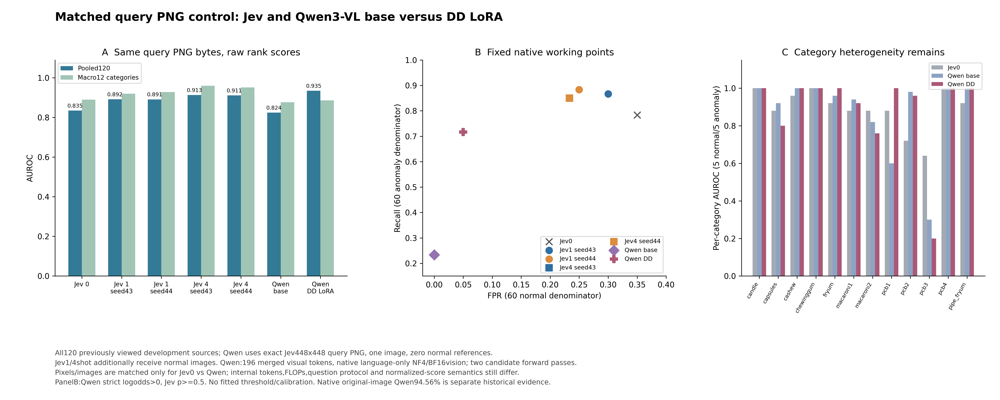
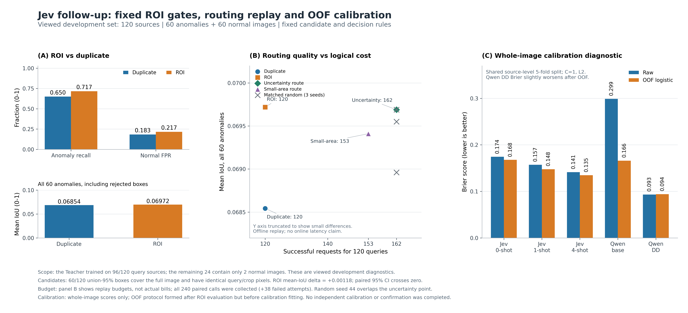

# Jev 判别式基线：定位、结果与边界

> 更新：2026-11-11。本文是 Qwen-VLM 主项目的**附加对照研究**，不改变原有“AnomalyGPT → Qwen 语言迁移 + 原生 Qwen3-VL QLoRA”的主线。Jev 只作为另一条通用判别基线和决策层试验台，用来回答“领域后训练、上下文参考、校准和路由各自贡献多少”。

## 1. 为什么引入 Jev

Jev 是 TypeSafe AI 的 **System One 判别模型**：输入 `state` 和类型化问题，输出 `Noul`（是/否概率）、`Choice`（选项概率）、`Score`（有序评分）或 `Box`（位置），不生成自然语言。它不是 LLM，也不是检测主干。

在本项目里，Jev 承担三个角色：

1. **通用判别基线**：在同一批工业图像上测零样本和正常参考图 few-shot，量化“通用能力”与“领域后训练”的差距。
2. **决策层原型**：用 Noul 概率做“是否需要裁剪”、三态路由和人工升级，检验通用判别器能否成为 Agent 的决策组件。
3. **校准与评测试验台**：用原生概率做 Brier/ECE、固定 FPR、置信区间和负结果分析，补上主线此前较弱的部署层证据。

## 2. 实验设计

- **同一批 query**：120 张 VisA 同域开发图（12 类，60 正常 / 60 异常），与训练来源隔离。
- **同一输入条件**：448×448 等比缩放 + 白色填充；Jev 与 Qwen 共用同一批 PNG。
- **Jev 条件**：0 / 1 / 4 张同类正常参考图；参考图只作为推理上下文，不更新权重，不是 LoRA。
- **Qwen 对照**：同一批图、同一 448 输入，比较 NF4 量化底座与 DD LoRA。
- **后续实验**：固定 Teacher 候选的 ROI 复核（240 个判断）、24 图真实 gate→裁剪→末级请求 pilot（61 次请求）、cal120/heldout120 校准、一次性 confirmation240。

## 3. 主结果：通用能力、few-shot 与领域后训练

| 系统 | 训练方式 | AUROC | 默认阈值下 Recall | 默认阈值下 FPR |
|---|---|---:|---:|---:|
| Jev 0-shot | 无训练，仅提示 | 83.46% | 78.33% | 35.00% |
| Jev 1-shot（seed43 / 44） | 1 张正常参考 | 89.21% / 89.14% | 86.67% / 88.33% | 30.00% / 25.00% |
| Jev 4-shot（seed43 / 44） | 4 张正常参考 | **91.33% / 91.13%** | 85.00% / 85.00% | 23.33% / 23.33% |
| Qwen 量化底座 | 无领域训练 | 82.44% | 23.33% | 0.00% |
| Qwen DD LoRA | 领域 SFT | **93.49%** | 71.67% | **5.00%** |

三点结论：

- 通用零样本能力接近：Jev 0-shot 83.46% 与 Qwen 量化底座 82.44% 只差约 1 个百分点。
- 领域后训练仍是最强杠杆：DD 比底座高 **11.05 个百分点**。
- 上下文参考能回收大部分差距，但没有追平：Jev 4-shot 比 0-shot 高约 **7.7–7.9 个百分点**，仍比 DD 低 **2.16 个百分点**。首轮旧渲染的 0/1/4-shot 为 82.54% / 87.19% / 88.85%（+6.31pp），说明“参考图增益”在两轮渲染上都存在。

> 注意：Jev 用 0.5 阈值，Qwen 用 `log-odds > 0`，默认运行点不同；Recall/FPR 不能直接当作模型排名。AUROC 才是同图同标签下可比的排序指标。

## 4. ROI 复核与动态路由：两个负结果

### 4.1 候选区域复核

固定 Teacher union95 候选，比较“候选裁片交给 Jev”与“重复原图交给 Jev”：

| 条件 | 全异常 mean IoU | 异常保留召回 | 正常出框率 |
|---|---:|---:|---:|
| ROI 复核 | 0.069719 | 71.67% | 21.67% |
| 重复原图对照 | 0.068542 | 65.00% | 18.33% |

mean IoU 差 **0.001176**，配对 95% 区间跨 0。更关键的是候选本身：Teacher 无条件候选 mean IoU 仅 **0.089529**，且 **60/120 是整图框**；整图异常候选的 IoU 只有 0.0123，而面积 1%–10% 的候选可达 0.4138。**决策层无法修复上游几何**，这是 ROI 方向的主要瓶颈。

### 4.2 真实在线 gate→裁剪→末级请求

24 张已看开发图（12 正常 / 12 异常），13 个 eligible 候选，固定 K=8；24 次 gate、24 次新 duplicate、13 次真实裁片末级请求，共 **61 次**，全部 HTTP 200，0 失败、0 未知。

| 策略 | AUROC（整图标签代理） | Recall | 正常 FPR |
|---|---:|---:|---:|
| 新 duplicate 基准 | **82.99%** | 58.33% | 16.67% |
| Jev crop-needed gate | 77.08% | 66.67% | 25.00% |
| 同 K 随机 | 77.78% | 66.67% | 25.00% |
| 候选面积优先 | 81.94% | 58.33% | 16.67% |

Jev gate 多检出 1 个异常，同时多报 1 个正常；相对基准 AUROC 低 **5.90 个百分点**，配对区间 `[-17.36, +2.08]`。**通用判别器不等于策略头**；pilot 证明了真实调用链可运行，但没有证明智能路由更好或更省费。

后续困难样本实验：`connected95` 将候选 mean IoU 从 0.089529 提升到 0.180475，并消除整图框；Qwen DD gate 回顾 AUROC 82.64%，不优于新 duplicate 82.99%，Jev gate 仍为 77.08%。因此暂停付费 Jev 路由，保留为困难样本语义复核候选。详见 [hardcase 目录](../../industrial_vlm/experiments/jev_hardcase_integration_20261111/README.md)。

## 5. 校准、三态路由与最终确认

- **校准不改变排序**：heldout120 上 logistic 校准后 AUROC 92.82% 不变、Recall 88.33% 不变，但 FPR 18.33%→**10.00%**、Brier 0.12423→**0.10774**。
- **固定经验 FPR**：目标 5% → heldout FPR 3.33%、Recall 75.00%；目标 10% → FPR 5.00%、Recall 81.67%。这是校准集经验运行点，不是未来总体保证。
- **三态路由**：`p<0.07` 自动正常、`p≥0.80` 自动异常、中间人工；自动覆盖 34.17%、人工 65.83%；自动误报 1/60=1.67%，异常自动放行 0/60，自动正常污染 0/5（但只有 5 张，Wilson 上界 43.45%）。
- **一次性 confirmation240**：AUROC **90.18%**、Recall **85.00%**、FPR **20.83%**；相对 raw 少 5 个误报、多 4 个漏检，Brier 0.14010→0.12697。

结论：校准是**部署层**，不是性能层；三态路由是“用人工覆盖率换低误报”，不是免费降 FPR。

## 6. 语义复核：只完成最小诊断

- 严格空间规则下 24 个来源只有 2 个合格；8 次有图/无图空间命题全部成功；有图 4/4 与 mask 空间代理一致，平均分离度 0.44，无图 0.055。
- 只有 2 个独立来源，标签还是 mask 派生的，不能包装成“语义核验准确率 100%”。
- 已准备 24 个来源、48 张图、48 份空表的人工复核包；当前 `human_completed=0`，等待两位复核者独立填写。

## 7. 有价值的结论

1. **Jev 是“通用判别器”，不是“通用判断者”**：能做有限答案的校准判断，但不写解释、不做多步推理、不补外部证据。
2. **本任务上：领域 SFT > 上下文 few-shot > 零样本**：约 93.49% > 91.33% > 83.46%；有标签时 SFT 仍是最强杠杆，没标签时 few-shot 是性价比最高的基线。
3. **校准是部署层，不是排序层**：校准改善 Brier/FPR，但 AUROC/Recall 不变；不要指望校准“提升模型能力”。
4. **决策层受限于上游感知**：60/120 整图候选、mean IoU 0.0895；再好的 gate 也修不了几何。
5. **通用 gate 不等于策略头**：Jev gate 77.08% 低于 duplicate 82.99%，也低于同 K 随机 77.78%。
6. **三态路由的代价是人工覆盖率**：自动覆盖 34.17%、人工 65.83%；业务上要问“人工能不能接住”，而不只是 AUROC。
7. **闭源模型的概率不能直接迁移**：版本、图片 header、网关行为和域内校准都需要本地复验。
8. **评测纪律比单点数字更重要**：训练暴露 96/120、unseen 24 只有 2 张正常、confirmation 已查看，这些边界必须写清楚。

## 8. 边界

- 所有结果来自 **已查看的开发集**，不是新盲测；confirmation240 已查看，不能再用于同轮调参。
- Jev 4-shot 91.33% 低于 Qwen DD 93.49%，**不能写“Jev 更强”**；两者阈值和内部算力也不同。
- ROI 复核和在线路由均未证明净收益；不能写“定位提升”或“Agent 已部署”。
- 图片/Box 是厂商实验特性，不能写生产就绪；语义复核尚未完成人工 gold。
- 仓库只保留报告、代码、协议、汇总指标和图表，不包含原始图片、权重、缓存、逐样本预测或人工复核原图。

## 9. 目录与证据

### 文档

- [能力分析与项目应用研究](Jev_能力分析与项目应用研究.md)
- [三项推进完成情况与结果汇总](Jev_三项推进完成情况与结果汇总_20261111.md)
- [推荐清单完成情况与下一轮计划](Jev_推荐清单完成情况与下一轮计划_20261111.md)
- [研究任务清单](Jev_研究任务清单.md)
- [图像判断基线实验报告](Jev_图像判断基线实验报告.md)
- [下一轮执行计划与采纳意见](Jev_下一轮执行计划与采纳意见_20261111.md)
- [执行环境与复现边界](执行环境与复现边界.md)

### 实验

- [困难样本二次判定器：候选几何与 Qwen DD gate 回顾](../../industrial_vlm/experiments/jev_hardcase_integration_20261111/README.md)
- [Jev 图像判断基线（0/1/4-shot）](../../industrial_vlm/experiments/jev_baseline_20261110/README.md)
- [阶段 01–13 完整报告](../../industrial_vlm/experiments/jev_followup_20261111/CONTINUOUS_RESEARCH_COMPLETION.md)
- [候选瓶颈分析](../../industrial_vlm/experiments/jev_followup_20261111/CANDIDATE_FAILURE_ANALYSIS.md)
- [匹配 448 输入的 Qwen 对照](../../industrial_vlm/experiments/jev_followup_20261111/stage09_qwen_matched/REPORT.md)
- [ROI 复核报告](../../industrial_vlm/experiments/jev_followup_20261111/REPORT.md)
- [在线路由报告](../../industrial_vlm/experiments/jev_decision_round2_20261111/online_route_pilot/REPORT.md)
- [固定 FPR 独立审计](../../industrial_vlm/experiments/jev_decision_round2_20261111/fixed_fpr_operating_points/independent_audit.md)
- [语义复核设计](../../industrial_vlm/experiments/jev_decision_round2_20261111/human_semantic_review/DESIGN_AND_PLAN.md)
- [最终确认报告](../../industrial_vlm/experiments/jev_followup_20261111/stage13_confirmation/REPORT.md)
