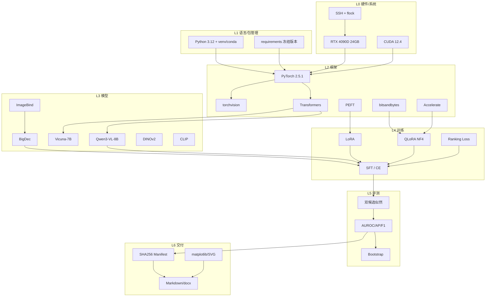

# Qwen-VLM 技术栈全景与从零实操教程

> **文档定位**：把 [Qhf7/Qwen-VLM](https://github.com/Qhf7/Qwen-VLM) 这个仓库里"实际用到的全部技术"拆开讲清楚，并给出一条可以从零走到能复现实验的路线。
>
> **整理日期**：2026-11-06
> **对应代码**：本仓库当前 `main` 分支（本地路径 `Qwen-VLM/`）
> **读者**：已经会写 Python、学过一点深度学习，但没做过"视觉语言模型 + 工业异常检测"完整项目的人
>
> **重要前提**：本仓库是**代码与文档交付副本**，不含数据集、底座权重、LoRA/adapter 权重、特征缓存（见 [ASSETS.md](../ASSETS.md)）。教程里的每一步都会说明"哪些能直接跑、哪些必须先准备资产"。

---

## 目录

- [0. 怎么用这份文档](#0-怎么用这份文档)
- [1. 项目全景：它到底在做什么](#1-项目全景它到底在做什么)
- [2. 技术栈总表](#2-技术栈总表)
- [3. 前置知识包（贯穿全程）](#3-前置知识包贯穿全程)
- [4. 分阶段实操教程](#4-分阶段实操教程)
  - [Step 0 环境与资产准备](#step-0-环境与资产准备)
  - [Step 1 拿代码、读懂仓库、跑通 CPU 自测](#step-1-拿代码读懂仓库跑通-cpu-自测)
  - [Step 2 数据工程：VisA 划分、mask 语义与指令构造](#step-2-数据工程visa-划分mask-语义与指令构造)
  - [Step 3 视觉定位前端：ImageBind + BigDec](#step-3-视觉定位前端imagebind--bigdec)
  - [Step 4 跨模态桥接层：19 个 soft token](#step-4-跨模态桥接层19-个-soft-token)
  - [Step 5 语言骨干受控迁移：Vicuna vs Qwen](#step-5-语言骨干受控迁移vicuna-vs-qwen)
  - [Step 6 语言 LoRA：B/C/D 三臂对照](#step-6-语言-lorabcd-三臂对照)
  - [Step 7 原生 Qwen3-VL QLoRA（独立路线）](#step-7-原生-qwen3-vl-qlora独立路线)
  - [Step 8 连续评分与指标：从生成答案到 AUROC](#step-8-连续评分与指标从生成答案到-auroc)
  - [Step 9 结构化输出与排序目标](#step-9-结构化输出与排序目标)
  - [Step 10 冻结外部评测与工具调用实验](#step-10-冻结外部评测与工具调用实验)
  - [Step 11 工程化交付：让结果可复核](#step-11-工程化交付让结果可复核)
- [5. 六段关键代码精读](#5-六段关键代码精读)
- [6. 常见坑与排错清单](#6-常见坑与排错清单)
- [7. 学习效果自测](#7-学习效果自测)
- [8. 术语表](#8-术语表)
- [9. 参考入口](#9-参考入口)

---

## 0. 怎么用这份文档

### 0.1 三条阅读路径

| 你的目标 | 建议路线 | 预计时间 |
|---|---|---|
| **只想搞懂这个项目在讲什么**（答辩/汇报） | 第 1 章 → 第 2 章 → 第 8 章术语表 → 第 7 章自测 | 2～3 小时 |
| **想复现其中一条技术路线** | 第 3 章前置知识 → Step 0/1/2 必做 → 选 Step 3+4+5+6（迁移路线）或 Step 7（原生路线）→ Step 8 | 1～2 周（含等 GPU） |
| **想在此基础上做新研究** | 全部读一遍，重点第 5 章代码精读与第 6 章避坑 | 2～3 周 |

### 0.2 每一步的统一结构

从第 4 章开始，每个 Step 都按同一模板写，方便你跳读：

```
🎯 本步目标与产出物
📚 前置知识（这一步为什么需要它）
🛠 操作步骤（可以复制执行的命令）
🔍 代码怎么读（对应文件 + 行号 + 关键片段）
✅ 验收标准（怎么判断你做对了）
⚠️ 常见坑
```

### 0.3 关于环境的两句话

- **有 GPU**（≥24GB，本项目实测单张 RTX 4090D 24GB）：可以跑完整训练与评分。
- **只有 CPU / Mac**：只能做数据准备、指标复算、解析器自测、文档与图表生成。**不要**指望在 CPU 上跑 8B 模型的 LoRA 训练。本仓库大量脚本明确写了 `requires one CUDA GPU with bf16 support`，这是设计约束，不是没优化。

### 0.4 本文与原仓库文档的关系

仓库里已经有很多高质量文档（[项目精读](项目精读/00_导读与项目地图.md)、[成果总结](项目成果与创新总结.md)、[代码索引](项目精读附录_代码与文件索引.md)）。本文不重复它们的内容，而是**补上"技术栈清单 + 教学顺序 + 操作命令"**这三件它们在体例上没有覆盖的事。遇到细节想深挖，本文会指向那些文档。

---

## 1. 项目全景：它到底在做什么

### 1.1 一句话版本

> 用 **Qwen3-VL-8B** 做工业异常检测（Industrial Anomaly Detection）：既要判断"这张零件图有没有缺陷"，又要能说出"缺陷大概在哪"，并且要**用可复核的实验证明每一处性能提升到底来自哪个技术选择**。

这句话里有三个关键词，对应项目的三条技术路线：

| 关键词 | 技术含义 | 对应路线 |
|---|---|---|
| **Qwen3-VL-8B** | 一个视觉语言模型（VLM）。项目研究"怎么把一个通用 VLM 改造成工业质检专家" | 路线 B：原生 Qwen3-VL QLoRA |
| **参数高效** | 不重训 8B 全参数，只训 383 万～1533 万个参数 | 路线 A：语言迁移 + LoRA/QLoRA |
| **可复核** | 每个数字都要能追到输入哈希、代码哈希、权重哈希 | 全项目的工程主线 |

### 1.2 三条技术路线（这是理解整个仓库的钥匙）


上图是本项目的"总纲"。把它拆成三条互不混淆的路线：

#### 路线 A：语言迁移 + 参数高效后训练（项目主线）

```
工业图像
  → ImageBind ViT-H（冻结）→ 4 层 patch 特征 + 全局 CLS
  → BigDec 解码器（可训练，5.4M 参数）→ 224×224 异常热图
  → 19 个 soft token（1 个 CLS 投影 + 18 个 PromptLearner token）
  → Qwen3-VL 的【语言部分】（视觉塔完全不用，BF16 冻结）
  → 三个出口：首答案 Yes/No 分数、自由生成、结构化 JSON
```

这条路线又分四代实验：

| 代号 | 训什么 | 可训练参数 | 作用 |
|---|---|---:|---|
| **Phase 1 / A** | 桥接层（PromptLearner + CLS 投影） | 111,614,904 | 证明"换语言骨干"有收益：Vicuna 88.97% → Qwen 92.58% AUROC |
| **B** | 从 A 继续训桥接 | 111,614,904 | 控制臂：继续训桥接还能不能涨 |
| **C** | 冻结桥接，只训语言 q/v LoRA | **3,833,856** | 参数高效路线主结果：93.70% AUROC |
| **D** | 桥接低 LR + 语言 LoRA 联合 | 115,448,760 | 联合适配，略高于 C 但参数代价大 |
| **Cpair / R** | 加不加 pairwise ranking | 3,833,856 | 研究排序目标：域内涨、域外跌 |
| **S** | 从 C best 继续训结构化输出 | 3,833,856 | 让模型输出 `Yes + {bbox, location}` |

#### 路线 B：原生 Qwen3-VL QLoRA（独立对照）

```
工业图像 + 指令
  → Qwen3-VL 原生 processor（图像预处理、chat template、image_grid_thw）
  → Qwen 原生视觉塔 + merger + DeepStack（BF16 冻结）
  → 语言模型 NF4 量化 + q/k/v/o LoRA
  → 生成 {"is_anomalous": true, "boxes": [[...]]}
```

这条路线的价值：它保留了 VLM 原生视觉能力，用来回答一个关键问题——**"路线 A 里我们扔掉了 Qwen 的视觉塔，只用外挂 ImageBind 特征，到底损失了多少？"**

#### 路线 C：早期跨零件分割（项目地基）

```
RGB → DINOv2-B/14（冻结）→ 32×32 patch 特征 → 解码器 → 像素级 mask
                                    ↑
                          CLIP 文本锚点（可选的语义辅助）
```

这条路线对应 [seg_cross_part/](../seg_cross_part/)，做的是 Real-IAD 数据集上的跨零件类别泛化（18 类训练 / 6 类整类留出）。它的产出不是最终方案，而是"数据地基 + 泛化基线 + 一批踩过的坑"。

### 1.3 仓库目录地图

| 路径 | 内容 | 读者什么时候看 |
|---|---|---|
| [README.md](../README.md) | 项目入口、结果入口、代码入口 | 第一次打开 |
| [ASSETS.md](../ASSETS.md) | **必须外部准备**的底座/数据/权重清单 | 想跑起来之前 |
| [THIRD_PARTY.md](../THIRD_PARTY.md) | 上游组件来源与许可证 | 关心合规 |
| [industrial_vlm/src/industrial_vlm/](../industrial_vlm/src/industrial_vlm/) | 原生 Qwen3-VL QLoRA 的完整实现（数据/模型/训练/评分/指标） | Step 2、7、8 |
| [migration_20261103/code/](../migration_20261103/code/) | 桥接层、特征缓存、迁移训练、指标 | Step 3、4、5 |
| [migration_20261103/lora_20261104/](../migration_20261103/lora_20261104/) | B/C LoRA 训练与验证 | Step 6 |
| [migration_20261103/advanced_20261104/](../migration_20261103/advanced_20261104/) | D/Cpair/R/S、结构化输出、外评、工具调用 | Step 9、10 |
| [migration_20261103/student_roi_20261104/](../migration_20261103/student_roi_20261104/) | 学生模型 ROI 选择 | Step 10 拓展 |
| [repair_20261103/](../repair_20261103/) | 定位管线修复（mask/几何/特征轴）与复评 | **Step 3 必读** |
| [seg_cross_part/](../seg_cross_part/) | 早期分割训练、指标、协议 | 路线 C |
| [AnomalyGPT/](../AnomalyGPT/) | AnomalyGPT/ImageBind 必要运行时快照 + 迁移脚本 | Step 3、4 |
| [industrial_vlm/ops/](../industrial_vlm/ops/) | 数据下载、环境审计、流水线编排、绘图 | Step 11 |
| [docs/](../docs/) | 全程精读、成果总结、图表 | 随时 |

### 1.4 已经跑出来的关键数字（附口径）

> ⚠️ 看数字前必须先看口径。这个项目最值得学习的地方之一，就是它把每个数字的适用范围写得很死。

| 实验 | 数据 | 指标 | 结果 |
|---|---|---|---|
| 定位前端修复 | VisA 历史 456 图 | 类别宏 Pixel AUROC | 80.51% → **97.68%** |
| Phase 1 语言迁移（3 seed 均值） | VisA 自定义 val 380 | Image AUROC | Vicuna 88.97% → **Qwen 92.58%** |
| C：q/v LoRA（3 seed 均值） | 同上 | Image AUROC | **93.70%**，生成 Macro F1 86.17% |
| D：联合适配 | 同上 | Image AUROC | 94.03%（参数 1.15 亿，代价大） |
| R：加 ranking | 同上 | Image AUROC | 94.73%（**域外反而下降**） |
| 原生 QLoRA DD 臂 | VisA val 120 | AUROC | 82.39%（底座）→ **94.56%** |
| 结构化 SFT（S） | 外部 MVTec | 严格结构有效率 | 64.13% → **91.96%** |
| 外部 MVTec 外评 | 1575 图 | AUROC | 约 70%～72% |
| 外部 MVTec 外评 | 1575 图 | 正常 FPR | **61%～72%（不可部署）** |

**必须一起记住的三条边界**：

1. 主线训练用了**真实异常标注**（有监督），不是论文里常见的"只用正常图"无监督协议，所以不能直接和 AnomalyGPT 论文数字比。
2. val 380 被反复用于开发与选点，test 456 也已参与过历史开发，因此这些都不是"未查看确认集"。
3. 外部 FPR 60%+ 说明当前模型**不具备生产可用性**。诚实地写出这一点，比多刷 1 个百分点更有价值。

---

## 2. 技术栈总表

### 2.1 分层总览

把整个仓库的 import 语句、依赖文件、脚本命令全部扫一遍，可以归纳成 7 层。下表按"从下往上"排列：越靠下越基础，越靠上越贴近业务。

#### L0 硬件与运行环境

| 技术 | 规格/版本 | 在项目里做什么 | 证据位置 |
|---|---|---|---|
| NVIDIA RTX 4090D | 24GB 显存，单卡 | 全部训练/推理；单卡单进程，无分布式 | `industrial_vlm/README.md` |
| CUDA | 12.4 | PyTorch 后端 | `industrial_vlm/ops/runtime_audit.json` |
| Linux（AutoDL 容器） | Ubuntu 系 | 训练服务器 | 各协议的运行命令 |
| SSH + rsync | OpenSSH ControlMaster | 本地 ↔ 服务器传代码/拉结果，不存密码 | [ops/remote.py](../industrial_vlm/ops/remote.py) |
| `flock` | util-linux | GPU 文件锁，保证多个实验串行 | 各协议中的 `flock runs/.../gpu.lock` |
| macOS | 本地 | 文档、图表、docx/pdf 生成 | `docs/render.py`、`md2docx.py` |

#### L1 语言与包管理

| 技术 | 版本 | 在项目里做什么 | 证据位置 |
|---|---|---|---|
| Python | 3.12.3 | 全项目 | `ops/runtime_audit.json` |
| venv / conda | `.venv`、`conda-envs/qwen3vl2` | 两套环境隔离（原生路线 vs 迁移路线） | 各协议命令 |
| pip + requirements | `requirements-runtime.txt` | 冻结实测版本 | [industrial_vlm/requirements-runtime.txt](../industrial_vlm/requirements-runtime.txt) |
| pyproject.toml | setuptools | 把 `src/` 装成包 `industrial_vlm` | [pyproject.toml](../industrial_vlm/pyproject.toml) |
| PyYAML | — | 早期分割实验的协议文件 | `seg_cross_part/protocols/*.yaml` |

#### L2 深度学习框架

| 技术 | 版本 | 在项目里做什么 | 证据位置 |
|---|---|---|---|
| PyTorch | 2.5.1 | 张量、自动微分、优化器、AMP | 全局 |
| torchvision | 0.20.1 | 图像变换、数据集加载 | `seg_cross_part`、`AnomalyGPT` |
| Transformers | 5.14.1（代码要求 ≥4.57） | Qwen3-VL / LLaMA / CLIP 的模型、processor、tokenizer | `modeling.py`、`migration_language.py` |
| PEFT | 0.21.2 | LoRA 注入、adapter 保存/加载/导出 | `modeling.py`、`migration_lora_train.py` |
| Accelerate | 1.14.0 | `init_empty_weights`（在 meta device 上枚举结构）、`device_map` | `modeling.py:load_model` |
| bitsandbytes | 0.48.2 | NF4 4-bit 量化、双重量化 | `modeling.py:load_model` |
| safetensors | 0.8.0 | 权重安全序列化 | `_save()` |
| huggingface-hub | 1.29.0 | 本地权重加载（`local_files_only=True`） | 全局 |
| kornia | — | AnomalyGPT 上游的图像增强 | `AnomalyGPT/.../openllama.py` |

#### L3 模型与算法

| 技术 | 规格 | 在项目里做什么 | 证据位置 |
|---|---|---|---|
| **Qwen3-VL-8B-Instruct** | 8B，hidden 4096，36 层 | 语言骨干（路线 A）/ 完整 VLM（路线 B） | `migration_language.py`、`modeling.py` |
| **Vicuna-7B-v1.1** | LLaMA 架构，hidden 4096 | 语言迁移的严格对照臂 | `migration_language.py` |
| **ImageBind ViT-H** | 1280 维，257 token（1 CLS + 256 patch），4 个中间层 | 冻结视觉特征提取 | `dec_big.py`、`AnomalyGPT/` |
| **BigDec 解码器** | ConvTranspose 上采样，5,409,537 参数 | patch 特征 → 224×224 异常热图 | [repair_20261103/code/dec_big.py](../repair_20261103/code/dec_big.py) |
| **AnomalyGPT PromptLearner** | 9 base + 9 adaptive token | 把热图变成 18 个 soft token | `AnomalyGPT/.../AnomalyGPT_models.py` |
| **DINOv2-B/14** | 768 维，448 输入 → 32×32 patch | 早期分割的冻结视觉骨干 | `seg_cross_part/train_seg.py` |
| **CLIP ViT-L/14-336** | 文本塔 + 视觉塔 | WinCLIP 文本锚点基线 | `seg_cross_part/winclip_b2.py` |
| **SpatialHead** | 小 MLP | 学生模型在线选 ROI | `migration_dense_train.py` |

#### L4 训练方法

| 技术 | 参数/配置 | 在项目里做什么 | 证据位置 |
|---|---|---|---|
| SFT（有监督微调） | assistant-only CE | 一切训练任务的底座 | `train.py`、`migration_train.py` |
| **QLoRA** | NF4 + double quant + bf16 compute | 8B 模型塞进 24GB | `modeling.py:75-206` |
| **LoRA** | r=8/α=16（q,v）；r=16/α=32（q,k,v,o） | 参数高效适配 | `migration_lora_train.py:64`、`modeling.py` |
| 全参数训练（小模块） | PromptLearner + 投影，111M | Phase 1 / B 臂 | `migration_train.py` |
| 梯度累积 | micro-batch 1 × accum 4/8 | 显存不够时放大有效 batch | `train.py:main` |
| 梯度检查点 | non-reentrant | 用时间换显存 | `modeling.py` |
| BF16 混合精度 | `torch.autocast` | 前向/反向加速 | 全局 |
| AdamW | wd 0/0.01，foreach=False | 优化器 | `train.py`、`migration_lora_train.py` |
| 学习率调度 | warmup + 线性衰减 / OneCycleLR | 训练稳定性 | `train.py:multiplier` |
| 梯度裁剪 | clip 1.0 | 防炸 | 全局 |
| 多 seed 配对 | seed 42/43/44 | 区分"真实收益"与"随机波动" | 各 RESULTS.md |
| 匹配对照 | Cpair vs R | 单因素归因 | `advanced_20261104` |
| 排序损失 | `softplus(-(s_pos - s_neg))` | 直接优化 AUROC 类排序 | `migration_advanced_train.py` |
| 特征缓存 | CLS + map 存盘 | 避免重复跑视觉前端 | `migration_cache.py` |
| 数据去重 | SHA256 字节哈希 | 防同一张图跨 split | `data.py:_deduplicate` |
| 分层抽样 | (category, label) 分层 + 面积分层 | 保证消融公平 | `data.py:training_subsets` |

#### L5 推理与评测

| 技术 | 在项目里做什么 | 证据位置 |
|---|---|---|
| 贪心解码 | 生成 Yes/No 与 JSON | `migration_language.py:generate` |
| Chat template | 把对话渲染成模型输入 | `processor.apply_chat_template` |
| **双候选对数似然评分** | `logP(true) - logP(false)`，比生成更稳 | `score.py:_score_image` |
| Token 边界审计 | 校验布尔值的 token 精确对齐 | `score.py:boolean_token_span` |
| JSON schema 校验 | 严格字段/类型/坐标检查 | `metrics.py:parse_prediction` |
| AUROC（并列安全） | 排序能力 | `score.py:ranking_metrics` |
| 非插值 AP | 检索质量 | 同上 |
| Macro F1 / Recall / FPR | 生成式决策质量 | `metrics.py:_summary` |
| Bootstrap 置信区间 | 抽样不确定性 | `metrics.py:compute_metrics` |
| 配对 bootstrap | 两个模型的差值区间 | `compare.py:paired_comparison` |
| 阈值校准 | 按目标 FPR 取分位数 | `score.py:calibrate_normal_threshold` |
| 像素级 AUROC/AP/AUPRO | 分割质量 | `seg_cross_part/metrics_pixel.py` |
| 框 IoU / 九宫格命中 | 定位质量 | `metrics.py:union_box_iou` |

#### L6 工程、可视化与交付

| 技术 | 在项目里做什么 | 证据位置 |
|---|---|---|
| SHA256 manifest | 给每个输入/权重/代码留指纹 | 全局 `sha256` 函数 |
| 原子写 | `os.replace` 防半截文件 | `_atomic_json`、`atomic_save` |
| JSONL 断点续跑 | 崩溃后截断最后一行继续 | `evaluate.py:_read_predictions` |
| 运行配置快照 | `run_config.json` 记录一切参数与版本 | `train.py` |
| 参数审计 | 断言"只有该训的参数在训" | `modeling.py:audit_trainable_parameters` |
| 重载一致性检查 | 存盘再加载，比 logits 最大差 | `train.py` 末尾 |
| matplotlib | 训练曲线、对比柱状图、框架图 | `render_figures.py`、`ops/plot_*.py` |
| SVG / HTML | 可编辑矢量图 | `docs/assets/readme/*.svg`、`fig_framework.html` |
| Chrome headless | HTML → PNG（自动裁白） | `docs/render.py` |
| python-docx | Markdown → Word | `md2docx.py` |
| Git / GitHub | 版本管理与发布 | `.git`、README |
| Mermaid | 流程图源码 | `experiment_routes.mmd` |

### 2.2 技术栈依赖关系



### 2.3 技术点 → 代码位置索引

这张表是"我想看某技术怎么写的"的速查表。

| 你想学的东西 | 直接打开 | 关键函数/行 |
|---|---|---|
| NF4 量化怎么配 | `industrial_vlm/src/industrial_vlm/modeling.py` | `load_model` (L75) |
| 为什么只量化语言层 | 同上 | `_is_visual` / `_is_language` (L24–30)、`skip_names` |
| LoRA 注入了哪些层 | 同上 | `LANGUAGE_ATTENTION` 正则 (L18) |
| 可训练参数审计 | 同上 | `audit_trainable_parameters` (L44) |
| 多模态输入怎么构造 | 同上 | `make_inputs` (L207) |
| assistant-only 标签掩码 | 同上 | `labels[:, :n_prefix] = -100` |
| 原生 QLoRA 训练循环 | `industrial_vlm/src/industrial_vlm/train.py` | `main` (L202) |
| 梯度按 token 数归一化 | 同上 | `parameter.grad.div_(target_tokens)` |
| 双候选评分 | `industrial_vlm/src/industrial_vlm/score.py` | `_score_image` (L226) |
| 布尔 token 边界审计 | 同上 | `boolean_token_span` (L47) |
| AUROC/AP 手写实现 | 同上 | `ranking_metrics` (L97) |
| FPR 阈值校准 | 同上 | `calibrate_normal_threshold` (L165) |
| VisA 数据清洗与切分 | `industrial_vlm/src/industrial_vlm/data.py` | `prepare_visa` (L354) |
| 面积分层抽样 | 同上 | `training_subsets` (L264) |
| JSON 解析与框校验 | `industrial_vlm/src/industrial_vlm/metrics.py` | `parse_prediction` (L45) |
| 断点续跑 | `industrial_vlm/src/industrial_vlm/evaluate.py` | `_read_predictions` (L89) |
| 桥接层 forward | `migration_20261103/code/migration_language.py` | `FrozenLanguageBridge` (L87)、`pack` (L228) |
| 19 token 怎么拼 | 同上 | `torch.cat([image_token, tokens], dim=1)` |
| 首 token 打分 | 同上 | `score` (L297) |
| LoRA 臂配置 | `migration_20261103/lora_20261104/migration_lora_train.py` | `configure_arm` (L64) |
| BigDec 解码器 | `repair_20261103/code/dec_big.py` | `BigDec` (L36)、`loss_fn` (L60) |
| ImageBind 特征轴修复 | 同上 | `patch_features` (L24) |
| DINOv2 分割 | `seg_cross_part/train_seg.py` | `DinoFeatures` (L170)、`SegModel` (L221) |
| WinCLIP 基线 | `seg_cross_part/winclip_b2.py` | `_to_tensor`、`DinoRef` |

---

## 3. 前置知识包（贯穿全程）

> 这一章不是"教材替代品"，而是**这个项目真正会用到的知识**，每个概念都配一个项目里的真实数字。建议先通读一遍，遇到不懂的再回来查。

### 3.1 数学：你只需要这几件事

#### 3.1.1 logits、softmax、log-softmax

模型最后一层输出的是**未归一化的分数**（logits），不是概率。设某一步有 3 个候选词，logits 是 `[2.0, 1.0, 0.0]`：

```
softmax([2,1,0]) = [e², e¹, e⁰] / (e²+e¹+e⁰)
                 = [7.389, 2.718, 1.000] / 11.107
                 = [0.665, 0.245, 0.090]
```

`log_softmax` 就是取对数：`[-0.408, -1.407, -2.408]`。**为什么项目里到处用 log 而不是概率？** 因为长度 1000 的序列概率连乘会下溢成 0，取对数后变成加法，数值稳定。

项目里的用法见 [score.py:31](../industrial_vlm/src/industrial_vlm/score.py#L31)：

```python
def normalized_score(log_true: float, log_false: float) -> dict[str, float]:
    """Two-option log-softmax, without treating likelihood as confidence."""
    margin = log_true - log_false
    correction = math.log1p(math.exp(-abs(margin)))
    ...
```

这是**二选一的 log-softmax**，手算一遍就懂了。假设 `log_true = -3.0`，`log_false = -1.0`：

```
margin = -3 - (-1) = -2
correction = log(1 + e^{-2}) = log(1.1353) = 0.1269
log_normalized_true  = min(-2, 0) - 0.1269 = -2.1269
log_normalized_false = min( 2, 0) - 0.1269 = -0.1269
anomaly_score = exp(-2.1269) = 0.1192
```

验证：`exp(-2.1269) + exp(-0.1269) = 0.1192 + 0.8808 = 1.0` ✓

**为什么不用朴素写法 `exp(a)/(exp(a)+exp(b))`？** 因为 `a`、`b` 可能是 -1000，`exp` 直接下溢成 0/0。上面用 `min(margin,0) - log1p(exp(-|margin|))` 是标准稳定写法。

#### 3.1.2 交叉熵（Cross Entropy）

语言模型训练就是"给定前文，预测下一个 token"。设正确 token 的预测概率是 `p`，则这一步的损失是 `-log(p)`：

| 模型给正确 token 的概率 | 损失 |
|---|---|
| 0.9 | 0.105 |
| 0.5 | 0.693 |
| 0.1 | 2.303 |

项目里的 SFT 就是对这些损失求平均，**但只对答案 token 求**。代码里把输入部分的 label 设成 `-100`，PyTorch 的 `cross_entropy(ignore_index=-100)` 会自动跳过：

```python
labels[:, :n_prefix] = -100          # 图片 + 用户提问 + 模板前缀，不算损失
labels[full["attention_mask"] == 0] = -100   # padding 也不算
```

对应 [modeling.py:make_inputs](../industrial_vlm/src/industrial_vlm/modeling.py#L207)。

#### 3.1.3 分类指标：从混淆矩阵开始

二分类（正常 / 异常）的四种结果：

|  | 预测异常 | 预测正常 |
|---|---|---|
| **真实异常** | TP | FN（漏检） |
| **真实正常** | FP（误报） | TN |

```
Precision = TP / (TP + FP)      预测为异常的里面，真的有多少异常
Recall    = TP / (TP + FN)      真异常里，抓到了多少
F1        = 2·P·R / (P + R)
FPR       = FP / (FP + TN)      正常图里被误判为异常的比例
```

项目特意强调的 **Macro F1** 是"正常类 F1 与异常类 F1 的平均"：

```python
f1_positive = 2*tp / (2*tp + fp + fn)
f1_negative = 2*tn / (2*tn + fp + fn)
macro_f1 = (f1_positive + f1_negative) / 2
```

见 [score.py:threshold_metrics](../industrial_vlm/src/industrial_vlm/score.py#L141)。它**不是** 12 个产品类别的平均，这一点在报告里被反复强调。

#### 3.1.4 AUROC：为什么它比准确率更适合异常检测

异常检测有个天然困难：**阈值怎么定？** 一个模型可能"排序能力很好，但阈值没调好"。AUROC 只看排序：

> 随机抽一张异常图 + 一张正常图，模型给异常图的分数更高的概率。

手算例子。6 张图，分数与真实标签：

| 图 | 分数 s | 标签 |
|---|---:|---|
| A | 0.9 | 异常 |
| B | 0.8 | 正常 |
| C | 0.7 | 异常 |
| D | 0.6 | 正常 |
| E | 0.4 | 异常 |
| F | 0.2 | 正常 |

异常 3 张、正常 3 张，共 9 对。逐一数"异常分数 > 正常分数"的对：

- A(0.9) vs B,C?,D,F：A>B ✓，A>D ✓，A>F ✓ → 3
- C(0.7) vs B(0.8) ✗，C>D ✓，C>F ✓ → 2
- E(0.4) vs B ✗，D ✗，E>F ✓ → 1

`AUROC = (3+2+1)/9 = 0.667`

**并列分数怎么算？** 记 0.5 分。项目里的实现用手写循环而不是 sklearn，就是为了精确处理并列并保证可复算：

```python
for score in sorted(grouped, reverse=True):
    labels = grouped[score]           # 同一分数的所有样本一起处理
    add_tp = sum(labels)
    add_fp = len(labels) - add_tp
    auc_numerator += (tp + add_tp / 2) * add_fp   # 并列记半分的梯形
```

见 [score.py:ranking_metrics](../industrial_vlm/src/industrial_vlm/score.py#L97)。注意注释里的关键一句：**ranking 用 log-odds 而不是 sigmoid 后的概率**，否则极端分数会被压成同一个值，制造假并列。

#### 3.1.5 AP（Average Precision）

AP 关心"排在前面的命中率"：

```
AP = Σ (ΔRecall_k × Precision_k)     k 遍历每个不同阈值
```

项目用的是**非插值 AP**（不是 PR 曲线下的梯形面积），并在文档里写清楚了这个区别，因为两者数值不同、不能混用。

#### 3.1.6 IoU

```
IoU = 交集面积 / 并集面积
```

项目里有个容易看错的地方：`union_box_iou` 先把**所有预测框合成一个外接矩形**，再和**所有真值框的外接矩形**算 IoU。它不是逐实例匹配，也不是 mask 的像素 IoU。见 [metrics.py:82](../industrial_vlm/src/industrial_vlm/metrics.py#L82)。

#### 3.1.7 Bootstrap：3 个 seed 不够，怎么办

项目只有 3 个 seed，样本量小。bootstrap 的思路是：**从现有 N 个样本里有放回地抽 N 个，重复 2000 次，看指标波动范围**。

```python
# 概念代码
for _ in range(2000):
    sample = [rows[i] for i in rng.choices(range(len(rows)), k=len(rows))]
    stats.append(metric(sample))
lo, hi = percentile(stats, 2.5), percentile(stats, 97.5)
```

项目用的是**配对 bootstrap**：两个模型在**同一张图**上的差值作为统计量，见 [compare.py:123](../industrial_vlm/src/industrial_vlm/compare.py#L123)。这比各自算区间再相减更严格。

> ⚠️ 必须理解：bootstrap 只刻画"当前这批图重采样"的不确定性，**不包含训练 seed 的波动**。所以 3 seed 的均值±标准差与 bootstrap 区间是两种不同的不确定性，不能混写。

### 3.2 深度学习：这个项目真正用到的部分

#### 3.2.1 参数、张量、dtype、device

```python
t = torch.zeros(2, 3, 4)                 # shape [2,3,4]
t = t.to("cuda")                          # device
t = t.to(torch.bfloat16)                  # dtype
t.requires_grad_(False)                   # 冻结（不计算梯度）
```

**字节数怎么算**：BF16 每个数 2 字节，FP32 每 4 字节，NF4 名义上 0.5 字节（实际有量化常数开销）。

一个 8B 模型全参数 BF16 ≈ 16GB。这已经接近 4090D 的 24GB，还没算激活值和优化器状态——**这就是必须量化的原因**。

#### 3.2.2 BF16 vs FP16 vs FP32

| 格式 | 字节 | 指数位 | 尾数位 | 特点 |
|---|---:|---:|---:|---|
| FP32 | 4 | 8 | 23 | 训练默认，稳定但吃显存 |
| FP16 | 2 | 5 | 10 | 容易溢出，需要 loss scaling |
| BF16 | 2 | 8 | 7 | 范围同 FP32，精度低但不溢出 |

项目全用 BF16 + `torch.autocast("cuda", dtype=torch.bfloat16)`。**但 LoRA 参数和优化器状态保持 FP32**——这是关键工程细节，见 [migration_lora_train.py:64](../migration_20261103/lora_20261104/migration_lora_train.py#L64) 里的断言：`if allowed and p.dtype != torch.float32: raise`。

#### 3.2.3 显存都花在哪

```
显存 ≈ 权重(参数量 × 每参数字节)
     + 梯度(只有可训练参数才有)
     + 优化器状态(AdamW: 每个可训练参数 2 份 FP32)
     + 激活值(与 batch × 序列长度 × 层数 成正比)
     + 临时缓冲
```

项目的实测峰值：原生 QLoRA 三臂 **8.23～8.39 GiB**；迁移路线 C 臂 **16.37 GiB**。差异主要来自：原生路线量化了语言层，迁移路线是完整 BF16 骨干。

> 注意报告里写的是 **PyTorch allocated 峰值**，不是 `nvidia-smi` 的整卡占用。后者包含 CUDA context、碎片、缓存分配器预留，通常更大。写报告时不能混。

#### 3.2.4 梯度累积与"按 token 归一化"的陷阱

显存不够时，用 `micro-batch=1` 跑 8 次，把梯度加起来再更新一次：

```
有效 batch = micro_batch × gradient_accumulation_steps
```

**陷阱**：PyTorch 的 `loss` 默认是**当前 micro-batch 内 token 的平均**。如果每个样本的答案长度不同，直接 `(loss1+loss2+...)/N` 会让短答案样本被过度加权。

项目的做法是：每个 microstep 用 **SUM** 回传，最后统一除以**本次更新的真实监督 token 总数**：

```python
(loss * n_targets).backward()      # 先还原成 SUM
...
for parameter in parameters:
    parameter.grad.div_(target_tokens)   # 再除以总 token 数
```

见 [train.py:main](../industrial_vlm/src/industrial_vlm/train.py#L202)。这是"让长短答案获得正确权重"的标准做法，也是很多复现失败的地方。

#### 3.2.5 梯度检查点（Gradient Checkpointing）

前向时不保存中间激活，反向时重新算一遍。显存省很多，速度慢约 20%～30%。

项目用了 **non-reentrant** 版本，并且配合 PEFT 必须调用 `enable_input_require_grads()`：

```python
model.enable_input_require_grads()
language.gradient_checkpointing_enable(
    gradient_checkpointing_kwargs={"use_reentrant": False})
```

见 [modeling.py:load_model](../industrial_vlm/src/industrial_vlm/modeling.py#L75)。**为什么要 `enable_input_require_grads`？** 因为如果 embedding 冻结且输入不需要梯度，checkpoint 段的反向图会断掉，LoRA 拿不到梯度——这是 PEFT + checkpointing 最经典的坑。

#### 3.2.6 LoRA 的数学（含项目真实参数验证）

LoRA 不改原权重 `W`，而是旁边加一个低秩分支：

```
W_new = W + (α / r) · B · A
其中 A: [r, d_in]，B: [d_out, r]，r ≪ d
```

参数量 = `r × d_in + d_out × r`。用项目真实配置算一遍：

**C 臂（r=8, α=16, 只 q/v，36 层）**

Qwen3-VL 语言层是 GQA：`q_proj` 输出 4096 维，`k_proj`/`v_proj` 输出 1024 维（多个 query 头共享一组 KV）。

```
q_proj: A[8,4096] + B[4096,8] = 32,768 + 32,768 = 65,536
v_proj: A[8,4096] + B[1024,8] = 32,768 +  8,192 = 40,960
每层 = 106,496
36 层 × 2 模块 = 3,833,856   ← 与 ANALYSIS.md 的 3,833,856 完全一致 ✓
```

**原生 QLoRA（r=16, α=32, q/k/v/o，36 层）**

```
q_proj: 16×4096 + 4096×16 = 131,072
k_proj: 16×4096 + 1024×16 =  81,920
v_proj: 16×4096 + 1024×16 =  81,920
o_proj: 16×4096 + 4096×16 = 131,072
每层 = 425,984
36 × 425,984 = 15,335,424   ← 与实验报告的 15,335,424 完全一致 ✓
```

> 💡 **这就是为什么"参数审计"必须按真实投影形状算**。如果误以为 k/v 也是 4096 输出，会算出 18,874,368，和实际差 23%。

#### 3.2.7 QLoRA / NF4 直觉

**NF4 = 4-bit NormalFloat**，核心思想：预训练权重近似正态分布，与其均匀切 16 档，不如**按正态分布的分位数切**，让每个档位包含相同数量的权重。

三个术语：

| 术语 | 含义 | 项目配置 |
|---|---|---|
| `bnb_4bit_quant_type` | 量化数据类型 | `"nf4"` |
| `bnb_4bit_use_double_quant` | 对量化常数再量化一次，再省一点 | `True` |
| `bnb_4bit_compute_dtype` | 计算时反量化成什么精度 | `torch.bfloat16` |

**关键工程点：只量化语言层。** 视觉塔、merger、DeepStack、embedding、lm_head 都保持 BF16。原因写在 [modeling.py](../industrial_vlm/src/industrial_vlm/modeling.py) 注释里：视觉编码器对量化误差更敏感，而且它本来就冻结、不参与训练。

实现方式很巧妙——先在 meta device 上建一个空壳模型，枚举出所有语言线性层名字，再作为 `llm_int8_skip_modules` 传进去：

```python
with init_empty_weights():
    skeleton = Qwen3VLForConditionalGeneration(config)
target_names = [name for name, _ in skeleton.named_modules()
                if LANGUAGE_ATTENTION.search(name)]
```

**为什么要用 meta device？** 因为直接实例化一个 8B 模型会把显存吃满；meta device 只记录形状不分配内存。

#### 3.2.8 `model.train()` vs `model.eval()` vs `requires_grad_(False)`

这三个经常被混淆：

| 操作 | 影响什么 | 不影响什么 |
|---|---|---|
| `requires_grad_(False)` | 不计算梯度、不更新 | 前向仍然会跑，dropout 仍然生效 |
| `.eval()` | 关闭 dropout、BN 用运行统计量 | 仍然可以计算梯度 |
| `torch.no_grad()` | 不建计算图 | 不改变模块模式 |

项目的做法是**两个都做**：视觉塔 `eval()` + 参数冻结，语言模型训练时 `train()` 但只有 LoRA 参数 `requires_grad=True`：

```python
def set_training_mode(model):
    model.train()
    for name, module in model.named_modules():
        if name.split(".")[-1] in {"visual", "vision_tower", "vision_model"}:
            module.eval()      # 视觉塔始终 eval
```

#### 3.2.9 优化器与学习率调度

- **AdamW**：Adam + 解耦权重衰减。项目 `weight_decay=0.01`（LoRA 臂）或 `0.0`。
- **warmup**：前 N 步线性升高学习率，防止一开始梯度爆炸。项目 `warmup_steps=5/10`。
- **线性衰减**：`lr × (max_steps - step) / (max_steps - warmup)`。
- **OneCycleLR**：先升后降，迁移路线用 `pct_start=0.05`。

见 [train.py:multiplier](../industrial_vlm/src/industrial_vlm/train.py#L202)：

```python
def multiplier(index):
    if args.warmup_steps and index < args.warmup_steps:
        return (index + 1) / args.warmup_steps
    return max(0.0, (args.max_steps - index) / max(1, args.max_steps - args.warmup_steps))
```

### 3.3 多模态：图像怎么变成语言模型能读的东西

#### 3.3.1 ViT 与 patch

一张 224×224 的图，用 patch size = 14 的 ViT 切分：

```
224 / 14 = 16  →  16×16 = 256 个 patch
每个 patch 拉平成 14×14×3 = 588 维，再线性投影到模型维度（如 1280）
序列长度 = 256 个 patch token + 1 个 [CLS] token = 257
```

**这正是 ImageBind 输出的 `[257, B, 1280]` 的来源**，也是项目修复的一个 bug 点：原始布局是 `[序列, batch, 维度]`，不是常见的 `[batch, 序列, 维度]`。

```python
def patch_features(raw, batch_size):
    for f in raw:
        if f.ndim != 3 or f.shape[0] != 257 or f.shape[1] != batch_size or f.shape[2] != 1280:
            raise ValueError(...)
        out.append(f.transpose(0, 1)[:, 1:, :].contiguous())   # -> [B, 256, 1280]，去掉 CLS
```

见 [dec_big.py:24](../repair_20261103/code/dec_big.py#L24)。

#### 3.3.2 CLS token 与 patch token 的分工

| token | 代表什么 | 项目里怎么用 |
|---|---|---|
| `[CLS]` | 整张图的全局语义 | 投影成 1 个 soft token，给语言模型"全局印象" |
| patch tokens | 局部区域 | 送进 BigDec，重建出 224×224 的异常热图 |

#### 3.3.3 Soft prompt（软提示）

正常情况下，语言模型的输入是 **token id**（整数），再查 embedding 表变成向量。Soft prompt 是**跳过查表，直接塞向量**：

```python
embedding = self.language_model.get_input_embeddings()
prefix = torch.cat([embedding(before_ids),   # 文本 token 的向量
                    features[index],         # 19 个"学出来的"向量
                    embedding(after_ids)],   # 文本 token 的向量
                   dim=0)
```

见 [migration_language.py:pack](../migration_20261103/code/migration_language.py#L228)。这 19 个向量没有对应的词表条目，是**连续空间里的"伪词"**。

#### 3.3.4 Chat template

现代 VLM 的输入不是裸文本，而是按模板渲染的对话。Qwen 用 ChatML：

```
<|im_start|>system
You are a helpful assistant.<|im_end|>
<|im_start|>user
<image>这张图有缺陷吗？<|im_end|>
<|im_start|>assistant
```

代码里不手写这个字符串，而是：

```python
processor.apply_chat_template(messages, tokenize=False,
                              add_generation_prompt=True, enable_thinking=False)
```

**为什么要校验"前缀一致性"？** 因为训练要算 assistant-only loss，需要知道"从哪里开始是答案"。项目的做法是：分别编码"只有提问"和"提问+答案"，然后断言前者的 token id 序列是后者的**严格前缀**：

```python
if ids.shape[-1] <= n_prefix or not torch.equal(ids[:, :n_prefix], prefix_ids):
    raise ValueError("Native chat-template prefix mismatch")
```

见 [modeling.py:make_inputs](../industrial_vlm/src/industrial_vlm/modeling.py#L207)。如果模板不稳定（比如自动插入了额外空格），这个检查会直接报错，而不是悄悄算错损失。

#### 3.3.5 Qwen3-VL 的三个专有概念

| 概念 | 作用 | 项目里的态度 |
|---|---|---|
| `image_grid_thw` | 记录图像被切成 `[时间, 高, 宽]` 的 patch 网格 | 原样透传，并校验两个候选答案的 grid 一致 |
| **MRoPE** | 多模态旋转位置编码，位置有三个轴（t/h/w） | 原生路线由官方实现处理；迁移路线只有文本位置 |
| **DeepStack** | 多层视觉特征注入语言模型 | 冻结，不重训，名字里的 `deepstack_merger_list` 被排除在量化外 |

#### 3.3.6 两条推理路径：生成 vs 评分

同一个模型，两种用法，**结果可能不一致**（项目实测 380 张里有 1～2 张不一致）：

| 路径 | 做什么 | 优点 | 缺点 |
|---|---|---|---|
| **生成** | 贪心解码出完整文本，再解析 Yes/No | 直观、可读、能输出 JSON | 离散、无置信度、无法算 AUROC |
| **评分** | 分别算 `logP(true)` 和 `logP(false)`，取差值 | 连续、可排序、可校准 | 需要精确控制 token 边界 |

项目把两条都做了，并且**分开报告**，不互相替代。

### 3.4 工程：让结果能被别人复核

#### 3.4.1 虚拟环境与 CUDA 匹配

```bash
python3 -m venv .venv
source .venv/bin/activate
pip install torch==2.5.1 torchvision==0.20.1 --index-url https://download.pytorch.org/whl/cu124
pip install -r industrial_vlm/requirements-runtime.txt
```

> **注意**：`requirements-runtime.txt` 里记录的 `transformers==5.14.1`、`numpy==2.5.2` 等是**那台服务器当时的实测版本**。如果你的 pip 源找不到这些版本，不要硬编造；用 `pyproject.toml` 里的下限（`transformers>=4.57.0`、`peft>=0.17.0`）安装，然后把你自己的 `pip freeze` 存成新文件。项目文档本身就反复强调"不要用一套最新环境替代历史版本后宣称精确复现"。

#### 3.4.2 Hugging Face 本地加载

训练的服务器常常没网，所以项目全部用：

```python
AutoConfig.from_pretrained(model_path, local_files_only=True)
```

配合 `HF_HOME` 或直接下载到本地目录。**不要**让脚本偷偷下载模型——那会导致"我明明没改配置，结果却变了"。

#### 3.4.3 JSONL：一行一个 JSON

```jsonl
{"id":"visa_ab12...__region","image":"/data/VisA/candle/000.JPG","prompt":"...","answer":"{\"is_anomalous\":true,\"boxes\":[[100,200,350,600]]}"}
{"id":"visa_cd34...__region",...}
```

优点：可以流式处理、可以追加写、崩溃后只需丢掉最后一行。项目的断点续跑就是利用这个特性（[evaluate.py:89](../industrial_vlm/src/industrial_vlm/evaluate.py#L89)）。

#### 3.4.4 SHA256：可复现的核心手段

```python
def _sha256(path):
    digest = hashlib.sha256()
    with path.open("rb") as stream:
        for chunk in iter(lambda: stream.read(1024 * 1024), b""):
            digest.update(chunk)
    return digest.hexdigest()
```

项目给这些对象都算了哈希并写进元数据：

- 每张原图（用于去重、防篡改）
- 训练/验证 JSONL
- LoRA/adapter 权重文件
- 代码文件本身（`code_sha256`）
- 配置文件、分数文件

**为什么这么较真？** 因为报告里说"我用了 seed 42 的 C 臂权重"，半年后别人想验证，只有哈希能证明"你用的确实是那个文件"。

#### 3.4.5 原子写

```python
def _atomic_json(path, value):
    temporary = path.with_name(path.name + ".tmp")
    json.dump(value, temporary)
    os.replace(temporary, path)     # 原子替换
```

如果直接往目标文件写，进程在写到一半崩溃，会留下一个**看起来存在但内容损坏**的文件。`os.replace` 保证"要么是旧文件，要么是完整新文件"。

#### 3.4.6 日志与可观测性

项目每个训练目录都有：

| 文件 | 内容 |
|---|---|
| `run_config.json` | 全部参数 + 包版本 + 数据哈希 |
| `metrics.jsonl` | 每步 loss/lr/grad_norm/吞吐/显存 |
| `exposures.jsonl` | 每张图在哪个 step、哪个 microstep 被看过 |
| `parameter_audit.json` | 哪些参数可训练、量化了哪些模块 |
| `first_sample_audit.json` | 第一条样本的 token 数、监督文本解码结果 |
| `summary.json` | 最终状态、聚合指标、重载检查结果 |

**可以讲的一点**：这套日志设计让"训练到底发生了什么"变成可查询的事实，而不是靠回忆。

---

## 4. 分阶段实操教程

> **路线建议**：如果你的目标是"最快跑通一次完整训练"，直接走
> Step 0 → 1 → 2 → **7（原生 QLoRA）** → 8。
> 这条路线依赖最少（只要 Qwen3-VL 权重 + VisA），不需要 ImageBind、Vicuna、AnomalyGPT 快照。
> Step 3～6 是主线迁移路线，依赖更多，但技术含量和工程价值更高。

---

### Step 0 环境与资产准备

#### 🎯 本步目标与产出物

- 一台能跑 BF16 的 NVIDIA GPU 机器
- 两套隔离的 Python 环境
- 一份"我有什么、还缺什么"的资产清单

#### 📚 前置知识

**1. 为什么必须 BF16 显卡？**

项目里所有模型加载都有一句硬检查：

```python
if not torch.cuda.is_available() or not torch.cuda.is_bf16_supported():
    raise RuntimeError("This loader requires one CUDA GPU with bf16 support")
```

Ampere 架构（RTX 30 系 / A100）及更新的卡才原生支持 BF16；Turing（T4、GTX 16 系）与 Volta（V100）不支持。

**2. 24GB 显存是怎么算出来的？**

- Qwen3-VL-8B 全参数 BF16 ≈ 16GB
- 语言层 NF4 量化后 ≈ 4～5GB，加上 BF16 视觉塔 ≈ 8～9GB
- 再留激活值、梯度、CUDA context → 24GB 刚好够

**3. 为什么要两套环境？**

| 环境 | 用途 | 关键差异 |
|---|---|---|
| 原生 QLoRA 环境 | `industrial_vlm/` | 需要 bitsandbytes、transformers ≥4.57 |
| 迁移环境（`qwen3vl2`） | `migration_20261103/` | 需要 ImageBind 依赖（pytorchvideo、timm 等）、AnomalyGPT 代码 |

两套环境的 transformers 版本可能不同，**不要混用**，否则 checkpoint 加载会出莫名其妙的问题。

#### 🛠 操作步骤

**0.1 检查硬件与环境**

```bash
nvidia-smi                              # 看型号、显存、驱动、CUDA 版本
python3 -c "import torch; print(torch.__version__, torch.version.cuda); print('bf16:', torch.cuda.is_bf16_supported())"
```

期望输出类似：

```
2.5.1 12.4
bf16: True
```

**0.2 规划服务器目录**

项目文档里的历史路径是 `/root/autodl-tmp/...`。建议你**换成自己的根目录**，然后统一用环境变量：

```bash
export PROJ=/root/autodl-tmp/industrial_vlm    # 示例路径，换成你自己的
mkdir -p $PROJ/{models,datasets,prepared,runs,evaluations,reports,logs}
```

```
$PROJ
├── models/qwen/Qwen3-VL-8B-Instruct      # 底座权重
├── models/imagebind/                     # ImageBind 权重（路线 A 才需要）
├── models/vicuna/vicuna-7b-v1.1          # 对照臂（路线 A 才需要）
├── datasets/VisA/                        # VisA 原始数据
├── datasets/MVTec_AD/                    # 外部评测
├── prepared/visa/                        # 生成的 manifest 与指令
├── runs/                                 # 训练输出
├── evaluations/                          # 推理输出
├── reports/                              # 报告与图
└── logs/
```

**0.3 准备资产（对照 [ASSETS.md](../ASSETS.md)）**

| 资产 | 是否必需 | 来源 | 大约体积 |
|---|---|---|---|
| Qwen3-VL-8B-Instruct | **必需** | [HuggingFace](https://huggingface.co/Qwen/Qwen3-VL-8B-Instruct) | 约 16GB |
| VisA 数据集 | **必需** | [amazon-science/spot-diff](https://github.com/amazon-science/spot-diff) | 约 2GB |
| MVTec AD | 外评需要 | [官方页](https://www.mvtec.com/company/research/datasets/mvtec-ad) | 约 5GB |
| ImageBind 权重 | 路线 A 需要 | [ImageBind](https://github.com/facebookresearch/ImageBind) | 约 4GB |
| Vicuna-7B-v1.1 | 路线 A 的对照臂 | [FastChat](https://github.com/lm-sys/FastChat) | 约 13GB |
| AnomalyGPT 运行时代码 | 路线 A 需要 | [CASIA-IVA-Lab/AnomalyGPT](https://github.com/CASIA-IVA-Lab/AnomalyGPT) | 代码 |
| DINOv2-base | 路线 C 需要 | [dinov2](https://github.com/facebookresearch/dinov2) | 约 350MB |
| CLIP ViT-L/14-336 | WinCLIP 基线 | HuggingFace | 约 1.7GB |

**0.4 安装原生路线环境**

```bash
cd $PROJ
python3 -m venv .venv
source .venv/bin/activate
pip install --upgrade pip

# 先装 PyTorch（CUDA 12.4 轮子）
pip install torch==2.5.1 torchvision==0.20.1 \
  --index-url https://download.pytorch.org/whl/cu124

# 再装项目依赖
pip install "transformers>=4.57.0" "peft>=0.17.0" "accelerate>=1.0" \
  bitsandbytes==0.48.2 Pillow numpy safetensors
```

**0.5 安装迁移路线环境**

```bash
conda create -n qwen3vl2 python=3.12 -y
conda activate qwen3vl2
pip install torch==2.5.1 torchvision==0.20.1 --index-url https://download.pytorch.org/whl/cu124
pip install transformers peft accelerate "pytorchvideo" "timm" "kornia" \
  "matplotlib" "scikit-learn" "pandas" "pyyaml" "tqdm"
```

**0.6 验证**

```bash
python -c "
import torch, transformers, peft, bitsandbytes
print('torch', torch.__version__)
print('transformers', transformers.__version__)
print('peft', peft.__version__)
print('bnb', bitsandbytes.__version__)
print('cuda', torch.cuda.is_available())
"
```

#### ✅ 验收标准

- `torch.cuda.is_bf16_supported()` 返回 `True`
- `nvidia-smi` 显示显存 ≥ 24GB
- 能 `import bitsandbytes`（如果报 `libcudart.so` 找不到，是 CUDA 版本不匹配）

#### ⚠️ 常见坑

| 现象 | 原因 | 解决 |
|---|---|---|
| `bitsandbytes` 导入报错 | pip 装的是 CPU 版 | 卸载重装，确认 CUDA 版本匹配 |
| `CUDA out of memory` 在加载阶段 | 视觉塔也被量化/加载策略不对 | 确认用的是项目的 `load_model`，它把视觉模块排除在量化外 |
| 模型下载到一半断了 | 网络问题 | 用 `huggingface-cli download` 断点续传，或 `HF_HUB_ENABLE_HF_TRANSFER=1` |
| 两个环境混用 | 忘了 `conda activate` | 在脚本里写死解释器绝对路径（项目就是这么做的） |

---

### Step 1 拿代码、读懂仓库、跑通 CPU 自测

#### 🎯 本步目标与产出物

- 本地有一份可运行的仓库
- **在没有任何 GPU 的情况下**，跑通评分器与解析器的单元测试
- 建立"哪段代码管哪件事"的地图

#### 📚 前置知识

**1. 什么是"CPU 可跑的自测"？**

这个项目很值得学的一点：它把**不需要模型权重**的逻辑单独抽出来测。

- 双候选评分的数学（log-softmax）
- token 边界审计
- JSON 解析与 schema 校验
- AUROC/AP 的并列处理
- 阈值校准

这些全部能用构造的假数据验证，不需要 GPU、不需要 16GB 权重。**先让这些通过，再上 GPU**，可以省掉大量"训练跑了两小时才发现解析器写错"的时间。

**2. 项目的可测试性设计**

| 设计 | 好处 |
|---|---|
| 纯函数（`normalized_score`、`boolean_token_span`） | 可以直接断言 |
| 依赖注入（`_score_image` 接收 model/processor） | 可以用 dummy 模型测 |
| 元数据驱动（schema_version、status） | 可以测"不完整的结果不允许参与指标计算" |

#### 🛠 操作步骤

**1.1 克隆并进入**

```bash
git clone https://github.com/Qhf7/Qwen-VLM.git
cd Qwen-VLM
```

**1.2 读三个文件，建立地图**

按顺序读，每读一个回答一个问题：

| 文件 | 读完要能回答 |
|---|---|
| [README.md](../README.md) | 项目有哪几条路线？结果入口在哪？ |
| [ASSETS.md](../ASSETS.md) | 仓库里**没有**什么？我需要自己准备什么？ |

**1.3 跑代码语法检查**

```bash
python -m compileall -q industrial_vlm seg_cross_part migration_20261103 repair_20261103
echo "exit=$?"
```

**1.4 跑评分器 CPU 自测（重点）**

```bash
cd industrial_vlm
PYTHONPATH=src python ops/test_score.py
```

这个测试做了什么（[ops/test_score.py](../industrial_vlm/ops/test_score.py)）：

```python
from industrial_vlm.score import (JSON_PREFIX, SCHEMA_VERSION, _calibration,
                                  _read_scores, _run, _score_image, boolean_token_span,
                                  calibrate_normal_threshold, candidate_plan,
                                  normalized_score, ranking_metrics, threshold_metrics)
```

它用假 tokenizer、假模型验证：

- `normalized_score` 的两个候选概率加起来等于 1
- `boolean_token_span` 能识别"布尔值被切在两个 token 中间"的非法情况
- `ranking_metrics` 对并列分数给出正确的 AUROC
- 不完整的分数文件（`status != "complete"`）会被拒绝

**1.5 跑原生数据脚本的 `--help`（不需要数据）**

```bash
PYTHONPATH=src python -m industrial_vlm.data --help
PYTHONPATH=src python -m industrial_vlm.train --help
PYTHONPATH=src python -m industrial_vlm.score --help
```

**1.6 验证 CLI 的"失败关闭"设计**

试着故意传错参数，观察它是否**报错而不是静默降级**：

```bash
PYTHONPATH=src python -m industrial_vlm.train --train-file /nonexistent.jsonl --output /tmp/x
# 期望：明确报错 "--model is required" 或文件不存在，而不是开始训练
```

#### 🔍 代码怎么读

先看包的入口结构：

```
industrial_vlm/src/industrial_vlm/
├── data.py      数据准备（VisA/MVTec → 指令 JSONL）
├── modeling.py  模型加载（NF4 + LoRA）与输入构造
├── train.py     训练循环（手写，不用 Trainer）
├── evaluate.py  生成式评测（贪心解码 + 解析 + 指标）
├── score.py     双候选似然评分 + 校准
├── metrics.py   指标与解析
├── compare.py   配对比较 + bootstrap
├── report.py    Markdown 报告生成
└── infer.py     单图推理 CLI
```

**为什么不用 HuggingFace `Trainer`？**

看 [train.py](../industrial_vlm/src/industrial_vlm/train.py) 开头的 docstring：

> `Auditable microbatch-one Qwen3-VL QLoRA SFT, without Trainer loss shortcuts.`

`Trainer` 会做一些"聪明"的事（自动 loss 归一化、自动梯度累积缩放），而这些行为**在不同版本间会变**，导致复现困难。项目选择手写循环，每一行 loss 怎么算、梯度怎么归一化都是显式的。

#### ✅ 验收标准

- `compileall` 无错误
- `ops/test_score.py` 全部通过
- 你能说出"评分"和"生成"两条路径分别在哪个文件

#### ⚠️ 常见坑

| 现象 | 原因 |
|---|---|
| `ModuleNotFoundError: industrial_vlm` | 忘了 `PYTHONPATH=src`，或没 `pip install -e .` |
| `test_score.py` 报 `torch` 相关问题 | 它在 CPU 上也需要 torch；先装 CPU 版也行 |
| 直接 `pip install -e industrial_vlm` 后路径混乱 | `pyproject.toml` 用的是 `src` 布局，安装后 import 名是 `industrial_vlm` |

---

### Step 2 数据工程：VisA 划分、mask 语义与指令构造

#### 🎯 本步目标与产出物

- 一份经过校验、去重、分层的 VisA 数据清单
- 若干份指令 JSONL（训练臂 / 验证 / 测试 / 区域任务 / 判断任务）
- 一份 `audit_report.json`，证明"没有数据泄漏、没有坏 mask"

#### 📚 前置知识

**1. VisA 数据集长什么样**

```
VisA/
├── split_csv/1cls.csv          # 官方划分表
├── candle/
│   ├── Data/Images/Normal/*.JPG
│   ├── Data/Images/Anomaly/*.JPG
│   └── Data/Masks/Anomaly/*.png
├── capsules/...
└── ...（12 类）
```

`1cls.csv` 的列是 `object,split,label,image,mask`。

**2. 最关键的一点：VisA 的 mask 不是 0/1**

VisA 的 mask 是**调色板索引（class index）**：0 是背景，1～8 是不同的缺陷类别编号。所以：

```python
# ❌ 错误写法（项目修复前的 bug）
binary = (mask / 255.0 > 0.3)     # 索引 1/255 = 0.0039，全部被当成背景！

# ✅ 正确写法
binary = mask > 0                  # 任何非零索引都是前景
```

这个 bug 会让**所有异常 mask 变成全黑**，模型学不到任何定位信息。项目的 [REPAIR_REPORT.md](../repair_20261103/REPAIR_REPORT.md) 记录了这个修复，以及修复后 Pixel AUROC 从 80.5% 涨到 97.7%。

**3. 坐标归一化到 [0,1000]**

模型输出的是 `[x1,y1,x2,y2]`，范围 0～1000，相对整张图。为什么用 1000 而不是 0～1？因为**整数更好生成、更好校验**，而且 1000 的分辨率对工业缺陷足够。

转换公式（[data.py:_mask_info](../industrial_vlm/src/industrial_vlm/data.py#L80)）：

```python
boxes = [[math.floor(x1 * 1000 / width), math.floor(y1 * 1000 / height),
          math.ceil (x2 * 1000 / width), math.ceil (y2 * 1000 / height)]]
```

**下界向下取整、上界向上取整**，保证一个只有 1 像素的缺陷也不会变成零面积框。

**4. 为什么必须按 SHA256 去重**

同一张图如果同时出现在 train 和 test，模型就是"背答案"。VisA 里存在**完全相同字节的重复图**（不同文件名/不同类别目录）。项目的做法：

```python
grouped = defaultdict(list)
for record in records:
    grouped[record['image_sha256']].append(record)
```

- 同哈希、同标注 → 保留一个，其余记为 `aliases`
- 同哈希、**不同标注** → 整组拒绝（因为监督信号自相矛盾）
- 同一哈希不能跨 split

**5. 分层抽样**

按 `(category, is_anomalous)` 分组，每组内按 70/15/15 切分，并且用**最大余数法**保证总数精确：

```
exact = [n*0.7, n*0.15, n*0.15]
先取 floor，余下的名额按小数部分从大到小分配
```

**6. 面积分层抽样（项目的一个消融实验）**

项目想验证一个假设："训练时让缺陷面积覆盖更均匀，会不会更好？"

做法：只在**训练集异常图**上算 mask 面积占比，取 1/3、2/3 分位数，分成 small/medium/large 三档，每档等量抽。**正常图用完全相同的样本**，保证两个训练臂唯一的差别就是异常图的面积分布。

#### 🛠 操作步骤

**2.1 下载 VisA**

按 [spot-diff 官方说明](https://github.com/amazon-science/spot-diff) 下载并解压到 `$PROJ/datasets/VisA`，确认存在 `split_csv/1cls.csv`。

**2.2 生成数据**

```bash
cd $PROJ/industrial_vlm
export PYTHONPATH=$PWD/src

python -m industrial_vlm.data \
  --data-root $PROJ/datasets/VisA \
  --output $PROJ/prepared/visa \
  --train-size 768 \
  --eval-size 120 \
  --seed 42
```

期望的输出目录：

```
prepared/visa/
├── manifest.jsonl                        # 所有有效源图（含哈希、尺寸、框、mask 信息）
├── split.json                            # train/val/test 的 source_id 列表
├── train_quality_region.jsonl            # 面积分层训练臂（768）
├── train_random_region.jsonl             # 随机训练臂（768）
├── train_quality_decision.jsonl          # 与 quality 同源，但只问判断
├── val.jsonl / test.jsonl                # 完整留出集
├── val_balanced_120.jsonl                # 类别/标签均衡子集
├── val_balanced_120_decision.jsonl
├── test_balanced_120.jsonl
├── test_balanced_120_decision.jsonl
├── rejects.jsonl                         # 被拒绝的样本及原因
├── duplicates.jsonl                      # 重复组
└── audit_report.json                     # 汇总审计
```

**2.3 读审计报告（这一步不能跳）**

```bash
python -m json.tool $PROJ/prepared/visa/audit_report.json | head -60
```

重点看这几个字段：

```json
{
  "valid_unique_images": 10821,
  "rejected_rows": 0,
  "splits": {"train": {"n": 7575}, "val": {"n": 1624}, "test": {"n": 1622}},
  "checks": {
    "source_id_disjoint": true,
    "exact_hash_disjoint": true,
    "quality_random_same_category_label_quotas": true,
    "normal_source_ids_equal": true,
    "category_label_sequence_equal": true
  }
}
```

**如果 `rejected_rows > 0`，先看 `reject_reasons` 再继续。** 常见原因：mask 尺寸不匹配、异常图没有 mask、正常图有前景。

**2.4 验证划分（可选，但推荐）**

```bash
PYTHONPATH=src python ops/validate_prepared.py
```

> ⚠️ 这个脚本把 10821、768 等数字写死了（`assert audit["valid_unique_images"] == 10821`），它验证的是"你复现的数据和原实验完全一致"。如果你换了数据版本或用子集，它会失败——这是**预期行为**，不是 bug。此时请自己写一个宽松版校验。

**2.5 理解一条指令长什么样**

```json
{
  "id": "visa_<sha256>__region",
  "source_id": "visa_<sha256>",
  "image": "/abs/path/candle/000.JPG",
  "category": "candle",
  "is_anomalous": true,
  "anomaly_area_fraction": 0.0312,
  "boxes": [[100, 200, 350, 600]],
  "prompt": "Inspect this industrial image. Return JSON only: {...}",
  "answer": "{\"is_anomalous\":true,\"boxes\":[[100,200,350,600]]}"
}
```

**关键约定**（[DATA_PROTOCOL.md](../industrial_vlm/DATA_PROTOCOL.md)）：

- 模型**只能看到** `image` 和 `prompt`
- `answer` 只在训练/teacher-forcing 验证时用
- `category`、`is_anomalous`、`boxes`、`anomaly_area_fraction` 都是**元数据**，绝不能拼进 prompt

**2.6 准备外部评测数据（MVTec）**

```bash
python -m industrial_vlm.data prepare_mvtec \
  --data-root $PROJ/datasets/MVTec_AD \
  --output $PROJ/prepared/mvtec \
  --eval-size 120 \
  --seed 42
```

注意：MVTec 的 mask 是二值的（0/1 或 0/255），而 VisA 是索引式的。脚本用 `dataset` 参数区分这两种语义：

```python
if dataset != 'visa' and not (set(values).issubset({0,1}) or set(values).issubset({0,255})):
    raise ValueError(f'mask_is_not_binary:{values[:12]}')
```

#### 🔍 代码怎么读

按调用顺序读 [data.py](../industrial_vlm/src/industrial_vlm/data.py)：

```
read_visa (L197)
  → _validate_record (L128)      逐行校验：图片能解码、EXIF 方向、mask 尺寸/语义
      → _mask_info (L80)         算面积、二值化、外接框、mask 哈希
  → _deduplicate (L157)          SHA256 分组去重
split_records (L224)             分层 70/15/15
training_subsets (L264)          面积分层抽样 + 匹配控制
instruction (L327)               生成最终 JSONL 行
prepare_visa (L354)              串起来 + 写审计
```

#### ✅ 验收标准

| 检查项 | 期望 |
|---|---|
| `valid_unique_images` | 10821（完整 VisA） |
| `rejected_rows` | 0 |
| train/val/test | 7575 / 1624 / 1622 |
| `exact_hash_disjoint` | true |
| 每个训练臂条数 | 768 |
| `normal_source_ids_equal` | true（两个训练臂的正常图完全一致） |
| 异常 mask 是否非空 | `anomalous_mask_is_empty` 不应出现在 rejects 里 |

#### ⚠️ 常见坑

| 坑 | 表现 | 解决 |
|---|---|---|
| **mask 用 `/255` 二值化** | 训练 loss 正常降，但定位指标接近随机 | 改成 `> 0` |
| **mask 路径后缀不对** | `.JPG` 图去找 `.JPG` mask，找不到就当正常 | 严格映射到 `.png`，缺失直接报错 |
| **图像与 mask 缩放方式不一致** | 图像中心裁剪、mask 直接拉伸 → 几何错位 | 统一 `224×224`，图像 bicubic、mask nearest |
| **EXIF 旋转** | 手机拍的照片方向不对，框全错 | 项目直接拒绝 orientation ≠ 1 的图 |
| **绝对路径写进 JSONL** | 换机器后全部找不到图 | 换机器就重新生成，或用 `--image-root` 做相对解析 |
| **正常图有前景 mask** | 标签自相矛盾 | 脚本会拒绝，检查原始数据 |

---

### Step 3 视觉定位前端：ImageBind + BigDec

#### 🎯 本步目标与产出物

- 一个冻结的 ImageBind 特征提取器
- 一个可训练的 BigDec 解码器（5.4M 参数）
- 每张图输出 224×224 的异常概率热图
- 一个缓存文件 `teacher_cache.pt`，供后续语言模型训练直接复用

> 这一步只属于**路线 A**。如果你的目标是原生 QLoRA，可以跳到 Step 7。

#### 📚 前置知识

**1. 为什么不用现成的异常检测模型？**

因为项目需要的是一个**可控、可审计的"证据提供者"**：

- 它必须是冻结的（否则语言模型的收益无法归因）
- 它必须输出**密集的空间信息**（热图），而不只是一个分数
- 它必须能被缓存（否则每训一步语言模型都要重跑视觉前端，太慢）

**2. ImageBind 的多层特征**

ImageBind ViT-H 有 32 层，项目取第 7/15/23/31 层的中间特征，每层形状 `[257, B, 1280]`（1 CLS + 256 patch）。

四层特征拼起来，既保留浅层的纹理细节，也保留深层的语义。

**3. BigDec 的结构**

```python
class BigDec(nn.Module):
    def __init__(self, in_dim=1280, d=512):
        self.proj = nn.ModuleList([nn.Linear(in_dim, d) for _ in range(4)])   # 4 层 → 512
        self.up = nn.Sequential(
            nn.ConvTranspose2d(512, 256, 4, 2, 1), nn.ReLU(),   # 16 → 32
            nn.ConvTranspose2d(256, 128, 4, 2, 1), nn.ReLU(),   # 32 → 64
            nn.ConvTranspose2d(128,  64, 4, 2, 1), nn.ReLU(),   # 64 → 128
            nn.ConvTranspose2d( 64,  32, 4, 2, 1), nn.ReLU(),   # 128 → 256
            nn.Conv2d(32, 1, 3, 1, 1))                          # → 1 通道
```

forward 的关键一步：把 patch token 从 `[B, 256, 512]` reshape 成 `[B, 512, 16, 16]`，因为 256 = 16×16。

```python
h = layer(f.float())                                   # [B,256,512]
maps.append(h.transpose(1, 2).reshape(h.shape[0], h.shape[2], 16, 16))
y = self.up(torch.stack(maps).mean(0))                 # 4 层平均
return F.interpolate(y, size=(224, 224), mode='bilinear')
```

**4. Focal Loss + Dice Loss**

异常分割的极端不平衡（缺陷像素可能只占 0.1%）让普通 BCE 失效。项目用：

```python
bce = F.binary_cross_entropy_with_logits(logit, gt, reduction='none')
p = logit.sigmoid()
pt = p * gt + (1 - p) * (1 - gt)          # 预测正确的概率
focal = ((1 - pt).square() * bce).mean()  # 难样本权重更大
dice  = 1 - (2*(p*gt).sum(dims)+1) / (p.sum(dims)+gt.sum(dims)+1)
return focal + dice.mean()
```

**为什么用 `binary_cross_entropy_with_logits` 而不是先 sigmoid 再算？**

因为 `sigmoid` 在饱和区梯度接近 0，如果再用 `clamp` 处理数值，梯度会被彻底截断。带 logits 的版本在数值上更稳定。项目文档里明确写了这一点是修复项之一。

#### 🛠 操作步骤

**3.1 确认 AnomalyGPT 运行时**

```bash
export ANOMALYGPT_REPO=$PROJ/AnomalyGPT
ls $ANOMALYGPT_REPO/code/code/model/AnomalyGPT_models.py
ls $ANOMALYGPT_REPO/code/model/ImageBind 2>/dev/null || ls $ANOMALYGPT_REPO/code/code/model/ImageBind
```

> 仓库自带的快照在 `Qwen-VLM/AnomalyGPT/followup_20261026/server_snapshot/`，可以直接拷到 `$PROJ/AnomalyGPT` 使用。

**3.2 训练定位解码器**

把 `repair_20261103/code/dec_big.py` 放到 AnomalyGPT 仓库根目录（和 `visa_pipeline.py`、`split_visa.py` 同级），然后：

```bash
cd $PROJ/AnomalyGPT
export ANOMALYGPT_REPO=$PWD
PY=$PROJ/conda-envs/qwen3vl2/bin/python   # 或你的迁移环境

# 训练（1200 步，约 302 秒）
$PY -u dec_big.py --steps 1200 --bs 4 --seed 42 --val-every 200 --cache-gb 2 \
  --out runs/dec_big_fixed_s42

# 评测（默认 test split）
$PY -u dec_big.py --eval --split test --bs 4 --out runs/dec_big_fixed_s42
```

> ⚠️ 三个必须知道的事实：
> 1. 脚本头部写着 `REPO = os.environ.get('ANOMALYGPT_REPO', '/root/autodl-tmp/AnomalyGPT')`，**必须先设对这个环境变量**。
> 2. `--out` 是**相对 REPO 的路径**（代码里有 `os.path.join(REPO, a.out)`），不是当前目录。
> 3. 脚本会严格加载 `pretrained_ckpt/imagebind_ckpt/imagebind_huge.pth`，并断言 `layers=[7,15,23,31]`。权重缺失会直接失败，不会静默跳过。

**3.3 构建共享 teacher 缓存**

```bash
cd $PROJ/AnomalyGPT
$PY -u migration_cache.py \
  --decoder runs/dec_big_fixed_s42/best.pt \
  --out runs/migration_20261103/teacher_cache.pt \
  --batch-size 8
```

> 注意 `migration_cache.py` 的输出路径默认是**绝对路径**（`REPO + '/runs/...'`），且输出文件已存在时会 `raise FileExistsError` —— 这是"不覆盖旧证据"的强制约束。

产出的 `teacher_cache.pt` 包含：

```python
{
  "pipeline_version": "...",
  "decoder_sha256": "...",
  "items": [{"path":..., "category":..., "label":..., "split":...}, ...],
  "cls":  FloatTensor[N, 1024],       # 全局特征
  "maps": FloatTensor[N, 224, 224],   # 异常热图（概率）
}
```

**为什么要缓存？** 因为语言模型要训练 6000 次图像曝光，如果每次都重跑 ImageBind + BigDec，GPU 时间会翻好几倍。缓存之后，语言训练只做"查表 + 小 MLP"。

#### 🔍 代码怎么读

| 关注点 | 文件与行 |
|---|---|
| 特征轴修复 | [dec_big.py:24 `patch_features`](../repair_20261103/code/dec_big.py#L24) |
| 解码器结构 | [dec_big.py:36 `BigDec`](../repair_20261103/code/dec_big.py#L36) |
| 损失函数 | [dec_big.py:60 `loss_fn`](../repair_20261103/code/dec_big.py#L60) |
| 原子保存 | [dec_big.py:78 `atomic_save`](../repair_20261103/code/dec_big.py#L78) |
| 缓存构建 | [migration_cache.py](../migration_20261103/code/migration_cache.py) |

#### ✅ 验收标准

| 检查项 | 期望 |
|---|---|
| 特征形状断言 | `patch_features` 不抛 `Unexpected ImageBind feature layout` |
| 热图数值范围 | 0～1 之间的概率 |
| 类别宏 Pixel AUROC | 修复后应 ≥ 95%（项目实测 97.68%） |
| 缓存大小 | N×224×224×4 字节 ≈ 每 1000 张图 200MB |
| mask 前景 | 修复后缩放，迁移协议训练集的 732 个异常 mask 都应保留非零前景（注意：这是迁移路线的 9985 划分，不是原生路线的 7575 划分） |

#### ⚠️ 常见坑

| 坑 | 症状 | 原因 |
|---|---|---|
| 单张图变成 257 个 token | 显存爆炸、loss 异常 | 把 `[257,B,1280]` 当成 `[B,257,1280]` |
| 定位指标随机 | Pixel AUROC ≈ 0.5 | mask 被清零（见 Step 2） |
| loss 一开始就 NaN | sigmoid 饱和 + clamp | 用 `bce_with_logits` |
| 热图整张高亮 | 正常图也有强响应 | 训练不充分，或正常/异常样本比例失衡 |
| 权重被覆盖 | 复现结果对不上 | 项目用"新目录 + 原子写"，不要覆盖旧 run |

---

### Step 4 跨模态桥接层：19 个 soft token

#### 🎯 本步目标与产出物

- 一个 `FrozenLanguageBridge`，能把 (CLS, 热图) 变成 19 个向量
- 能跑前向、算 loss、打分、生成
- 理解"为什么 19 个 token"和"111,614,904 个参数从哪来"

#### 📚 前置知识

**1. 桥接要解决什么问题**

ImageBind 输出 1024 维 CLS，Qwen 的输入是 4096 维词向量。**维度对不上只是表层问题，真正的问题是语义不对齐**：1024 维向量里的每一维，和 4096 维词空间里的每一维没有任何关系。

项目文档有个很好的比喻：把 USB 接口转换成网口形状，不代表通信协议已经兼容。

**2. 19 个 token 是怎么来的**

| 来源 | 数量 | 维度 | 生成方式 |
|---|---:|---:|---|
| 全局 CLS | 1 | 4096 | `Linear(1024 → 4096)` |
| 固定 base prompt | 9 | 4096 | `nn.Parameter(torch.randn(9, 4096))` |
| 热图自适应 prompt | 9 | 4096 | 5 层卷积网络从 `224×224` 压到 `4096×9` |
| **合计** | **19** | 4096 | |

**3. PromptLearner 的卷积塔**

```python
self.meta_net = nn.Sequential(
    Conv2d(1,    4, 3, padding=1), ReLU(), MaxPool2d(2),     # 224 → 112
    Conv2d(4,   16, 3, padding=1), ReLU(), MaxPool2d(2),     # 112 →  56
    Conv2d(16,  64, 3, padding=1), ReLU(), MaxPool2d(2),     #  56 →  28
    Conv2d(64, 256, 3, padding=1), ReLU(), MaxPool2d(2),     #  28 →  14
    Conv2d(256,1024, 3, padding=1), ReLU(), MaxPool2d(2),    #  14 →   7
    Conv2d(1024,4096, 5, padding=0),                          #   7 →   3
)
img_prompts = self.meta_net(input).reshape(B, 4096, 9).transpose(-2, -1)  # [B,9,4096]
output = torch.cat([self.base_prompts.expand(B,-1,-1), img_prompts], dim=1)  # [B,18,4096]
```

**注意这里的 `dim_in=1`**：因为输入是单通道热图，不是三通道图像。

**4. 111,614,904 个参数从哪来（手算验证）**

```
meta_net 各层参数量：
  Conv(1   → 4,   3×3)  = 4×1×9   + 4     =       40
  Conv(4   → 16,  3×3)  = 16×4×9  + 16    =      592
  Conv(16  → 64,  3×3)  = 64×16×9 + 64    =    9,280
  Conv(64  → 256, 3×3)  = 256×64×9+ 256   =  147,712
  Conv(256 → 1024,3×3)  = 1024×256×9+1024 = 2,359,296
  Conv(1024→ 4096,5×5)  = 4096×1024×25+4096 = 104,861,696
  base_prompts = 9 × 4096                  =   36,864
  ------------------------------------------------
  PromptLearner 合计                        = 107,416,504
  cls_proj: Linear(1024 → 4096) = 4096×1024 + 4096 = 4,198,400
  ------------------------------------------------
  总计                                      = 111,614,904  ✓
```

> 这个数字与 [NATIVE_PROTOCOL_AUDIT.md](../migration_20261103/NATIVE_PROTOCOL_AUDIT.md) 里记的 `map 107,416,504`、`Phase1 111,614,904` 完全吻合。**能自己算出来，才算真的读懂了模型。**

**5. 为什么语言模型必须"冻结但可导"**

桥接层要学习，梯度必须从 loss 一路穿过 36 层 Transformer 回到桥接层。所以：

- 语言模型参数 `requires_grad=False`（不更新）
- 但**不能加 `torch.no_grad()`**（否则梯度断了）

代码里对应的注释写得很清楚：

```python
# The LM parameters stay frozen/eval, but training forwards remain in autograd:
# gradients must pass through the language model into the bridge.
```

**6. Yes/No 单 token 校验**

项目用两个固定句子作为答案：

```
YES = "Yes, there is an anomaly in the image."
NO  = "No, there is no anomaly in the image."
```

打分时只取**第一个 token**（Yes / No）的 logit 差。所以必须验证 `"Yes"` 确实被切成**一个** token：

```python
def _single_token(self, text):
    ids = self.tok.encode(text, add_special_tokens=False)
    if len(ids) != 1:
        raise ValueError("%s must be one token for strict first-token scoring" % text)
```

不同 tokenizer 对同一个词的分词可能不同，**这个检查必须做**，否则"首 token 打分"根本不成立。

#### 🛠 操作步骤

**4.1 准备语言骨干**

```bash
# Qwen3-VL-8B（迁移路线只用语言部分）
export QWEN3VL_MODEL=$PROJ/models/qwen/Qwen3-VL-8B-Instruct

# Vicuna（对照臂）
export VICUNA_BF16_MODEL=$PROJ/models/vicuna/vicuna-7b-v1.1
```

**4.2 训练桥接（Qwen 臂）**

```bash
cd $PROJ/AnomalyGPT
export ANOMALYGPT_REPO=$PWD
$PY migration_train.py \
  --backend qwen \
  --cache runs/migration_20261103/teacher_cache.pt \
  --out runs/migration_20261103/lm_qwen_s42 \
  --seed 42 \
  --steps 1500 \
  --batch-size 4 --accum 1 \
  --lr 5e-4 \
  --val-every 250
```

**4.3 训练桥接（Vicuna 臂）**

```bash
$PY migration_train.py \
  --backend vicuna \
  --cache runs/migration_20261103/teacher_cache.pt \
  --out runs/migration_20261103/lm_vicuna_s42 \
  --seed 42 --steps 1500 --batch-size 4 --accum 1 --lr 5e-4 --val-every 250
```

**4.4 只评测，不训练**

```bash
$PY migration_train.py --backend qwen --eval-only \
  --ckpt runs/migration_20261103/lm_qwen_s42/best.pt \
  --eval-split val --generate-limit 0
```

#### 🔍 代码怎么读

打开 [migration_language.py](../migration_20261103/code/migration_language.py)：

| 函数 | 行 | 做什么 |
|---|---:|---|
| `FrozenLanguageBridge.__init__` | 87 | 加载语言模型、初始化桥接、校验 dtype |
| `_load_language` | 132 | 分别处理 Vicuna（`LlamaForCausalLM.model`）和 Qwen（`Qwen3VLForConditionalGeneration.model.language_model`） |
| `_single_token` | 183 | 校验 Yes/No 是单 token |
| `_template_ids` | 200 | 把模板渲染成 token id，用 `FEATURE_MARKER` 占位 |
| `pack` | 228 | **核心**：拼出 19 个 token、构造 labels、padding、position_ids |
| `forward_batch` | 282 | 跑语言模型 + lm_head |
| `loss` | 288 | teacher-forcing 交叉熵 |
| `score` | 297 | 取第一个答案位置的 `logit(Yes) - logit(No)` |
| `generate` | 304 | 逐样本 cached 贪心解码 |
| `_audit_initialization` | 343 | 记录初始化统计（可复现性） |

**重点看 `pack` 的 labels 构造**：

```python
labels.append(torch.cat([
    torch.full((prefix.shape[0],), -100, dtype=torch.long),  # 前缀全屏蔽
    target_tensor]))                                           # 只有答案算损失
```

这就是 assistant-only loss。

**再看 `score` 为什么取 `prefix_lengths - 1`**：

```python
first = logits[rows, pack["prefix_lengths"] - 1].float()
return first[:, self.yes_id] - first[:, self.no_id]
```

`logits[t]` 是"预测第 t+1 个 token"的分布。前缀最后一个位置（`prefix_lengths - 1`）预测的正是**答案的第一个 token**，所以取它。

#### ✅ 验收标准

| 检查项 | 期望 |
|---|---|
| loss 下降 | 1500 步后应有明显下降 |
| 语言参数冻结 | `frozen_language_parameters` 数量正确，且 `.requires_grad_all() == False` |
| 桥接参数可训练 | 111,614,904 |
| 保存/加载一致 | 重载后首 token 分数误差为 0 或极小 |
| val AUROC | Qwen 臂应明显高于 Vicuna（同 seed） |
| `initialization_audit` | 记录 base prompt 的范数，与词向量范数可比 |

#### ⚠️ 常见坑

| 坑 | 症状 | 解决 |
|---|---|---|
| 加了 `torch.no_grad()` | 桥接 loss 不降 | 训练前向必须在 autograd 里 |
| 两臂初始化不同 | 无法归因 | 用同一个 `init_seed`，并在 `fork_rng` 里初始化 |
| Vicuna tokenizer 与 config 的 bos/eos 不一致 | loss 异常 | 项目显式用 tokenizer 的 id 覆盖 config |
| padding 位置算出损失 | loss 虚低 | `attention_mask` 同时用于 mask labels |
| 序列超过上下文 | 报错或截断 | 项目直接 raise，不静默截断 |

---

### Step 5 语言骨干受控迁移：Vicuna vs Qwen

#### 🎯 本步目标与产出物

- 两个用**完全相同的视觉证据、相同的桥接初始化、相同的采样顺序**训练出来的语言臂
- 一份能回答"换成 Qwen 到底有没有用"的三 seed 对照结果

#### 📚 前置知识

**1. 什么叫"受控实验"**

如果你直接拿 AnomalyGPT 的 Vicuna 权重，换成 Qwen 再训，训练完发现 AUROC 变高了，**你不能说这是 Qwen 更好**。因为同时变了的因素有：

- 底座权重不同
- 分词器不同
- 对话模板不同
- 桥接的初始化不同
- 采样顺序不同

项目把这些**全部控住**：

| 变量 | 怎么控 |
|---|---|
| 视觉输入 | 同一个 `teacher_cache.pt`（同 CLS、同 map） |
| 桥接初始化 | 同一个 `init_seed`，在 `torch.random.fork_rng` 里初始化 |
| 采样顺序 | 预先保存一份共同顺序，两臂读同一份 |
| 训练预算 | 都是 1500 更新 × 4 图 = 6000 曝光 |
| 优化器/学习率/调度 | 完全一致 |
| 语言骨干 | **唯一改变的变量** |

**2. 为什么用 `fork_rng`**

模型构造本身会消耗 CPU 随机数（比如权重初始化）。如果不隔离，先构造 Vicuna 再构造 Qwen，两边的 RNG 状态就不同了，桥接初始化会不一样。

```python
with torch.random.fork_rng(devices=[]):
    torch.manual_seed(self.init_seed)
    self.prompt_learner = PromptLearner(1, HIDDEN_SIZE).float()
    self.cls_proj = nn.Linear(1024, HIDDEN_SIZE).float()
```

`fork_rng` 保存当前 RNG 状态，退出时恢复，保证"初始化桥接"这件事不污染也不受污染。

**3. 为什么两臂都不用原生视觉塔**

因为这一阶段的问题是"**语言骨干**换掉有没有用"，不是"整个 VLM 换掉有没有用"。如果把 Qwen 的视觉塔也放进来，变量就多了一个。

原生视觉塔的对照在 Step 7 的独立路线里做。

**4. 位置编码的处理**

- Vicuna：普通文本位置 `0,1,2,...`
- Qwen：文本模型会把一维位置展开成三个相同的旋转轴

项目明确写了：**"Both models use ordinary text positions in this language-only protocol"**，并且不做 native image token / visual position mask / DeepStack。

**5. 指标口径**

| 指标 | 从哪来 | 说明 |
|---|---|---|
| Image AUROC / AP | 首 token `logit(Yes)-logit(No)` | 连续分数，衡量排序 |
| 生成 Macro F1 | 贪心解码后解析 Yes/No | 离散决策 |
| Recall / FPR | 同上 | 分别看漏检和误报 |
| invalid rate | 生成结果解析失败的比例 | 必须报告，且计入分母 |

#### 🛠 操作步骤

**5.1 先跑 seed 42，确认链路**

```bash
# 两臂串行，不要并发抢 GPU
$PY migration_train.py --backend vicuna --cache runs/migration_20261103/teacher_cache.pt \
  --out runs/migration_20261103/lm_vicuna_s42 --seed 42 --steps 1500 --batch-size 4 --accum 1 --lr 5e-4

$PY migration_train.py --backend qwen --cache runs/migration_20261103/teacher_cache.pt \
  --out runs/migration_20261103/lm_qwen_s42 --seed 42 --steps 1500 --batch-size 4 --accum 1 --lr 5e-4
```

**5.2 检查 run 元数据**

```bash
python -m json.tool runs/migration_20261103/lm_qwen_s42/run.json | head -50
```

重点字段：

- `initialization_audit`：桥接初始化统计、base prompt 范数
- `sampling_sha256`：两臂应完全一致
- `code`：源码哈希
- `geometry_audit`：图像缩放到多少、视觉 token 多少

**5.3 补 seed 43 / 44**

```bash
for s in 43 44; do
  $PY migration_train.py --backend vicuna --cache runs/migration_20261103/teacher_cache.pt \
    --out runs/migration_20261103/lm_vicuna_s$s --seed $s --steps 1500 --batch-size 4 --accum 1 --lr 5e-4
  $PY migration_train.py --backend qwen --cache runs/migration_20261103/teacher_cache.pt \
    --out runs/migration_20261103/lm_qwen_s$s --seed $s --steps 1500 --batch-size 4 --accum 1 --lr 5e-4
done
```

**5.4 汇总**

```bash
$PY migration_metrics.py ...   # 按各 run 的预测文件复算
# 或直接看 migration_20261103/PHASE1_RESULTS.md 的表格
```

#### 🔍 结果与解读

三 seed 均值：

| 指标 | Vicuna | Qwen | 差值 |
|---|---:|---:|---:|
| Image AUROC | 88.9684% | **92.5779%** | **+3.61pp** |
| Image AP | 91.9143% | 94.1595% | +2.25pp |
| 生成 Macro F1 | 81.6122% | **84.5672%** | +2.96pp |
| 异常 Recall | 66.6667% | 71.9551% | +5.29pp |
| 正常 FPR | 0% | 0% | 不变 |

逐 seed AUROC：

| Seed | Vicuna | Qwen | 配对差 |
|---|---:|---:|---:|
| 42 | 90.4643% | 95.8659% | +5.40pp |
| 43 | 87.9263% | 89.3266% | +1.40pp |
| 44 | 88.5146% | 92.5411% | +4.03pp |

**三条必须一起说的事**：

1. 三个 seed 的 AUROC 都是正向，但 Qwen 的 seed 间波动更大（SD 3.27pp vs Vicuna 1.33pp）。
2. 生成 F1 只有两个 seed 提高，seed 43 略降。
3. **三 seed 不是三套独立图像**，不能构成统计显著性。

#### ✅ 验收标准

| 检查项 | 期望 |
|---|---|
| 两臂 `sampling_sha256` | 相同 |
| 两臂桥接初始化 | 同 seed 下张量相等 |
| 语言参数 | 全部 `requires_grad=False`、BF16 |
| 生成 invalid | 越低越好（项目两臂都是 0） |
| 结果方向 | Qwen ≥ Vicuna（若相反，先查是不是初始化/采样没对齐） |

#### ⚠️ 常见坑

| 坑 | 症状 | 原因 |
|---|---|---|
| 两臂显存差异巨大 | 一臂 16GB、一臂 22GB | 一臂用了 BF16，另一臂用了 FP32 |
| `sampling_sha256` 不同 | 采样没对齐 | 顺序文件没复用 |
| Vicuna 加载失败 | 找不到 `tokenizer.model` | Vicuna 用的是 SentencePiece，需要单独文件 |
| 打分全 0 | Yes/No 不是单 token | tokenizer 版本不同，加空格/大写试试 |
| 首 token 位置取错 | AUROC ≈ 0.5 | 注意 `prefix_lengths - 1` |

---

### Step 6 语言 LoRA：B/C/D 三臂对照

#### 🎯 本步目标与产出物

- 从 Phase 1 的 best bridge 出发，训三个臂：
  - **B**：继续训桥接（111M 参数）
  - **C**：冻结桥接，只训语言 q/v LoRA（**3,833,856 参数**）
  - **D**：桥接低 LR + 语言 LoRA（115M 参数）
- 一份"参数效率 vs 性能"的对照结论

#### 📚 前置知识

**1. PEFT 的 LoRA 是怎么注入的**

```python
from peft import LoraConfig, get_peft_model, TaskType

cfg = LoraConfig(
    r=8, lora_alpha=16, lora_dropout=0.0, bias='none',
    target_modules=['q_proj', 'v_proj'],
    init_lora_weights=True,
)
model.language_model = get_peft_model(model.language_model, cfg)
```

注入后，每个 `q_proj` 会变成：

```
q_proj
├── base_layer (原 Linear，冻结)
└── lora_A / lora_B (新增，可训练)
```

**2. 为什么只给"保留的语言模型"注入**

```python
model.language_model = get_peft_model(model.language_model, cfg)
```

因为桥接层（`prompt_learner`、`cls_proj`）不在 `language_model` 里，所以 LoRA 不会误注入到视觉/桥接模块。这是"作用域最小化"的工程实践。

**3. 参数组的 dtype 纪律**

```python
for n, p in model.named_parameters():
    allowed = n.startswith(('prompt_learner.', 'cls_proj.')) if arm == 'B' else (
        n.startswith('language_model.') and ('.lora_A.' in n or '.lora_B.' in n))
    p.requires_grad_(allowed)
    if allowed and p.dtype != torch.float32:
        raise ...
```

**桥接和 LoRA 都用 FP32，语言底座用 BF16。** 为什么？BF16 只有 7 位尾数，小梯度的更新会被"吃掉"。Adapter 参数本来就少，用 FP32 存不占多少显存，但能保证更新精度。

**4. 为什么 B 和 C 的学习率不同**

| 臂 | 训练对象 | lr |
|---|---|---:|
| B | 桥接（107M 全参数） | 5e-4 |
| C | LoRA（3.8M） | 1e-4 |

项目在协议里明确写了：**"B/C 不同参数组学习率属于各自起始设置，不作等学习率算法隔离的表述"**。这是一个诚实的边界声明，因为严格来说，学习率不同会让归因不纯。

**5. Adapter 保存与导出**

```python
from peft import get_peft_model_state_dict, set_peft_model_state_dict

state = get_peft_model_state_dict(model.language_model)   # 只含 lora_A/lora_B
model.save_pretrained(directory)                           # 标准 PEFT 格式
```

标准 PEFT 格式的好处：可以用 `PeftModel.from_pretrained(base, adapter_dir)` 直接加载，不需要项目代码。

**6. 为什么不能精确断点续训**

项目只保存了 adapter 权重，**没有保存 optimizer/scheduler 状态**。所以：

- 可以"从某个 checkpoint 继续训练"
- 但不能"完全复现中断前的训练轨迹"

这一点在协议里被反复声明，是科研诚信的一部分。

#### 🛠 操作步骤

**6.1 先跑 40 步工程预检**

不要一上来就跑 500 步正式训练。先确认：

- 冻结参数在训练前后**逐位不变**
- 梯度有限且非零
- LoRA A 在第二步获得梯度
- 桥接（C 臂）确实冻结
- 保存后重载，分数精确恢复

```bash
$PY migration_lora_runner.py --help   # 看它支持哪些阶段
# 或用 migration_lora_train.py 直接跑一个小步数版本
$PY migration_lora_train.py --arm C --steps 40 --out runs/preflight_C_s42 --seed 42
```

**6.2 正式训练（以 seed 42 为例）**

真实 CLI 参数（见 [migration_lora_train.py:107](../migration_20261103/lora_20261104/migration_lora_train.py#L107)）：

```bash
# C 臂：只训语言 q/v LoRA（输出目录必须新建）
$PY migration_lora_train.py --arm C --seed 42 \
  --bridge  /absolute/path/lm_qwen_s42/best.pt \
  --cache   /absolute/path/teacher_cache.pt \
  --base-manifest /absolute/path/base_manifest.json \
  --out     /absolute/path/new_lora_root/arm_C_s42 \
  --steps 500 --microbatch 1 --accum 4 --rank 8 --alpha 16 --lr-lora 1e-4

# B 臂：继续训桥接（同曝光控制臂）
$PY migration_lora_train.py --arm B --seed 42 \
  --bridge  /absolute/path/lm_qwen_s42/best.pt \
  --cache   /absolute/path/teacher_cache.pt \
  --base-manifest /absolute/path/base_manifest.json \
  --out     /absolute/path/new_lora_root/arm_B_s42 \
  --steps 500 --microbatch 1 --accum 4 --lr-bridge 5e-4
```

> ⚠️ 三个要点：
> 1. `--bridge` 指向 Phase 1 产出的**同 seed 最佳桥接权重**，不是 adapter。
> 2. `--base-manifest` 记录 Qwen 底座文件哈希，是"换底座就报错"的保险。
> 3. `--arm` 只有 `B`/`C`；**D 与 R 在 `migration_advanced_train.py` 里**（`--arm D|R`，见 Step 9）。
>
> 协议推荐的批量入口是 `migration_lora_runner.py`，它持有 GPU 文件锁，串行执行 B42/C42/B43/C43…，任何检查失败立即停止。

**6.3 验证 checkpoint**

```bash
$PY verify_lora_checkpoint.py --root /absolute/path/lora_root --arm C --seed 42 --mode final
```

它检查：

- adapter 文件哈希
- 重载后同一批样本的分数
- 关闭 adapter 后是否精确恢复到起点

**6.4 汇总三 seed**

```bash
$PY summarize_lora.py --root runs/migration_20261103/lora_20261104
```

#### 🔍 结果与解读

三 seed 均值（A 是起点，B/C/D 是新增 500 更新 / 2000 曝光）：

| 方案 | 可训练参数 | AUROC | AP | 生成 Macro F1 | Recall | FPR |
|---|---:|---:|---:|---:|---:|---:|
| A（Phase 1 起点） | — | 92.5779% | 94.1595% | 84.5672% | 71.9551% | 0% |
| B（继续训桥接） | 111,614,904 | 92.7242% | 94.3270% | 84.7499% | 72.2756% | 0% |
| C（q/v LoRA） | **3,833,856** | **93.6983%** | **95.1534%** | **86.1732%** | **76.4423%** | 1.9380% |
| D（联合适配） | 115,448,760 | **94.0258%** | **95.4396%** | **86.6186%** | 76.6026% | 1.1628% |

**怎么读这张表**：

1. **C 相对 A：AUROC +1.12pp、F1 +1.61pp、Recall +4.49pp**，代价是 FPR +1.94pp。收益和代价必须一起说。
2. **C 相对同曝光的 B：AUROC 高 0.97pp**，但参数只有 B 的 3.43%。这是"参数效率"的核心证据。
3. **D 比 C 再好一点（+0.33pp）**，但参数多了 30 倍。值不值取决于你的资源约束。
4. **固定 500 步的 final C 仍有 93.65%**，说明收益不是"选点选出来的"。

#### ✅ 验收标准

| 检查项 | 期望 |
|---|---|
| 可训练参数 | C 臂精确等于 3,833,856 |
| 桥接参数（C 臂） | 训练前后 SHA 完全相同 |
| 语言底座 | 96 个权重张量哈希不变（除 LoRA 外） |
| 峰值显存 | C ≈ 16.4 GiB，B ≈ 17.6 GiB |
| 关闭 adapter 后 | 分数精确恢复到起点 |
| 重载一致性 | 同一 batch 分数最大误差 0 |

#### ⚠️ 常见坑

| 坑 | 症状 | 解决 |
|---|---|---|
| LoRA 注入到视觉层 | 可训练参数暴涨 | 只对 `language_model` 调 `get_peft_model` |
| Adapter 用 BF16 存 | 训练不稳定、重载后不一致 | 强制 FP32 并断言 |
| 忘了 `set_peft_model_state_dict` | 加载后效果等于没训 | 用标准 PEFT 导出/加载 |
| 以为能断点续训 | 恢复后 loss 跳变 | 项目不保存 optimizer 状态，只能"从权重继续" |
| 用 B 和 C 的学习率差异做因果结论 | 审稿人会质疑 | 明确声明这是"各自的起始配置" |

---

### Step 7 原生 Qwen3-VL QLoRA（独立路线）

#### 🎯 本步目标与产出物

- 一套完整的、只依赖 Qwen3-VL + VisA 的训练/评分流水线
- 单张 24GB 显卡上跑通 8B 模型的 QLoRA 训练
- 理解"原生视觉路径"和"外挂桥接"的本质区别

> 这是**最推荐先跑通**的一条路线：依赖最少、代码最干净、工程细节最值得学。

#### 📚 前置知识

**1. QLoRA 的三层结构**

```
底层：Qwen3-VL-8B 原权重
  ├── 视觉塔 / merger / DeepStack → BF16，冻结，不量化
  ├── 语言层 Linear → NF4 量化（4-bit）
  └── embedding / lm_head → BF16，冻结
上层：LoRA adapter（FP32）
  └── 只加在语言 attention 的 q/k/v/o
```

**2. 为什么视觉塔不量化**

- 视觉塔参数量远小于语言部分（且不参与训练）
- 它对输入像素的微小变化非常敏感，4-bit 量化会明显掉点
- 它本来就冻结，量化只省显存不省计算

代码里的实现：先用 meta device 建空壳，枚举所有**非语言**的 Linear，塞进 `llm_int8_skip_modules`：

```python
skip_names = [name for name, module in skeleton.named_modules()
              if isinstance(module, torch.nn.Linear) and not _is_language(name)]
```

**3. `max_pixels` 是什么**

Qwen3-VL 的 processor 会把图片切成 patch，图片越大 token 越多。`max_pixels=524288` 限制了图像被缩放后的最大像素数，从而控制视觉 token 数量。

估算公式（patch=16、2×2 merge 后）：**视觉 token ≈ max_pixels / 1024**

| 输入 | 视觉 token |
|---|---:|
| 448×448 | 196（工具实验实测值） |
| max_pixels = 524,288 | 约 512 |
| max_pixels = 262,144 | 约 256 |

512 个视觉 token 对 24GB 显存仍是不小的负担，所以实际还要配合 `max_length`、梯度累积和梯度检查点。

**4. assistant-only label 的构造**

```python
prefix_text = apply_chat_template(messages, add_generation_prompt=True)
full_text   = apply_chat_template(messages + [assistant], add_generation_prompt=False)

prefix = processor(text=[prefix_text], images=[image], ...)
full   = processor(text=[full_text],   images=[image], ...)

# 断言：prefix 的 token 序列必须是 full 的严格前缀
if not torch.equal(full["input_ids"][:, :n_prefix], prefix["input_ids"]):
    raise ValueError("prefix mismatch")

labels = full["input_ids"].clone()
labels[:, :n_prefix] = -100
```

**5. 为什么"不截断"**

```python
if full["input_ids"].shape[-1] > max_length:
    raise ValueError(f"Input has {N} tokens, exceeding max_length={max_length}; "
                     "reduce max_pixels or prompt length; no automatic truncation")
```

因为截断可能**截掉答案**或**截掉图像 token**，导致：
- 答案被截断 → loss 算错
- 图像 token 被截断 → 图文不对应

宁可报错让你调参数，也不静默产生错误训练数据。

**6. 保存与重载核验**

训练结束后，项目会：

1. 取第一条训练样本的前向 logits
2. 释放模型、清显存
3. 用**新底座 + 刚保存的 adapter** 重新加载
4. 比对 logits 最大绝对差

```python
passed = bool(torch.allclose(before, after, rtol=1e-3, atol=1e-3))
```

这是"存下来的东西真的能用"的最低验证。

#### 🛠 操作步骤

**7.1 安装包**

```bash
cd $PROJ/industrial_vlm
pip install -e .          # 或继续用 PYTHONPATH=src
```

**7.2 准备数据**（见 Step 2）

**7.3 接口预检（强烈建议）**

```bash
# 先改脚本第一行的 base 路径（它写死为 /root/autodl-tmp/industrial_vlm）
sed -i 's#/root/autodl-tmp/industrial_vlm#<你的项目根>#' ops/preflight.py
PYTHONPATH=src python ops/preflight.py
```

它会生成一张**合成图**（灰色背景 + 一个黑色矩形），配一条假标注，然后跑通"加载模型 → 编码 → 前向 → 反向"。目的是验证软件链路，不验证效果。

> ⚠️ `ops/preflight.py` 与 `configs/*.json` 里写死了 `/root/autodl-tmp/...` 的绝对路径 —— 这是历史服务器路径，**换机器必须替换**。项目在 [ASSETS.md](../ASSETS.md) 里明确说明了这一点。（`ops/validate_prepared.py` 用的是相对项目根的路径，但它把 10821、768 等数字写死了，见 Step 2.4。）

**7.4 训练**

```bash
export PYTHONPATH=$PWD/src
export OMP_NUM_THREADS=8
export TOKENIZERS_PARALLELISM=false

python -m industrial_vlm.train \
  --config configs/multitask_v2/decision_decision.json
```

配置文件内容（[decision_decision.json](../industrial_vlm/configs/multitask_v2/decision_decision.json)。**注意：里面的路径是历史服务器路径，必须先替换成你自己的**）：

```json
{
  "model": ".../Qwen3-VL-8B-Instruct",
  "train_file": ".../prepared/multitask_v2/train_decision_decision.jsonl",
  "val_file": ".../prepared/multitask_v2/val_decision_120.jsonl",
  "image_root": ".../datasets/VisA",
  "output": ".../runs/multitask_v2/decision_decision",
  "max_steps": 192,
  "seed": 42,
  "sample_order": "sequential",
  "max_pixels": 524288,
  "max_length": 2048,
  "gradient_accumulation_steps": 8,
  "learning_rate": 0.0001,
  "warmup_steps": 10,
  "save_steps": 64,
  "eval_steps": 64,
  "val_max_samples": 24,
  "lora_r": 16,
  "lora_alpha": 32,
  "lora_dropout": 0.05
}
```

**7.5 看训练日志**

```bash
tail -5 runs/multitask_v2/decision_decision/metrics.jsonl | python -m json.tool --json-lines
```

重要的行：

```json
{"event":"loaded","trainable_parameters":15335424,"gpu":"NVIDIA GeForce RTX 4090D","allocated_gib":8.1}
{"event":"gradient_audit","nonzero_gradient_tensors":[...]}
{"event":"train","optimizer_step":1,"loss":2.13,"grad_norm_before_clip":0.87,"peak_allocated_gib":8.23}
{"event":"reload_check","passed":true,"max_absolute_logit_difference":0.0}
```

**7.6 检查参数审计**

```bash
python -m json.tool runs/multitask_v2/decision_decision/parameter_audit.json | head -30
```

应该看到：

- `trainable_parameters`: 15335424
- `quantized_modules`: 252 个（都是语言层）
- `lora_target_modules`: 144 个（36 层 × 4）

**7.7 连续评分**

```bash
python -m industrial_vlm.score score \
  --model .../Qwen3-VL-8B-Instruct \
  --adapter runs/multitask_v2/decision_decision/adapter \
  --data .../prepared/visa/val_balanced_120_decision.jsonl \
  --image-root .../datasets/VisA \
  --output evaluations/dd_val \
  --data-role validation
```

**7.8 生成式评测**

```bash
python -m industrial_vlm.evaluate \
  --model .../Qwen3-VL-8B-Instruct \
  --adapter runs/multitask_v2/decision_decision/adapter \
  --data .../prepared/visa/val_balanced_120_decision.jsonl \
  --image-root .../datasets/VisA \
  --output evaluations/dd_val_generate \
  --max-pixels 524288 --max-new-tokens 128
```

**7.9 单图推理（最有成就感的验证）**

```bash
python -m industrial_vlm.infer \
  --model .../Qwen3-VL-8B-Instruct \
  --adapter runs/multitask_v2/decision_decision/adapter \
  --image /absolute/path/test.png \
  --task region \
  --output prediction.json
```

#### 🔍 结果与解读

原生路线（单 seed 42，val 120 图，正常/异常各 60）：

| 方案 | AUROC | AP |
|---|---:|---:|
| 相同量化底座 | 82.39% | 85.58% |
| RR（两次区域任务） | 91.49% | 93.01% |
| **DD（两次判断任务）** | **94.56%** | **95.26%** |
| RD（区域 + 判断） | 92.01% | 93.54% |

**结论**：领域后训练确实带来大幅提升（+12.17pp），但**混合任务没有证明优于单任务**，反而略低。这是一个典型的"负结果"，项目完整保留并写进了报告。

#### ✅ 验收标准

| 检查项 | 期望 |
|---|---|
| 可训练参数 | 15,335,424 |
| 量化模块数 | 252（全在 language_model 内） |
| 视觉参数 dtype | 全 BF16 |
| 首步非零梯度 | 存在（否则说明 LoRA 没接上） |
| 峰值显存 | ≈ 8.2～8.4 GiB |
| 重载 logits 差 | ≈ 0 |
| 训练循环耗时 | 约 830～850 秒（192 更新，含验证） |

#### ⚠️ 常见坑

| 坑 | 症状 | 原因 |
|---|---|---|
| 显存爆在加载阶段 | OOM | 没用 `init_empty_weights` 枚举，或没设 `local_files_only` |
| 视觉塔也被量化 | 视觉特征崩坏 | skip 列表没生效，检查模块名 |
| `prepare_model_for_kbit_training` 用了 | 视觉塔被升到 FP32，显存翻倍 | 项目**故意不用**它，注释里写了原因 |
| loss 为 NaN | 学习率太大 / 梯度没裁剪 | lr 1e-4 + clip 1.0 |
| 答案 token 全被 mask | loss 恒为 0 | 前缀断言应该先报错，检查 chat template |
| 训练到一半 OOM | 长答案样本 | `max_length` 太小会报错，太大才 OOM；权衡 `max_pixels` |

---

### Step 8 连续评分与指标：从生成答案到 AUROC

#### 🎯 本步目标与产出物

- 一套"不给模型看答案，也能算出 AUROC"的评分器
- 一个在验证集上校准的 FPR 阈值
- 一份能复算的指标 JSON

#### 📚 前置知识

**1. 为什么生成答案算不出 AUROC**

贪心生成只给你一个离散的 "Yes"/"No"。8 张图可能生成 4 个 Yes、4 个 No，你只能算准确率，不能算"把异常排在正常前面"的能力。

**2. 双候选条件似然**

固定一个前缀 `{"is_anomalous":`，然后分别算：

```
s_true  = log P("true"  | 图像, 提示词, 前缀)
s_false = log P("false" | 图像, 提示词, 前缀)
log_odds = s_true - s_false
```

两个候选共享**完全相同的前缀和后缀**，唯一的差别就是布尔值本身。这样差值才干净。

**3. 最容易被忽略的细节：token 边界**

`true` 在 Qwen 的 tokenizer 里可能是**一个** token，也可能是**两个**。如果不检查：

- 你可能只算了第一个子 token 的似然（低估）
- 也可能把后面的 `}` 也算进去（污染）

项目的 [`boolean_token_span`](../industrial_vlm/src/industrial_vlm/score.py#L47) 用 offset mapping 精确定位：

```python
for i, (left, right) in enumerate(offsets):
    if left < start < right or left < end < right:
        raise ValueError("boolean boundary is inside a tokenizer token")
```

然后验证：

```python
decoded = tokenizer.decode(ids[begin:end], ...)
if decoded != value:
    raise ValueError(f"boolean token decoding differs from {value!r}: {decoded!r}")
```

**4. 为什么用 log-odds 而不是 sigmoid 后的概率**

因为 `sigmoid(30)` 和 `sigmoid(50)` 在 float32 里都可能变成 `1.0`，制造假并列，破坏 AUROC 的排序。用 log-odds 保留原始差值。

**5. 阈值校准**

目标：让正常图上的误报率控制在 5%。

做法：取验证集**正常图**的 log-odds，从大到小排序，取第 `floor(0.05 × N)` 个作为阈值。

```python
normals = sorted([r["anomaly_log_odds"] for r in records if not r["label"]], reverse=True)
allowed = math.floor(target_fpr * len(normals) + 1e-12)
threshold = normals[allowed]
```

**关键认知**：这只保证**校准集上的经验 FPR**，不保证未来。项目实测：验证集校准 5%，换到另一个回归集变成 **6.67%**。

**6. 校准集与评测集必须不相交**

```python
overlap = {r["source_id"] for r in data}.intersection(calibration["calibration_source_ids"])
if overlap:
    raise ValueError("applying a calibration artifact requires disjoint evaluation source images")
```

如果同一批图既校准又评测，FPR 一定"恰好"等于目标值——这是自欺欺人。

#### 🛠 操作步骤

**8.1 评分**

```bash
python -m industrial_vlm.score score \
  --model $PROJ/models/qwen/Qwen3-VL-8B-Instruct \
  --adapter $PROJ/runs/multitask_v2/decision_decision/adapter \
  --data $PROJ/prepared/visa/val_balanced_120_decision.jsonl \
  --image-root $PROJ/datasets/VisA \
  --output $PROJ/evaluations/dd_val \
  --data-role validation
```

输出三件套：

```
evaluations/dd_val/
├── scores.jsonl      # 每张图的 log_likelihood_true/false、log_odds、延迟、显存
├── metrics.json      # 总体与分类别 AUROC/AP、阈值指标、延迟
└── meta.json         # 配置、模型文件哈希、代码哈希、状态
```

**8.2 看指标**

```bash
python -m json.tool evaluations/dd_val/metrics.json | head -40
```

```json
{
  "overall": {
    "n": 120, "n_anomalous": 60, "n_normal": 60,
    "auroc": 0.9456, "average_precision": 0.9526,
    "ranking_field": "anomaly_log_odds",
    "confidence_calibrated": false
  },
  "default_equal_candidate_threshold": {"threshold_log_odds": 0.0, "macro_f1": 0.8583}
}
```

**8.3 校准阈值**

```bash
python -m industrial_vlm.score calibrate \
  --scores $PROJ/evaluations/dd_val \
  --output $PROJ/evaluations/threshold_fpr5.json \
  --target-fpr 0.05
```

**8.4 把校准应用到另一个集合**

```bash
python -m industrial_vlm.score score \
  --model ... --adapter ... \
  --data $PROJ/prepared/visa/test_balanced_120_decision.jsonl \
  --image-root $PROJ/datasets/VisA \
  --output $PROJ/evaluations/dd_test_regression \
  --data-role regression \
  --calibration $PROJ/evaluations/threshold_fpr5.json
```

`--data-role regression` 会明确标注：这是**已看过的开发回归集**，不是独立确认集。

**8.5 生成式评测与报告**

```bash
python -m industrial_vlm.evaluate --model ... --adapter ... --data ... --image-root ... --output ...
python -m industrial_vlm.report   --runs evaluations --output reports
python -m industrial_vlm.compare  --evaluations evaluations --output reports
python ops/plot_results.py --root $PROJ --output reports/figures
```

#### 🔍 代码怎么读

| 环节 | 文件 | 关键点 |
|---|---|---|
| 评分主流程 | [score.py:_run](../industrial_vlm/src/industrial_vlm/score.py#L328) | 加载、逐图评分、写 JSONL、算指标 |
| 单图打分 | [score.py:_score_image](../industrial_vlm/src/industrial_vlm/score.py#L226) | 两个候选各跑一次前向 |
| token 边界 | [score.py:candidate_plan](../industrial_vlm/src/industrial_vlm/score.py#L78) | offset mapping |
| 归一化 | [score.py:normalized_score](../industrial_vlm/src/industrial_vlm/score.py#L31) | 稳定 log-softmax |
| AUROC/AP | [score.py:ranking_metrics](../industrial_vlm/src/industrial_vlm/score.py#L97) | 并列分组 |
| 校准 | [score.py:calibrate_normal_threshold](../industrial_vlm/src/industrial_vlm/score.py#L165) | 次序统计量 |
| 生成评测 | [evaluate.py:main](../industrial_vlm/src/industrial_vlm/evaluate.py#L133) | 贪心 + 解析 + 指标 |
| 解析器 | [metrics.py:parse_prediction](../industrial_vlm/src/industrial_vlm/metrics.py#L45) | 严格 schema |

**看 `_score_image` 里最精妙的一段**：

```python
positions = torch.arange(len(prompt_ids) + plan["value_begin"],
                         len(prompt_ids) + plan["value_end"])
output = model(**inputs, use_cache=False)
value_logits = output.logits[0, positions - 1].float()
targets = inputs["input_ids"][0, positions]
log_probabilities = value_logits.log_softmax(-1).gather(-1, targets[:, None]).squeeze(-1)
raw[value] = float(log_probabilities.sum().item())
```

- `positions` 是布尔值那几个 token 的绝对位置
- `logits[positions - 1]` 是"预测该位置"的分布（因果偏移）
- `gather` 取出正确 token 的 log 概率
- 求和得到整段布尔的 log 似然

#### ✅ 验收标准

| 检查项 | 期望 |
|---|---|
| `meta.json.status` | `"complete"` |
| `scores_sha256` | 与文件实际哈希一致 |
| 重算校验 | `normalized_score` 重算结果与存储值一致 |
| AUROC 方向 | 异常分数高 → 异常 |
| 校准集的 FPR | 等于目标值（允许 1/N 误差） |
| 应用校准的集合 | 与校准集 source_id 无交集 |

#### ⚠️ 常见坑

| 坑 | 症状 | 原因 |
|---|---|---|
| 把标签喂进模型 | AUROC 虚高 | `_score_image` 签名里没有 label 参数，这是设计约束 |
| 用整句概率和 | 长答案被惩罚 | 项目只算布尔 token |
| 候选长度不同还做长度归一化 | 引入偏差 | 项目明确"no length normalization" |
| 同一批图校准+评测 | FPR 恰好 5% | 必须 disjoint |
| 只报告校准集指标 | 过度乐观 | 项目把校准集指标标注为"not independent test" |
| 修改已完成的结果文件 | 无法追溯 | 项目有 `scores_sha256` 校验，改动会被发现 |

---

### Step 9 结构化输出与排序目标

#### 🎯 本步目标与产出物

- 让模型输出**可解析的 JSON**：`Yes` + `{"bbox":[x1,y1,x2,y2],"location":"top_left"}`
- 理解 pairwise ranking loss 以及它为什么会在域外失效
- 学会用"匹配对照"（Cpair）做单因素归因

#### 📚 前置知识

**1. 结构化输出训练（Structured SFT）**

原本模型只输出 `Yes` / `No`。现在要求：

```
Yes
{"bbox":[150,200,400,400],"location":"top_left"}
```

正常图：

```
No
{"bbox":null,"location":"none"}
```

**难点不在"能不能输出 JSON"，而在"输出的坐标对不对"**。所以项目把两件事分开评：

| 指标 | 衡量什么 |
|---|---|
| 严格结构有效率 | 语法、字段、类型、内部一致性都对 |
| 框 IoU / IoU≥0.5 | 位置准不准 |
| 九宫格 location 准确率 | 粗粒度方位对不对 |

**2. 九宫格 location 的定义**

用框的中心点落在 3×3 网格的哪一格：

```
top_left    | top_center    | top_right
------------+---------------+------------
middle_left | middle_center | middle_right
------------+---------------+------------
bottom_left | bottom_center | bottom_right
```

它的作用是：即使框不够准，也能给出"缺陷大概在左上角"这种粗信息。

**3. Ranking Loss**

设 `s(x) = logit(Yes) - logit(No)`，让异常图的分数高于同类别正常图：

```
L_rank = softplus(-(s_anomaly - s_normal))
L = L_CE + λ · L_rank
```

`softplus(-Δ)` 的行为：
- Δ 很大（排序正确且自信）→ loss ≈ 0
- Δ = 0（打平）→ loss = log 2 ≈ 0.693
- Δ 很负（排反了）→ loss ≈ -Δ，线性惩罚

**4. λ 怎么定**

项目没有拍脑袋，而是：

1. 取 16 个**只用训练集**构造的 pair
2. 算 `L_rank` 与 `L_CE` 的初始梯度范数比
3. 取中位数 14.06
4. 预先 clamp 到 `[0.01, 1]`，最终取 **1.0**

这个流程写死在协议里，**在看到结果之前就固定**，避免"调参调到好看为止"。

**5. 匹配对照 Cpair**

要证明"ranking 有用"，你需要一个**除了 ranking 以外其他都一样**的对照：

| 项目 | Cpair | R |
|---|---|---|
| 起点 | 同 seed 的 A | 同 seed 的 A |
| 输入序列 | 同类正负 pair | 相同 |
| micro×accum | 2×2 | 2×2 |
| CE 归约 | 相同 | 相同 |
| ranking 项 | **无** | **有** |

只有这样，R − Cpair 的差值才能归因到 ranking。

#### 🛠 操作步骤

**9.1 结构化目标生成（CPU 自测）**

```bash
cd $PROJ/AnomalyGPT
$PY structured_geometry.py --self-test
```

它验证：mask → 外接框 → 归一化 → 九宫格的几何变换在已知样例上正确。

**9.2 生成训练目标**

```bash
$PY structured_geometry.py \
  --cache runs/migration_20261103/teacher_cache.pt \
  --out runs/migration_20261103/advanced_20261104/structured_targets.jsonl
```

注意：这一步会打开 **train/val 的 mask**（只用训练 mask 造标签），并记录每个 mask 的 SHA256。缺失或空 mask 会直接报错。

**9.3 预检 40 步**

```bash
$PY structured_train.py \
  --cache runs/migration_20261103/teacher_cache.pt \
  --targets runs/migration_20261103/advanced_20261104/structured_targets.jsonl \
  --source-c runs/migration_20261103/lora_20261104/arm_C_s42 \
  --out runs/migration_20261103/advanced_20261104/preflight_S_s42 \
  --seed 42 --preflight --steps 40 --val-every 20
```

**9.4 正式训练 + 验证**

```bash
$PY structured_train.py \
  --cache ... --targets ... \
  --source-c runs/migration_20261103/lora_20261104/arm_C_s42 \
  --out runs/migration_20261103/advanced_20261104/arm_S_s42 \
  --seed 42

$PY structured_verify.py --run runs/migration_20261103/advanced_20261104/arm_S_s42 --mode final
$PY structured_verify.py --run runs/migration_20261103/advanced_20261104/arm_S_s42 --mode best
```

**9.5 ranking 实验（R 与 Cpair）**

```bash
# D：桥接低 LR + 语言 LoRA 联合适配
$PY migration_advanced_train.py --arm D --seed 42 \
  --cache /absolute/path/teacher_cache.pt \
  --bridge /absolute/path/lm_qwen_s43/best.pt \
  --base-manifest /absolute/path/base_manifest.json \
  --out /absolute/path/advanced/arm_D_s42 \
  --steps 500 --microbatch 1 --accum 4 --lr-bridge 1e-5 --lr-lora 1e-4

# R：CE + pairwise ranking（--objective ce_pair_rank）
$PY migration_advanced_train.py --arm R --seed 42 \
  --cache /absolute/path/teacher_cache.pt \
  --bridge /absolute/path/lm_qwen_s42/best.pt \
  --base-manifest /absolute/path/base_manifest.json \
  --out /absolute/path/advanced/arm_R_s42 \
  --steps 500 --microbatch 2 --accum 2 \
  --objective ce_pair_rank --rank-weight 1.0 --paired-sampling

# Cpair：匹配对照（同 2×2、同 CE，只去掉 ranking）
$PY migration_advanced_train.py --arm C --seed 42 \
  --cache /absolute/path/teacher_cache.pt \
  --bridge /absolute/path/lm_qwen_s42/best.pt \
  --base-manifest /absolute/path/base_manifest.json \
  --out /absolute/path/advanced/arm_Cpair_s42 \
  --steps 500 --microbatch 2 --accum 2 --objective ce --paired-sampling
```

> ⚠️ `--arm` 的取值是 `B/C/D/R`，**没有 `Cpair` 这个字面值**。Cpair 的做法是"用 C 的配置 + `--paired-sampling` + `--objective ce`"，R 则是同配置再加 `--objective ce_pair_rank`。参数定义见 [migration_advanced_train.py:140](../migration_20261103/advanced_20261104/migration_advanced_train.py#L140)。

#### 🔍 结果与解读

| 三 seed 均值 | 开发 Cstructured | 开发 S | 外部 Cstructured | 外部 S |
|---|---:|---:|---:|---:|
| AUROC | 89.9975% | **93.9489%** | 69.9067% | **71.7814%** |
| 生成 Macro F1 | 82.1152% | **84.1060%** | 66.7084% | 67.0401% |
| 严格结构有效率 | 84.9123% | **95.9649%** | 64.1270% | **91.9577%** |
| 平均框 IoU | 0.030993 | **0.068755** | 0.071108 | 0.069815 |

ranking（R vs Cpair）：

| 指标 | Cpair | R | 差值 |
|---|---:|---:|---:|
| 开发 AUROC | 93.5334% | **94.7348%** | +1.20pp |
| 开发 FPR | 2.5194% | 6.2016% | **+3.68pp** |
| **外部 AUROC** | 70.9581% | 70.3438% | **−0.61pp** |
| **外部生成 F1** | 65.3811% | 63.6020% | **−1.78pp** |

**这是整个项目最有教学价值的一组结果**：

1. **结构化 SFT 明显提高了"格式遵循"**：外部严格有效率 +27.83pp。
2. **但框 IoU 没提高**（外部甚至略降）。说明"会输出框"≠"框得准"。
3. **ranking 在域内涨、域外跌**。这是典型的过拟合到开发集排序结构。
4. 所以结论只能写成"**结构化监督流程 + 格式遵循的成果**"，**不能**写成"精确定位突破"。

#### ✅ 验收标准

| 检查项 | 期望 |
|---|---|
| `--self-test` | 全通过 |
| 严格有效率 | 内部 ≥ 95% |
| 框 IoU 分母 | **所有异常图**（含 No/无效/缺框，记 0） |
| best 重载 | 同图同 batch 分数与生成逐字符一致 |
| 外部结果 | 训练/选择阶段完全没看过 |

#### ⚠️ 常见坑

| 坑 | 症状 | 解决 |
|---|---|---|
| 框 IoU 只统计"成功出框"的样本 | 指标虚高 | 分母必须是全部异常图 |
| 把"无效框"从分母剔除 | 同上 | 项目明确规定记 0 |
| 用外部结果反选 checkpoint | 结论失效 | 项目冻结外评，事后统一跑 |
| location 与 bbox 中心矛盾 | 严格有效率虚高 | 一致性检查必须做 |
| ranking λ 用测试集调 | 数据泄漏 | 只用训练 pair 的梯度比 |

---

### Step 10 冻结外部评测与工具调用实验

#### 🎯 本步目标与产出物

- 一套"权重、提示、源码、解码策略全部冻结后统一跑"的外评流程
- 一份诚实的跨域结论（含高 FPR 的负面发现）
- 一个可审计的单次工具调用（crop）实验

#### 📚 前置知识

**1. 什么叫"冻结外评"**

```
1. 在 VisA 上训练、选 checkpoint、选提示词、定解码策略
2. 把这些全部"封存"：记录 SHA256，之后不许改
3. 再到 MVTec 上一次性跑完
4. 不许根据外部结果回头改任何东西
```

违反任何一条，"外部泛化"这个说法就不成立。

**2. 为什么外部 FPR 会这么高（61%～72%）**

因为 VisA 和 MVTec 的**正常外观分布差异极大**：

- VisA：12 类，多为小零件（蜡烛、胶囊、PCB、通心粉）
- MVTec：15 类，包括大面积纹理（地毯、皮革、木材、格子布）

模型在 VisA 正常图上学会的"正常"，在 MVTec 正常图上大量触发。这是域偏移的典型表现，不是代码 bug。

**3. MVTec 外评集的构造**

- 官方 test 共 1725 张
- 扣除项目历史用过的 150 张 pilot
- 剩余 **1575 张**冻结：392 正常 + 1183 异常，15 类
- 与 VisA 全部 10821 张按 SHA256 比对，**字节交集为 0**

**4. 工具调用（Tool Use）的最小协议**

项目只做**单次、有界**的调用，不假装多步 agent：

```
第一轮：模型只看 448×448 原图
  → 输出 {"action":"crop","center":[x,y]}  或  {"action":"answer"}

执行：按中心裁一个 1/3 × 1/3 的窗口（面积 1/9），缩放到 448×448

第二轮：模型看 原图 + 裁剪图，输出 Yes/No + 证据
```

**5. 为什么要设"控制臂"**

如果模型调用了 crop 之后变好，你怎么知道是"crop 有用"还是"多了一张图本身就有用"？

所以设 4 个对照，**视觉 token 预算对齐**：

| 条件 | 实际执行 | 视觉 token |
|---|---|---:|
| `no_tool` | 只看原图 | 196 |
| `duplicate_original` | 原图 + 原图副本 | 392 |
| `center_crop` | 原图 + 固定中心裁剪 | 392 |
| `random_crop` | 原图 + 随机位置裁剪 | 392 |
| `model_tool` | 原图 + 模型请求的裁剪 | 392 |

只有当 `model_tool` 明显好于 `center_crop` / `random_crop` / `duplicate_original` 时，才能说"模型学会了有用地选择区域"。

#### 🛠 操作步骤

**10.1 外部评测**

```bash
# 1) 准备 MVTec 外评指令（Step 2 已做）
# 2) 冻结：记录权重/提示/源码 SHA
python -m industrial_vlm.score score \
  --model ... --adapter ... \
  --data $PROJ/prepared/mvtec/external_test_balanced_120_decision.jsonl \
  --image-root $PROJ/datasets/MVTec_AD \
  --output $PROJ/evaluations/external_mvtec \
  --data-role external_pilot
```

**10.2 工具实验**

```bash
cd $PROJ/AnomalyGPT
$PY tool_workflow.py --self-test                     # CPU 自测
$PY tool_workflow.py --run --limit 8  --out .../tool_preflight   # 8 图工程预检
$PY tool_workflow.py --run --limit 0  --out .../tool_val         # 全量 380
$PY tool_audit.py --run .../tool_val --out .../tool_val/audit.json --with-masks
```

**10.3 看结果**

```bash
python -m json.tool .../tool_val/audit.json | head -60
```

重点：

- `planner` 有效率 / 拒绝率
- `真实调用率`
- 各条件的 AUROC / F1 / FPR
- crop hit rate（裁剪窗口是否覆盖缺陷）

#### 🔍 结果与解读

外部外评（7 个模型 × 3 seed × 1575 图 = 33,075 条预测）：

| 方案 | 外部 AUROC | 外部生成 F1 | 外部 FPR |
|---|---:|---:|---:|
| A | 70.88% | 67.20% | 61.22% |
| C | 71.14% | 65.78% | 65.05% |
| D | 71.41% | 65.18% | 66.84% |
| R | 70.34% | 63.60% | 71.60% |
| S | **71.78%** | 67.04% | 61.48% |

**必须写进结论的三句话**：

1. 域内（VisA）的提升**没有**转化为域外提升。
2. 外部 FPR 61%～72%，**不具备生产可用性**。
3. 没有 Vicuna 外部臂，所以**不能**说"Qwen 跨域优于 Vicuna"。

工具实验的结论更克制：

> 模型 planner 380/380 都输出了合法 answer，crop 调用 0 次；漏检 202/208 异常。因此只能报告"**执行器与协议实现完成**"，不能报告"工具带来收益"。

#### ✅ 验收标准

| 检查项 | 期望 |
|---|---|
| 外评权重/提示 | 与域内选型时完全一致（哈希比对） |
| 预测条数 | 模型数 × seed × 图数，一条不少 |
| 指标复算 | 从原始预测重算结果一致 |
| 工具审计顺序 | 先完成预测，再读 GT mask |
| 工具分母 | 所有异常都计入，未调用记 0 |

#### ⚠️ 常见坑

| 坑 | 症状 | 解决 |
|---|---|---|
| 外评时又调了提示词 | 结论不成立 | 冻结后再跑，记录提示词 SHA |
| 用外评结果选 best checkpoint | 数据泄漏 | best 只能由 val 决定 |
| 只报 AUROC 不报 FPR | 掩盖部署风险 | 两者必须同时报 |
| 工具实验只报"成功调用"的样本 | 指标虚高 | 全样本作分母 |
| 把 crop 0 次解释成"模型很聪明" | 过度解读 | 只能说"在该提示下未学会调用" |

---

### Step 11 工程化交付：让结果可复核

#### 🎯 本步目标与产出物

- 一套别人能照着跑的文档与清单
- 一组带哈希的证据文件
- 能在半年后回答"这个数字是怎么来的"

#### 📚 前置知识

**1. 三种"可复现"的强度**

| 级别 | 含义 | 本项目做到什么程度 |
|---|---|---|
| **结果复算** | 给预测文件，能重算出指标 | ✅ 完全做到（CPU 即可） |
| **重跑复现** | 给数据+权重+代码，能跑出同样的预测 | ✅ 基本做到（需 GPU） |
| **逐位复现** | 同硬件同环境跑出 bit-level 相同 | ⚠️ 不保证（浮点非确定性） |

项目文档明确区分这三者，不混说。

**2. 为什么"没有 optimizer 状态"是个重要声明**

如果只保存 adapter 权重：

- 从 checkpoint 继续训练是可行的
- 但"回到第 300 步的精确状态继续"做不到

写清楚这一点，别人就不会误以为能精确续训。

**3. Manifest 的作用**

```
文件路径 | SHA256 | 大小 | 角色（源码/配置/报告/证据）
```

它回答的是"你到底交付了什么"，而不是"你以为你交付了什么"。

#### 🛠 操作步骤

**11.1 冻结运行环境**

```bash
pip freeze > $PROJ/logs/environment_freeze.txt
python -c "import torch, platform; print(platform.platform(), torch.version.cuda)" \
  > $PROJ/logs/system_info.txt
```

**11.2 生成交付清单**

```bash
python $PROJ/industrial_vlm/ops/verify_completion.py --root $PROJ
# 或使用项目自带的生成脚本
python - <<'EOF'
import hashlib, json
from pathlib import Path
root = Path(".")
rows = []
for p in sorted(root.rglob("*")):
    if p.is_file() and ".git" not in p.parts:
        rows.append({"path": str(p), "sha256": hashlib.sha256(p.read_bytes()).hexdigest(),
                     "size": p.stat().st_size})
Path("MANIFEST.json").write_text(json.dumps(rows, indent=1))
print(len(rows), "files")
EOF
```

**11.3 生成图表**

```bash
python docs/assets/readme/render_figures.py      # 只依赖 matplotlib + numpy
python $PROJ/industrial_vlm/ops/plot_results.py --root $PROJ --output $PROJ/reports/figures
```

**11.4 生成文档**

```bash
# Markdown → docx
python md2docx.py docs/报告.md docs/报告.docx

# HTML → PNG（macOS，需 Chrome）
python docs/render.py framework.html framework.png 1540
```

**11.5 提交**

```bash
git status
git add -A
git commit -m "docs: 补充技术栈教程"
git push origin main
```

> ⚠️ 提交前务必确认 `.gitignore` 生效：数据集、权重、缓存、日志、`.jsonl` 都不应该进仓库。项目根目录的 [.gitignore](../.gitignore) 已经配好。

#### ✅ 验收标准

| 检查项 | 期望 |
|---|---|
| `MANIFEST` | 每个文件都有 SHA256 |
| 仓库体积 | 不含大文件（< 100MB 单文件） |
| 文档链接 | 相对路径可点开 |
| 图表 | 每个图都能追溯到生成脚本 + 源数据 |
| 结论声明 | 每个数字都带口径与限制 |

#### ⚠️ 常见坑

| 坑 | 症状 | 解决 |
|---|---|---|
| 把权重提交上去 | GitHub 拒收 / 仓库爆炸 | `.gitignore` + `git lfs` 都不建议，直接放外部 |
| 报告里写绝对路径 | 换机器就失效 | 用相对路径 + 说明历史路径 |
| 图表是手工 P 的 | 无法追溯 | 项目所有图都由脚本从 JSON 生成 |
| 结论写"达到 SOTA" | 没有证据 | 项目明确写"没有公开 SOTA 的充分证据" |

---

## 5. 六段关键代码精读

> 这一章挑六段"看似普通、其实每个判断都有原因"的代码。读懂它们，你就读懂了这个项目的工程哲学：**失败关闭（fail closed）、身份可追溯、不静默降级**。

### 5.1 只量化语言层：`load_model` 的元设备技巧

📄 [modeling.py:75](../industrial_vlm/src/industrial_vlm/modeling.py#L75)

```python
config = AutoConfig.from_pretrained(model_path, local_files_only=local_files_only)
if config.model_type != "qwen3_vl":
    raise ValueError(f"Expected Qwen3-VL dense model, found {config.model_type!r}")

# Enumerate architecture on meta before loading weights. A global suffix
# such as q_proj would also select vision projections in some VLMs.
with init_empty_weights():
    skeleton = Qwen3VLForConditionalGeneration(config)
target_names = [name for name, _ in skeleton.named_modules() if LANGUAGE_ATTENTION.search(name)]
expected = int(config.text_config.num_hidden_layers) * 4
if len(target_names) != expected:
    raise RuntimeError(f"Expected {expected} language q/k/v/o modules, found {len(target_names)}")
```

**逐句解释**：

| 代码 | 为什么这么写 | 不这么写会怎样 |
|---|---|---|
| `model_type != "qwen3_vl"` 就报错 | 防止把 Qwen2-VL 的权重当 Qwen3-VL 加载 | 加载成功但结构不对，训到一半才炸 |
| `with init_empty_weights()` | 只建结构、不分配显存 | 实例化 8B 模型直接 OOM |
| 用**完整正则**而不是 `endswith("q_proj")` | 有些 VLM 的视觉投影也叫 `q_proj` | 视觉层被注入 LoRA，训崩 |
| 断言数量 == `层数 × 4` | 确保 q/k/v/o 一个不少 | 少几层 LoRA 也能"跑通"，但效果打折 |

**下一步的量化审计同样严格**：

```python
quantized_names = [name for name, module in model.named_modules() if isinstance(module, Linear4bit)]
if not quantized_names or any(not _is_language(name) for name in quantized_names):
    raise RuntimeError("Quantization audit failed: all 4-bit layers must belong to language_model")
```

注意 `any(...)` 的写法：**只要有一个 4-bit 层不在 language_model 里，就整体失败**。这叫"全称检查"，不是"存在检查"。

**还有一个刻意的"不做"**：

```python
# Deliberately avoid prepare_model_for_kbit_training: its global float32
# promotion can unnecessarily upcast the complete frozen visual encoder.
```

`prepare_model_for_kbit_training` 是 QLoRA 教程里的标准步骤，但它会把所有参数升到 FP32——对 8B 模型来说，视觉塔从 2GB 变 4GB，直接爆显存。项目选择**不用它**，手动做它真正需要的两件事（冻结 + 输入梯度）。

### 5.2 前缀一致性：`make_inputs` 的三重校验

📄 [modeling.py:207](../industrial_vlm/src/industrial_vlm/modeling.py#L207)

```python
prefix = processor(text=[prefix_text], images=[image], return_tensors="pt", padding=False)
full   = processor(text=[full_text],   images=[image], return_tensors="pt", padding=False)

prefix_ids, ids = prefix["input_ids"], full["input_ids"]
n_prefix = prefix_ids.shape[-1]
if ids.shape[-1] <= n_prefix or not torch.equal(ids[:, :n_prefix], prefix_ids):
    raise ValueError("Native chat-template prefix mismatch: refusing shifted assistant labels")

if "image_grid_thw" not in full or not torch.equal(full["image_grid_thw"], prefix["image_grid_thw"]):
    raise ValueError("Native image grids changed between prompt and answer encoding")

labels = ids.clone()
labels[:, :n_prefix] = -100
labels[full["attention_mask"] == 0] = -100
```

**三重校验分别在防什么**：

| 校验 | 防的问题 |
|---|---|
| `ids[:, :n_prefix] == prefix_ids` | 模板渲染不稳定（空格、换行、特殊 token 差异）导致"答案起点"错位 |
| `image_grid_thw` 相同 | 两次调用把图切成了不同网格 → 视觉 token 数不同 → 标签错位 |
| `labels[:, 1:]` 至少有一个非 -100 | 所有答案都被 mask 掉 → loss 恒为 0，训练"成功"但没学到东西 |

**为什么不用"找 assistant 关键词再切"这种土办法？**

因为不同 tokenizer 对同一段文本的分词不同，字符串位置和 token 位置不是一一对应的。**"两次编码 + 断言前缀"是唯一稳妥的做法。**

### 5.3 梯度归一化：`train.py` 的核心十行

📄 [train.py:202](../industrial_vlm/src/industrial_vlm/train.py#L202)

```python
with torch.autocast("cuda", dtype=torch.bfloat16):
    output = model(**batch, use_cache=False)
    loss = output.loss

# Accumulate SUM token losses, then normalize gradients once by
# the actual supervised-token count.
(loss * n_targets).backward()
loss_sum += float(loss.detach()) * n_targets
target_tokens += n_targets

...

for parameter in parameters:
    if parameter.grad is not None:
        parameter.grad.div_(target_tokens)

grad_norm = torch.nn.utils.clip_grad_norm_(parameters, args.max_grad_norm, error_if_nonfinite=True)
```

**这三步在做什么**：

1. `loss` 是当前样本的 **token 平均** CE
2. `loss * n_targets` = 该样本的 **token 总和** CE
3. 所有 microstep 累加后，`.grad.div_(target_tokens)` = 除以**全局** token 数

**如果直接 `loss.backward()` 会怎样**：

设两个样本答案长度 2 和 20：

```
错误做法：梯度 = (g1/2 + g2/20) / 2      → 短答案样本权重被放大 10 倍
正确做法：梯度 = (g1 + g2) / 22           → 每个 token 等权重
```

在 RD 这种"区域任务答案长、判断任务答案短"的混合臂里，这个差别会直接改变实验结论。

**第一步的梯度审计**：

```python
if step == 1:
    nonzero = [name for name, parameter in model.named_parameters()
               if parameter.requires_grad and parameter.grad is not None
               and bool(parameter.grad.abs().max() > 0)]
    if not nonzero:
        raise RuntimeError("No nonzero LoRA gradients on the first optimizer step")
    _emit(log_path, {"event": "gradient_audit", "nonzero_gradient_tensors": nonzero})
```

**为什么只查第一步？** 因为"LoRA 接没接上"是结构问题，第一步就能暴露。后面再查是浪费。

### 5.4 候选构造：`_score_image` 的共同前后缀

📄 [score.py:226](../industrial_vlm/src/industrial_vlm/score.py#L226)

```python
for value in VALUES:                     # ("true", "false")
    answer = JSON_PREFIX + value + "}"   # '{"is_anomalous":true}'
    full_text = processor.apply_chat_template(
        messages + [{"role": "assistant", "content": [{"type": "text", "text": answer}]}],
        tokenize=False, add_generation_prompt=False, enable_thinking=False)
    continuation = full_text[len(prefix_text):]
    plan = candidate_plan(processor.tokenizer, continuation, value)
    ...
    if full_ids[:len(prompt_ids)] != prompt_ids or full_ids[len(prompt_ids):] != plan["continuation_ids"]:
        raise ValueError("isolated continuation tokenization differs from native full inputs")

if (plans["true"]["prefix_ids"] != plans["false"]["prefix_ids"]
        or plans["true"]["suffix_ids"] != plans["false"]["suffix_ids"]):
    raise ValueError("candidates do not have the exact same token prefix and suffix")
```

**为什么要求"前后缀完全相同"**：

条件似然要公平比较，就必须保证：

```
P(true  | 前缀)  和  P(false | 前缀)
```

前缀完全一样（`{"is_anomalous":`），后缀也完全一样（`}` + 结束符）。**唯一的差别是布尔值本身**。

如果 `true` 被切成 `[t, rue]`，而 `false` 是 `[false]`，那么"整段概率"天然不公平——长 token 序列的联合概率必然更低。项目通过 `boolean_token_span` 把贡献**精确限制在布尔值那几个 token 上**，从而消除了长度差异。

**还有一个细节**：

```python
inputs.pop("labels", None)  # Candidate labels are never passed to model.forward.
```

虽然 `make_inputs` 生成了 labels，但评分时**必须删掉**——否则模型前向会同时算 loss，既浪费又可能引入意外行为。

### 5.5 并列安全：`ranking_metrics` 的手写 ROC

📄 [score.py:97](../industrial_vlm/src/industrial_vlm/score.py#L97)

```python
grouped: dict[float, list[bool]] = defaultdict(list)
for row in records:
    ...
    grouped[float(value)].append(row["label"])

positive = sum(row["label"] for row in records)
negative = len(records) - positive
tp = fp = 0
auc_numerator = ap = 0.0
for score in sorted(grouped, reverse=True):
    labels = grouped[score]
    add_tp = sum(labels)
    add_fp = len(labels) - add_tp
    # Descending ROC trapezoids in count coordinates, tie-safe.
    auc_numerator += (tp + add_tp / 2) * add_fp
    tp += add_tp
    fp += add_fp
```

**关键在"按分数分组"**：所有同分样本一次性处理，`add_tp / 2` 相当于"并列时随机排序的期望值"。

**为什么不用 sklearn？**

不是不能，而是为了：

1. **完全可复算**（不依赖 sklearn 版本的实现细节）
2. **明确并列策略**（写在代码里，而不是文档里）
3. **无依赖**（`score.py` 的离线模式只需要标准库）

同时注释也写清了：`ranking_field = "anomaly_log_odds"`，用 log-odds 而不是概率，避免 `sigmoid` 把极端分数压成 1.0 制造假并列。

### 5.6 失败关闭：`audit_trainable_parameters` 的白名单

📄 [modeling.py:44](../industrial_vlm/src/industrial_vlm/modeling.py#L44)

```python
trainable = []
for name, parameter in model.named_parameters():
    total += parameter.numel()
    if not parameter.requires_grad:
        continue
    # PEFT inserts .lora_A.default.weight / .lora_B.default.weight.
    parent = re.split(r"\.lora_[AB]\.", name, maxsplit=1)[0]
    if _is_visual(name) or not LANGUAGE_ATTENTION.search(parent) or ".lora_" not in name:
        raise RuntimeError(f"Forbidden trainable parameter: {name}")
    trainable.append({"name": name, "numel": parameter.numel(), "dtype": str(parameter.dtype)})
```

**这是"白名单"而不是"黑名单"**：

| 写法 | 含义 | 风险 |
|---|---|---|
| 黑名单：`if "visual" in name: 禁止` | 只挡住已知的坏情况 | 新加一个模块就漏了 |
| **白名单：`if not (在语言 attention 且是 lora_): 报错`** | 只允许已知的好情况 | 任何意外都会立即失败 |

`re.split(r"\.lora_[AB]\.", name)` 的作用：PEFT 的参数名是 `...self_attn.q_proj.lora_A.default.weight`，切掉 LoRA 后缀后得到 `...self_attn.q_proj`，再用正则匹配 `language_model.layers.<n>.self_attn.q_proj`。

**这段代码的价值不在"检查"，而在"训练开始前就失败"**。如果等到训完 500 步才发现视觉塔被更新了，损失的是几小时 GPU 时间和一次实验的可信度。

---

## 6. 常见坑与排错清单

> 这张表可以直接当"复现时先查什么"的手册用。按出现频率排序。

### 6.1 数据与几何

| # | 症状 | 根因 | 修复 | 相关代码 |
|---:|---|---|---|---|
| 1 | 定位指标接近随机（Pixel AUROC ≈ 0.5） | VisA mask 用 `/255` 二值化，索引 1～8 全被清零 | 用 `mask > 0` | [data.py:_mask_info](../industrial_vlm/src/industrial_vlm/data.py#L80) |
| 2 | 找不到 mask 就静默当正常 | 文件后缀映射错误（`.JPG` → `.png`） | 严格路径映射，缺失即报错 | 同上 |
| 3 | 热图与图像错位 | 图像中心裁剪、mask 直接拉伸 | 统一直接缩放到 224×224；图像 bicubic，mask nearest | [visa_pipeline.py](../repair_20261103/code/visa_pipeline.py) |
| 4 | 框整体偏移/翻转 | EXIF orientation 未处理 | 拒绝 orientation ≠ 1，或统一 transpose | [data.py:_validate_record](../industrial_vlm/src/industrial_vlm/data.py#L128) |
| 5 | 同一张图出现在 train 和 test | 没做内容去重 | SHA256 分组去重 + 跨 split 断言 | [data.py:_deduplicate](../industrial_vlm/src/industrial_vlm/data.py#L157) |
| 6 | 一像素缺陷变成零面积框 | 上下界都直接 `round` | 下界 floor、上界 ceil | [data.py:_mask_info](../industrial_vlm/src/industrial_vlm/data.py#L80) |
| 7 | 换机器后全部找不到图 | JSONL 里写的是绝对路径 | 重新生成，或用 `--image-root` 做相对解析 | — |

### 6.2 模型与显存

| # | 症状 | 根因 | 修复 | 相关代码 |
|---:|---|---|---|---|
| 8 | 加载阶段 OOM | 直接实例化 8B 模型 | `init_empty_weights()` 先枚举结构 | [modeling.py:load_model](../industrial_vlm/src/industrial_vlm/modeling.py#L75) |
| 9 | 视觉塔被量化，特征崩坏 | skip 列表没覆盖 | 检查 `quantized_names` 是否全在 language_model | 同上 |
| 10 | 视觉塔被升到 FP32，显存翻倍 | 用了 `prepare_model_for_kbit_training` | **不要用**，手动冻结 | 同上 |
| 11 | LoRA 拿不到梯度 | 梯度检查点 + 输入无梯度 | `enable_input_require_grads()` + non-reentrant | 同上 |
| 12 | 单张图变成 257 个"batch" | ImageBind 输出是 `[257,B,1280]` | `transpose(0,1)[:,1:,:]` | [dec_big.py:patch_features](../repair_20261103/code/dec_big.py#L24) |
| 13 | 训练后期 OOM（长答案） | `max_length` / `max_pixels` 太大 | 都调小，或减小 `val_max_samples` | [modeling.py:make_inputs](../industrial_vlm/src/industrial_vlm/modeling.py#L207) |
| 14 | 两个模型显存差一倍 | 一个 BF16、一个 FP32 | 显式断言 dtype | [migration_lora_train.py](../migration_20261103/lora_20261104/migration_lora_train.py) |

### 6.3 训练

| # | 症状 | 根因 | 修复 | 相关代码 |
|---:|---|---|---|---|
| 15 | loss 恒为 0 或 NaN | 答案全被 mask，或数据里有空答案 | 断言 `labels[:,1:]` 至少一个非 -100 | [modeling.py:make_inputs](../industrial_vlm/src/industrial_vlm/modeling.py#L207) |
| 16 | 答案前缀错位 | chat template 渲染不稳定 | 双重编码 + 前缀断言 | 同上 |
| 17 | 短答案被过度加权 | 直接累加 token 平均 loss | 乘 `n_targets` 还原成 SUM，最后除总数 | [train.py](../industrial_vlm/src/industrial_vlm/train.py#L202) |
| 18 | 训练"成功"但效果为零 | LoRA 没注入 / 冻结了什么都没训 | 首步非零梯度审计 + 参数审计 | [modeling.py:audit_trainable_parameters](../industrial_vlm/src/industrial_vlm/modeling.py#L44) |
| 19 | 恢复训练后 loss 跳变 | 只存了权重，没存 optimizer | 明确声明"不是精确续训" | [train.py:_save](../industrial_vlm/src/industrial_vlm/train.py#L163) |
| 20 | 两臂采样不同，结论不可比 | 顺序没复用 | 预生成共享顺序 + 记录 `sampling_sha256` | [migration_train.py](../migration_20261103/code/migration_train.py) |
| 21 | 存盘后重载分数不一致 | adapter 保存/加载路径不同 | 重载核验（logits max diff） | [train.py](../industrial_vlm/src/industrial_vlm/train.py#L202) |

### 6.4 评测

| # | 症状 | 根因 | 修复 | 相关代码 |
|---:|---|---|---|---|
| 22 | AUROC 虚高 | 标签被拼进 prompt | 推理函数签名里不放 label | [score.py:_score_image](../industrial_vlm/src/industrial_vlm/score.py#L226) |
| 23 | 布尔似然算错 | `true` 被切成多个 token | offset mapping + 边界断言 | [score.py:boolean_token_span](../industrial_vlm/src/industrial_vlm/score.py#L47) |
| 24 | 相同分数被算成不同排序 | sigmoid 饱和造成假并列 | 用 log-odds 排序 | [score.py:normalized_score](../industrial_vlm/src/industrial_vlm/score.py#L31) |
| 25 | FPR "恰好"等于目标 | 校准集与评测集重叠 | 强制 disjoint 检查 | [score.py:_run](../industrial_vlm/src/industrial_vlm/score.py#L328) |
| 26 | 框 IoU 虚高 | 分母只算"成功出框"的样本 | 分母 = 全部异常图 | [metrics.py](../industrial_vlm/src/industrial_vlm/metrics.py) |
| 27 | 生成与评分结论不一致 | 两套前向路径（batch vs 单图 cache） | 分开报告，不互相替代 | [PHASE1_PROTOCOL.md](../migration_20261103/PHASE1_PROTOCOL.md) |
| 28 | 外部指标好得可疑 | 用外评结果反选了 checkpoint | 冻结后再跑 | [FINAL_EVIDENCE_AUDIT.md](../migration_20261103/advanced_20261104/FINAL_EVIDENCE_AUDIT.md) |

### 6.5 工程

| # | 症状 | 根因 | 修复 |
|---:|---|---|---|
| 29 | 结果文件被改过却没人发现 | 没有哈希校验 | 分数文件带 `scores_sha256` |
| 30 | 进程崩溃留下半截 JSON | 直接写目标文件 | `os.replace` 原子写 |
| 31 | 旧 run 被覆盖 | 输出目录不检查 | 输出目录必须为空，否则报错 |
| 32 | 复现时不知道用了哪版代码 | 没记录代码哈希 | `code_sha256` + git commit |
| 33 | 多实验抢 GPU | 并发跑 | `flock` 文件锁串行 |

---

## 7. 学习效果自测

> 建议先自己回答，再展开看答案。答不上来就回到对应章节。

### 7.1 概念层（10 题）

<details>
<summary>1. 为什么这个项目的 AUROC 比生成准确率更重要？</summary>

因为 AUROC 只看排序，不依赖阈值；而异常检测的现实困难正是"阈值怎么定"。生成准确率固定了一个隐式阈值（分数 > 0），无法反映模型的排序能力，也无法做阈值校准。
</details>

<details>
<summary>2. Macro F1 在这个项目里是什么意思？不是什么？</summary>

是"正常类 F1 与异常类 F1 的平均"。**不是** 12 个产品类别的宏平均。类别级结果单独报告。
</details>

<details>
<summary>3. 为什么 19 个 soft token 里，只有 9 个是"随图变化"的？</summary>

9 个 `base_prompts` 是固定的可学习参数（所有图共享），9 个由热图经卷积塔生成（随图变化）。加上 1 个 CLS 投影 token，共 19 个。
</details>

<details>
<summary>4. NF4 和普通 4-bit 量化有什么区别？</summary>

普通 4-bit 均匀切 16 档；NF4 按正态分布的分位数切，使每档覆盖相同比例的权重。因为预训练权重近似正态，NF4 的量化误差更小。
</details>

<details>
<summary>5. 为什么视觉塔不量化、不训练、还要 `.eval()`？</summary>

不量化：它冻结且对像素敏感；不训练：收益归因需要；`.eval()`：关闭 dropout，保证推理确定性。
</details>

<details>
<summary>6. `logP(true) - logP(false)` 为什么比直接生成 Yes/No 更适合算 AUROC？</summary>

生成是离散的，只有两个值，无法产生足够多的排序层次；似然差是连续的，能给出细粒度排序，且不需要采样。
</details>

<details>
<summary>7. 为什么 ranking loss 在域内涨、域外跌？</summary>

pairwise ranking 强依赖"同类别异常图分数 > 正常图分数"这一结构。VisA 的类别结构和 MVTec 差异大，学到的排序偏好在域外不成立，甚至反向。
</details>

<details>
<summary>8. 为什么"严格结构有效率 92%"不等于"定位准"？</summary>

结构有效率只看语法/字段/坐标合法性；框可能完全落在错误位置。项目实测外部框 IoU 只有 0.07 左右，远低于结构有效率。
</details>

<details>
<summary>9. 三 seed 能证明统计显著吗？</summary>

不能。三 seed 只反映训练随机性的一部分，且不是三套独立图像。要证明显著需要更多 seed + 配对检验 + 独立确认集。
</details>

<details>
<summary>10. 外部 FPR 61%～72% 意味着什么？</summary>

意味着在 MVTec 正常图上，超过六成被误判为异常。模型不具备生产可用性；域内指标不能外推。
</details>

### 7.2 代码层（8 题）

<details>
<summary>11. `LANGUAGE_ATTENTION` 正则为什么要求 `language_model` 前缀？</summary>

因为有些 VLM 的视觉投影层也叫 `q_proj`。只按后缀匹配会误注入视觉层，导致训练崩坏或显存暴涨。
</details>

<details>
<summary>12. `enable_input_require_grads()` 解决什么问题？</summary>

PEFT + gradient checkpointing 时，如果输入 embedding 不需要梯度，checkpoint 段的反向图会断开，LoRA 拿不到梯度。它让输入"假装"需要梯度，从而保住反向链路（并不解冻 embedding 权重）。
</details>

<details>
<summary>13. 为什么 loss 要乘 `n_targets` 再 backward？</summary>

`output.loss` 是当前样本的 token 平均。乘 `n_targets` 还原成 token 总和，累加后再除以全局 token 数，实现"每个 token 等权重"。
</details>

<details>
<summary>14. `labels[:, :n_prefix] = -100` 之后，为什么还要 `labels[attention_mask == 0] = -100`？</summary>

padding 位置也不能算损失，否则模型会学着预测 pad token。
</details>

<details>
<summary>15. `boolean_token_span` 里 `left < start < right` 这个判断在防什么？</summary>

防"布尔值的边界落在某个 token 内部"。如果 `true` 的起始字符被切在 token 中间，按 token 算似然就没有意义。
</details>

<details>
<summary>16. `_score_image` 为什么要把 `labels` pop 掉？</summary>

评分只需要前向 logits；带着 labels 会让模型同时算 loss，既浪费又可能触发不必要的分支。
</details>

<details>
<summary>17. `ranking_metrics` 里 `add_tp / 2` 是什么？</summary>

并列分数的期望贡献。同分样本在随机排序下，平均有一半的正样本排在负样本前面。
</details>

<details>
<summary>18. 为什么训练输出目录必须为空？</summary>

防止新 run 与旧 run 的文件混在一起，导致"这个指标是哪次训练产生的"无法回答。
</details>

### 7.3 实验设计层（7 题）

<details>
<summary>19. 为什么 Phase 1 的两臂要共享同一个桥接初始化？</summary>

否则"Qwen 更好"可能只是"这次初始化更幸运"。共享初始化把随机性从变量里去掉。
</details>

<details>
<summary>20. 为什么 B 和 C 的学习率不同，还能比较？</summary>

能比较"整体方案"，但不能说"差异纯粹来自训练对象"。项目明确声明了这个边界，没有把它包装成单因素因果。
</details>

<details>
<summary>21. Cpair 存在的意义是什么？</summary>

它是 R 的匹配对照：除了 ranking 项，其他全部相同。只有它能把 R 的差异归因到 ranking。
</details>

<details>
<summary>22. 为什么外评必须在所有选择完成后才跑？</summary>

否则外评结果会反向影响 checkpoint、提示词、阈值的选择，外部集就不再是"未查看"的。
</details>

<details>
<summary>23. 为什么阈值校准只能说明"校准集 FPR"？</summary>

因为它是经验分位数，没有分布假设，也没有有限样本保证。换域后 FPR 会变（项目实测 5% → 6.67%）。
</details>

<details>
<summary>24. 工具实验为什么要设 `duplicate_original` 控制臂？</summary>

为了区分"多一张图有用"和"裁剪到局部有用"。如果 duplicate 也涨，说明收益只是来自视觉 token 变多。
</details>

<details>
<summary>25. 为什么说"结构化 SFT 是格式成果，不是定位突破"？</summary>

因为结构有效率大幅提升，但框 IoU 没有提升（外部甚至略降）。格式与几何是两种能力，必须分开评价。
</details>

---

## 8. 术语表

| 术语 | 英文/缩写 | 在本项目中的含义 |
|---|---|---|
| 异常检测 | Anomaly Detection | 判断图像/像素是否偏离"正常" |
| 有监督异常检测 | Supervised AD | 训练时使用真实异常标注（本项目主线） |
| 无监督/半监督 AD | Unsupervised AD | 训练只用正常图（AnomalyGPT 原论文设定） |
| AUROC | Area Under ROC Curve | 排序能力，随机正负样本对中正样本排前的概率 |
| AP | Average Precision | 非插值平均精度 |
| AUPRC | Area Under PR Curve | PR 曲线面积（本项目用非插值 AP，不用梯形面积） |
| Macro F1 | — | 两类 F1 的平均 |
| FPR | False Positive Rate | 正常被判异常的比例 |
| Recall | — | 异常被检出的比例 |
| IoU | Intersection over Union | 交并比 |
| AUPRO | Area Under Per-Region Overlap | 分割指标，对大小缺陷更公平 |
| VLM | Vision-Language Model | 视觉语言模型 |
| ViT | Vision Transformer | 视觉 Transformer |
| patch | — | 图像被切分的小块 |
| CLS token | — | ViT 的全局汇总 token |
| soft prompt | — | 直接注入 embedding 空间的连续向量 |
| projector | — | 维度/语义对齐的线性或 MLP 层 |
| bridge | — | 本项目对"视觉→语言"适配模块的统称 |
| PromptLearner | — | AnomalyGPT 的热图→soft token 模块 |
| BigDec | — | 本项目的 patch 特征→热图解码器 |
| LoRA | Low-Rank Adaptation | 低秩适配 |
| QLoRA | Quantized LoRA | 量化底座 + LoRA |
| NF4 | 4-bit NormalFloat | 按正态分位数切分的 4-bit 量化 |
| double quant | — | 对量化常数再量化一次 |
| PEFT | Parameter-Efficient Fine-Tuning | 参数高效微调 |
| adapter | — | 只含 LoRA 权重的检查点 |
| SFT | Supervised Fine-Tuning | 有监督微调 |
| CE | Cross Entropy | 交叉熵 |
| teacher forcing | — | 用真值前文预测下一个 token |
| assistant-only loss | — | 只对答案 token 算损失 |
| gradient checkpointing | — | 用重算换显存的技巧 |
| gradient accumulation | — | 多次 microstep 累积成一次更新 |
| micro-batch | — | 单次前向的样本数（本项目固定为 1） |
| BF16 | BFloat16 | 16 位浮点，范围同 FP32 |
| SDPA | Scaled Dot-Product Attention | PyTorch 的高效注意力实现 |
| GQA | Grouped-Query Attention | 多个 query 头共享 KV 头 |
| MRoPE | Multimodal RoPE | 多模态三维旋转位置编码 |
| DeepStack | — | Qwen3-VL 的多层视觉特征注入 |
| merger | — | 视觉 token 整理到语言空间的模块 |
| chat template | — | 对话渲染模板（Qwen 用 ChatML） |
| logits | — | 未归一化的预测分数 |
| log-odds | — | 对数几率，本项目用作异常分数 |
| calibration | — | 用验证集正常图确定阈值 |
| bootstrap | — | 有放回重采样估计不确定性 |
| frozen external eval | — | 冻结一切后的一次性外部评测 |
| teacher cache | — | 预计算的 CLS + 热图缓存 |
| manifest | — | 文件身份清单（路径 + SHA256） |
| fail closed | — | 遇到异常输入直接报错，不静默降级 |

---

## 9. 参考入口

### 9.1 仓库内的必读文档

| 文档 | 用途 |
|---|---|
| [README.md](../README.md) | 项目总入口 |
| [ASSETS.md](../ASSETS.md) | 需要外部准备的资产 |
| [THIRD_PARTY.md](../THIRD_PARTY.md) | 上游来源与许可证 |
| [DATA_PROTOCOL.md](../industrial_vlm/DATA_PROTOCOL.md) | 数据协议（必读） |
| [项目精读 01：概念与三条架构](项目精读/01_概念基础与三条架构.md) | 概念入门 |
| [项目精读 02：原生 Qwen](项目精读/02_原生Qwen_数据训练与推理.md) | 路线 B 细节 |
| [项目精读 03：AnomalyGPT 桥接](项目精读/03_AnomalyGPT_视觉语言桥接.md) | 路线 A 细节 |
| [项目精读 06：逐函数代码索引](项目精读/06_逐函数代码索引.md) | 查函数 |
| [项目精读附录：代码与文件索引](项目精读附录_代码与文件索引.md) | 全仓库索引 |
| [成果与创新总结](项目成果与创新总结.md) | 结果与边界 |
| [PHASE1_PROTOCOL.md](../migration_20261103/PHASE1_PROTOCOL.md) | 受控迁移协议 |
| [lora_20261104/PROTOCOL.md](../migration_20261103/lora_20261104/PROTOCOL.md) | B/C 协议 |
| [STRUCTURED_PROTOCOL.md](../migration_20261103/advanced_20261104/STRUCTURED_PROTOCOL.md) | 结构化输出协议 |
| [TOOL_PROTOCOL.md](../migration_20261103/advanced_20261104/TOOL_PROTOCOL.md) | 工具调用协议 |
| [REPAIR_REPORT.md](../repair_20261103/REPAIR_REPORT.md) | 定位修复记录 |
| [multitask_v2/实验报告.md](../industrial_vlm/reports/multitask_v2/实验报告.md) | 原生 QLoRA 结果 |

### 9.2 外部资料

**模型与代码**

- [Qwen3-VL 官方仓库](https://github.com/QwenLM/Qwen3-VL)
- [Qwen3-VL-8B-Instruct 模型卡](https://huggingface.co/Qwen/Qwen3-VL-8B-Instruct)
- [AnomalyGPT](https://github.com/CASIA-IVA-Lab/AnomalyGPT)
- [ImageBind](https://github.com/facebookresearch/ImageBind)
- [FastChat / Vicuna](https://github.com/lm-sys/FastChat)
- [DINOv2](https://github.com/facebookresearch/dinov2)
- [CLIP](https://github.com/openai/CLIP)

**方法**

- [LoRA 原始实现](https://github.com/microsoft/LoRA)
- [PEFT 文档](https://huggingface.co/docs/peft)
- [bitsandbytes](https://github.com/bitsandbytes-foundation/bitsandbytes)
- [Transformers 文档](https://huggingface.co/docs/transformers)

**数据**

- [VisA / spot-diff](https://github.com/amazon-science/spot-diff)
- [MVTec AD](https://www.mvtec.com/company/research/datasets/mvtec-ad)
- [Real-IAD](https://github.com/M-3LAB/Real-IAD)

**评测**

- [WinCLIP 论文（CVPR 2023）](https://arxiv.org/abs/2303.14814)
- [AnomalyGPT 论文](https://arxiv.org/abs/2308.15366)

### 9.3 一份"最短上手清单"

如果你只有 30 分钟，按这个顺序做：

1. 读本文第 1 章（10 分钟）
2. 看仓库根的框架图 `docs/assets/readme/architecture_real_part_editable.jpg`（2 分钟）
3. 跑 `cd industrial_vlm && PYTHONPATH=src python ops/test_score.py`（3 分钟）
4. 读 [成果与创新总结](项目成果与创新总结.md) 的"可以称什么/不能称什么"表（10 分钟）
5. 打开 [项目精读附录：代码与文件索引](项目精读附录_代码与文件索引.md)，挑 5 个模块自测（5 分钟）

---

## 附录 A：参数量速查

| 模块 | 参数量 | 计算方式 |
|---|---:|---|
| PromptLearner（meta_net + 9 base prompts） | 107,416,504 | 5 层 3×3 卷积 + 1 层 5×5 卷积 + 9×4096 |
| CLS 投影 `Linear(1024→4096)` | 4,198,400 | 4096×1024 + 4096 |
| 桥接合计 | **111,614,904** | 107,416,504 + 4,198,400 |
| BigDec（定位解码器） | 5,409,537 | 4×Linear(1280→512) + 4 层 ConvTranspose + 1 层 Conv |
| C 臂 LoRA（r=8，q/v，36 层） | **3,833,856** | 36 × (65,536 + 40,960) |
| 原生 QLoRA（r=16，q/k/v/o，36 层） | **15,335,424** | 36 × 425,984 |
| D 臂合计 | 115,448,760 | 111,614,904 + 3,833,856 |

## 附录 B：显存与耗时速查（RTX 4090D 24GB）

| 场景 | 峰值 allocated | 说明 |
|---|---:|---|
| 原生 QLoRA 训练（RR/RD） | 8.39 GiB | NF4 语言层 + BF16 视觉 + 梯度检查点 |
| 原生 QLoRA 训练（DD） | 8.23 GiB | 答案更短 |
| 迁移 C 臂训练 | 16.37 GiB | BF16 全骨干（不含视觉塔） |
| 迁移 B 臂训练 | 17.62 GiB | 多了 111M 可训练桥接 |
| 8B 模型 BF16 全参数（参考） | ≈ 16 GiB | 仅权重，不含激活 |

| 场景 | 耗时 |
|---|---|
| 原生 QLoRA 192 更新（含验证） | 约 833～850 秒 |
| BigDec 定位训练 1200 步 | 约 302 秒 |
| 迁移路线 500 更新/2000 曝光 | 约 114～225 秒（各臂差异大） |

## 附录 C：一句话记住每条路线

| 路线 | 一句话 | 关键收益 | 关键局限 |
|---|---|---|---|
| 定位修复 | 把 mask 语义和几何改对，定位从"随机"变成"可用" | Pixel AUROC +17pp | 未做逐项消融 |
| Phase 1 迁移 | 换语言骨干，桥接重训 | AUROC +3.6pp | 需重训 111M 桥接 |
| C：q/v LoRA | 只训 383 万参数 | AUROC +1.12pp，参数仅 B 的 3.4% | FPR 上升 |
| D：联合适配 | 桥接 + LoRA 一起微调 | 略高于 C | 参数 30 倍 |
| R：ranking | 直接优化排序 | 域内最高 | 域外负迁移 |
| S：结构化 | 输出可解析 JSON | 结构有效率 +28pp | 框 IoU 没涨 |
| 原生 QLoRA | 保留原生视觉 | 底座 82% → 94.56% | 单 seed、开发验证 |
| 外部外评 | 冻结后一次性评测 | 发现域偏移 | FPR 61%+，不可部署 |

---

> **最后一句**：这个项目最值得学的不是"用了多少技术"，而是**它如何诚实地处理负面结果**。外部 FPR 61%、ranking 域外下跌、工具调用 0 次、结构化不提升定位——这些都被完整记录下来，并写进结论。这比任何一个漂亮的百分点都更难做到。
