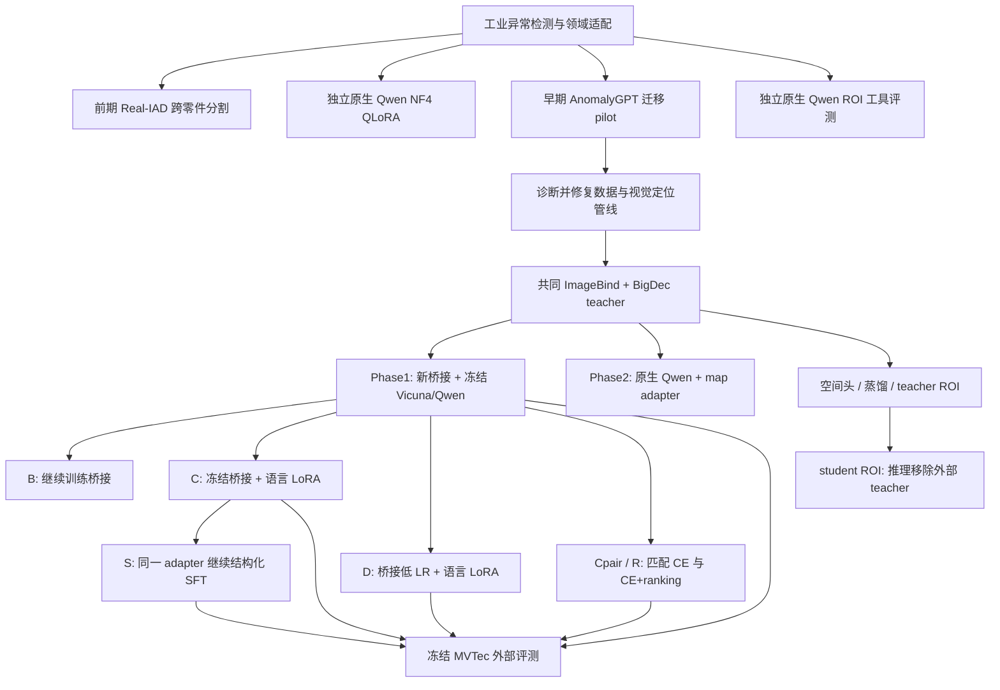
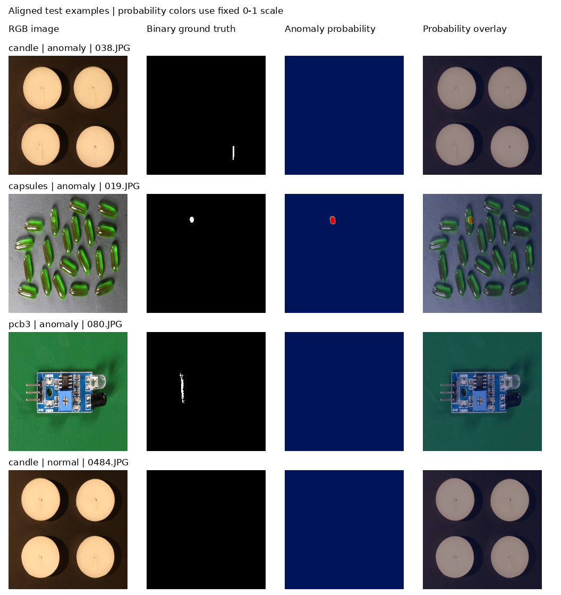
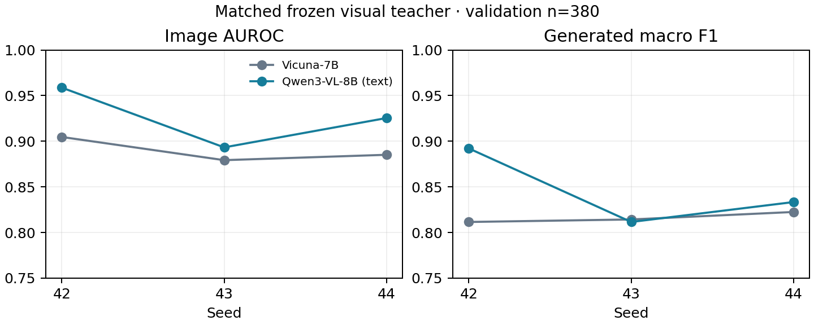
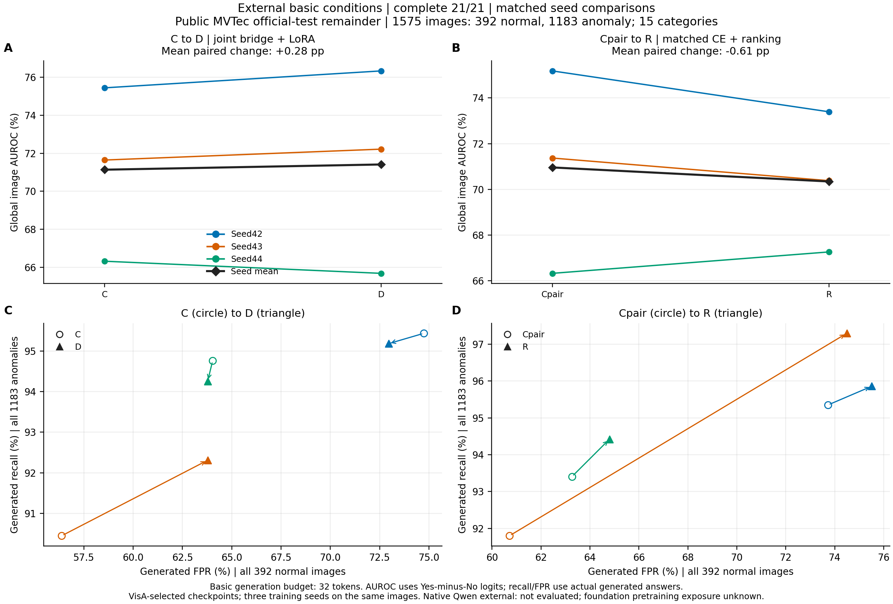

# Qwen3-VL 多模态适配与后训练优化：项目全程精读

> 整理日期：2026-11-05。范围：本地项目、历史对话、源码、运行配置、逐图预测和审计报告；实验进展截至现有 2026-11-04 最终报告。本次整理没有新增训练或模型推理。
>
> 阅读方法：[kelip-paper-reading](https://github.com/skJack/kelip-paper-reading) 的六站法——动机 → 架构 → 训练 → 数据 → 输入输出信息流 → 对照代码走一个例子，之后补齐项目演进、实验和附录。本项目是研究与工程实践，不是一篇已发表论文，因此用“源码与实验记录”代替论文中的章节和公式出处。

<a id="toc"></a>
## 阅读地图

| 阅读顺序 | 章节 | 读完应能回答 |
|---|---|---|
| 先建立坐标 | [0. 基本情况与证据约定](#overview) | 项目到底做了什么？哪些结论最可靠？ |
| ① 动机 | [1. 问题、困难与研究假设](#motivation) | 为什么要把 Qwen 接到 AnomalyGPT？ |
| ② 架构 | [2. 三条路线及当前主线](#architecture) | 哪些模块来自上游，数据怎样连接？ |
| ③ 训练 | [3. 损失、梯度与全部训练分支](#training) | 每次训练实际更新了哪些参数？ |
| ④ 数据 | [4. 一条样本、划分与监督边界](#data) | 模型看见什么？标签在哪里使用？ |
| ⑤ 信息流 | [5. 从 RGB 到答案的完整调用链](#flow) | 张量形状、位置编码、缓存怎样变化？ |
| ⑥ 例子 | [6. 用真实样例和可手算数字走一遍](#example) | 真的能把输入、分数和回答对起来吗？ |
| ⑦ 实验 | [7. 从起点到最终外评的演进](#history) | 为什么早期失败，后来哪些方案有效？ |
| 工程与复现 | [8. 环境、运行方法和证据审计](#reproduction) | 别人怎样复核，哪些资产还需准备？ |
| 研究判断 | [9. 贡献、局限和下一步](#discussion) | 哪些成果已证实，哪些还需验证？ |
| 附录 A | [所有代码与文件结构](#appendix-code) | 每个目录和项目脚本负责什么？ |

建议第一次按顺序读正文；第二次沿附录 A 找代码，并对照正文的证据边界检查自己的理解。

<a id="overview"></a>
## 0. 基本情况与证据约定

### 0.1 一句话介绍

输入一张工业产品图像，输出异常判断，并探索像素热图、异常框和位置回答。围绕 Qwen3-VL-8B，项目实现了跨模态桥接、语言 LoRA/QLoRA、成对排序和结构化 SFT，最终用冻结外部评测检查同域收益能否迁移。

仓库：[Qhf7/Qwen-VLM](https://github.com/Qhf7/Qwen-VLM)。主要底座为 Qwen3-VL-8B-Instruct；对照包含 Vicuna-7B；视觉模块涉及 ImageBind、Qwen 原生视觉和前期 DINOv2。项目实现、必要上游快照与研究来源的边界见 [THIRD_PARTY.md](../THIRD_PARTY.md)。GitHub 中的源码和轻量结果不等于完整模型交付，数据、底座、历史桥接权重和缓存需另外准备。

### 0.2 先记住项目的分支关系



这张图表示实验和资产的关系。箭头不都代表权重连续训练：例如原生 QLoRA 是独立分支；D、Cpair、R 都从各 seed 的 Phase1 A 起点重新出发；只有 S 明确从原 C 的 best adapter 继续。前期分割也没有成为当前桥接主线的视觉塔。

### 0.3 当前结论的最短版本

| 问题 | 当前证据 | 解释范围 |
|---|---|---|
| 修复后的共同视觉输入下，Qwen 语言部分能否替代 Vicuna？ | val380 三 seed AUROC：0.889684 → 0.925779 | 两边重训各自桥接、语言本体冻结；同域开发验证 |
| 能否进一步训练 Qwen 内部 LoRA？ | C：AUROC 0.936983，生成 Macro-F1 0.861732 | q/v LoRA 383 万参数，三 seed；FPR 同时增加 |
| 联合训练桥接是否有价值？ | D：开发 AUROC 0.940258 | 相对 C 增益小；多训练约 1.116 亿桥接参数 |
| 排序损失是否有效？ | R 相对 Cpair 开发 AUROC +1.2015pp；外部 −0.6143pp | 同域收益存在，跨域收益未成立 |
| 结构化 SFT 是否学会准确定位？ | 有效率提高，外部框 IoU 未提高 | 结构可解析和几何正确必须分开评价 |
| Qwen 能否主动调用 ROI 工具提高检测？ | planner 380/380 都直接 answer，crop=0 | 完成了工具系统和对照评测，本轮没有自主裁剪收益 |
| 是否已具备跨域部署能力？ | MVTec 1575 图误报率很高 | 当前不支持部署结论；需要新的校准与确认实验 |

所有 AUROC/F1 默认用 0–1 表示；“pp”是百分点，例如 0.925779 到 0.936983 是 +1.1204pp。F1 若未另说明，指整集合并后计算的正常/异常二分类 Macro-F1，不是 12/15 个产品类别的 F1 等权平均。

### 0.4 如何识别一条陈述的来源

- **代码事实**：能在当前函数、配置或冻结源码中找到，例如 `pack()` 插入 19 个软 token。
- **实验事实**：来自特定 run 和预测，例如 C 的三 seed 均值；不表示本次整理又跑了一遍模型。
- **诊断解释**：与观察一致但尚未隔离因果，例如跨类别分数偏移可能影响全局 AUROC。
- **教学示意**：为手算而给的小矩阵、概率或坐标，正文明确标注。
- **后续计划**：尚未实现或未训练，不计入已完成贡献。

历史对话是追溯材料。对话中的旧命令、推测和曾经的“下一步”不作为本次执行指令；旧结论与当前原始记录冲突时，以已核对的运行与预测证据为准。旧文档中的“尚未完成 LoRA”等状态也不能覆盖较晚的完成报告。

<a id="motivation"></a>
## 1. ① 动机：为什么做这件事

### 1.1 任务有三个层次

工厂给出一张电路板、胶囊或蜡烛的图片，至少可以提出三种不同问题：

| 层次 | 输入 | 期望输出 | 典型评价 |
|---|---|---|---|
| 图像判断 | RGB | 正常/异常及连续分数 | Image AUROC/AP、生成 F1、Recall、FPR |
| 区域定位 | RGB | 一个或多个异常框 | 框 IoU、IoU≥0.5、覆盖率 |
| 像素分割 | RGB | 每像素异常分数 | Pixel AUROC/AP、AUPRO |

一个模型可能正确回答“有缺陷”却框错位置，也可能热图排序不错却在固定阈值下漏掉微小缺陷。项目始终需要分开评价这三个层次，不能用语言流畅性代替检测与定位。

### 1.2 通用 VLM 的优势与工业图像的困难

Qwen3-VL 提供预训练的视觉语言表示、指令遵循、序列建模和生成接口。但工业异常往往只占少数像素，产品外观高度相似，且正常/异常基率严重不平衡。“图片里有一块电路板”这种语义正确，不等于发现焊点缺失或细小裂痕。

AnomalyGPT 提供了另一种接口：先用专门视觉分支产生异常图，再把异常图编码为软提示交给语言模型。它给了一个可拆解的问题：保持可靠的视觉证据，是否可以通过重新学习接口，把更强或更新的语言底座接进来？

### 1.3 项目的核心假设

第一层假设是**表征可迁移**：冻结预训练视觉模块后，用较小的可训练头或桥接可以学到异常任务。这里的“小”是相对 8B 底座而言，不能忽略桥接实际上有 1.116 亿参数。

第二层假设是**语言底座可适配**：相同异常证据进入 Qwen 的语言嵌入空间，经过专门桥接训练后，可能比旧 Vicuna 更好地完成异常判断。相同隐藏维度 4096 只保证张量能相接，不保证嵌入语义相同，因此必须重新适配接口。

第三层假设是**后训练目标能改进行为**：仅训练 q/v LoRA，或加入成对排序、空间输出监督，可以进一步调整判别和输出。最终实验说明：这些目标在开发集上的改善，并不自动转化为跨域收益或准确空间理解。

### 1.4 一个具体场景

给模型一张胶囊图片：大部分胶囊正常，只有一个存在局部破损。直接让 VLM 看整图可能忽略细节；定位器先给出异常概率图，桥接把全局图像向量与概率图编码成语言 token，LLM 再回答 Yes/No。若能保留空间信息，还希望它给出破损位置。但从“利用热图作判断”到“输出正确坐标”，中间仍有信息压缩和解码难题，这正是后续 S 分支暴露的瓶颈。

<a id="architecture"></a>
## 2. ② 架构：模型由哪些模块组成

### 2.1 三条实现路线的接口比较

| 路线 | 实际视觉输入 | 语言接口 | 训练对象 | 输出 |
|---|---|---|---|---|
| 前期跨零件分割 | DINOv2 patch，部分对照有 CLIP 锚点/缓存特征 | 通常不经过生成式 LLM | 分割 decoder 等 | 像素异常图 |
| 独立原生 Qwen QLoRA | 完整 Qwen 原生视觉塔 | 官方多模态 processor/模型 | 语言 q/k/v/o LoRA | 判断 JSON 或区域 JSON |
| 修复后 AnomalyGPT 主线 | ImageBind CLS＋四层 patch → BigDec 热图 | 自定义 `inputs_embeds`，仅用 Qwen/Vicuna 语言部分 | 新 bridge，随后可训练语言 q/v LoRA | 判断；S 增加框与位置 |

另有两类探索：原生 Qwen 加 teacher-map adapter，以及原生 Qwen 配 ROI 图像。它们使用完整 Qwen 视觉路径，必须作为独立系统比较。

### 2.2 当前主线总览

```text
RGB 图像
  │ 同步定义的 square224 图像预处理
  ▼
冻结 ImageBind
  ├── 全局 CLS [B,1024] ── Linear(1024,4096) ───────────────┐
  │                                                        │ 1 个 token
  └── 四层 patch，各 [B,256,1280]                          │
             │                                             │
             ▼                                             │
         冻结 BigDec                                       │
             │ 概率图 [B,1,224,224]                         │
             ▼                                             │
       PromptLearner ── 9 个 base + 9 个图相关 token ────────┤
                                                           ▼
                   文本前缀 + 19×4096 软 token + 文本后缀
                                                           │
                                                           ▼
                    冻结 BF16 语言底座 + 可选 q/v LoRA
                                                           │
                         ┌─────────────────────────────────┴─────────┐
                         ▼                                           ▼
               首答案 Yes−No logit                           greedy 自回归生成
               AUROC/AP 连续分数                             判断 / 结构化回答
```

此处不加载 Qwen 的原生视觉塔，不向文本模型传 DeepStack 特征；输入的 19 个向量来自 ImageBind 和 BigDec。称“Qwen3-VL 的语言部分迁移”比称“整个 Qwen3-VL 替换 AnomalyGPT”更准确。

### 2.3 ImageBind 与 BigDec

实验用 ImageBind 四个中间层 `[7,15,23,31]`。原始每层是 `[257,B,1280]`：257 包括 1 个 CLS 和 256 个空间 patch。必须先转成 `[B,257,1280]`，再去 CLS，恢复为 16×16 网格。全局 1024 维 CLS 来自另外的输出接口，不能把它与中间层 1280 维 patch 混用。

BigDec 对每层 patch 做 `Linear(1280,512)`，恢复 `[B,512,16,16]` 后四层平均；上采样通道为 `512→256→128→64→32→1`，最后插值至 224×224。BigDec 输出 logits，计算损失时直接使用 logits；生成缓存时再 sigmoid 为概率。

代码：[patch_features / BigDec / loss_fn](../repair_20261103/code/dec_big.py)。BigDec 共 **5,409,537** 参数；修复阶段训练，之后固定为同一个 teacher，语言后训练没有反复更新它。

### 2.4 PromptLearner 为什么输出 18 个 token

代码来自上游 [PromptLearner](../AnomalyGPT/followup_20261026/server_snapshot/code/model/AnomalyGPT_models.py)。对单通道 224×224 热图，五次卷积与池化将空间尺寸降到 7×7，最后 `5×5` 卷积输出 4096 通道的 3×3 特征：

```text
[B,1,224,224]
 → Conv/ReLU/Pool ×5
 → [B,1024,7,7]
 → Conv5×5
 → [B,4096,3,3]
 → reshape/transpose
 → [B,9,4096]
 + 拼接 learned base_prompts [B,9,4096]
 → [B,18,4096]
```

9 个 base prompts 是所有图共享的可学习参数；9 个 adaptive prompts 随输入热图变化。再拼 1 个 CLS 投影，就是 19 个软 token。它们是连续向量，不能像自然语言词一样逐个解码解释。

这里的 base prompts 是 `N(0,1)` 初始化，初始化平均范数约 64.43，而 Qwen 抽样词嵌入范数约 1.32。实验记录了这一尺度差异，但没有按后端额外重缩放；不能说当前初始化已最优。PromptLearner 很大，主要参数来自最后的卷积，后续可以研究更轻的空间接口。

### 2.5 模块、初始化和更新范围

| 模块 | 来源/初始化 | 参数量 | 哪些阶段更新 | 作用 |
|---|---|---:|---|---|
| ImageBind | 预训练权重，strict load | 大型冻结编码器，主线不更新 | 本主线均冻结 | CLS 和空间特征 |
| BigDec | 修复后独立训练 | 5,409,537 | 定位器修复阶段 | patch → 热图 |
| PromptLearner | 上游结构，同 seed 新初始化 | 107,416,504 | Phase1/B/D；Phase2独立训练一份 | 热图 → 18 token |
| CLS projection | 新 `Linear(1024,4096)` | 4,198,400 | Phase1/B/D | 全局向量 → 1 token |
| 桥接总计 | 上两行 | 111,614,904 | 取决于分支 | 视觉证据对齐语言输入 |
| Qwen 文本模型＋lm_head | Qwen3-VL-8B-Instruct | 8,190,735,360，按该 run 审计 | 原权重均冻结 | 语言建模与输出 |
| q/v LoRA | 36 层×2 模块，r8 | 3,833,856 | C/D/Cpair/R/S | 语言内部低秩适配 |
| D 总可训练参数 | bridge＋LoRA | 115,448,760 | D | 联合适配 |

参数量来自 [Phase1 run](../migration_20261103/lm_qwen_s42/run.json) 和 [LoRA 实现记录](../migration_20261103/lora_20261104/IMPLEMENTATION.md)。保留语言模块＋lm_head的数量与模型商品名“8B”不是两个应强行相等的口径。

### 2.6 为什么不能直接接原 Vicuna 桥接

一个 4096 维向量在 Vicuna 与 Qwen 中可以具有完全不同的含义。把原桥接直接插入新 LLM，只证明程序 shape 能对上；是否能读懂，取决于嵌入分布、attention、归一化、位置编码和训练目标。当前配对实验不沿用旧 Vicuna bridge：两边都从相同 seed 的相同新桥接张量训练，分别适配自己的语言空间。

### 2.7 原生 Qwen 路径与主线的区别

原生路径中 RGB 由官方 processor 切 patch，经过视觉 transformer、merger，再作为视觉 token 插入多模态序列；DeepStack 的多层视觉特征还会在指定语言层注入。这时需要正确的 image grid、MRoPE、视觉 token mask 和 cache 位置。

主线传的是普通连续软 token，位置按文本单调递增；Qwen 文本模型内部使用相同的三轴位置值，没有原生图像网格。不能因为模型类源于 Qwen3-VL，就宣称主线使用了原生多模态空间位置能力。

在 ROI 实验里，每张 448×448 图的 grid 为 `[1,28,28]`，patch16、merge2 后有 196 个视觉 token；两图为392，三图为588。这与主线的19个软 token 不在同一计算/信息预算下。

<a id="training"></a>
## 3. ③ 训练：每个目标在逼模型学什么

### 3.1 像素监督：稳定 Focal＋Dice

人话解释：让缺陷像素的预测升高、背景降低，同时照顾缺陷区域通常很小的问题。

```text
p = sigmoid(z)
p_t = y·p + (1−y)·(1−p)
L_focal = mean((1−p_t)² · BCEWithLogits(z,y))
L_dice = mean_batch[1 − (2·Σ(p·y)+1)/(Σp+Σy+1)]
L_seg = L_focal + L_dice
```

| 符号 | 含义 | 形状/范围 |
|---|---|---|
| z | decoder 输出的原始 logit | `[B,1,224,224]`，实数 |
| y | 原始 mask 非零二值化后的标签 | 同形状，0/1 |
| p | 像素概率 | 0–1 |
| Σ | 对一张图的全部空间/通道求和 | 一个标量 |

教学示意：只有两个像素，`y=[1,0]`，`p=[0.8,0.2]`。每像素 BCE≈0.2231，focal 因子0.04，Focal≈0.00893；Dice损失 `1−(1.6+1)/(1+1+1)=0.13333`，总损失约0.14226。难例会获得更大的 focal 权重。实际代码先从 logits 用稳定 BCE 计算，避免先 sigmoid 再 clamp 造成饱和区梯度消失。

### 3.2 语言监督：assistant-only causal CE

人话解释：给定视觉证据和问题，只要求模型把答案 token 逐个预测正确，不要求重建问题和软 token。

```text
L_CE = − Σ(i,t 属于有效答案位置) log Pθ(a_i,t | prefix_i, a_i,<t)
         / 有效答案 token 总数
```

`prefix` 包含文本和视觉软 token；标签为 −100 的位置不进入损失；答案和 EOS 进入损失。causal shift 必须是 `logits[:, :-1]` 对 `labels[:, 1:]`，否则会错成用当前位置预测自身。

教学示意：答案有3个有效 token，模型给真值概率 `[0.8,0.5,0.9]`，CE为 `−(ln0.8+ln0.5+ln0.9)/3≈0.34055`。这仍不等于图像判别效果：模型可以靠固定句式把多数答案 token 预测好，但 Yes/No 首 token 判错。

主线代码：[FrozenLanguageBridge.loss](../migration_20261103/code/migration_language.py)；`pack()` 中对全部前缀填 −100，显式检查答案不被上下文上限静默截断。

### 3.3 冻结 LLM 为什么还能训练桥接

冻结是 `requires_grad=False`，表示不计算/保存这些权重的梯度；它不应切断输出对输入的导数。

```text
热图 → bridgeφ → 输入向量 e → 冻结 LLMθ → CE
                  ▲                          │
                  └──── ∂L/∂e ────────────────┘
∂L/∂φ = (∂L/∂e)·(∂e/∂φ)，θ 不更新
```

若把训练时的 LLM forward 放进 `no_grad()`/`inference_mode()`，桥接就收不到这条梯度。`eval()` 只控制 dropout 等行为，不关闭 autograd。主线覆盖 `train()` 保证冻结语言模型处于 eval，但训练 forward 仍建图。

### 3.4 LoRA 的数学和参数量

```text
W′ = W₀ + (α/r)·B·A
y  = W₀x + (α/r)·B(Ax)
A ∈ R^(r×d_in)，B ∈ R^(d_out×r)
新增参数量 = r·(d_in+d_out)
```

`W₀` 冻结，A/B训练。教学示意：`d_in=d_out=4,r=2`，原矩阵16个参数，低秩增量也16个；小矩阵不一定省。真实主线36层的q/v总参数3,833,856，省参数的优势来自大维度和r8。

不能简单用 `72×8×(4096+4096)` 复算真实值，因为 Qwen 使用 GQA，v_proj 的输出维度与 q_proj 不同。按当前结构 `q:4096→4096`，`v:4096→1024`：

```text
每层 q/v LoRA = 8·(4096+4096) + 8·(4096+1024) = 106,496
36 层 = 3,833,856
α/r = 16/8 = 2
```

标准初始化中 B=0、A非零，所以初始增量为0，注入前后 logits 应一致。首步A梯度含B因子因此可以为0；B更新后第二步A开始有梯度，这是正常现象。项目实际做了这一检查，不能把“首步A为0”误判成LoRA没训练。

### 3.5 LoRA 与 QLoRA 在本项目中分别指什么

| 实验 | 底座精度 | LoRA | 训练内存策略 |
|---|---|---|---|
| 独立原生工业 QLoRA | 语言NF4＋double quant，视觉BF16 | q/k/v/o，r16/α32/dropout0.05，15,335,424参数 | gradient checkpointing、micro1×accum8 |
| 早期 AnomalyGPT pilot LoRA | NF4语言 | q/k/v/o，r8/α16/dropout0.05，约766.8万 | 极小16步pilot，独立历史配方 |
| 修复后 C/D/Cpair/R/S | 未量化BF16语言原权重 | q/v，r8/α16/dropout0，3,833,856参数 | FP32 adapter，无gradient checkpointing |

所以“项目用了4bit”与“后期所有训练都是4bit”是不同陈述。后期 C 的结果不能记到早期 NF4 QLoRA 名下。

### 3.6 成对排序：让异常分数高于同类正常图

R在CE外加一个目标：同类别的一张异常图，其首答案异常分数应高于正常图。

```text
s(x) = logit_Yes(x) − logit_No(x)
d = s(x_anomaly) − s(x_normal)
L_rank = softplus(−d) = log(1+exp(−d))
L_R = L_CE + λ·L_rank
```

教学示意：异常分数2、正常分数1，`d=1`，排序损失≈0.31326；若反过来，`d=−1`，损失≈1.31326。对d的导数是 `−sigmoid(−d)`，鼓励增大异常与正常的差。

这是一项监督式 pairwise ranking，没有 reference policy、chosen/rejected 答案相对概率的DPO目标，也没有在线rollout/reward优化，不能称DPO、RLHF或GRPO。

λ在正式训练前用16个**训练集**同类正负对的初始梯度范数比标定，median为14.06366，按预先约定clamp到 `[0.01,1]` 后取1。它是损失尺度标定，不是以验证收益选最优λ。

关键控制是 Cpair：同初值、相同正负配对序列、micro2×accum2、相同CE归约，唯一区别是有无ranking项。R直接减历史C会混入采样、microbatch和token权重变化。

代码：[paired_schedule / 训练循环](../migration_20261103/advanced_20261104/migration_advanced_train.py)、[λ标定](../migration_20261103/advanced_20261104/calibrate_rank_weight.py)。

### 3.7 空间头蒸馏与结构化 SFT

空间头的KD目标是：

```text
L_student = L_focal_GT + L_dice_GT + 0.5·mean|p_student − p_teacher|
```

teacher概率只来自训练图，visual encoder和teacher冻结；更新的是独立SpatialHead。这是特征/输出头学习，不是更新Qwen视觉塔，也不是端到端视觉—语言联合训练。

S则完全不同：从原C继续训练现有语言LoRA，用mask生成的框和九宫格位置作为**答案文本**，仍然只算CE。S不包含R的排序项，没有叠加第二个adapter。

```text
Yes
{"bbox":[150,200,400,400],"location":"top_left"}
```

上面是schema示意。模型训练的是离散坐标token；代码没有直接对预测框与GT框求可导IoU loss。格式合法也不代表框位置正确。

### 3.8 全项目实际训练清单

| 阶段 | 更新参数/模块 | 冻结部分 | 正式预算与seed |
|---|---|---|---|
| 前期跨零件分割 | DINOv2特征上的decoder及不同实验分支 | 主视觉底座 | 按实验台账，四折类别留出，不能与三seed混用 |
| 原生QLoRA RR/DD/RD | 原生Qwen语言q/k/v/o LoRA 1534万 | NF4底座、BF16视觉 | 每臂192更新×8=1536曝光，seed42 |
| 旧迁移pilot | decoder/PromptLearner/投影；LoRA臂额外q/k/v/o | 相应底座 | 每臂16更新×2=32曝光，seeds42/43/44 |
| 修复BigDec | decoder 540.95万 | ImageBind，无LLM | 1200×4=4800曝光，seed42 |
| 修复后Vicuna接续 | bridge 1.116亿 | ImageBind/BigDec/Vicuna | 1500更新，单seed，val仅300/380 |
| Phase1配对 | 各自重新训练bridge 1.116亿 | 同teacher，分别冻结Qwen/Vicuna | 每臂1500×4=6000曝光，各3seed |
| Phase2 native＋map | 独立18-token PromptLearner 1.074亿 | 完整原生Qwen、teacher | 1500×micro1×accum4，seed42 |
| GT spatial heads，5格 | IB/pre/post独立head | 对应视觉底座 | 每格1200×4=4800曝光，seed42 |
| GT＋KD heads，2格 | pre448/post448 head | Qwen视觉、teacher | 同GT匹配计划，seed42 |
| B | 原bridge继续训练 | 语言原权重、teacher | 500更新/2000曝光，各3seed |
| C | q/v LoRA 383万 | bridge、语言原权重、teacher | 同B预算，各3seed |
| D | bridge＋q/v LoRA 1.154亿 | 语言原权重、teacher | 500更新/2000曝光，各3seed |
| Cpair/R | q/v LoRA 383万 | bridge、语言原权重、teacher | 各500更新/2000曝光，各3seed |
| S | 同seed C的同一个LoRA继续 | bridge、语言原权重、teacher | 新增500更新/2000曝光，各3seed |

normal-memory建库、teacher/student ROI组合推理、Cstructured换提示、工具五臂、外部21组预测、缓存提取和重载审计都没有新增梯度训练。不要把每一个结果目录都数作一次模型训练。

### 3.9 主线优化与统计口径

Phase1采用AdamW，OneCycle最大学习率5e−4、weight decay0.01、OneCycleLR（正式长run，pct_start0.05），梯度裁剪1。默认cycle_momentum还会调整AdamW第一项beta，并非全程固定学习率或固定betas。batch4×accum1，每250步评全部val380，按AUROC取best，另存final，正式6run的best均在1500。

B/C均micro1×accum4、500步，每100步验证，允许step0入选；B LR5e−4，C LR1e−4。D桥接LR1e−5、LoRA LR1e−4；Cpair/R使用micro2×accum2。S继续C、LR1e−4、80token生成预算。

batch4全token均值与4个单图token均值再平均，只有在有效答案长度相同等条件下才等价。B/C内部使用同归约，Cpair/R内部也匹配，但把A→C全部差值归为LoRA的纯因果效果仍然过强。

<a id="data"></a>
## 4. ④ 数据：一条样本究竟是什么

### 4.1 主线 VisA 不是官方 normal-only 协议

| 集合 | 总图数 | 正常 | 异常 | 角色 |
|---|---:|---:|---:|---|
| 自定义train | 9985 | 9253 | 732 | 训练bridge/head/LoRA；异常mask可用于相应监督 |
| 自定义val | 380 | 172 | 208 | 反复用于checkpoint/方案开发 |
| 历史test | 456 | 196 | 260 | 历史开发与诊断，已不再是未查看确认集 |
| 总计 | 10821 | 9621 | 1200 | 12个产品类别 |

构造规则来自 [split_visa.py](../repair_20261103/code/split_visa.py)：官方train正常图进入训练，官方test部分按自定义60/20/20拆分；不是把全部10821简单按60/20/20随机切。历史实现对**绝对路径字符串**计算MD5再取模，不是按图像内容hash划分；换数据根后重新执行可能改变split。跨机复现应使用冻结manifest或严格保持原路径映射，不能仅沿用相同seed。由于训练包含真实异常和mask，不能和只用正常训练图的无监督方法直接比较论文表格数字。

### 4.2 缓存里的一条记录

共享缓存的items携带身份，张量另外存放：

| 字段 | 类型/形状 | 意义与示例 |
|---|---|---|
| path | 字符串 | `.../VisA/candle/Data/Images/Anomaly/010.JPG`，真实已用val样本 |
| category | 字符串 | `candle` |
| label | 0/1 | 正常0、异常1；用于训练答案与评价 |
| split | 字符串 | train/val/test；不能靠文件夹名称重新猜 |
| cls[index] | float32 `[1024]` | ImageBind全局特征 |
| maps[index] | float32 `[224,224]` | 固定BigDec概率图，非GT mask |
| pipeline_version | 字符串 | `visa-square-binary-sklearn-v1` |
| decoder_sha256等 | SHA256 | 缓存、模型和实现身份 |

真实推理调用只需要图像和接口要求的类别描述。训练缓存中的label/split不应流入答案生成输入。类别文本是主线的输入条件；student单图入口则使用通用描述，不需要类别参数。

### 4.3 GT mask、teacher map、student map 的区别

| 名称 | 来源 | 能否直接作为部署真值输入 | 在哪里使用 |
|---|---|---|---|
| GT mask | 数据集人工标签，原值非零即异常 | 不能 | 定位监督、S答案构造、预测后评价 |
| teacher map | ImageBind＋已训练BigDec预测 | 可以由图像在线生成 | 主线软提示、teacher ROI、KD监督 |
| student map | Qwen视觉＋独立head预测 | 可以由图像在线生成 | student ROI |

主线依赖一个用异常mask训练过的teacher；因此“LLM没看GT”不等于整个系统无监督。student ROI移除的是推理时ImageBind/BigDec依赖，不是抹除历史训练监督。

### 4.4 原生 QLoRA 数据与当前主线不能混用

原生路线先建立旧70/15/15来源池：7575/1624/1622；第二轮实际只取768张训练来源图、120张同域验证图（60正常/60异常）。RR/DD/RD每张源图曝光两次，总1536曝光。

它的连续分数是JSON候选 `logP(true)−logP(false)`；当前桥接主线是首答案 `logit(Yes)−logit(No)`。两种评分、验证集合、视觉输入和训练预算都不同，不能把原生DD的0.945556与主线R的0.947348排在同一排行榜。

### 4.5 MVTec 外部冻结集合

MVTec官方test共1725图，排除全项目历史已查询的150图pilot后保留1575：392正常、1183异常、15类。与全VisA10821按文件内容SHA核对，交集为0。manifest SHA为：

```text
4cf2709614c8fd6aabe1268ef3c9f8687a07a0849d3d0f0341d1756570f9497a
```

先冻结权重选择、提示、源码和生成策略，再统一评7模型×3seed。对外部图没有训练、选prompt、调阈值或选checkpoint。结构化mask在预测SHA落盘后用于后验评价。

这是公共跨数据集评测，不是对基座预训练“绝对未见”的证明：公开模型预训练中是否见过相似/相同图片仍未知。原生工具分支没有进入这21组外评；也没有Vicuna外部臂。

### 4.6 重复、采样和泄漏要分层看

“路径不重叠”排除同一路径跨split；“文件SHA不重叠”进一步检查完全相同字节；“近重复/同零件多视角分组”解决外观高度相关；“历史未查询”解决开发过程泄漏；“基座预训练来源未知”仍是额外边界。这几层不能用一次hash检查全部替代。

主线6000曝光是有放回采样的训练访问量，正常/异常各3000，不是6000独立新图，更不是完整遍历train9985。三seed同样是同一划分上的随机训练重复，不是三份独立数据集。

<a id="flow"></a>
## 5. ⑤ 输入输出信息流：对照函数理解完整运行

### 5.1 定位训练时

```text
train路径＋标签
 → 同步square224 RGB / mask
 → 冻结ImageBind（no_grad可用）
 → patch_features: 4×[257,B,1280] → 4×[B,256,1280]
 → BigDec: [B,1,224,224] logits
 → Focal＋Dice对GT
 → backward / clip / AdamW
 → 只更新BigDec
```

读取 [visa_pipeline.py](../repair_20261103/code/visa_pipeline.py) 时先确认图像与mask几何；再读 [dec_big.py](../repair_20261103/code/dec_big.py) 的特征轴、forward和损失。不要从最终图像AUROC倒推这条链正确，逐层shape和非空标签检查更直接。

### 5.2 桥接训练时

```text
固定teacher cache + train-only采样顺序
 → cls [B,1024] / maps [B,224,224] / category / label
 → label选择Yes/No canonical目标句（含EOS）
 → pack: CLS投影＋18map tokens插入对话特征槽
 → inputs_embeds [B,L,4096]
 → attention_mask [B,L] / position_ids [B,L] / labels [B,L]
 → 冻结LLM forward（保留输入梯度）
 → lm_head logits [B,L,V]
 → shift后答案CE
 → 更新bridge；C时改为更新LoRA
```

核心代码压缩如下，省略了padding、校验和不同文本模板：

```python
tokens = self.prompt_learner(amap)                # [B,18,4096]
image_token = self.cls_proj(cls_emb).unsqueeze(1) # [B,1,4096]
features = torch.cat([image_token, tokens], 1)
prefix = torch.cat([embedding(before), features[i], embedding(after)], 0)
labels = torch.cat([prefix_ignore_minus100, target_ids_with_eos])
```

实际顺序是CLS、9个base、9个map-adaptive token。软token必须保持训练和推理相同顺序、相同精度策略；只要加载错bridge或漏CLS，程序可以正常输出文字，但不再是同一个模型。

### 5.3 打分与自由生成是两条分支

若prefix长度为P，最后一个prefix位置 `P−1` 的logits用于预测第一个答案token：

```python
first = logits[rows, prefix_lengths - 1].float()
score = first[:, yes_id] - first[:, no_id]
```

`score>0` 只是候选Yes/No间的零阈值决策，不是校准异常概率；vocabulary里还存在其他词。greedy生成会在**整个词表**选最大logit，可能先说解释、出现不符合格式的文本，甚至与二候选决策不同。因此必须保存两种结果。

生成时先prefill完整prefix并保存KV cache，再每步输入一个新token，更新mask、位置和cache，直到EOS或预算上限。主线默认最多32新token；S为80。重新评分与重新生成可能各做一次prefill，计时不能把它们当同一次零额外成本调用。

### 5.4 原生 Qwen 的手工路径为何必须核对官方

直接绕过官方 `forward` 插入map token时，容易遗漏DeepStack注入、MRoPE或cached generation的位置更新。Phase2专门比较了官方/manual同shape的prefill、cached step和full replay logits，检查语言输入、视觉mask、cache长度与重载。

同shape核对是关键：BF16下不同batch/序列shape可能触发不同kernel和舍入；官方cached和full-replay在不同shape下本身可有差异，不能把任意数值不完全相同都判成接口错误，也不能用“BF16有误差”掩盖真正的位置和注入错误。

### 5.5 Student ROI 的在线流

```text
原始RGB
 → 冻结Qwen pre-merger视觉，448输入
 → 已训练SpatialHead
 → 224概率图 → 固定规则选择面积1/9的ROI
 → 从原RGB裁剪、保持边界与面积
 → 原图448＋ROI448
 → 完整冻结native Qwen，392 visual tokens
 → 首答案分数＋greedy回答
```

这是两次视觉处理阶段，不是把head特征直接送给语言层。单图验证入口先加载视觉塔/head、释放GPU引用，再加载完整Qwen；两次模型加载计入端到端耗时。批量实验用预计算地图，表中不含地图生成的ROI时间不能直接当部署延迟。

### 5.6 ROI 工具的调用流

```text
原图 → 原生Qwen planner
       ├─ {"action":"answer"} → 按协议使用回答分支
       └─ crop请求 → executor校验范围/面积 → RGB裁剪观察
                                             │
                                   原图＋观察 → 最终判断
```

工具能力需要实际调用轨迹。当前所有planner都走answer，没有crop观察；系统实现完整不等于模型已经学会有益的工具策略。

<a id="example"></a>
## 6. ⑥ 走一个具体例子：从蜡烛图片到回答

### 6.1 真实主线样例：`candle/Anomaly/010.JPG`

证据：[单图原始JSON](../migration_20261103/route1_demo/qwen_s42_first_val_anomaly.json)。它是已有val顺序中首张异常图，并非本次新采集或按成功结果挑选的新测试样本。

| 步骤 | 现在手里有什么 | 实际操作与结果 |
|---|---|---|
| 1 | RGB文件＋类别candle | square224，未输入label/GT mask |
| 2 | ImageBind输出 | CLS `[1,1024]`，四层原始 `[257,1,1280]` |
| 3 | canonical patch | 四层 `[1,256,1280]`，已去CLS |
| 4 | BigDec概率图 | `[224,224]` float32，min≈4.48e−23，max≈0.991636 |
| 5 | 全局与地图桥接 | 1＋18个4096维soft tokens |
| 6 | Qwen ChatML前缀 | 特征插入user内容指定槽位，生成从assistant起点开始 |
| 7 | 首答案候选打分 | Yes−No=2.625，零阈值判Yes |
| 8 | 独立greedy生成 | `Yes, there is an anomaly in the image.` |

该图map均值约0.000877875，P99约1.18487e−7，最大值却接近1。它展示了稀疏缺陷分数的特点：大部分像素很低，少数像素很高；均值、P99和最大值不是可互换的异常摘要。不能根据单图这些统计推出整个数据集的最佳评分规则。

模型使用seed42 Phase1 bridge、step1500。单次含加载运行约44.11秒，allocated峰值18.375GiB；这是加载式CLI验证，不是常驻服务吞吐。

### 6.2 看见同图在另一条路线上的真实失败

[student ROI的同图产物](../migration_20261103/student_roi_20261104/demo/anomaly010.json) 使用pre448 GT head和完整native Qwen，score为−1.25，回答No，异常漏检。它与批量路径的map、ROI、logits和生成token完全一致。

这两条事实要同时保留：主线这张图判断正确，student入口这张图判断错误；student的精确一致性检查通过。**工程一致性只证明复现同一行为，不证明行为正确。** 两例也不能代表整体路线孰优，整体比较应看对应的完整val结果。

### 6.3 用玩具维度理解“梯度穿过冻结底座”

以下是教学示意，真实模型维度是4096。设bridge输出 `e=φx`，冻结模型暂用 `z=2e`，目标为Yes：

```text
x=1，φ=0.2 → e=0.2 → z=0.4 → sigmoid(z)≈0.59869
L=−log(sigmoid(z))≈0.51302
∂L/∂z≈−0.40131
∂L/∂φ=(∂L/∂z)·2·x≈−0.80262
```

数字2不更新，φ仍能学习；若把 `z=2e` 放在no_grad中，φ就收不到这条导数。真实项目同理，只是冻结映射从乘2变成了36层语言网络。

### 6.4 用一块mask手算结构化目标

以下坐标是教学示意：mask宽1000、高500，前景最小/最大像素为 `x=150…399，y=100…199`。坐标使用最大边exclusive、向外取整：

```text
x1=floor(150/1000×1000)=150
y1=floor(100/500×1000)=200
x2=ceil((399+1)/1000×1000)=400
y2=ceil((199+1)/500×1000)=400
bbox=[150,200,400,400]
center=(275,300) → 3×3中的top_left
```

训练答案为Yes和对应JSON。若有两个相隔很远的小缺陷，union box会包住它们之间的正常区域，这是当前单框监督定义带来的取舍。模型输出 `top_right` 却给出上述bbox，即使JSON语法正确，也会被严格schema判为无效。

### 6.5 走两轮自回归，理解KV cache

第一轮prefill输入全部视觉/文本prefix，最后位置的logits产生“Yes”；缓存里保存prefix各层的K/V。第二轮只把“Yes”的embedding连同新位置送入，模型读旧cache预测后续逗号或换行；新token的K/V追加进去。

每步都会变的是序列长度、当前position和cache；RGB、ImageBind特征、teacher map、19个soft tokens不会重新计算。S框坐标也沿同一token循环生成，不能把坐标输出想象为额外检测头直接读图回归。

<a id="history"></a>
## 7. ⑦ 项目从头到尾：实验为什么这样推进

### 7.1 研究演进与前期分支

| 阶段 | 材料入口 | 核心问题 | 应保留的结论 |
|---|---|---|---|
| 论文调研与Real-IAD | [实验台账](实验进度与版本记录.md)、[前期精读](项目精读/04_跨零件分割与历史探索.md) | 未见零件类型上如何定位？ | 同域强，跨类别有明显差距；若干分支控制不足 |
| 原生Qwen领域QLoRA | [v2报告](../industrial_vlm/reports/multitask_v2/实验报告.md) | 原生视觉语言路径能否用小预算适配？ | 单seed同域DD有效，独立于桥接主线 |
| 2026-10-26迁移pilot | [matched报告](../AnomalyGPT/followup_20261026/final_results/final_report/RESULTS_REAL_AND_MATCHED.md) | Qwen替换语言骨干是否可行？ | 小预算未形成稳定收益，LoRA有塌缩 |
| 旧日志进一步探索 | [历史核对](Qwen迁移实验演进与训练清单.md) | 原生视觉/软提示/CLS等如何组合？ | 多因素及协议变化，不可直接归因 |
| 2026-11-03修复 | [修复报告](../repair_20261103/REPAIR_REPORT.md) | 视觉监督和实现是否正确？ | 发现实质bug，统一口径定位显著改善 |
| Phase1 | [配对结果](../migration_20261103/PHASE1_RESULTS.md) | 固定teacher后只迁移语言部分如何？ | 新桥接下Qwen三seedAUROC更高 |
| Phase2–5 | [全结果](../migration_20261103/ALL_RESULTS.md) | 原生视觉、空间头、蒸馏、ROI能否接上？ | 部分接口有效，蒸馏与定位仍有限 |
| B/C | [LoRA分析](../migration_20261103/lora_20261104/ANALYSIS.md) | 仅训练LLM低秩增量能否继续提高？ | 同域开发进一步改善 |
| D/Cpair/R/S/工具 | [最终报告](../migration_20261103/advanced_20261104/FINAL_REPORT.md) | 更进一步的后训练目标与能力是什么？ | 开发收益与跨域/空间/工具能力分开 |
| 冻结外评与审计 | [外部分析](../migration_20261103/advanced_20261104/EXTERNAL_ANALYSIS.md) | 开发收益是否跨域成立？ | 误报高，ranking负迁移，空间保真不足 |

下面先给前期路线的完整核查，再解释当前主线的演进。

#### 这几条路线怎样连接

项目最初关注“语言语义能否改善工业图像在未见零件类别上的异常定位”，后来转向“如何把可靠的异常视觉证据接入较新的 VLM/LLM，并通过领域后训练改善判断、格式和定位”。这是一条研究问题逐渐具体化的路线，**不是所有实验依次继承同一个模型权重**。

```text
论文阅读与数据审计
 ├─ Real-IAD：DINOv2 密集分割 → 文本锚点/视觉融合/候选复核
 │                          └→ 早期 Real-IAD 原生 SFT、DINO→LLM 对齐、二选一
 ├─ VisA 原生 Qwen3-VL-8B：独立 NF4 QLoRA 工程
 │    ├→ 第一轮：面积覆盖/随机、区域/判断
 │    └→ 第二轮：RR/DD/RD 等图片曝光任务消融、连续评分与正常阈值
 │         └→ 第三轮困难正常挖掘/分辨率：本地有协议与代码，未见完成报告
 └─ AnomalyGPT 迁移：旧 pilot → 视觉定位修复 → 共用前端的语言骨干配对
                            └→ 后续 BF16 q/v LoRA、排序、结构化 SFT、外评
```

三条最容易混淆的 LoRA 必须分开：Real-IAD 早期 SFT 的目标包括 MLP；`industrial_vlm` 原生 QLoRA 只适配语言 attention q/k/v/o、r16；后期迁移主线使用 BF16 语言基座及 q/v、r8。它们的底座精度、输入接口、数据、参数量和结果协议均不同。

#### 论文调研实际提供了什么

前期调研参考了 CLIP、WinCLIP、AdaCLIP、AnomalyCLIP、AA-CLIP、Dual Anchors、MoECLIP、FB-CLIP、AnomalyVFM、AnomalyGPT 等方法，相关假设通过本项目代码与实验进行检验。它们提供了不同的结构思路：

| 方法家族 | 给予本项目的启发 | 在项目中怎样检验 |
|---|---|---|
| CLIP 及文本 prompt | 用正常/异常短语提供语义锚点 | A2 学习 DINO patch 到文本锚点的投影，比较真实/随机锚点 |
| WinCLIP/正常图参考 | 用同类别少量正常图提供局部外观参照 | B0 语言、B1 正常参考、B2 融合及融合方式对照 |
| 双塔的轻量适配 | 冻结大部分底座，训练接口或低秩参数 | 先建立冻结表征＋可训练头，再检验领域 SFT |
| AnomalyGPT | 定位器给异常图，PromptLearner 将图压成软 token，再由 LLM 回答 | 后期修复定位链路，并固定视觉证据比较 Vicuna 与 Qwen |
| 原生 VLM | 保留官方视觉 token/位置编码，直接做领域指令适配 | `industrial_vlm` 原生 QLoRA 分支 |

不能把“读过某篇”写成“实现或训练了该篇全部方法”，也不能把不同论文自报指标排列成统一性能排名。早期横向阅读只用于形成研究假设；方法和开源状态应核对公开原始来源。原始 normal-only、辅助异常训练、真实 mask 监督和本项目重新划分的有监督 VisA 所用信息不同。

#### Real-IAD：首先把标签与划分做对

##### 数据规模与标签语义

来源：[manifest 汇总](../artifacts/manifest_report.txt)、[近重复视觉组报告](../artifacts/part_clusters_report.txt)、[像素 manifest 统计](../artifacts/seg_cross_part/mask_manifest_stats.json)。

| 项目 | 实际数值 | 解释 |
|---|---:|---|
| 产品类别 | 24 | Real-IAD Variety 子集 |
| 视角图 | 29,855 | 每个采集组通常五个视角 |
| `group_path` | 5,971 | 一次五视角采集目录 |
| `visual_group_id` | 4,231 | 视觉近重复分组，是防泄漏代理，不是真实物理零件身份 |
| 视角级正常 | 6,486 | 包含 NG 目录下本视角没有缺陷的图 |
| 视角级异常 | 23,369 | 有有效非空 mask |
| NG 目录下空/缺失 mask 的视角 | 491 | 9 张空 mask＋482 张缺失 mask，按本数据的视角级规则记正常 |

这里的 491 张来自已审计的 Real-IAD 多视角标签规则，不能迁移成“所有数据集缺失异常 mask 都当正常”。后期 VisA 的异常缺失 mask 必须报错。

`source_part_key` 有 1,200 个，但源 S 编号跨批身份不可靠；因此没有把它当真实物理身份拆分。视觉组整体分配，可减少明显近重复跨集合；这依旧不保证所有物理实例、重拍和近重复都已识别。

异常视角占 78.27%，与通常缺陷稀少的生产环境相反。恒答“异常”也可能有较高 accuracy，因此需要混淆矩阵、异常召回、正常 FPR、预测分布及连续排序指标。

##### 一条分割样本的字段

| 字段 | 类型/形状 | 用途 |
|---|---|---|
| `image_path` | 字符串，相对数据根 | 单张视角输入 |
| `mask_path` | 字符串 | 像素监督来源 |
| `class_name` | 24 类之一 | 整类划分和逐类评价 |
| `group_path` | 字符串 | 五视角相关性及组级统计 |
| `visual_group_id` | 字符串/组 ID | 近重复整体隔离 |
| `view_label` | 0/1 | 当前视角，而非整组是否异常 |
| `mask_valid` | bool | 该视角是否有有效缺陷 mask |
| `area_bucket` | none/small/medium/large | 固定面积分层 |

真实指令文件中的一例是 `silicon_cell_sensor/NG/Scratch/S0007/..._C4_20240626173733543.png`，其元数据为 `label=1`、`defect=scratch`、`area=small`、`split=train`、`grid=bottom center`。这里只引用已存字段，未声称本次重新看图确认划痕。

分割 loader 返回 `RGB tensor、二值 mask、路径、类别、view_label`。图像与 mask 共用随机裁剪框和翻转决定；RGB 用 bilinear，mask 用 nearest，ImageNet 归一化只作用 RGB。Real-IAD loader 使用 mask>127；VisA class-index mask 应使用原始值>0，两者不能直接混用。

##### 三套划分回答不同问题

来源：[split_report.json](../artifacts/splits/split_report.json)、[audit_report.json](../artifacts/splits/audit_report.json)。

| 协议 | train/val/test 视角数 | 类别条件 | 作用 |
|---|---|---|---|
| A | 21,110 / 4,370 / 4,375 | 均包含24类 | sanity check |
| B | 20,950 / 4,515 / 4,390 | 均包含24类 | 同类新采集/视觉组 |
| C fold0 | 17,890 / 4,510 / 7,455 | 18类训练、6类整类留出 | 未见产品类别定位 |
| C fold1 | 17,870 / 4,505 / 7,480 | 同上，另一组6类 | 未见类 |
| C fold2 | 17,905 / 4,485 / 7,465 | 同上 | 未见类 |
| C fold3 | 17,870 / 4,530 / 7,455 | 同上 | 未见类 |

四折数目直接读取冻结 `split_report.json`。四折由类别固定顺序轮转，每类恰当一次 holdout；不是按缺陷语义、分辨率均衡构造的随机四折。train/val 再按视觉组隔离，测试类不进入该折训练。

`audit_report.json`对 group 和视觉组交集、C 的训练/测试类别交集、所有类恰被留出一次提供布尔审计。它证明实现检查通过，不能证明公开底座预训练从未见过这些图。

#### 冻结 DINOv2＋分割头怎样训练

##### 架构与张量

```text
RGB [B,3,448,448]
 → DINOv2-B/14（冻结）
 → 第3/6/9/12层，去CLS后每层 [B,1024,768]
 → 各转为 [B,768,32,32]
 → 四个1×1 Conv，各768→256
 → 拼接 [B,1024,32,32]
 → 3×3 Conv＋GroupNorm＋GELU，1024→256→128
 → bilinear 到448×448
 → 1×1 Conv，128→1
 → [B,448,448] logits → sigmoid 概率图
```

DINOv2 是特征提取器；分割能力来自冻结特征和本项目训练的头的组合。不能把这一头的失败等同于 DINOv2 表征本身没有缺陷信息。

关键实现：[DinoFeatures](../seg_cross_part/train_seg.py#L172)、[SegDecoder](../seg_cross_part/train_seg.py#L196)、[SegDataset](../seg_cross_part/train_seg.py#L44)。源码行号为本次工作区位置，后续变动应按符号名查找。

##### Focal＋Dice 的目标

```text
p = sigmoid(logits)
pₜ = p×y + (1−p)×(1−y)
CE = −y log p − (1−y) log(1−p)
L_Focal = mean[(1−pₜ)² × CE]
L_Dice = 1 − (2Σpy + ε)/(Σp + Σy + ε)
L = 0.5 L_Focal + 0.5 L_Dice
```

| 符号 | 含义 |
|---|---|
| `p` | 逐像素异常概率 |
| `y` | 像素GT，0/1 |
| `pₜ` | 真实标签的预测概率 |
| `ε` | 1e−6，防止空分母 |

**示意手算：**GT=[1,0]、p=[0.8,0.2]，两像素 CE≈0.2231，Focal≈0.00893；软重叠Σpy=0.8，Dice loss≈0.2；组合≈0.10446。Dice 当前在整个 batch 的像素上求和，不是逐图平均 Dice。

对应 [focal_dice](../seg_cross_part/train_seg.py#L246)。BCE 直接使用 logits 保持数值稳定；正常背景较多时 Focal 降低容易样本贡献，Dice强调前景重叠。硬阈值化后再训练会破坏连续梯度。

首轮固定配置是 batch8、6,000步、lr1e−3、weight decay1e−4、warmup100，按 val 类宏平均 AUPRO@0.3 选 best。准确复现仍应读取各 run 的 `frozen_protocol.json`；协议默认不能替代实际 run。fold2 最终评测前中断，历史结果由 best 离线补评。

##### 结果与边界

来源：[统一口径的历史台账](实验进度与版本记录.md#L130)。

| 指标 | B 已见类 | C 四折均值±std |
|---|---:|---:|
| AUPRO@0.3 | 0.8258 | 0.6587±0.0563 |
| Pixel AUPR | 0.8301 | 0.3386±0.1563 |
| Pixel AUROC | 0.9533 | 0.8430±0.0452 |
| Image AUROC | 0.9215 | 0.7121±0.0870 |

C四折AUPRO为 `.7064/.6822/.6688/.5776`。这些数字描述已见/未见类的性能差异；两协议测试对象不同，差值不能当成某个模块的单因素因果损失。四折 std 是类别组合变化，后期三seed std 是训练随机性，两者不能混称“多次实验稳定性”。

评价修复过两个问题：像素抽样曾只覆盖每类前若干图，旧 P-AUPR/P-AUROC 被统一全量像素直方图统计替代；AUPRO 的 FPR 需包含正常图上的背景误报。标签相关的负像素下采样会改变阳性率并抬高 PR 指标。组级 bootstrap 应说明组类型，不能把五视角当独立实例。

#### 语言与视觉融合的负结果怎样读

##### 文本锚点并不等于让 Qwen 生成文本

A2把DINO四层拼接3072通道，经可训练卷积投影到文本维度，与冻结正常/异常锚点做余弦。实际代码用 logsumexp 聚合多个锚点：

```text
simₖ(h,w) = 10 × cosine(normalize(P(f(h,w))), normalize(anchorₖ))
aux(h,w) = logsumexp(sim_anomaly) − logsumexp(sim_normal)
output_logits = decoder_logits + upsample(aux)
```

**示意：**正常锚点分数[1,1]、异常[2,2]，两组 logsumexp 分别1.693和2.693，差1。两组锚点数量不等时也会引入数量效应。

CLIP文本锚点取EOS隐藏状态；不宜笼统说成所有CLIP接口返回的带投影图文 embedding。DINO视觉空间本来不与文本空间对齐，投影必须通过已见类mask学习。

fold0：A0 `.7064`，随机锚点 `.7092`，CLIP锚点 `.7020`。这些实验没有形成真实文本语义稳定改善定位的证据。[a2_language.py](../seg_cross_part/a2_language.py)定义了`modulate`门控函数，但当前`SegModel.forward`调用的是加性语言输出，未调用`modulate`；因此“源码有门控函数”不能证明当前训练实际采用门控，旧门控结果应绑定历史源码版本。

##### 正常参考、局部复核和视觉缓存

历史fold0的正常参考B1 AUPRO `.7616`、通用词融合B2 `.7678`；具体缺陷词融合 `.5890`，换max后 `.6413`。这说明参考和融合设计需要实证检验，但旧文档把差值精确拆成“1/3标定、2/3语言错”的说法过强：这些干预会同时改变排序、极值和错误传播，不能把恢复比例当成已识别的因果份额。

局部裁片让Qwen判断的AUROC在当时设置下约 `.51–.55`。1024px整图二选一小探针22/30正确，后来choice-SFT 1,200组为 `.7925`，零样本另300组为 `.7500`。两者不是完全同组配对，历史两比例检验p=.124，不能确认SFT增益；能说该配方下有相对比较信号，不能说VLM“只有相对比较能力”或已经验证“分辨率无关”。

A3缓存冻结Qwen视觉特征，原始1152维以固定随机投影到512维，与DINO四层合成解码器。历史记录融合 `.7046`，置零控制 `.7057`。现有[train_a3.py](../seg_cross_part/train_a3.py)还显示：RGB/GT由`SegDataset`随机几何变换，缓存却按原图路径直接读取且未同步；这限制“VLM特征本质无贡献”的因果解释，复用前应核验实际训练版本。当前负结果只约束该实现及预算，不否定更合理的视觉融合。

#### Real-IAD 早期 SFT 与对齐：格式学会，不代表判断学会

历史[节点I-27～I-30](实验进度与版本记录.md#L601)记录了：

| 实验 | 实际工作 | 当前可支持的结论 |
|---|---|---|
| 五任务原生SFT | 5,000张不同图派生5,000条cls/type/loc/desc/cot；LoRA目标q/k/v/o/gate/up/down，r16/alpha32，历史记录约43.6M | 格式解析率17.2%→99.4%；未形成可靠的绝对异常判断提升 |
| choice-SFT | 2,000条二选一/类型二选一，再训250步 | 二选一有信号；与零样本增益需同组配对复验 |
| DINO→LLM对齐 | DINO最后层32×32×768→两层stride2卷积→64×4096；约44.8M projector，冻结LLM，500步batch2 | 接口可训练、能生成格式；66.7%准确率后来确认是恒答Yes基线 |
| 对齐＋LoRA阶段二 | projector与LoRA训练探索 | 历史输出与恒答退化结果相同，不算有效判别证据 |

五任务条数为cls1550、desc1100、type1000、loc1000、cot350。构造器默认从该折train+val取图，测试类不入；因此原分割val若被用于指令训练，就不能继续作为该SFT的独立验证集。cot是依据mask/缺陷标签模板拼出的三段文字，**不是专家可验证推理轨迹，也不证明模型推理能力**。后期`industrial_vlm`没有把这种标签模板CoT当训练核心。

现有`build_instructions.py`、`sft_qwen3vl.py`、`align_dino_llm.py`与`sft_stage2.py`供历史阅读；其参数范围和张量接口不能直接当作后期已审计迁移主线的实现。尤其早期`sft_qwen3vl.py`对完整VLM使用短目标模块名，缺少后期`industrial_vlm`按语言层完整路径筛选的审计，复用前应重新核对实际LoRA落点。早期64.8%/66.7% accuracy“提升”已经撤回：评测异常率约2/3，常数异常回答即可达到66.7%。

#### 独立原生 Qwen3-VL-8B QLoRA：更规范的领域后训练

##### 原生输入与训练边界

该分支继承完整Qwen3-VL原生processor、视觉token、image grid、位置编码和DeepStack；没有用ImageBind，也没有AnomalyGPT的18-map-token桥接。

```text
一张RGB原图＋统一英文指令
 → 官方processor/chat template
 → 原生视觉编码与merger/DeepStack（冻结BF16）
 → 原生语言模型（语言Linear NF4 double quant，BF16 compute）
 → 语言attention q/k/v/o LoRA（r16、alpha32、dropout .05）
 → JSON判断或判断＋union bbox
```

实际可训练15,335,424参数；144个LoRA目标模块，252个量化模块。参数审计使用语言层完整路径匹配，避免仅凭`q_proj`名字误选视觉层。视觉连接模块保持冻结，因此不能称为更新了原生视觉对齐器或全参训练基座。

##### 真实训练样本

来源：`industrial_vlm/prepared/visa/train_quality_region.jsonl`首条已有记录。

```json
{
  "source_id": "visa_e0afe15a69d18accaeecdd8202b25248407f5f60b5322713d061de275997c82d",
  "image_relative": "pcb1/Data/Images/Anomaly/041.JPG",
  "category": "pcb1",
  "is_anomalous": true,
  "anomaly_area_fraction": 0.10318981814308917,
  "boxes": [[165,334,793,660]],
  "answer": "{\"is_anomalous\":true,\"boxes\":[[165,334,793,660]]}"
}
```

原指令行的`image`为服务器绝对路径；此处以`image_relative`展示来源，避免把位置元数据误当成额外模型输入。**模型推理只接收图和prompt**；category、GT、area和框用来构造训练目标或事后评分。

mask按原始非零值取前景，合并所有缺陷为一个union box。使用左/上闭、右/下开像素边界，左上向下取整、右下向上取整缩放到[0,1000]，避免一像素缺陷被舍入成零面积。union box不等于缺陷实例列表；离散文本框不等于像素分割。

##### 数据与第一轮

VisA 10,821张有效唯一图，SHA256去重后按类别×标签分层70/15/15＝7,575/1,624/1,622。SHA排除相同字节，不识别重新压缩的近重复和同物理件多视角。先划分源图，再派生不同任务；同源判断/区域目标不能跨split。

第一轮各768来源、96更新、micro1×accum8，即每图一次。三臂：面积覆盖区域、随机区域、同源面积覆盖判断。正常384图完全相同、类别标签配额匹配；区域两臂总重叠557来源。“quality”指mask面积三分位覆盖，不代表把随机臂标签弄坏或已经实现标注清洗。

第一轮120图VisA测试后来已被查看，后续改称开发回归。区域SFT相对底座的区域提示F1 `.5943→.8326`，但同判断提示下判断专训 `.8581` 优于区域专训 `.7454`。面积覆盖相对随机F1+2.53pp的95%区间覆盖0，不能宣称采样算法稳定有效。第一轮MVTec150图只是外部pilot，区域SFT F1 `.7128→.7358`，FPR `.0533→.3867`；后续独立外评必须排除这150图。

##### RR/DD/RD：固定图片曝光的任务消融

第二轮复用同一768来源、相同source曝光顺序、相同LoRA初值，192更新、micro1×accum8＝1536曝光。每图两次，seed42：

| 臂 | 第一次/第二次任务 | 监督token数 | 峰值allocated GiB |
|---|---|---:|---:|
| RR | region/region | 33,012 | 8.3945 |
| DD | decision/decision | 15,360 | 8.2281 |
| RD | region/decision，分层平衡首次任务后第二次反转 | 24,186 | 8.3945 |

保持来源曝光不等于相同答案长度、监督token权重或FLOPs；RD各占一半样本，也不等于两任务各占一半梯度。最终固定192步，不依据CE选择best。

##### assistant-only、causal shift与梯度累计

```text
输入序列：用户/图像/前缀 token ＋ assistant answer ＋ end marker
labels：  −100 … −100           ＋ answer token IDs ＋ end marker
L = −ΣᵢΣₜ mᵢₜ log P(tokenᵢₜ | prefixᵢ, tokenᵢ,<t) / ΣᵢΣₜ mᵢₜ
```

`m=1`表示答案监督位置；用户/图像前缀及padding为0。代码核验原生模板prefix是完整序列的前缀；token t由前一位置logits预测。监督token数按`labels[:,1:]!=-100`计算，包含assistant结束标记。

micro样本i的平均CE为Li、监督token数Ti；实际先反传`Li×Ti`，完成累计后按`ΣTi`归一化梯度。这等价于整个有效batch的token均值CE。**示意：**两个样本CE为1和3、token数2和6，整体为(1×2+3×6)/8=2.5，而样本均值是2，优化权重不同。

实现入口：[make_inputs](../industrial_vlm/src/industrial_vlm/modeling.py#L207)、[train.py累计循环](../industrial_vlm/src/industrial_vlm/train.py#L285)。历史实验结论应绑定`experiments/multitask_v2/runtime_src`冻结源码，而不是假定当前`src`永远相同。

##### 生成与连续评分是两种评价

120张固定验证为12类×每类5正常＋5异常。

| 臂/提示 | Macro F1 | 异常召回 | 正常FPR | 所有异常分母的box R@IoU≥.5 |
|---|---:|---:|---:|---:|
| RR/区域 | .8326 | .7667 | .1000 | .4667 |
| RR/判断 | .8222 | .7000 | .0500 | — |
| DD/判断 | .8583 | .8500 | .1333 | — |
| RD/区域 | .8000 | .8000 | .2000 | .4667 |
| RD/判断 | .8414 | .8000 | .1167 | — |

混合任务没有稳定优于单任务；配对bootstrap差值区间跨0，且只有单训练seed。parser有效率100%接受可选围栏、有限浮点坐标和多框归并，不能说严格schema100%。

连续评分固定判断prompt及JSON布尔位置，分别算候选`true`、`false`值token的条件对数似然：

```text
s = log P(true | image,prompt,prefix) − log P(false | image,prompt,prefix)
p_two_candidates = sigmoid(s)
```

该值仅在两个候选中归一化，不是校准真实异常概率。s用于AUROC/AP，避免sigmoid饱和制造额外ties。实际值token为true=1866、false=3849；布尔token边界与原生完整编码经过核验。标签只作评价，不作为forward输入。

| 模型 | 验证AUROC | 验证AP | 旧测试开发回归AUROC |
|---|---:|---:|---:|
| 相同量化底座 | .8239 | .8558 | .8339 |
| RR | .9149 | .9301 | .9283 |
| DD | .9456 | .9526 | .9526 |
| RD | .9201 | .9354 | .9410 |

这是单seed、同域小开发集的排序结果，不能与后期380图 `.925779`或MVTec1575 `.71`直接比较大小。

阈值只由同一60张正常验证图确定，判异常为`s>τ`。5%经验目标允许3/60误报；DD得到τ=.5，应用到120图开发回归，FPR6.67%、Recall78.33%、F1 85.75%。同scorer阈值0时FPR10%、Recall83.33%、F1 86.65%。降低误报伴随召回下降；验证5%经验误报不是未来保证。

##### 工程、成本及未完成的方向

QLoRA使用RTX4090D 24GB；micro1、accum8、max_pixels524288、max_length2048、lr1e−4、warmup10、gradient checkpointing。BF16视觉与语言NF4有明确边界。记录峰值是PyTorch allocated，不是整机占用；循环约833–850秒含诊断验证，不含全部模型加载及最终交付。

训练/生成核验101项、连续评分核验256项及15项CPU评分检查有本地记录；适配器重新加载新底座，首样本提示末位置logits最大差0。该范围不等于所有图每个位置全等。未保存优化器，不能精确断点续训。

`multitask_v2/state.json`记录`complete`且`confirmation_evaluated=false`。240张新确认来源已冻结，但只能说该轮产物记录未查询；后续其他路线是否使用同源，应另审计，不可自动称全项目从未见过。

第三轮困难正常挖掘与高分辨率已有[协议](../industrial_vlm/reports/curation_v3/实验协议.md)及`prepare/preflight/run/analyze_curation_v3.py`，本地未见完整完成结果。设计为1152训练正常候选、hard每类前16＋剩余随机16，与随机32比较；高分辨率提高max_pixels到1048576。**这是可复用方案/实现，不能列为已完成且有效的训练结果。**

#### 最值得说明的前期教训

1. “未见图片”“未见视觉组”“未见产品类别”“未见外部数据集”是四种不同泛化问题。
2. 数据标签要解释到视角：NG组不代表每个视角都能见到缺陷；VisA低整数mask也不代表灰度强度。
3. 格式解析率、答案CE、accuracy、连续AUROC与真实定位质量分别度量不同能力。恒答也能降低CE、抬高accuracy。
4. 融合差不能直接归因为“语言没用”。先检查坐标、特征是否同步变换、桥接是否重训和预算是否充足。
5. 所有负结果只约束具体实现、数据、精度和预算；早期多次修改过的开发集不能用于独立确认。
6. 原生QLoRA与AnomalyGPT语言替换是互补分支：前者复用官方视觉接口，后者控制共同视觉证据研究语言骨干和后训练。不能将两条路线的最好数字拼成一个模型。

### 7.2 早期“替换Qwen效果更差”至少有两种不同实验

**第一种是极小预算language-only pilot。** 使用48张source/96个synthetic variants缓存，每臂16更新×batch2，只曝光32个variant；每seed实际涉及源图27/28/25张。加载发布VisA decoder和原本配套Vicuna的PromptLearner warm-start，旧组联合更新decoder/PromptLearner/投影，LoRA组再更新语言低秩参数。

在已使用的2005张真实诊断图上，三seed均值如下：

| 方案 | 回答分数AUROC | 生成Macro-F1 | 异常Recall | 正常FPR |
|---|---:|---:|---:|---:|
| Qwen frozen | 0.4737 | 0.4063 | 0.2120 | 0.2328 |
| Qwen LoRA | 0.5619 | 0.4052 | 0.4185 | 0.3366 |
| Vicuna | 0.5689 | 0.3514 | 0.0389 | 0.0022 |

Qwen并非所有指标更低，但没有稳定、综合的迁移收益。LoRA seed42在2005图中2001次答No，seed43全部答Yes；这是训练配方不稳定的实证。训练token accuracy提高不能掩盖判别塌缩。

**第二种是旧日志的0.780与0.917。** Qwen侧是原生RGB＋18token，Vicuna侧是ImageBind CLS＋语言投影；还同时变化了LLM、视觉源和模板。这不是固定视觉接口的只换LLM实验。旧0.917也不是现在配对基线的0.889684。

日志还先后使用过8图随机验证、30图挑best、300/600同池诊断、后来380val/456历史test。验证可能抽成全正常，30图best在更大集合反而比final差，都说明模型选择曾不稳。保留这些历史数值的作用是解释诊断过程，不能把它们排列成一条严格性能曲线。

旧对话中“Qwen视觉无效”“无论怎么适配都不行”“唯一瓶颈”等强断言超出了实验。应保留特定配置的失败，撤回对底座能力上限的泛化推论。

### 7.3 修复：先确认视觉证据是否真实可靠

| 问题 | 错误影响 | 实际修正 |
|---|---|---|
| mask原值1–8却先÷255再>0.3 | 标签全部变背景 | 原始值>0二值化 |
| `.JPG`图片后缀沿用到mask | 实际`.png`找不到，被静默当正常 | 严格定位mask，缺失异常标签报错 |
| 图像中心裁剪、mask直接拉伸 | 像素监督错位 | 两者同步square224；RGB bicubic，mask nearest |
| `[257,B,1280]`被当batch-first | 批次与token轴混淆，CLS被当空间输出 | 转置、去CLS、严格每图shape |
| sigmoid后clamp再算损失 | 饱和区可能无梯度 | 稳定BCEWithLogits focal |
| 权重/代码/缓存身份不严格 | 正常运行但可能评错模型 | strict load、版本和SHA绑定 |

这些bug是在**相关旧训练与定位路径**确认的，不能未经链路核对就说旧2005图评测逐项都存在它们；例如旧真实mask评价已使用过正确的>0，synthetic soft mask的阈值也有不同含义。

修复后12个CPU回归测试通过；732 train、208val、260历史test异常mask缩放后均保留前景。BigDec独立训练1200步/4800曝光，在同口径历史456图得到：

| 指标 | 旧linear权重复评 | 新BigDec |
|---|---:|---:|
| 类别宏Pixel AUROC | 0.805068 | 0.976802 |
| 类别宏Pixel AP | 0.039255 | 0.393868 |
| 热图P99 Image AUROC | 0.540228 | 0.817053 |

架构、数据处理和训练一起变化，没有逐项消融，不能把所有增益单独记给“修mask”或“增加decoder容量”。



图按行是预先指定的candle、capsules、pcb3异常例和candle正常例，四列依次为RGB、GT、预测概率、叠加；颜色固定0–1。capsules较明显，所选candle/pcb3缺陷概率偏低。这说明高Pixel AUROC仍可能伴随某些缺陷在固定概率阈值下漏检，不能只挑成功热图展示。

修复后还做过单seedVicuna接续：val300最佳AUROC0.930178，历史test456为0.909350，没有超过旧历史均值0.917。它不是下面新三seedVicuna基线，不能交叉相减。

### 7.4 Phase1：Qwen 0.9258 vs Vicuna 0.8897究竟怎么比较

共享修复后的ImageBind/BigDec cache，语言原权重均BF16冻结；不使用Qwen原生视觉。每seed两边从相同新bridge张量训练，1500更新、batch4、6000曝光；相同数据顺序、正常/异常配比、优化器与选择规则。模板按各底座必要接口分别使用原生ChatML或Vicuna v1.1。

| Seed | Vicuna AUROC | Qwen AUROC | 同seed差 | Vicuna生成F1 | Qwen生成F1 |
|---|---:|---:|---:|---:|---:|
| 42 | 0.904643 | 0.958659 | +0.054017 | 0.811559 | 0.892087 |
| 43 | 0.879263 | 0.893266 | +0.014004 | 0.814303 | 0.811559 |
| 44 | 0.885146 | 0.925411 | +0.040264 | 0.822503 | 0.833369 |
| 均值 | 0.889684 | 0.925779 | +0.036095 | 0.816122 | 0.845672 |
| 样本SD | 0.013285 | 0.032698 | 0.020330 | 0.005694 | 0.041649 |



图左是AUROC，三seed Qwen均高；右是生成Macro-F1，seed43稍低。横轴是随机种子，不是时间；连线用于配对阅读。Qwen平均更好但波动更大，不能写成所有指标三seed全面提升。

平均AUROC的计算是 `(0.958659+0.893266+0.925411)/3≈0.925779`，不是把三次预测拼成1140张新独立图，也不是模型集成。比较先做同seed差，再汇总差值；0.9258不是92.58%分类准确率。

该结论应表述为：**在修复后的共同视觉teacher和重新训练桥接下，Qwen语言骨干获得正向的三seed同域开发配对证据。** 这里没有LoRA更新，不能用后续C/D/R更高的数字解释这个结果。

### 7.5 地图干预：模型用到了什么

Phase1三seed均值：

| map条件 | Vicuna AUROC | Qwen AUROC | 解释 |
|---|---:|---:|---|
| real | 0.889684 | 0.925779 | 原始输入 |
| zero | 0.541112 | 0.695480 | 消除地图内容，CLS保留；推理分布改变 |
| 同类相反label donor | 0.158728 | 0.223194 | 地图证据被反转，依赖label构造诊断 |
| 空间shuffle | 0.882496 | 0.917375 | 保留值分布、打乱位置，影响相对小 |

模型对map内容敏感，但空间shuffle跌幅小，提示它可能主要利用强度/分布等统计。这个结果不能单独证明“完全不理解空间”，也不能把真实与zero的差全部当作地图的因果贡献。zero模型不是从头训练的无map对照，donor更不是部署方案。

### 7.6 原生视觉与地图适配：Phase2

冻结完整原生Qwen，单seed42，只训练独立18-token map PromptLearner，1500更新/6000曝光。最佳step500：

| 条件 | AUROC | AP | 生成F1 | invalid |
|---|---:|---:|---:|---:|
| native baseline | 0.626342 | 0.703170 | 0.218069 | 0.702632 |
| native＋map adapter | 0.866391 | 0.907728 | 0.812690 | 0 |

baseline原prompt没有强制Yes/No首词，267条invalid是非空解释性开头；所以生成F1提升混有canonical格式监督收益。地图干预real0.866391、zero0.514898、donor0.146048、shuffle0.849969，与内容依赖较强、精确空间证据不足的观察一致。

官方/manual接口同shape精确核对通过，是此分支重要工程成果。它的0.866391低于Phase1 seed42的0.958659，但输入来源、参数和接口不同，不能据此单独否定Qwen原生视觉表征。

### 7.7 冻结视觉、监督head和KD：Phase3/5

先做12格normal-memory：224/448/672×pre/post×16/64-shot，冻结特征建立正常记忆库，无梯度训练，最高Pixel AP仅0.039597。再做5格GT SpatialHead及2格GT＋0.5L1 KD。

| 特征/监督 | 类别宏Pixel AP | 可支持的观察 |
|---|---:|---|
| ImageBind224 GT head | 0.390244 | 同矩阵中强的空间基线 |
| Qwen pre448 GT head | 0.336404 | 冻结原生视觉含可学习空间信息 |
| Qwen pre448 GT＋KD | 0.327643 | KD在pre的AP下降 |
| Qwen post448 GT head | 0.295317 | 当前head/接口下结果 |
| Qwen post448 GT＋KD | 0.302921 | KD在post的AP上升 |

每格seed42，1200更新×4=4800曝光，2799唯一训练路径。IB/pre/post head参数分别697,345/664,577/1,418,241；输入宽度、精度、预处理也有差别，因此跨特征源不是等参数纯表征对照。BigDec teacher还是四层上采样网络，不能与单层head作完全匹配比较。

结论是“GT监督可学到地图；当前KD未稳定提高全部指标”，不是“蒸馏已全面成功”或“Qwen没有异常特征”。

### 7.8 ROI与reference：Phase4和student接续

冻结native Qwen，统一448分辨率和面积1/9的crop：

| 输入 | visual tokens | AUROC | 生成F1 | Recall | FPR |
|---|---:|---:|---:|---:|---:|
| 原图 | 196 | 0.753480 | 0.446888 | 0.134615 | 0 |
| 原图＋中心crop | 392 | 0.713174 | 0.639874 | 0.384615 | 0.005814 |
| 原图＋随机crop | 392 | 0.726996 | 0.548301 | 0.269231 | 0.029070 |
| 原图＋teacher ROI | 392 | 0.837265 | 0.765826 | 0.605769 | 0.034884 |
| 再加正常reference | 588 | 0.830417 | 0.731000 | 0.538462 | 0.023256 |

同两图预算下teacher定位ROI有帮助；reference让决策更保守但召回、F1、AUROC下降。不要只说“加参考图能减少误报”而忽略漏检增加。

student复用pre448 GT/KD head生成ROI，再接冻结native Qwen，没有新训练。GT student ROI AUROC0.836161、F1 0.743272；teacher ROI为0.837265/0.765826。单seed相近的AUROC不构成等价性证明。

失败分析发现90个student漏检中30个零GT覆盖、17个部分覆盖、43个完整覆盖；漏检不能全部归因裁剪错位。后验覆盖只说明缺陷在crop里，不证明LLM关注或识别了它。

### 7.9 B/C：从桥接适配进入LLM内部LoRA

| 方案 | 更新对象 | best AUROC | best生成F1 | 固定500步final AUROC |
|---|---|---:|---:|---:|
| A | 已有Phase1起点，无新增训练 | 0.925779 | 0.845672 | 不适用 |
| B | bridge继续 | 0.927242 | 0.847499 | 0.917687 |
| C | bridge冻结，仅q/v LoRA | 0.936983 | 0.861732 | 0.936452 |

均为seeds42/43/44，B/C每run500更新/2000曝光。C相对A的生成Recall为0.719551→0.764423，FPR为0→0.019380。C allocated峰值16.371GiB，B17.622GiB；训练吞吐C9.10曝光/s、B10.56。可以说C省可训练参数且此口径显存较低，不能同时说更快。

工程验证包括：零adapter与起点logits一致、A/B低秩梯度检查、底座冻结、optimizer身份、bridge SHA不变、导出PEFT参数一致、独立进程回载和关闭adapter恢复A。只存权重增量未存optimizer/scheduler，不能精确断点续训。

### 7.10 D与匹配排序R

| 方案 | AUROC | AP | 生成F1 | Recall | FPR |
|---|---:|---:|---:|---:|---:|
| C | 0.936983 | 0.951534 | 0.861732 | 0.764423 | 0.019380 |
| D | 0.940258 | 0.954396 | 0.866186 | 0.766026 | 0.011628 |
| Cpair | 0.935334 | 0.948872 | 0.860004 | 0.766026 | 0.025194 |
| R | 0.947348 | 0.962738 | 0.871828 | 0.817308 | 0.062016 |

D相对C的AUROC/AP/F1三seed均升，均值增益小；它更新115,448,760参数，不能把结果称“仅383万参数”。D从A出发，不是C继续训练。

R−Cpair开发AUROC +1.2015pp、F1 +1.1825pp、Recall +5.1282pp，同时FPR +3.6822pp。seed43贡献较大，生成F1只2/3seed升。收益应完整报告代价，并等待外部验证。

### 7.11 S：结构化回答学会了什么

S从原C best继续同一q/v adapter，用train mask产生Yes/No＋bbox＋九宫格位置答案，新增500步/2000曝光。Cstructured是同一个C权重换结构化prompt的step0对照，没有另训模型。

| 开发val380三seed均值 | Cstructured | S best |
|---|---:|---:|
| AUROC | 0.899975 | 0.939489 |
| 生成F1 | 0.821152 | 0.841060 |
| 严格结构有效率 | 0.849123 | 0.959649 |
| 全208异常平均框IoU | 0.030993 | 0.068755 |
| 全异常IoU≥0.5 | 0.009615 | 0.022436 |

无效、No、缺框计0，不能只挑正确出框的子集。S相对原binary C的生成F1仍低约2.0672pp。当前同时增加了空间监督、token长度和训练曝光，缺少同曝光继续binary CE等控制，不能隔离“mask监督”一个因素。

### 7.12 原生工具五臂：真实保留负结果

这是独立完整native Qwen，完成8图工程预检和380×5=1900预测，无工具SFT、无RL：

| 条件 | AUROC | 生成F1 | Recall | FPR | 秒/图 |
|---|---:|---:|---:|---:|---:|
| no_tool | 0.751705 | 0.583752 | 0.317308 | 0.029070 | 0.674717 |
| duplicate原图 | 0.741531 | 0.343056 | 0.028846 | 0 | 0.999283 |
| center | 0.719603 | 0.631566 | 0.389423 | 0.034884 | 1.089189 |
| random | 0.715955 | 0.595174 | 0.379808 | 0.110465 | 1.095113 |
| model工具 | 0.741531 | 0.343056 | 0.028846 | 0 | 1.240340 |

planner380次均输出合法`{"action":"answer"}`，crop0。模型臂和duplicate逐图logits/文本/token一致，漏检202/208异常。合法action schema不代表策略有效，也不能把executor能裁图写成模型主动学会使用工具。

此处native baseline0.751705与Phase4的0.753480不是可无条件混用的数值：对应各自提示/协议，比较应在同一五臂内进行。双图392 visual tokens只控制观察预算，planner额外调用仍消耗计算。

### 7.13 冻结外部评测：同域收益能否带出去

权重与策略冻结后评7模型×3seed×1575图，共33075条预测；全部完成并复算：

| 方案 | 开发AUROC | 开发生成F1 | 外部AUROC | 外部生成F1 | 外部FPR |
|---|---:|---:|---:|---:|---:|
| A | 0.925779 | 0.845672 | 0.708834 | 0.671986 | 0.612245 |
| C | 0.936983 | 0.861732 | 0.711363 | 0.657848 | 0.650510 |
| D | 0.940258 | 0.866186 | 0.714118 | 0.651824 | 0.668367 |
| Cpair | 0.935334 | 0.860004 | 0.709581 | 0.653811 | 0.659014 |
| R | 0.947348 | 0.871828 | 0.703438 | 0.636020 | 0.715986 |
| Cstructured | 0.899975 | 0.821152 | 0.699067 | 0.667084 | 0.631803 |
| S | 0.939489 | 0.841060 | 0.717814 | 0.670401 | 0.614796 |



图上两幅是C→D、Cpair→R的全局AUROC；下两幅是生成Recall/FPR的变化。D的AUROC仅2/3seed升，R的外部均值下降；下方箭头显示更高召回可能伴随更高误报。图不是新的模型查询，来源和SHA见 [external_figure_provenance.json](../migration_20261103/advanced_20261104/external_figures/external_figure_provenance.json)。

关键同seed均值差：D−C外部AUROC +0.2754pp、F1 −0.6024pp、FPR +1.7857pp；R−Cpair外部AUROC −0.6143pp、F1 −1.7791pp、FPR +5.6973pp，外部F1三seed均降。不能只展示R开发的最高分。

所有外部FPR都很高，不能拿0.71左右AUROC包装成部署已达标。没有Vicuna外部臂，因此此表也不能回答“Qwen跨域是否优于Vicuna”。

### 7.14 结构有效率提高，但外部几何定位没有同步提高

| 外部三seed均值 | Cstructured | S |
|---|---:|---:|
| 严格结构有效率 | 0.641270 | 0.919577 |
| 全1183异常框IoU | 0.071108 | 0.069815 |
| 全异常IoU≥0.5 | 0.036066 | 0.015779 |

S−Cstructured外部AUROC +1.8747pp（三seed均正），生成F1仅+0.3317pp且只有seed44提高。结构失败主要包括位置词与其自身bbox中心不一致，不应一概说JSON语法错误。

预测完成后，用开发阶段已有固定95分位teacher-map union-box规则做控制，不调外部阈值：无条件teacher IoU0.224989；用同seed Cstructured score>0门控后0.210527，明显高于S0.069815。但无条件teacher正常出框率1，门控仍0.635204，所以更好的框IoU也不等于可部署检测器。

该结果显示当前语言坐标输出未充分保留teacher空间信息。它不足以单独断言信息究竟丢在视觉表征、19token压缩还是语言坐标解码；需要更细消融。

### 7.15 指标为什么会看起来矛盾

AUROC衡量排序，生成F1衡量实际回答，FPR衡量正常图误报，框IoU衡量位置，schema validity衡量结构与内部一致性。它们的目标不同，方向不必相同。

全局AUROC与类别宏AUROC也不同。外部R全局为0.703438，类别宏为0.826927；前者包含跨类别正负比较，后者先类内计算再等权平均。此集合全局正负对中93.24%跨类别，因此类内排序好但跨类别分数不可比时，两者可以差很多。这里只是诊断，不证明退化全由类别偏置造成。

外部异常基率75.11%，随机排序AP的参考水平也较高；AP必须结合基率。Pixel AUROC受大量背景像素影响，需同时看Pixel AP和缺陷召回；normal-only低误报策略也可能靠大量漏检获得看似漂亮的FPR。

<a id="reproduction"></a>
## 8. 工程实现、复现与证据审计

### 8.1 环境按路线区分

修复后迁移环境记录为Python3.10、PyTorch2.3.0+cu121、Transformers4.57.1、PEFT0.7.1，RTX4090D 24GB。运行时对FP32 adapter作显式转换，不假设旧版PEFT自动保持所需dtype。完整原生QLoRA环境见 [requirements-runtime.txt](../industrial_vlm/requirements-runtime.txt)，不能把两套依赖无条件混装后认为等价。

主线权重策略：ImageBind FP16、BigDec/bridge/adapter FP32、语言原权重BF16。cache中CLS和概率图保存FP32，避免小概率被额外截断。训练/评测batch不同可能产生BF16数值差；记录精确形状和原batch组成，核验时复用。

### 8.2 从仓库到实验需要哪些资产

| 资产 | 主要用途 | GitHub轻量源码能否代替 |
|---|---|---|
| 官方VisA/MVTec/Real-IAD图像与标签 | 训练、外评和分割 | 不能 |
| Qwen/Vicuna/ImageBind底座权重与tokenizer | 重建模型 | 不能 |
| BigDec best | 共同teacher | 不能用报告数值代替 |
| 各seed Phase1 bridge | C/D/R/S的身份起点 | 不能只载LoRA |
| LoRA/结构化delta | 后训练参数 | 需和正确底座、bridge组合 |
| teacher cache及manifest | 训练输入与身份控制 | JSON清单不是tensor cache |
| runtime源码与协议 | 重建逻辑 | 仓库提供相应快照/版本记录 |
| 逐图预测和summary | CPU复算指标 | 可以用于结果核验，不能证明本机已重跑模型 |

### 8.3 推荐代码阅读顺序

1. [visa_pipeline.py](../repair_20261103/code/visa_pipeline.py)：mask/几何/指标约定。
2. [dec_big.py](../repair_20261103/code/dec_big.py)：真实特征布局和定位损失。
3. [migration_cache.py](../migration_20261103/code/migration_cache.py)：输入缓存与共同teacher身份。
4. [migration_language.py](../migration_20261103/code/migration_language.py)：模板、19token、causal CE、score/generate。
5. [migration_train.py](../migration_20261103/code/migration_train.py)：采样、优化、验证和best/final。
6. [migration_lora_train.py](../migration_20261103/lora_20261104/migration_lora_train.py)：目标模块、dtype、冻结和adapter导出。
7. [migration_advanced_train.py](../migration_20261103/advanced_20261104/migration_advanced_train.py)：D与匹配ranking。
8. [structured_geometry.py](../migration_20261103/advanced_20261104/structured_geometry.py)、[structured_model.py](../migration_20261103/advanced_20261104/structured_model.py)、[structured_train.py](../migration_20261103/advanced_20261104/structured_train.py)：空间目标和继续训练。
9. 外评入口、汇总与审计脚本：沿附录A按角色查找，最后核对FINAL_REPORT与原始预测。

### 8.4 复现命令的使用方式

以下是准备好资产后的命令模板，**本次文档整理未执行训练**。旧快照部分import依赖服务器布局；先按 [migration README](../migration_20261103/README.md) 布置运行根、上游PromptLearner和修复脚本，再设置模型/数据路径。不要在缺少权重的本地轻量目录里期待命令直接成功。

```bash
# 运行根中需能import migration_language、visa_pipeline、dec_big等
export ANOMALYGPT_REPO=/absolute/path/AnomalyGPT
export QWEN3VL_MODEL=/absolute/path/Qwen3-VL-8B-Instruct

# 新的Phase1 Qwen桥接训练：输出目录必须全新
python migration_train.py --backend qwen --seed 42 \
  --cache /absolute/path/teacher_cache.pt \
  --out /absolute/path/new_phase1_qwen_s42

# 在相同seed既有bridge上复现C
python migration_lora_train.py --arm C --seed 42 \
  --bridge /absolute/path/lm_qwen_s42/best.pt \
  --cache /absolute/path/teacher_cache.pt \
  --base-manifest /absolute/path/base_manifest.json \
  --out /absolute/path/new_lora_root/arm_C_s42

# 已完成run的独立重载，需真实资产
python verify_lora_checkpoint.py \
  --root /absolute/path/new_lora_root --arm C --seed 42 --mode final
```

单图推理分别见 [主线CLI](../migration_20261103/INFERENCE_USAGE.md) 和 [student CLI](../migration_20261103/student_roi_20261104/INFERENCE_USAGE.md)。两者checkpoint结构和参数不同：主线需要category，student入口无需label/category/GT/cache，且要加`--run`才执行GPU；不能互换checkpoint。

无权重时，可以在已有NumPy/scikit-learn等依赖的环境中运行保存预测复算入口，例如 [audit_saved_predictions.py](../migration_20261103/lora_20261104/audit_saved_predictions.py)。它验证指标计算，不能宣称重新训练或独立重载了基座。

### 8.5 工程验证具体证明什么

| 检查 | 排除的错误 | 仍不能证明 |
|---|---|---|
| shape、非空mask、几何测试 | 轴错、标签清零、空间错位等已知bug | 未覆盖的所有实现都正确 |
| 零adapterlogits一致 | 初始LoRA改变了起点、误载模块 | 训练后必定有效 |
| optimizer参数集合等于trainables | 漏训练/误训练参数 | 学习率已最优 |
| bridge/base SHA不变 | 应冻结模块被改动 | 表征足够强 |
| 保存/扰动/重载一致 | 实际评估没加载已训权重 | 模型能泛化 |
| fresh-process核验 | 依赖旧内存或状态造成假恢复 | 新独立数据证据 |
| adapter关闭恢复起点 | delta隔离不清、加载顺序错 | LoRA的收益全由单一机制解释 |
| raw预测重算summary | 汇总、分母或解析错 | 原推理来源没有其他风险 |
| SHA身份链 | 文件/代码混淆和意外替换 | 单凭hash证明文件内部语义正确 |

### 8.6 最终审计覆盖

D/Cpair/R共9正式训练、best/final18份raw，共6840行；fresh每run每端点按原batch复验28图。S initial/best/final9份raw共3420行，6份fresh各104图，覆盖12类和双标签。外评21份完整预测共33075行，核对顺序、唯一ID、SHA、冻结身份、总体与类别指标、同seed差和聚合。

结构化外评先落盘预测SHA，再读mask生成评价目标，六组目标字节一致。teacher控制独立13项检查通过；本机从已保存派生框重算统计，未从tensor cache重新提取95分位框。

最终状态见 [FINAL_EVIDENCE_AUDIT.md](../migration_20261103/advanced_20261104/FINAL_EVIDENCE_AUDIT.md)。本机整理环境缺少这轮服务器权重/cache时，必须分别写清“服务器已有权重bytes/fresh验证”和“本机result-only复算”。A原bridge run元数据SHA没有在原freeze单独预绑定，属于来源恢复证据较弱的一环，不能略去。

历史partial、路径检查失败和checkpoint-scope失败记录保留；后续passed不意味着历史文件从未失败。跨机路径归一化只允许已知local/server根，拒绝未知路径、`..`或错误seed，不能任意修改旧run来让审计通过。

### 8.7 训练恢复与部署限制

当前checkpoint主要保留模型/bridge/adapter，未保存完整optimizer/scheduler/RNG，无法精确断点续训。加载权重继续训练可以作为新run，不能称逐位恢复原训练轨迹。

常驻部署还需拆分模型加载、teacher生成、prefill、decode和序列化耗时；分清allocated/reserved/nvidia-smi占用；制定阈值与误报约束；处理未知类别和分布漂移。当前已验证CLI可处理单图，不等于已实现完整生产服务。

<a id="discussion"></a>
## 9. 项目贡献、结论边界与下一步

### 9.1 主要技术工作

| 技术环节 | 本项目中具体做了什么 | 可展示证据 |
|---|---|---|
| 多模态接口适配 | CLS/map→soft tokens、不同LLM模板和嵌入、原生视觉接口核对 | pack/forward、官方parity、Phase1配对 |
| 参数高效后训练 | NF4 QLoRA与BF16 LoRA，精确语言目标模块、dtype、梯度和加载 | runtime manifest、trainable审计、fresh报告 |
| 目标函数与控制实验 | CE、pairwise ranking、GT/KD、结构化SFT | Cpair/R匹配、train-only λ、负结果 |
| 数据与评测设计 | 来源/曝光分开、类别/标签平衡、历史查询排除、冻结外评 | split、采样SHA、外部manifest与预测 |
| 训练工程 | BF16底座/FP32增量、梯度累积、缓存、GPU串行锁、原子保存 | run配置、完整状态与错误记录 |
| 可信结论 | 同域提升与跨域退化同时报告，schema与定位分开 | FINAL_REPORT、外部结构诊断 |

这是使用现有基座开展领域适配、后训练与评测研究；当前未训练8B全参，没有基座预训练、视觉encoder LoRA、DPO/RLHF、工具轨迹SFT或在线RL。在技术汇报中说清边界，有助于准确说明算法与工程的真实范围。

### 9.2 当前可以支持与不能支持的说法

可以支持：修复并建立了可复核的视觉—语言迁移管线；共同teacher下Qwen语言迁移有正向同域配对证据；进一步q/v LoRA在开发集改善；实现并完成了联合适配、排序、结构化和工具对照；外部实验发现明显负迁移/误报/空间瓶颈。

尚不能支持：达到公开无监督SOTA；Qwen任何条件下优于Vicuna；空间理解全面增强；自主工具使用成功；ranking跨域稳定改善；mask监督单因素带来所有增益；生产可用；三seed具有统计显著性。

### 9.3 如果继续做，优先顺序是什么

| 优先级 | 待验证工作 | 为什么 | 必要对照 |
|---|---|---|---|
| 1 | 保留空间信息的patch/map接口或独立坐标头 | teacher框明显强于语言生成框，19token接口可能压缩过多 | 同teacher、同曝光/预算、binary继续CE、参数量控制 |
| 2 | 新校准数据上的误报约束 | 外部FPR很高，AUROC收益不能解决工作点 | 独立calibration/confirm集合，先冻结阈值规则 |
| 3 | 排序的跨类分数可比性与鲁棒性 | 同类ranking提高开发但外部退化 | 同采样Cpair、类内/全局指标、多λ预注册 |
| 4 | 工具轨迹示范SFT | 当前planner从不crop，策略未学会收益 | direct-answer/有益crop示范、duplicate/center/random、总成本 |
| 5 | 扩大seed与跨类别确认 | 三seed、同一val多轮开发，泛化证据有限 | 新留出来源、类别级不确定性、预先定义主指标 |

这些是新研究计划，不是现有成果。当前MVTec外部结果已经看过，下一轮不能继续在同集合调prompt/阈值后仍称它为未查看确认集。

### 9.4 复习时必须能解释的五个因果边界

1. 修复后的收益不是“原配置只换LLM突然反转”，中间重建了可靠teacher和新桥接、预算与协议。
2. A→C是有价值的延续证据，但附加训练、归约等也变化；R−Cpair的匹配比较才是当前对ranking较严格的控制。
3. 格式更好、候选分数更好和自由回答更正确，是三件不同的事。
4. teacher/student/GT有不同角色；推理不读GT不等于训练无GT。
5. 更充分的审计提升可信度，但不会把负结果自动变成能力提升。

<a id="appendix-code"></a>
## 附录 A：项目代码、目录与交付文件索引

> 整理日期：2026-11-05（Asia/Shanghai）。本附录面向 `Qwen-VLM` 仓库根目录中的项目文件，说明代码、实验记录与文档之间的关系。目录名中的日期表示历史实验批次。

### A.1 交付范围与索引

本包收录 Qwen3-VL 工业异常检测项目的原创实现、必要上游运行时、实验协议、轻量预测与结果、审计证据及项目文档。可复核的交付文件以 [DELIVERY_MANIFEST.tsv](../DELIVERY_MANIFEST.tsv) 为准；获取数据、模型和运行环境的方法见 [README.md](../README.md)。原始数据集、模型权重、特征缓存及本地环境需按来源说明另行准备。

| 入口 | 使用方法 |
|---|---|
| [README.md](../README.md) | 从包入口理解项目阶段、运行准备与阅读顺序。 |
| [DELIVERY_MANIFEST.tsv](../DELIVERY_MANIFEST.tsv) | 核对实际交付路径；包内容更新后以重新生成的清单为准。 |
| 本文 A.6 | 按阶段查找项目脚本、上下游和关键符号；历史运行以其绑定的源码身份为准。 |

### A.2 仓库根目录

```text
Qwen-VLM/                                  仓库根目录
├── README.md / DELIVERY_MANIFEST.tsv  包入口与文件清单
├── THIRD_PARTY.md                            上游来源和许可
├── docs/                                    项目说明、精读、演进和图
├── seg_cross_part/                          Real-IAD / DINO / 指令与分割实验
├── artifacts/                               manifest、划分、像素统计和轻量运行证据
├── data/                                    轻量指令与选择任务元数据
├── industrial_vlm/                          独立原生 Qwen QLoRA 工程
│   ├── src/industrial_vlm/                   数据、模型、训练、推理和评分
│   ├── configs/ / ops/                       实验配置与编排/审计工具
│   └── experiments/ / reports/               运行记录、冻结源码和实验报告
├── AnomalyGPT/
│   ├── followup_20261026/                    早期迁移、配对评测和历史运行时快照
│   ├── qa_diagnostics/                      历史 QA 诊断
│   └── figs_concepts/                       教学图和本机演示
├── repair_20261103/                          定位管线修复、BigDec 训练与复评
└── migration_20261103/                       迁移主线、LoRA、ROI 与冻结外评
    ├── code/                                共同前端及各迁移路线实现
    ├── lora_20261104/                        B/C 语言 LoRA 与回载核验
    ├── student_roi_20261104/                 student-map ROI 推理
    └── advanced_20261104/                    D/Cpair/R/S、工具和外部审计
```

该目录树按用途折叠；每个目录的实际文件以交付清单为准。

### A.3 如何定位一次实验

先由阶段报告找到 run，再核对协议、来源划分、配置、源码身份和逐图预测。当前开发源码用于理解实现；当次冻结源码用于解释历史结果。相同文件 SHA 只说明字节相同，不能证明运行环境、权重或样本曝光相同。包中保存的轻量结果与审计记录也不等于服务器完整备份。

### A.4 原创实现、上游派生与运行时快照的关系

| 范围 | 应怎样理解 |
|---|---|
| `industrial_vlm/src/`、`seg_cross_part/`、当前 `migration_20261103/` 和 `repair_20261103/code/` | 本项目实验工程。具体方法仍使用 Qwen、DINO、ImageBind、LoRA 等已有算法；工程实现不等于发明基座模型。 |
| `AnomalyGPT/followup_20261026/server_snapshot/` | 当时使用的 AnomalyGPT 派生运行时。保留 `SOURCE_COMMIT`/许可证；严格 Qwen 接口等为项目修改。ImageBind 子树也有独立来源/许可。 |
| `industrial_vlm/experiments/*/runtime_src/`、`scoring_runtime_src*` | 当次执行冻结的源码；后续开发目录改变时，应以 run 绑定的 SHA 而非“同名文件”追溯结果。 |
| `AnomalyGPT/.../final_results/safe_runtime/`、`runtime_sources/` | 按任务保存的旧评测/训练源码，很多字节重复，也有 histogram 改动前后版本。 |

源码表中的“同内容镜像”只做历史阅读折叠。交付路径见包清单，历史内容身份查各阶段冻结的 source manifest；run 的初始化、权重与采样 SHA 才能绑定一个结果，单独源码去重不能取代这些证据。

### A.5 按任务阅读代码

| 想理解的问题 | 建议阅读顺序 |
|---|---|
| 为何早期换 Qwen 不稳定 | 旧 `prepare_matched → train_vicuna_matched/train_qwen_matched → evaluate_models → diagnose_generation`，再读修复报告与 Phase1 协议。 |
| 原生 QLoRA 如何实现 | `industrial_vlm/data → ops/prepare_multitask_v2 → modeling → train → infer/evaluate → score → analyze_scores_v2`。 |
| 0.9258 与 0.8897 怎么来的 | `visa_pipeline → dec_big → migration_cache → migration_language → migration_train → migration_summarize_phase1`。 |
| LoRA 到底更新谁 | `migration_lora_train.configure_arm → migration_advanced_train.configure_arm → test_advanced_contracts → verify_*`。 |
| 原生 Qwen 注入是否保持官方路径 | `migration_native_parity → migration_aux_official_parity → migration_native_train.NativeMapBridge`。 |
| GT/KD/student ROI 是什么关系 | `migration_dense_train → migration_export_teacher → migration_dense_infer → migration_student_roi / migration_infer_student_roi`。 |
| 排序损失与结构化 SFT | `calibrate_rank_weight → migration_advanced_train.paired_schedule/main → structured_geometry → structured_model → structured_train`。 |
| 工具调用为什么失败 | `tool_workflow.parse_request/planner/run_case → tool_audit → summarize_tool`，查真实 planner 选择和 crop 数。 |
| 外评怎样防止再次开发 | `prepare_external_protocol → external_queue → evaluate_external_checkpoint/structured_external → summarize_external → final_evidence_audit`。 |

### A.6 项目源码逐文件说明

下表依据源码内容、AST 顶层符号和同目录协议整理。括号中的行号来自本次静态读取；修改代码后可能移动。类的方法可在类定义下继续阅读。上游内部 Qwen/PEFT/Transformers 算子不在这些文件中，应结合运行环境版本和官方实现理解。

#### A.6.1 原生 QLoRA 核心包

| 文件 | 功能与上下游 | 关键入口/符号 |
|---|---|---|
| [industrial_vlm/src/industrial_vlm/__init__.py](../industrial_vlm/src/industrial_vlm/__init__.py) | Python 包标记及包级说明；不含独立训练循环。 | 模块顶层脚本 |
| [industrial_vlm/src/industrial_vlm/compare.py](../industrial_vlm/src/industrial_vlm/compare.py) | 对相同来源的原生生成结果做配对比较和提示一致性核验。 | `_read_json` L32、`_load_run` L39、`_align` L96、`_quantile` L115、`paired_comparison` L123、`build_comparisons` L160 等10个顶层符号 |
| [industrial_vlm/src/industrial_vlm/data.py](../industrial_vlm/src/industrial_vlm/data.py) | VisA/MVTec 来源校验、内容去重、分层 split、预算匹配子集与原生指令生成。 | `_json_write` L35、`_jsonl_write` L39、`_sha256` L45、`_resolve_relative` L53、`_label` L71、`_mask_info` L80 等23个顶层符号 |
| [industrial_vlm/src/industrial_vlm/evaluate.py](../industrial_vlm/src/industrial_vlm/evaluate.py) | 批量原生生成、按来源记录答案与分类/框指标。 | `_atomic_json` L19、`_sha256` L27、`_load_data` L35、`_paths` L81、`_read_predictions` L89、`_package_versions` L123 等7个顶层符号 |
| [industrial_vlm/src/industrial_vlm/infer.py](../industrial_vlm/src/industrial_vlm/infer.py) | 原生 Qwen 单图生成与 JSON 输出入口。 | `main` L12 |
| [industrial_vlm/src/industrial_vlm/metrics.py](../industrial_vlm/src/industrial_vlm/metrics.py) | 解析 JSON 及异常判断，计算分类、格式有效性和外接矩形 IoU/召回。 | `_unique_object` L19、`validate_boxes` L28、`parse_prediction` L45、`enclosing_box` L75、`union_box_iou` L82、`union_area_fraction` L93 等11个顶层符号 |
| [industrial_vlm/src/industrial_vlm/modeling.py](../industrial_vlm/src/industrial_vlm/modeling.py) | NF4 语言底座/BF16 视觉加载，精确枚举语言 q/k/v/o LoRA，构造原生 processor 输入与 assistant-only labels。 | `_is_visual` L24、`_is_language` L28、`input_device` L32、`move_inputs` L37、`audit_trainable_parameters` L44、`set_training_mode` L68 等8个顶层符号 |
| [industrial_vlm/src/industrial_vlm/report.py](../industrial_vlm/src/industrial_vlm/report.py) | 读取已有评测，生成比较报告。 | `_discover` L14、`_meta_path` L27、`_escape` L33、`_number` L37、`build_report` L45、`main` L123 |
| [industrial_vlm/src/industrial_vlm/score.py](../industrial_vlm/src/industrial_vlm/score.py) | 固定 true/false 续写的布尔 token 似然评分，token 边界核验、AUROC/AP 与验证阈值。 | `normalized_score` L31、`boolean_token_span` L47、`candidate_plan` L78、`ranking_metrics` L97、`threshold_metrics` L141、`calibrate_normal_threshold` L165 等15个顶层符号 |
| [industrial_vlm/src/industrial_vlm/train.py](../industrial_vlm/src/industrial_vlm/train.py) | 原生 QLoRA 的 token-mean CE、梯度累计、训练审计、adapter 保存及独立回载检查。 | `_write_json` L29、`_emit` L33、`_sha256` L41、`_parse_args` L49、`_read_rows` L107、`_encode` L155 等10个顶层符号 |

#### A.6.2 原生实验编排与证据核验

脚本存在只证明实现存在；尤其 curation_v3 的 prepare/preflight/run/analyze 不能据此算作已完成且有效的训练。完成状态须结合该轮 run、raw 和完成报告。

| 文件 | 功能与上下游 | 关键入口/符号 |
|---|---|---|
| [industrial_vlm/ops/analyze_curation_v3.py](../industrial_vlm/ops/analyze_curation_v3.py) | 用于审计 train-only 正常样本筛选和分辨率对照的输出；本地未见该轮完整完成报告。 | `obj` L51、`rows` L58、`same` L62、`source_hash` L72、`sequence_hash` L79、`local_path` L83 等24个顶层符号 |
| [industrial_vlm/ops/analyze_multitask_v2.py](../industrial_vlm/ops/analyze_multitask_v2.py) | 审计 RR/DD/RD 训练并汇总原生多任务验证。 | `read_json` L46、`read_jsonl` L53、`sha` L57、`source_digest` L65、`training_audit` L72、`prompt_consistency` L150 等14个顶层符号 |
| [industrial_vlm/ops/analyze_scores_v2.py](../industrial_vlm/ops/analyze_scores_v2.py) | 重算八条原生布尔似然评分与回归对照。 | `obj` L34、`rows` L38、`same` L42、`plot_curves` L50、`pct` L99、`markdown` L103 等7个顶层符号 |
| [industrial_vlm/ops/archive_code.py](../industrial_vlm/ops/archive_code.py) | 归档源码/配置并记录 SHA256。 | `main` L11 |
| [industrial_vlm/ops/archive_multitask_v2.py](../industrial_vlm/ops/archive_multitask_v2.py) | 归档冻结运行时和完成结果的字节身份。 | `_require` L28、`_read` L33、`_sha` L40、`_record` L48、`_line_count` L54、`_verify_runtime` L59 等10个顶层符号 |
| [industrial_vlm/ops/audit_runtime.py](../industrial_vlm/ops/audit_runtime.py) | 记录 GPU/依赖与模型分片结构。 | `main` L14 |
| [industrial_vlm/ops/audit_v2_source_bytes.py](../industrial_vlm/ops/audit_v2_source_bytes.py) | 核验训练/验证/回归图像字节，保持确认集隔离。 | `rows` L10、`main` L14 |
| [industrial_vlm/ops/download_data.py](../industrial_vlm/ops/download_data.py) | 可续传地下载官方数据、验证压缩档并安全解压。 | `main` L15 |
| [industrial_vlm/ops/download_mvtec_subset.py](../industrial_vlm/ops/download_mvtec_subset.py) | 从固定 revision 镜像取得预声明的外部 pilot。 | `main` L25 |
| [industrial_vlm/ops/finalize_multitask_v2.py](../industrial_vlm/ops/finalize_multitask_v2.py) | GPU 阶段完成后验证交付并渲染报告。 | `state` L16、`main` L22 |
| [industrial_vlm/ops/plot_examples.py](../industrial_vlm/ops/plot_examples.py) | 从完成结果选固定配对例图做后验可视化。 | `_json` L38、`_sha` L45、`_load_run` L49、`_correct` L87、`pair_and_select` L92、`_description` L121 等9个顶层符号 |
| [industrial_vlm/ops/plot_method.py](../industrial_vlm/ops/plot_method.py) | 绘制原生 QLoRA 方案图，不执行推理。 | `main` L8 |
| [industrial_vlm/ops/plot_multitask_v2.py](../industrial_vlm/ops/plot_multitask_v2.py) | 从已完成训练与验证结果绘制静态图。 | `_require` L34、`_number` L39、`_rate` L45、`_jsonl` L51、`_valid_decision` L58、`load_observed` L64 等12个顶层符号 |
| [industrial_vlm/ops/plot_results.py](../industrial_vlm/ops/plot_results.py) | 从已有 pilot 日志和指标绘制训练曲线及对照图。 | `_read` L44、`_sha` L51、`_number` L55、`_rate` L61、`load_training` L68、`load_evaluations` L104 等16个顶层符号 |
| [industrial_vlm/ops/preflight.py](../industrial_vlm/ops/preflight.py) | 在接口 fixture 上核验 NF4/LoRA 运行时。 | 模块顶层脚本 |
| [industrial_vlm/ops/preflight_curation_v3.py](../industrial_vlm/ops/preflight_curation_v3.py) | 不加载权重检查原生高分辨率编码和来源约束。 | `main` L9 |
| [industrial_vlm/ops/prepare_curation_v3.py](../industrial_vlm/ops/prepare_curation_v3.py) | 只用训练池冻结正常筛选与分辨率预算对照。 | `require` L39、`sha` L44、`canonical` L48、`jbytes` L53、`lbytes` L57、`rows` L62 等16个顶层符号 |
| [industrial_vlm/ops/prepare_multitask_v2.py](../industrial_vlm/ops/prepare_multitask_v2.py) | 冻结同源同序 RR/DD/RD 两次曝光与确认集。 | `_sha256_bytes` L35、`_json_bytes` L39、`_jsonl_bytes` L43、`_read_rows` L47、`_require` L59、`_source_ids` L64 等12个顶层符号 |
| [industrial_vlm/ops/prepare_server.py](../industrial_vlm/ops/prepare_server.py) | 历史一次性、有范围限制的服务器工作区准备脚本；阅读不应直接运行。 | `size_bytes` L17、`main` L27 |
| [industrial_vlm/ops/rebuild_training_arms.py](../industrial_vlm/ops/rebuild_training_arms.py) | 从校验后的来源清单重建训练臂，不读取图像。 | 模块顶层脚本 |
| [industrial_vlm/ops/remote.py](../industrial_vlm/ops/remote.py) | 通过已认证 SSH control connection 执行指定命令；不在文档记录认证信息。 | `main` L13 |
| [industrial_vlm/ops/run_curation_v3.py](../industrial_vlm/ops/run_curation_v3.py) | 冻结输入后顺序执行 v3 对照并保存状态。 | `sha` L17、`read` L24、`write` L27、`freeze_inputs` L33、`verify_frozen` L41、`stage` L48 等7个顶层符号 |
| [industrial_vlm/ops/run_multitask_v2.py](../industrial_vlm/ops/run_multitask_v2.py) | 冻结实际运行时代码后在单 GPU 顺序执行多任务 v2。 | `sha` L20、`write_state` L24、`freeze_runtime` L30、`run` L50、`main` L85 |
| [industrial_vlm/ops/run_pipeline.py](../industrial_vlm/ops/run_pipeline.py) | 固定 pilot 的准备、训练、评测串行队列。 | `state` L19、`run` L25、`evaluate` L49、`main` L62 |
| [industrial_vlm/ops/run_scores_v2.py](../industrial_vlm/ops/run_scores_v2.py) | 训练后运行固定布尔评分和验证阈值回归。 | `sha` L21、`state` L25、`main` L31 |
| [industrial_vlm/ops/score_train_mining_v3.py](../industrial_vlm/ops/score_train_mining_v3.py) | 冻结 scorer 只对训练池打分挖掘，不修改 v2 来源。 | `main` L10 |
| [industrial_vlm/ops/start_when_prepared.py](../industrial_vlm/ops/start_when_prepared.py) | 有界等待数据准备后执行校验和固定 pilot。 | 模块顶层脚本 |
| [industrial_vlm/ops/status_multitask_v2.py](../industrial_vlm/ops/status_multitask_v2.py) | 只读取元数据，输出紧凑状态。 | 模块顶层脚本 |
| [industrial_vlm/ops/test_score.py](../industrial_vlm/ops/test_score.py) | 布尔 token 边界、ties、指标和可选 processor 的 CPU 测试。 | `rows` L32、`TokenizerFixture` L37、`MetricsTest` L62、`BoundariesTest` L122、`OfflineArtifactTest` L144、`NativeProcessorTest` L232 |
| [industrial_vlm/ops/validate_prepared.py](../industrial_vlm/ops/validate_prepared.py) | 训练前核对来源隔离与固定实验矩阵。 | 模块顶层脚本 |
| [industrial_vlm/ops/verify_completion.py](../industrial_vlm/ops/verify_completion.py) | 核验固定 pilot 训练/评测产物完整性。 | `read` L13、`rows` L17、`sha` L21、`main` L25 |
| [industrial_vlm/ops/verify_delivery_multitask_v2.py](../industrial_vlm/ops/verify_delivery_multitask_v2.py) | 不加载模型/数据检查已完成交付。 | `require` L11、`sha` L16、`read` L24、`records` L28、`main` L40 |
| [industrial_vlm/ops/verify_multitask_v2.py](../industrial_vlm/ops/verify_multitask_v2.py) | 核验真实完成的训练/评测结果，不打开确认集图像。 | `rows` L13、`main` L17 |
| [industrial_vlm/ops/write_configs.py](../industrial_vlm/ops/write_configs.py) | 看测试预测前写入固定 pilot 配置。 | 模块顶层脚本 |
| [industrial_vlm/ops/write_report_zh.py](../industrial_vlm/ops/write_report_zh.py) | 只从通过验证的实际产物渲染中文报告。 | `require` L60、`read` L65、`rows` L71、`sha` L81、`number` L85、`same_number` L91 等13个顶层符号 |

#### A.6.3 前期 Real-IAD/跨零件分割

| 文件 | 功能与上下游 | 关键入口/符号 |
|---|---|---|
| [seg_cross_part/__init__.py](../seg_cross_part/__init__.py) | Python 包标记及包级说明；不含独立训练循环。 | 模块顶层脚本 |
| [seg_cross_part/a2_language.py](../seg_cross_part/a2_language.py) | 生成 CLIP 或随机正常/异常文本锚点；将 DINO patch 投影后输出辅助异常 logits。 | `prompts_sha256` L40、`build_anchors` L46、`LanguageBranch` L81、`build_language_branch` L131 |
| [seg_cross_part/align_dino_llm.py](../seg_cross_part/align_dino_llm.py) | 历史 LLaVA 式接口实验：把 DINO patch 压缩成 64 个 4096 维视觉 token，接冻结 Qwen 语言端做对齐。 | `Projector` L37、`Aligner` L51、`load_imgs` L93、`main` L103 |
| [seg_cross_part/bootstrap_pixel.py](../seg_cross_part/bootstrap_pixel.py) | 以来源 group 为单位做两模型配对 bootstrap，避免把像素当独立样本。 | `paired` L26、`main` L60 |
| [seg_cross_part/build_choice_data.py](../seg_cross_part/build_choice_data.py) | 把来源图与标签转成二选一判别任务，用于检查模型是否依赖视觉。 | `main` L48 |
| [seg_cross_part/build_instructions.py](../seg_cross_part/build_instructions.py) | 把 Real-IAD 标注转换为检测、类型、位置等 SFT 指令样本。 | `grid_of` L86、`capable_tasks` L100、`build_one` L110、`main` L181 |
| [seg_cross_part/build_mask_manifest.py](../seg_cross_part/build_mask_manifest.py) | 在已冻结的类别/来源划分上接回 mask 字段并校验像素标注。 | `verify_masks` L43、`main` L63 |
| [seg_cross_part/build_sim_anomaly.py](../seg_cross_part/build_sim_anomaly.py) | 用 cut-paste/Poisson 融合生成模拟异常及合成监督。 | `blob_mask` L40、`foreground` L69、`make_one` L74、`main` L131 |
| [seg_cross_part/check_metrics.py](../seg_cross_part/check_metrics.py) | 比较两套像素评测实现，检查指标定义与数值一致性。 | `compare_implementations` L20、`main` L39 |
| [seg_cross_part/common.py](../seg_cross_part/common.py) | 读取配置、定位 split、检查 A/B/C 协议和 fold 隔离、维护运行台账。 | `load_config` L31、`with_defaults` L36、`resolve_splits` L58、`check_protocol` L79、`sha256_of` L116、`append_ledger` L124 |
| [seg_cross_part/eval_choice.py](../seg_cross_part/eval_choice.py) | 对二选一任务做零样本或 SFT 后评测。 | `Judge` L41、`main` L69 |
| [seg_cross_part/eval_pair_big.py](../seg_cross_part/eval_pair_big.py) | 扩大跨类二选一评测，并提供 Wilson 区间与 bootstrap。 | `Judge` L29、`wilson` L57、`main` L67 |
| [seg_cross_part/eval_sft.py](../seg_cross_part/eval_sft.py) | 评测留出类别上的异常判断与缺陷类型生成。 | `Judge` L41、`parse_yes` L67、`parse_type` L76、`main` L86 |
| [seg_cross_part/evaluate_pixel.py](../seg_cross_part/evaluate_pixel.py) | 从已有 checkpoint 复评像素预测，并输出可重算统计。 | `build_model` L35、`main` L64 |
| [seg_cross_part/extract_vlm_feats.py](../seg_cross_part/extract_vlm_feats.py) | 抽取冻结 Qwen 视觉特征，为 A3 融合实验缓存空间表示；随机降维不是训练。 | `build_projection` L33、`VLMFeats` L39、`main` L64 |
| [seg_cross_part/metrics.py](../seg_cross_part/metrics.py) | 当前分支的指标与输出解析实现；详见对应分支说明，不能跨分支直接假设同一定义。 | `auroc` L13、`aupr` L35、`f1max` L48、`_roc_points` L65、`recall_at_fpr` L91、`balanced_accuracy_at` L100 等13个顶层符号 |
| [seg_cross_part/metrics_pixel.py](../seg_cross_part/metrics_pixel.py) | 像素 AUROC/AUPR/AUPRO 的 256-bin 统计实现；注意它与精确 AP 的定义差别。 | `_label_regions` L53、`_hist_ge` L66、`pooled_metrics_from_hist` L72、`PixelEvaluator` L101、`resize_mask` L210、`load_mask` L219 |
| [seg_cross_part/preflight.py](../seg_cross_part/preflight.py) | 运行前接口、数据、精度、可训练参数等预检；具体检查随所在分支而定。 | `Report` L40、`_within` L59、`run_preflight` L63、`main` L170 |
| [seg_cross_part/report_runs.py](../seg_cross_part/report_runs.py) | 扫描已有分割输出，生成运行台账。 | `collect` L29、`to_markdown` L73、`main` L82 |
| [seg_cross_part/sft_qwen3vl.py](../seg_cross_part/sft_qwen3vl.py) | 历史工业异常指令 LoRA-SFT 入口。 | `InsDataset` L25、`make_batch` L51、`main` L72 |
| [seg_cross_part/sft_stage2.py](../seg_cross_part/sft_stage2.py) | 历史 DINO projector 与语言 LoRA 联合适配入口；有脚本不等于全部配置已完成训练。 | `load_x` L37、`main` L44 |
| [seg_cross_part/stats_pixel.py](../seg_cross_part/stats_pixel.py) | 保存逐图前景/背景直方图、区域覆盖与来源组身份，支持离线重算和组 bootstrap。 | `image_hist` L30、`image_pro` L38、`PixelStats` L60、`bootstrap` L201 |
| [seg_cross_part/train_a3.py](../seg_cross_part/train_a3.py) | 冻结 DINO 与 Qwen 视觉特征的五路融合 decoder 实验，读取 mmap 缓存。 | `VLMFeatStore` L32、`FusionDataset` L43、`FusionDecoder` L64、`evaluate` L86、`main` L105 |
| [seg_cross_part/train_seg.py](../seg_cross_part/train_seg.py) | Real-IAD 冻结 DINOv2 四层特征+可训练分割 decoder，包含共享几何、Focal/Dice 和训练评测循环。 | `SegDataset` L48、`check_alignment` L118、`StubFeatures` L156、`DinoFeatures` L170、`SegDecoder` L196、`SegModel` L221 等11个顶层符号 |
| [seg_cross_part/vlm_recheck.py](../seg_cross_part/vlm_recheck.py) | 从 DINO 异常图选择候选区域，再让冻结原生 Qwen 复核。 | `peaks_from_map` L55、`crop_around` L69、`VLMJudge` L80、`main` L128 |
| [seg_cross_part/winclip_b2.py](../seg_cross_part/winclip_b2.py) | WinCLIP 思路的本地基线：窗口文本原型与 DINO 正常参考记忆库结合。 | `_to_tensor` L90、`_resize_map` L97、`_harmonic` L104、`ClipWindowScorer` L109、`DinoRef` L209、`main` L241 |

#### A.6.4 修复定位与统一数据管线

| 文件 | 功能与上下游 | 关键入口/符号 |
|---|---|---|
| [repair_20261103/code/dec_big.py](../repair_20261103/code/dec_big.py) | 修正 token/batch 布局后的 ImageBind 上采样 BigDec、稳定 Focal/Dice、缓存与训练/验证入口。 | `patch_features` L24、`BigDec` L36、`loss_fn` L60、`atomic_json` L71、`atomic_save` L78、`audit_data` L83 等10个顶层符号 |
| [repair_20261103/code/eval_native.py](../repair_20261103/code/eval_native.py) | 历史原生视觉 bridge 的真实/零/随机 18-token 对照评测。 | `collect_val` L21、`prompt_embeds` L33、`score_one` L57、`score_one_img` L64、`f1s` L67、`main` L72 |
| [repair_20261103/code/eval_pixel.py](../repair_20261103/code/eval_pixel.py) | 不加载 LLM，评价 decoder 的像素 AUROC/AP 及 map max/p99 图像分数。 | `anchors` L20、`ap` L28、`load_decoder` L32、`main` L45 |
| [repair_20261103/code/native_bridge.py](../repair_20261103/code/native_bridge.py) | 历史原生 Qwen 视觉与 18-token PromptLearner 的接入及冒烟训练。 | `load_module_checkpoint` L25、`text_anchors` L40、`eq1_map_with_cls` L51、`eq1_map` L67、`NativeBridge` L71、`find_image` L166 等7个顶层符号 |
| [repair_20261103/code/render_repaired_maps.py](../repair_20261103/code/render_repaired_maps.py) | 按固定例图渲染修复后定位图。 | `main` L20 |
| [repair_20261103/code/run_repair_20261103.sh](../repair_20261103/code/run_repair_20261103.sh) | 修复定位器的 shell 调度入口；依赖明确的数据、模型路径和已安装环境。 | 模块顶层脚本 |
| [repair_20261103/code/run_vicuna_repaired_20261103.sh](../repair_20261103/code/run_vicuna_repaired_20261103.sh) | 修复后单 seed Vicuna bridge 接续实验的 shell 入口。 | 模块顶层脚本 |
| [repair_20261103/code/split_visa.py](../repair_20261103/code/split_visa.py) | 依据 VisA 官方 CSV 构建项目自定义有监督 train/val/test 划分。 | `bucket` L5、`rows` L6、`splits` L14 |
| [repair_20261103/code/tests/test_decoder_layout.py](../repair_20261103/code/tests/test_decoder_layout.py) | CPU 回归：patch/batch 轴、CLS、梯度和特征缓存。 | `_items` L27、`FakeEncoder` L31、`DecoderLayoutTests` L51 |
| [repair_20261103/code/tests/test_visa_pipeline.py](../repair_20261103/code/tests/test_visa_pipeline.py) | CPU 回归：共享 RGB/mask 几何、非零前景、路径和标准指标。 | `VisaPipelineTests` L19 |
| [repair_20261103/code/train_native_seg.py](../repair_20261103/code/train_native_seg.py) | 历史原生视觉联合像素监督和文字 CE 的训练入口；用于追溯，不代表当前 Phase1 配方。 | `collect` L20、`load_mask` L31、`seg_loss` L34、`eq1_map_train_orig` L41、`eq1_map_train` L53、`mask_path` L67 等7个顶层符号 |
| [repair_20261103/code/train_vicuna_clean.py](../repair_20261103/code/train_vicuna_clean.py) | 修复后冻结共同 BigDec、训练 fresh PromptLearner+CLS 投影的单 seed Vicuna 接续；不是后续 Phase1 六 run。 | `_module_state` L23、`_load_decoder_init` L33、`fixed_validation_items` L63、`training_scheduler` L77、`text_anchors` L86、`VicunaBridge` L96 等11个顶层符号 |
| [repair_20261103/code/visa_pipeline.py](../repair_20261103/code/visa_pipeline.py) | 共享图像 square resize、严格 mask 路径解析、原始非零二值化及标准 AUROC/AP。 | `_size` L20、`_label` L26、`load_image_pil` L39、`load_image_tensor` L46、`mask_path_for_image` L55、`load_mask_tensor` L89 等11个顶层符号 |

#### A.6.5 五路线迁移主实现

| 文件 | 功能与上下游 | 关键入口/符号 |
|---|---|---|
| [migration_20261103/code/migration_aux_official_parity.py](../migration_20261103/code/migration_aux_official_parity.py) | 在完整原生 Qwen 路径中注入辅助 token，与官方 prefill/cache/replay 精确对照。 | `finite_json` L36、`save_report` L47、`exact_tensor` L51、`exact_traces` L60、`auxiliary_embedding_hook` L77、`logits_diagnostics` L119 等11个顶层符号 |
| [migration_20261103/code/migration_cache.py](../migration_20261103/code/migration_cache.py) | 由同一冻结修复 teacher 缓存全局 CLS 与概率 map，供所有语言配对臂复用。 | `sha256` L20、`main` L28 |
| [migration_20261103/code/migration_continue_ordered.py](../migration_20261103/code/migration_continue_ordered.py) | 核验各路线预检与结果契约后按顺序执行迁移计划，保存失败与已有输出。 | `require` L36、`read_json` L41、`digest` L52、`canonical` L56、`finite` L60、`required_metrics` L64 等25个顶层符号 |
| [migration_20261103/code/migration_convert_vicuna.py](../migration_20261103/code/migration_convert_vicuna.py) | 核验旧权重 SHA 后转换为 tensor-only safetensors。 | `digest` L22、`main` L30 |
| [migration_20261103/code/migration_dense_train.py](../migration_20261103/code/migration_dense_train.py) | 冻结视觉塔，训练独立 SpatialHead；支持 GT Focal/Dice 和 train-only teacher L1 KD。 | `json_sha` L74、`file_sha` L78、`head_pipeline_version` L86、`imagebind_source_audit` L90、`restore_imagebind_last_grid` L110、`load_imagebind_tower` L118 等22个顶层符号 |
| [migration_20261103/code/migration_export_teacher.py](../migration_20261103/code/migration_export_teacher.py) | 只为已冻结训练计划导出 teacher 概率图，校验来源与 map 字节身份。 | `canonical_sha` L36、`atomic_json` L41、`final_json_exclusive` L51、`export_lock` L64、`validate_plan` L77、`map_array` L107 等10个顶层符号 |
| [migration_20261103/code/migration_infer_language.py](../migration_20261103/code/migration_infer_language.py) | 单 RGB 图→共同定位前端→已训练语言 bridge 的独立 CLI；严格核验 checkpoint/模型身份。 | `sha256_file` L47、`state_hash` L55、`atomic_json` L66、`validate_bridge_checkpoint` L73、`resolve_decoder` L97、`_check_model_directory` L112 等13个顶层符号 |
| [migration_20261103/code/migration_language.py](../migration_20261103/code/migration_language.py) | 匹配的冻结 BF16 Qwen/Vicuna 后端、fresh bridge、chat template、答案 packing、CE 与生成。 | `parse_answer` L61、`_prompt_learner_class` L67、`_as_list` L78、`FrozenLanguageBridge` L87 |
| [migration_20261103/code/migration_metrics.py](../migration_20261103/code/migration_metrics.py) | 首答案分数与自由生成分开计分，并实现 donor/shuffle/zero map 干预和缓存校验。 | `_numpy` L15、`_labels` L25、`_scores` L32、`_classification` L39、`score_metrics` L59、`parse_generated` L83 等11个顶层符号 |
| [migration_20261103/code/migration_native_parity.py](../migration_20261103/code/migration_native_parity.py) | 完整原生 Qwen 的 processor、MRoPE、DeepStack、mask 与 KV cache 一致性 gate；提供最小原生接口。 | `atomic_json` L39、`source_audit` L47、`NativeInputs` L84、`NativeDecodeState` L107、`_validate_prompt` L113、`prepare_native_inputs` L132 等17个顶层符号 |
| [migration_20261103/code/migration_native_train.py](../migration_20261103/code/migration_native_train.py) | 原生冻结 Qwen 加可训练 map token 的 Phase2 训练/评估；不替换原生视觉路径。 | `sha256_file` L58、`json_hash` L66、`state_hash` L70、`atomic_save` L80、`check_parity_report` L87、`load_cache` L120 等14个顶层符号 |
| [migration_20261103/code/migration_plot_results.py](../migration_20261103/code/migration_plot_results.py) | 仅绘制已完成验证结果，并区分 best/final/不同端点。 | `read` L12、`main` L16 |
| [migration_20261103/code/migration_report_progress.py](../migration_20261103/code/migration_report_progress.py) | 从已验证汇总 JSON 生成一致的进度快照。 | `chosen` L9、`number` L15、`main` L19 |
| [migration_20261103/code/migration_roi_eval.py](../migration_20261103/code/migration_roi_eval.py) | 冻结原生 Qwen 的 full/reference/teacher-ROI 等对照，统一 crop 与多图输入预算。 | `atomic_json` L39、`sha256_file` L47、`as_numpy` L55、`stable_seed` L61、`select_validation_indices` L66、`shifted_square_bbox` L92 等17个顶层符号 |
| [migration_20261103/code/migration_roi_preflight.py](../migration_20261103/code/migration_roi_preflight.py) | 固定单图验证原生 448px、多图 ROI 路径及 token 预算。 | `require` L29、`canonical_sha` L34、`make_parser` L39、`main` L53 |
| [migration_20261103/code/migration_runner.py](../migration_20261103/code/migration_runner.py) | 单 GPU fail-fast 串行实验队列。 | `save` L16、`main` L22 |
| [migration_20261103/code/migration_summarize_all.py](../migration_20261103/code/migration_summarize_all.py) | 从 JSON 和契约汇总五条迁移路线，拒收未完成或身份不一致的结果。 | `numeric` L40、`nested` L44、`json_sha` L52、`read_json` L56、`load_documents` L72、`metric_subset` L94 等27个顶层符号 |
| [migration_20261103/code/migration_summarize_phase1.py](../migration_20261103/code/migration_summarize_phase1.py) | 核验六个 Phase1 run 的初始化/来源/预算，再计算三 seed 配对结果。 | `nested` L40、`numeric` L48、`atomic_text` L52、`read_json` L58、`audit_run_contract` L75、`extract_channel` L109 等15个顶层符号 |
| [migration_20261103/code/migration_train.py](../migration_20261103/code/migration_train.py) | 固定共同缓存与同 seed 抽样，训练 fresh bridge 的 Phase1 入口。 | `sample_schedule` L23、`fixed_subset` L32、`main` L42 |
| [migration_20261103/code/migration_visual_probe.py](../migration_20261103/code/migration_visual_probe.py) | 冻结原生视觉，恢复 pre/post merger 空间网格，构建正常 patch 记忆库并检验空间顺序。 | `restore_premerger_grid` L40、`restore_postmerger_grid` L52、`spatial_order_self_test` L61、`sample_spatial_features` L88、`normalized_features` L98、`nearest_cosine_map` L109 等15个顶层符号 |
| [migration_20261103/code/test_migration_metrics.py](../migration_20261103/code/test_migration_metrics.py) | CPU 测试指标、map 干预与缓存数据契约。 | `MetricsTests` L10、`InterventionTests` L83、`CacheTests` L139 |
| [migration_20261103/code/test_migration_schedule.py](../migration_20261103/code/test_migration_schedule.py) | CPU 测试采样计划、固定验证子集与曝光约束。 | `load_schedule_helpers` L15、`MigrationScheduleTests` L27 |

#### A.6.6 B/C 语言 LoRA

| 文件 | 功能与上下游 | 关键入口/符号 |
|---|---|---|
| [migration_20261103/lora_20261104/audit_saved_predictions.py](../migration_20261103/lora_20261104/audit_saved_predictions.py) | 从所有已保存 B/C 预测重算报告，避免摘要数字脱离 raw。 | `compare` L14、`main` L24 |
| [migration_20261103/lora_20261104/migration_lora_runner.py](../migration_20261103/lora_20261104/migration_lora_runner.py) | B/C 冒烟检查后单 GPU 串行正式队列与锁。 | `atomic_json` L14、`digest` L20、`main` L28 |
| [migration_20261103/lora_20261104/migration_lora_train.py](../migration_20261103/lora_20261104/migration_lora_train.py) | 从各 seed A 起点分别继续 bridge(B)或 q/v LoRA(C)，检查可训练参数和增量身份。 | `sha256_file` L27、`tensor_digest` L35、`bridge_state` L43、`bridge_digest` L48、`load_bridge` L54、`adapter_state` L59 等9个顶层符号 |
| [migration_20261103/lora_20261104/summarize_lora.py](../migration_20261103/lora_20261104/summarize_lora.py) | 汇总完成的 step0/best/final 及同 seed B/C 差值。 | `main` L9 |
| [migration_20261103/lora_20261104/verify_lora_checkpoint.py](../migration_20261103/lora_20261104/verify_lora_checkpoint.py) | 独立进程回载训练后 adapter/bridge，并核验已评测样本 logits/token。 | `main` L15 |
| [migration_20261103/lora_20261104/verify_lora_queue.py](../migration_20261103/lora_20261104/verify_lora_queue.py) | 训练队列后安排各 best/final 独立回载核验。 | `save` L10、`main` L16 |

#### A.6.7 Student ROI 与单图交付

| 文件 | 功能与上下游 | 关键入口/符号 |
|---|---|---|
| [migration_20261103/student_roi_20261104/code/migration_dense_infer.py](../migration_20261103/student_roi_20261104/code/migration_dense_infer.py) | 装载预训练 SpatialHead 导出 map，默认先检查配置/权重/来源计划；不新增训练。 | `require` L26、`sha256_file` L31、`canonical_sha` L39、`state_sha256` L44、`atomic_bytes` L58、`atomic_json` L76 等16个顶层符号 |
| [migration_20261103/student_roi_20261104/code/migration_infer_student_roi.py](../migration_20261103/student_roi_20261104/code/migration_infer_student_roi.py) | teacher-free 单 RGB→Qwen pre448 map→crop→原生双图回答的独立 CLI。 | `atomic_bytes` L28、`atomic_json` L45、`audit_inputs` L49、`infer_student_map` L66、`infer_native_answer` L104、`save_probability` L165 等8个顶层符号 |
| [migration_20261103/student_roi_20261104/code/migration_plot_student_roi.py](../migration_20261103/student_roi_20261104/code/migration_plot_student_roi.py) | 绘制同预算、全验证集 ROI 对照结果。 | `main` L12 |
| [migration_20261103/student_roi_20261104/code/migration_student_failure_analysis.py](../migration_20261103/student_roi_20261104/code/migration_student_failure_analysis.py) | 仅从已完成结果做后验 crop 覆盖和漏检归因诊断。 | `need` L38、`finite` L43、`is_sha` L47、`canonical` L51、`sha_file` L55、`read_json` L63 等19个顶层符号 |
| [migration_20261103/student_roi_20261104/code/migration_student_map_metrics.py](../migration_20261103/student_roi_20261104/code/migration_student_map_metrics.py) | 预测导出后再读 GT mask，计算 student map 指标。 | `main` L14 |
| [migration_20261103/student_roi_20261104/code/migration_student_roi.py](../migration_20261103/student_roi_20261104/code/migration_student_roi.py) | 用已导出的 student map 做冻结原生 Qwen ROI 推理，包含对照和重放契约。 | `json_sha` L27、`checked_maps` L31、`map_roi` L125、`views_for_roi` L137、`control_contract` L147、`replay_cases` L164 等8个顶层符号 |
| [migration_20261103/student_roi_20261104/code/migration_summarize_student_roi.py](../migration_20261103/student_roi_20261104/code/migration_summarize_student_roi.py) | 从已存 raw 结果构建严格的 student ROI 配对报告。 | `sha_file` L29、`canonical` L33、`need` L37、`finite` L42、`is_sha` L46、`atomic_json` L50 等13个顶层符号 |
| [migration_20261103/student_roi_20261104/code/migration_verify_student_demo.py](../migration_20261103/student_roi_20261104/code/migration_verify_student_demo.py) | CPU 核验独立单图 CLI 与冻结 batch 输出的一致性。 | `sha` L10、`canonical` L14、`require` L19、`main` L24 |
| [migration_20261103/student_roi_20261104/demo/run_fixed_demo.py](../migration_20261103/student_roi_20261104/demo/run_fixed_demo.py) | 运行固定正常/异常两张演示图的 CLI，演示不代表额外泛化评测。 | 模块顶层脚本 |

#### A.6.8 D/R/S、工具、冻结外评及最终审计

| 文件 | 功能与上下游 | 关键入口/符号 |
|---|---|---|
| [migration_20261103/advanced_20261104/advanced_generation.py](../migration_20261103/advanced_20261104/advanced_generation.py) | 经 exact gate 的批量 greedy 生成、trace 与冻结生成策略；不同 batch 路径须先通过一致性门槛。 | `file_sha` L24、`atomic_json` L31、`validate_budget` L36、`decoded` L41、`scalar_token_trace` L46、`batched_token_trace` L77 等13个顶层符号 |
| [migration_20261103/advanced_20261104/advanced_runner.py](../migration_20261103/advanced_20261104/advanced_runner.py) | 串行调度 D/Cpair/R 三 seed 训练。 | `atomic_json` L13、`main` L19 |
| [migration_20261103/advanced_20261104/cache_external_mvtec.py](../migration_20261103/advanced_20261104/cache_external_mvtec.py) | 只读冻结外评 manifest 中的图像，缓存共同 ImageBind/BigDec 特征。 | `sha256` L19、`main` L27 |
| [migration_20261103/advanced_20261104/calibrate_rank_weight.py](../migration_20261103/advanced_20261104/calibrate_rank_weight.py) | 只用训练配对的梯度范数标定 ranking loss 系数。 | `main` L16 |
| [migration_20261103/advanced_20261104/continue_stages.py](../migration_20261103/advanced_20261104/continue_stages.py) | D/R 核验完成后依次运行结构化 S 与冻结原生 ROI 工具对照。 | `write` L25、`read` L31、`require` L39、`sha256` L44、`validate_prior` L52、`validate_targets` L100 等11个顶层符号 |
| [migration_20261103/advanced_20261104/diagnose_external_structured.py](../migration_20261103/advanced_20261104/diagnose_external_structured.py) | 只读已封存结构化外评结果，重算格式/框/位置诊断，不回流选参。 | `require` L30、`read` L35、`sha256` L39、`checked_jsonl` L47、`DuplicateKey` L55、`unique_object` L59 等19个顶层符号 |
| [migration_20261103/advanced_20261104/evaluate_external_checkpoint.py](../migration_20261103/advanced_20261104/evaluate_external_checkpoint.py) | 按冻结协议在 MVTec residual 集上评价指定 bridge/LoRA checkpoint。 | `atomic_json` L17、`main` L21 |
| [migration_20261103/advanced_20261104/external_queue.py](../migration_20261103/advanced_20261104/external_queue.py) | 冻结模型、源码、提示与生成策略之后才打开外部数据并安排 21 条评测。 | `write` L22、`read` L28、`require` L35、`sha256` L40、`validate_staging` L48、`freeze_sources` L62 等10个顶层符号 |
| [migration_20261103/advanced_20261104/external_teacher_control.py](../migration_20261103/advanced_20261104/external_teacher_control.py) | 外评完成后的固定 teacher 框后验对照及严格来源门槛；不是新的训练或 LoRA 因果实验。 | `Contract` L36、`require` L44、`sha256` L49、`canonical` L57、`read` L61、`checked_read` L65 等22个顶层符号 |
| [migration_20261103/advanced_20261104/final_evidence_audit.py](../migration_20261103/advanced_20261104/final_evidence_audit.py) | 不读模型/权重/RGB/mask/cache，只审计已保存 raw、摘要、源码和冻结协议的最终 CPU 证据链。 | `require` L30、`read` L35、`sha256` L39、`canonical_sha` L43、`compare_saved` L47、`require_result_only_snapshot` L54 等19个顶层符号 |
| [migration_20261103/advanced_20261104/migration_advanced_train.py](../migration_20261103/advanced_20261104/migration_advanced_train.py) | D 的桥接+LoRA 双学习率，以及 Cpair/R 的同类正负配对 CE/可导排序损失。 | `sha256_file` L28、`tensor_digest` L36、`bridge_state` L44、`bridge_digest` L49、`load_bridge` L55、`adapter_state` L60 等10个顶层符号 |
| [migration_20261103/advanced_20261104/plot_advanced_evidence.py](../migration_20261103/advanced_20261104/plot_advanced_evidence.py) | 只从重新计算完成的 VisA 摘要绘制开发集科学图表。 | `sha256` L27、`read` L31、`require` L35、`finite` L40、`mean_sd` L44、`get_rows` L50 等14个顶层符号 |
| [migration_20261103/advanced_20261104/plot_external_evidence.py](../migration_20261103/advanced_20261104/plot_external_evidence.py) | 只从完整重算的 21 条外评结果绘制科学图表。 | `require` L41、`sha256` L46、`valid_sha` L50、`finite` L54、`metric` L58、`close` L66 等19个顶层符号 |
| [migration_20261103/advanced_20261104/preflight_D_source.py](../migration_20261103/advanced_20261104/preflight_D_source.py) | D 正式源实现冻结前的预检快照，保留工程追溯。 | `sha256_file` L28、`tensor_digest` L36、`bridge_state` L44、`bridge_digest` L49、`load_bridge` L55、`adapter_state` L60 等10个顶层符号 |
| [migration_20261103/advanced_20261104/prepare_external_protocol.py](../migration_20261103/advanced_20261104/prepare_external_protocol.py) | 构建并冻结 MVTec 外评来源，剔除历史 pilot、核验内容 SHA 隔离。 | `sha256` L15、`read_rows` L23、`main` L27 |
| [migration_20261103/advanced_20261104/stage_external_data.py](../migration_20261103/advanced_20261104/stage_external_data.py) | 只搬运 frozen manifest 允许的外评文件，并核验每张图/mask 字节。 | `sha` L5、`main` L10 |
| [migration_20261103/advanced_20261104/structured_cpu_tests.py](../migration_20261103/advanced_20261104/structured_cpu_tests.py) | 不加载 checkpoint，检查 mask 只进入监督目标、结构化输入与几何契约。 | `test_mask_manifest` L15、`MockTokenizer` L29、`MockLanguage` L38、`MockPrompt` L45、`test_pack_isolation` L49 |
| [migration_20261103/advanced_20261104/structured_external.py](../migration_20261103/advanced_20261104/structured_external.py) | 对冻结 S/Cstructured 先推理保存，再打开 GT mask 做外评。 | `atomic_json` L30、`relative_under` L36、`validate_manifest` L46、`validate_external_cache` L65、`posthoc_targets` L88、`load_and_validate_sources` L111 等7个顶层符号 |
| [migration_20261103/advanced_20261104/structured_geometry.py](../migration_20261103/advanced_20261104/structured_geometry.py) | 从 mask 生成 0–1000 bbox/九宫格目标，严格解析输出并计算 IoU/中心命中等。 | `sha256_file` L18、`location_for_box` L26、`mask_to_target` L32、`target_answer` L52、`parse_structured` L57、`bbox_iou` L84 等12个顶层符号 |
| [migration_20261103/advanced_20261104/structured_model.py](../migration_20261103/advanced_20261104/structured_model.py) | 复用语言 bridge 的结构化答案 packing；视觉输入接口不接收 GT mask。 | `StructuredLanguageBridge` L16、`load_fixed_c` L54 |
| [migration_20261103/advanced_20261104/structured_train.py](../migration_20261103/advanced_20261104/structured_train.py) | 从同 seed C best 的现有 adapter 继续结构化 CE-SFT，不叠新 adapter、不含 R loss。 | `parse_args` L22、`main` L46 |
| [migration_20261103/advanced_20261104/structured_verify.py](../migration_20261103/advanced_20261104/structured_verify.py) | 独立进程回载 S 的 initial/best/final，并核验结构化输出。 | `choose_batches` L15、`main` L35 |
| [migration_20261103/advanced_20261104/summarize_advanced.py](../migration_20261103/advanced_20261104/summarize_advanced.py) | 从已保存预测重算 D/Cpair/R 结果及配对差值。 | `digest` L8、`stats` L9、`same` L10、`main` L16 |
| [migration_20261103/advanced_20261104/summarize_external.py](../migration_20261103/advanced_20261104/summarize_external.py) | 严格区分 complete/partial，重算所有外评 global/macro、配对结果及策略身份。 | `read` L41、`jsonl` L45、`sha256` L49、`require` L57、`exact_metrics` L62、`numeric_metrics` L74 等15个顶层符号 |
| [migration_20261103/advanced_20261104/summarize_structured.py](../migration_20261103/advanced_20261104/summarize_structured.py) | 只读取 VisA 已保存预测汇总 S，避免偷看外评选 checkpoint。 | `atomic_json` L21、`recursive_compare` L26、`recompute` L43、`extract` L60、`paired_difference` L75、`aggregate` L80 等9个顶层符号 |
| [migration_20261103/advanced_20261104/summarize_tool.py](../migration_20261103/advanced_20261104/summarize_tool.py) | 只纳入完成并通过后验审计的五臂原生 ROI 工具结果。 | `read` L34、`require` L38、`finite` L43、`mean` L47、`describe` L51、`metric_delta` L59 等11个顶层符号 |
| [migration_20261103/advanced_20261104/test_advanced_contracts.py](../migration_20261103/advanced_20261104/test_advanced_contracts.py) | CPU 检查训练参数、配对调度、D 增量保存/恢复和来源契约。 | `source_functions` L22、`TinyBridge` L37、`new_model` L60、`test_arm` L68、`test_d_roundtrip` L127、`test_schedule` L162 等7个顶层符号 |
| [migration_20261103/advanced_20261104/tool_audit.py](../migration_20261103/advanced_20261104/tool_audit.py) | 核验工具五臂保存结果；GT 几何只在保存预测后做后验分析。 | `mean` L17、`audit_records` L21、`posthoc_geometry` L63、`main` L110 |
| [migration_20261103/advanced_20261104/tool_workflow.py](../migration_20261103/advanced_20261104/tool_workflow.py) | 冻结原生 Qwen 的有限动作 JSON planner、RGB crop、五臂预算对照与最终回答。 | `atomic_json` L43、`sha256_file` L51、`unique_object` L59、`parse_request` L68、`crop_bounds` L90、`stable_center` L99 等13个顶层符号 |
| [migration_20261103/advanced_20261104/verify_advanced_checkpoint.py](../migration_20261103/advanced_20261104/verify_advanced_checkpoint.py) | 用同一不可变 base 在独立进程核验 D/Cpair/R best/final 的 exact 回载。 | `choose_batches` L15、`audit_mode` L24、`main` L78 |
| [migration_20261103/advanced_20261104/verify_advanced_queue.py](../migration_20261103/advanced_20261104/verify_advanced_queue.py) | 九条正式训练结束后排队验证 best/final。 | `main` L9 |

#### A.6.9 早期迁移与生成诊断

| 文件 | 功能与上下游 | 关键入口/符号 |
|---|---|---|
| [AnomalyGPT/followup_20261026/archive_followup.py](../AnomalyGPT/followup_20261026/archive_followup.py) | 归档实验元数据、预测与源码身份，排除大权重和缓存。 | `sha256` L25、`read_json` L29、`archive` L33、`main` L106 |
| [AnomalyGPT/followup_20261026/audit_experiment.py](../AnomalyGPT/followup_20261026/audit_experiment.py) | 只读核对实验清单、source/split 身份和 Git 状态。 | `digest` L36、`excluded_name` L44、`iter_files` L49、`safe_run_fields` L59、`source_identity` L75、`read_split` L80 等8个顶层符号 |
| [AnomalyGPT/followup_20261026/convert_vicuna_weights.py](../AnomalyGPT/followup_20261026/convert_vicuna_weights.py) | 把旧 Vicuna 张量分片转换为现代安全加载格式。 | `sha256` L15、`main` L23 |
| [AnomalyGPT/followup_20261026/corrected_synthetic_eval.py](../AnomalyGPT/followup_20261026/corrected_synthetic_eval.py) | 按最终四层均值 map 重算合成缓存指标，修正把各层当样本的评价对象。 | `sha256` L28、`decoder_class` L36、`load_decoder` L52、`assistant_text` L69、`text_label` L79、`image_label` L88 等11个顶层符号 |
| [AnomalyGPT/followup_20261026/diagnose_generation.py](../AnomalyGPT/followup_20261026/diagnose_generation.py) | 从已有真实预测统计 Yes/No 塌缩、混淆矩阵、候选分数分布和配对翻转。 | `finite_number` L23、`gt_label` L31、`parsed_prediction` L42、`normalized_answer` L48、`source_key` L52、`quantiles` L60 等14个顶层符号 |
| [AnomalyGPT/followup_20261026/diagnose_layer_metrics.py](../AnomalyGPT/followup_20261026/diagnose_layer_metrics.py) | 同权重比较历史多层拼接计分与最终 map 计分，区分计分修正和训练收益。 | `sha256` L26、`ranking` L34、`distribution` L43、`evaluate_arrays` L52、`assistant_label` L106、`make_markdown` L116 等7个顶层符号 |
| [AnomalyGPT/followup_20261026/evaluate_models.py](../AnomalyGPT/followup_20261026/evaluate_models.py) | 从冻结 ImageBind 缓存装载 bridge，计算 map、候选似然和自由生成，按产品聚合。 | `sha256` L30、`load_torch` L38、`write_json` L43、`bridge_state` L50、`load_bridge` L56、`build_model` L76 等21个顶层符号 |
| [AnomalyGPT/followup_20261026/exact_bf16_ranking.py](../AnomalyGPT/followup_20261026/exact_bf16_ranking.py) | 对 BF16 取值构建精确直方图 AUROC/AP，正确处理分数 ties。 | `_fallback` L24、`ranking` L37、`_bf16_truncate` L97、`self_test` L105、`main` L163 |
| [AnomalyGPT/followup_20261026/plot_followup.py](../AnomalyGPT/followup_20261026/plot_followup.py) | 从已完成三 seed 汇总结果生成配对结果图。 | `digest` L31、`finite_rate` L35、`validate` L39、`configure_matplotlib` L93、`figure` L109、`caption` L166 等7个顶层符号 |
| [AnomalyGPT/followup_20261026/prepare_matched.py](../AnomalyGPT/followup_20261026/prepare_matched.py) | 冻结共享 bridge 初值和每步来源调度，控制早期语言臂配对。 | `digest` L12、`main` L20 |
| [AnomalyGPT/followup_20261026/prepare_real_cache.py](../AnomalyGPT/followup_20261026/prepare_real_cache.py) | 按固定真实来源缓存 ImageBind 特征；模型输入不读取标签。 | `sha256` L21、`write_json` L29、`main` L35 |
| [AnomalyGPT/followup_20261026/prompt_map_ablation.py](../AnomalyGPT/followup_20261026/prompt_map_ablation.py) | 固定全局图像表示和问题，仅交换/置零/扰动预测 map，诊断语言模型对提示图的依赖。 | `read_json` L34、`binary_label` L43、`verify_hash` L53、`validate_cache` L60、`SwapPromptLearner` L190、`select_sources` L203 等19个顶层符号 |
| [AnomalyGPT/followup_20261026/run_followup.py](../AnomalyGPT/followup_20261026/run_followup.py) | 早期单 GPU 顺序队列与状态持久化。 | `write` L13、`plan` L19、`main` L88 |
| [AnomalyGPT/followup_20261026/run_followup_safe.py](../AnomalyGPT/followup_20261026/run_followup_safe.py) | 核验源码和输出身份后安全续跑早期固定队列，并保留 partial 产物。 | `sha256` L33、`write_json` L46、`read_json` L54、`option` L61、`task_kind` L72、`task_output` L83 等18个顶层符号 |
| [AnomalyGPT/followup_20261026/runtime_sources/evaluate_pre_histogram.py](../AnomalyGPT/followup_20261026/runtime_sources/evaluate_pre_histogram.py) | 保存精确 BF16 直方图改动前的历史评测器；用于追溯旧结果。 | `sha256` L30、`load_torch` L38、`write_json` L43、`bridge_state` L50、`load_bridge` L56、`build_model` L76 等21个顶层符号 |
| [AnomalyGPT/followup_20261026/sensitivity_previous_test8.py](../AnomalyGPT/followup_20261026/sensitivity_previous_test8.py) | 对曾查看的旧 8 图做敏感性诊断，不能把它们继续当未见测试。 | `digest` L28、`read_json` L36、`normalize_source` L40、`exclusions` L49、`scores` L79、`audit_and_analyze` L91 等9个顶层符号 |
| [AnomalyGPT/followup_20261026/summarize_followup.py](../AnomalyGPT/followup_20261026/summarize_followup.py) | 汇总完成的三 seed 训练与真实评测。 | `digest` L34、`reject_json_constant` L42、`read_json` L46、`get` L61、`flat_metrics` L69、`stats` L73 等27个顶层符号 |
| [AnomalyGPT/followup_20261026/train_qwen_matched.py](../AnomalyGPT/followup_20261026/train_qwen_matched.py) | 早期缓存 ImageBind→Qwen 语言端：共享旧 bridge、手工模板、可选 q/k/v/o LoRA，复用匹配训练闭环。 | `reset_rng` L29、`QwenCachedModel` L36、`factory` L132、`read_schedule` L141、`main` L157 |
| [AnomalyGPT/followup_20261026/train_vicuna_matched.py](../AnomalyGPT/followup_20261026/train_vicuna_matched.py) | 早期缓存 ImageBind→Vicuna：显式调度与初始化、联合 decoder/prompt/projection、语言 CE 及像素损失。 | `resolve_code_dir` L32、`import_file` L44、`load_tensors` L54、`sha256` L58、`reset_rng` L66、`bridge_fingerprint` L73 等13个顶层符号 |

#### A.6.10 历史 QA 诊断

| 文件 | 功能与上下游 | 关键入口/符号 |
|---|---|---|
| [AnomalyGPT/qa_diagnostics/eval_qa_calibrated.py](../AnomalyGPT/qa_diagnostics/eval_qa_calibrated.py) | 历史 QA 分数/阈值校准诊断脚本；与新迁移主线的冻结外评分开。 | `map_max` L67 |
| [AnomalyGPT/qa_diagnostics/eval_qa_scores.py](../AnomalyGPT/qa_diagnostics/eval_qa_scores.py) | 历史 QA 候选答案分数诊断脚本。 | 模块顶层脚本 |
| [AnomalyGPT/qa_diagnostics/eval_qa_visa.py](../AnomalyGPT/qa_diagnostics/eval_qa_visa.py) | 历史 VisA QA 推理与评测诊断脚本。 | 模块顶层脚本 |

#### A.6.11 概念教学与本机演示

| 文件 | 功能与上下游 | 关键入口/符号 |
|---|---|---|
| [AnomalyGPT/figs_concepts/auroc_demo.py](../AnomalyGPT/figs_concepts/auroc_demo.py) | 用真实异常图讲解像素 AUROC 与图像级评分；不计入正式实验训练臂。 | `enc` L33、`run` L44、`auroc` L56、`roc` L62 |
| [AnomalyGPT/figs_concepts/basis_demo.py](../AnomalyGPT/figs_concepts/basis_demo.py) | 演示同维度网络经坐标置换后 token 语义不再直接匹配；不计入正式实验训练臂。 | `permute_model` L19、`logits` L48、`run_with_tokens` L61、`cos` L74 |
| [AnomalyGPT/figs_concepts/compare_two_maps.py](../AnomalyGPT/figs_concepts/compare_two_maps.py) | 对照文本锚点图与记忆库图；不计入正式实验训练臂。 | `enc` L35、`patches` L46、`text_map` L52、`mem_map` L69、`auroc` L81、`spearman` L87 |
| [AnomalyGPT/figs_concepts/draw_kernels.py](../AnomalyGPT/figs_concepts/draw_kernels.py) | 展示 PromptLearner 卷积核及激活响应；不计入正式实验训练臂。 | 模块顶层脚本 |
| [AnomalyGPT/figs_concepts/lr_fig.py](../AnomalyGPT/figs_concepts/lr_fig.py) | 学习率教学图；不计入正式实验训练臂。 | 模块顶层脚本 |
| [AnomalyGPT/figs_concepts/make_real_map.py](../AnomalyGPT/figs_concepts/make_real_map.py) | 用发布权重生成真实 ImageBind 异常图和软提示；不计入正式实验训练臂。 | `build_prompt_learner` L52、`sentences` L76、`encode_texts` L85、`compute` L111、`up` L134、`auroc` L138 等7个顶层符号 |
| [AnomalyGPT/figs_concepts/probe_fig.py](../AnomalyGPT/figs_concepts/probe_fig.py) | 生成提示探针教学图；不计入正式实验训练臂。 | 模块顶层脚本 |
| [AnomalyGPT/figs_concepts/relu_fig.py](../AnomalyGPT/figs_concepts/relu_fig.py) | ReLU 教学图；不计入正式实验训练臂。 | 模块顶层脚本 |
| [AnomalyGPT/figs_concepts/space_compare.py](../AnomalyGPT/figs_concepts/space_compare.py) | 比较 Vicuna/Qwen 词嵌入几何，说明维度相同不等于语义相同；不计入正式实验训练臂。 | `emb_of` L27、`nn` L44、`pca` L72 |
| [AnomalyGPT/figs_concepts/toy_cnn.py](../AnomalyGPT/figs_concepts/toy_cnn.py) | 28×28 玩具 CNN 到 9 个动态 token 的逐步示例；不计入正式实验训练臂。 | `show` L88 |
| [AnomalyGPT/figs_concepts/toy_loss.py](../AnomalyGPT/figs_concepts/toy_loss.py) | 10×10 玩具 mask 上计算 CE/Focal/Dice；不计入正式实验训练臂。 | `ce` L12、`focal` L16、`dice_loss` L21 |
| [AnomalyGPT/figs_concepts/vicuna_run/probe_prompts.py](../AnomalyGPT/figs_concepts/vicuna_run/probe_prompts.py) | 对软提示做词嵌入余弦探针；最近词不等于提示语义解释；不计入正式实验训练臂。 | 模块顶层脚本 |
| [AnomalyGPT/figs_concepts/vicuna_run/stage1_make_embeds.py](../AnomalyGPT/figs_concepts/vicuna_run/stage1_make_embeds.py) | 历史本机分阶段推理：ImageBind 与 prompt 产生 embedding；不计入正式实验训练臂。 | `enc` L48 |
| [AnomalyGPT/figs_concepts/vicuna_run/stage2_generate.py](../AnomalyGPT/figs_concepts/vicuna_run/stage2_generate.py) | 历史 CPU Vicuna 生成演示；不计入正式实验训练臂。 | `toks` L27 |
| [AnomalyGPT/figs_concepts/vicuna_run/stage2_mps.py](../AnomalyGPT/figs_concepts/vicuna_run/stage2_mps.py) | 历史 MPS Vicuna 生成演示；不计入正式实验训练臂。 | `toks` L60 |
| [AnomalyGPT/figs_concepts/vicuna_run/stage3_probe.py](../AnomalyGPT/figs_concepts/vicuna_run/stage3_probe.py) | 历史 MPS 加载与提示探针；不计入正式实验训练臂。 | `fix_rotary` L43、`toks` L54、`run` L70 |
| [AnomalyGPT/figs_concepts/vicuna_run/stage4_int8.py](../AnomalyGPT/figs_concepts/vicuna_run/stage4_int8.py) | 历史 int8 Vicuna 逐层反量化推理演示；不计入正式实验训练臂。 | `QLinear` L15、`fix_rotary` L73、`toks` L85、`run` L101 |

#### A.6.12 文档与辅助脚本

| 文件 | 功能与上下游 | 关键入口/符号 |
|---|---|---|
| [docs/project_design_20261023/figures/draw_framework.py](../docs/project_design_20261023/figures/draw_framework.py) | 绘制项目框架与能力示意图。 | `Figure` L33、`draw` L120 |
| [docs/render.py](../docs/render.py) | 文档渲染辅助入口；用于文档交付。 | 模块顶层脚本 |
| [docs/项目精读/figures/绘制项目图.py](../docs/项目精读/figures/绘制项目图.py) | 根据已实现的模块关系绘制项目教学图。 | `font` L12、`base` L15、`txt` L22、`box` L29、`arrow` L36、`finish` L46 |
| [docs/项目精读/维护代码索引.py](../docs/项目精读/维护代码索引.py) | 用 AST 静态扫描当前源码并维护函数索引；不导入模型。 | `resolve` L160、`link` L169、`main` L173 |

#### A.6.13 根目录与补充脚本

| 文件 | 作用 | 关键入口/符号 |
|---|---|---|
| [AnomalyGPT/fetch_mvtec.py](../AnomalyGPT/fetch_mvtec.py) | 按指定来源下载 MVTec 压缩档并记录下载过程。 | `fetch` L13、`run` L35 |
| 历史本地 `build_report.py`（项目包外） | 原工作区用于聚合论文笔记和配图的报告辅助脚本；不参与本项目模型训练或复现。 | 历史符号：`para` L32、`bullet` L41、`kv` L48、`shade` L55、`table` L61、`paper` L177 |
| [md2docx.py](../md2docx.py) | 把本地 Markdown 转为 Word 交付文档。 | `shade` L28、`add_table` L34 |

#### A.6.14 冻结源码快照与同内容镜像

这是实验追溯区。下表沿用历史源码核查时按内容 SHA 归并的阅读索引；实际交付路径查包清单。同名但不同 SHA 的版本分别占行，不能拿当前开发目录的行为解释旧 run。

| 代表路径 / SHA 前12位 | 同内容文件数 | 说明 |
|---|---:|---|
| [AnomalyGPT/followup_20261026/audit_experiment.py](../AnomalyGPT/followup_20261026/audit_experiment.py)<br>`28c1f61466fd` | 2（含快照1） | 只读核对实验清单、source/split 身份和 Git 状态。 |
| [AnomalyGPT/followup_20261026/convert_vicuna_weights.py](../AnomalyGPT/followup_20261026/convert_vicuna_weights.py)<br>`f2fb1226af40` | 2（含快照1） | 把旧 Vicuna 张量分片转换为现代安全加载格式。 |
| [AnomalyGPT/followup_20261026/corrected_synthetic_eval.py](../AnomalyGPT/followup_20261026/corrected_synthetic_eval.py)<br>`419ae6a0cf00` | 2（含快照1） | 按最终四层均值 map 重算合成缓存指标，修正把各层当样本的评价对象。 |
| [AnomalyGPT/followup_20261026/diagnose_generation.py](../AnomalyGPT/followup_20261026/diagnose_generation.py)<br>`ff23c0891031` | 2（含快照1） | 从已有真实预测统计 Yes/No 塌缩、混淆矩阵、候选分数分布和配对翻转。 |
| [AnomalyGPT/followup_20261026/diagnose_layer_metrics.py](../AnomalyGPT/followup_20261026/diagnose_layer_metrics.py)<br>`aacef7daf5f7` | 2（含快照1） | 同权重比较历史多层拼接计分与最终 map 计分，区分计分修正和训练收益。 |
| [AnomalyGPT/followup_20261026/evaluate_models.py](../AnomalyGPT/followup_20261026/evaluate_models.py)<br>`41d81f8cff7c` | 16（含快照15） | 从冻结 ImageBind 缓存装载 bridge，计算 map、候选似然和自由生成，按产品聚合。 |
| [AnomalyGPT/followup_20261026/exact_bf16_ranking.py](../AnomalyGPT/followup_20261026/exact_bf16_ranking.py)<br>`3ca199a34e03` | 12（含快照11） | 对 BF16 取值构建精确直方图 AUROC/AP，正确处理分数 ties。 |
| [AnomalyGPT/followup_20261026/final_results/after_main_20261026.py](../AnomalyGPT/followup_20261026/final_results/after_main_20261026.py)<br>`61608cd31e1b` | 1（含快照1） | 历史主队列完成后的接续/归档调度快照。 |
| [AnomalyGPT/followup_20261026/final_results/archive_followup.py](../AnomalyGPT/followup_20261026/final_results/archive_followup.py)<br>`5bd93a944baf` | 1（含快照1） | 归档实验元数据、预测与源码身份，排除大权重和缓存。 |
| [AnomalyGPT/followup_20261026/final_results/plot_followup.py](../AnomalyGPT/followup_20261026/final_results/plot_followup.py)<br>`d72912dfc1c4` | 1（含快照1） | 从已完成三 seed 汇总结果生成配对结果图。 |
| [AnomalyGPT/followup_20261026/final_results/safe_runtime/matched_qwen_frozen42/20261026T071715.233466Z/01/loss.py](../AnomalyGPT/followup_20261026/final_results/safe_runtime/matched_qwen_frozen42/20261026T071715.233466Z/01/loss.py)<br>`80679a2a9cf7` | 19（含快照19） | 冻结快照中的 Focal/Dice 像素监督实现；保留版本差异以追溯旧训练。 |
| [AnomalyGPT/followup_20261026/final_results/summarize_followup.py](../AnomalyGPT/followup_20261026/final_results/summarize_followup.py)<br>`0b29ff8560df` | 1（含快照1） | 汇总完成的三 seed 训练与真实评测。 |
| [AnomalyGPT/followup_20261026/prepare_matched.py](../AnomalyGPT/followup_20261026/prepare_matched.py)<br>`eabf663e4ee7` | 2（含快照1） | 冻结共享 bridge 初值和每步来源调度，控制早期语言臂配对。 |
| [AnomalyGPT/followup_20261026/prepare_real_cache.py](../AnomalyGPT/followup_20261026/prepare_real_cache.py)<br>`099fef84269a` | 2（含快照1） | 按固定真实来源缓存 ImageBind 特征；模型输入不读取标签。 |
| [AnomalyGPT/followup_20261026/prompt_map_ablation.py](../AnomalyGPT/followup_20261026/prompt_map_ablation.py)<br>`1550a9606042` | 2（含快照1） | 固定全局图像表示和问题，仅交换/置零/扰动预测 map，诊断语言模型对提示图的依赖。 |
| [AnomalyGPT/followup_20261026/run_followup.py](../AnomalyGPT/followup_20261026/run_followup.py)<br>`6b9bb68554f9` | 2（含快照1） | 早期单 GPU 顺序队列与状态持久化。 |
| [AnomalyGPT/followup_20261026/run_followup_safe.py](../AnomalyGPT/followup_20261026/run_followup_safe.py)<br>`c1d0c54bb313` | 2（含快照1） | 核验源码和输出身份后安全续跑早期固定队列，并保留 partial 产物。 |
| [AnomalyGPT/followup_20261026/runtime_sources/evaluate_pre_histogram.py](../AnomalyGPT/followup_20261026/runtime_sources/evaluate_pre_histogram.py)<br>`4c7ef9f07b67` | 6（含快照5） | 保存精确 BF16 直方图改动前的历史评测器；用于追溯旧结果。 |
| [AnomalyGPT/followup_20261026/sensitivity_previous_test8.py](../AnomalyGPT/followup_20261026/sensitivity_previous_test8.py)<br>`391a3f9733b4` | 2（含快照1） | 对曾查看的旧 8 图做敏感性诊断，不能把它们继续当未见测试。 |
| [AnomalyGPT/followup_20261026/server_snapshot/code/model/AnomalyGPT_models.py](../AnomalyGPT/followup_20261026/server_snapshot/code/model/AnomalyGPT_models.py)<br>`798397f04bf1` | 20（含快照20） | 上游派生的 Normalize/LinearLayer/PromptLearner：四层局部特征投影与 9 动态+9基础软提示。 |
| [AnomalyGPT/followup_20261026/server_snapshot/code/model/openllama.py](../AnomalyGPT/followup_20261026/server_snapshot/code/model/openllama.py)<br>`dcaffcfb512a` | 1（含快照1） | 上游派生的 Vicuna/OpenLLaMA 训练与推理基类，供旧迁移运行时读取。 |
| [AnomalyGPT/followup_20261026/server_snapshot/code/model/openllama_qwen3vl_strict.py](../AnomalyGPT/followup_20261026/server_snapshot/code/model/openllama_qwen3vl_strict.py)<br>`8bebd7270f75` | 3（含快照3） | 从上游 AnomalyGPT 派生的严格 Qwen 接口、语言输入与训练实现；不属于上游官方发布。 |
| [AnomalyGPT/followup_20261026/train_qwen_matched.py](../AnomalyGPT/followup_20261026/train_qwen_matched.py)<br>`29136939ab4b` | 15（含快照14） | 早期缓存 ImageBind→Qwen 语言端：共享旧 bridge、手工模板、可选 q/k/v/o LoRA，复用匹配训练闭环。 |
| [AnomalyGPT/followup_20261026/train_vicuna_matched.py](../AnomalyGPT/followup_20261026/train_vicuna_matched.py)<br>`de77b0e17388` | 21（含快照20） | 早期缓存 ImageBind→Vicuna：显式调度与初始化、联合 decoder/prompt/projection、语言 CE 及像素损失。 |
| [industrial_vlm/experiments/multitask_v2/scoring_runtime_src.preflight_v1/industrial_vlm/score.py](../industrial_vlm/experiments/multitask_v2/scoring_runtime_src.preflight_v1/industrial_vlm/score.py)<br>`29da00145dbb` | 1（含快照1） | 固定 true/false 续写的布尔 token 似然评分，token 边界核验、AUROC/AP 与验证阈值。（冻结运行时快照。） |
| [industrial_vlm/src/industrial_vlm/__init__.py](../industrial_vlm/src/industrial_vlm/__init__.py)<br>`e4d0ea02898a` | 4（含快照3） | Python 包标记及包级说明；不含独立训练循环。 |
| [industrial_vlm/src/industrial_vlm/compare.py](../industrial_vlm/src/industrial_vlm/compare.py)<br>`b986cbd27254` | 4（含快照3） | 对相同来源的原生生成结果做配对比较和提示一致性核验。 |
| [industrial_vlm/src/industrial_vlm/data.py](../industrial_vlm/src/industrial_vlm/data.py)<br>`958d6f88e7c9` | 4（含快照3） | VisA/MVTec 来源校验、内容去重、分层 split、预算匹配子集与原生指令生成。 |
| [industrial_vlm/src/industrial_vlm/evaluate.py](../industrial_vlm/src/industrial_vlm/evaluate.py)<br>`36c92459ff9f` | 4（含快照3） | 批量原生生成、按来源记录答案与分类/框指标。 |
| [industrial_vlm/src/industrial_vlm/infer.py](../industrial_vlm/src/industrial_vlm/infer.py)<br>`a2d91debf896` | 4（含快照3） | 原生 Qwen 单图生成与 JSON 输出入口。 |
| [industrial_vlm/src/industrial_vlm/metrics.py](../industrial_vlm/src/industrial_vlm/metrics.py)<br>`4a9c7904499c` | 4（含快照3） | 解析 JSON 及异常判断，计算分类、格式有效性和外接矩形 IoU/召回。 |
| [industrial_vlm/src/industrial_vlm/modeling.py](../industrial_vlm/src/industrial_vlm/modeling.py)<br>`7f86efc21f98` | 4（含快照3） | NF4 语言底座/BF16 视觉加载，精确枚举语言 q/k/v/o LoRA，构造原生 processor 输入与 assistant-only labels。 |
| [industrial_vlm/src/industrial_vlm/report.py](../industrial_vlm/src/industrial_vlm/report.py)<br>`34d09b3fafd6` | 4（含快照3） | 读取已有评测，生成比较报告。 |
| [industrial_vlm/src/industrial_vlm/score.py](../industrial_vlm/src/industrial_vlm/score.py)<br>`b2dd6dc53308` | 2（含快照1） | 固定 true/false 续写的布尔 token 似然评分，token 边界核验、AUROC/AP 与验证阈值。 |
| [industrial_vlm/src/industrial_vlm/train.py](../industrial_vlm/src/industrial_vlm/train.py)<br>`a9e643d05dcf` | 4（含快照3） | 原生 QLoRA 的 token-mean CE、梯度累计、训练审计、adapter 保存及独立回载检查。 |

### A.7 配置、来源、checkpoint 和结果文件怎么对应

| 文件/模式 | 装的是什么 | 使用时核对什么 |
|---|---|---|
| `configs/*.yaml` / `protocols/*.yaml` / `*PROTOCOL.md` | 阶段的固定任务、训练参数或评测约定。 | 协议形成于看结果之前还是之后；与实际 run 是否一致。 |
| `run.json` / `*_run.json` | 实际参数量、seed、步数、dtype、学习率、源路径及关键身份。 | 不只看命令默认值；以实际记录和 raw 为准。 |
| `source_manifest.json` / `code_manifest.json` / `*freeze*.json` | 源码、配置、模型、提示、来源或生成策略的绑定。 | 完整 SHA、绑定范围与路径是否属于该 seed/run。 |
| `*schedule*.json` / train plan | 实际来源顺序、配对、重复曝光。 | 训练曝光次数与独立来源数分开；同 seed 是否逐次匹配。 |
| `best*.pt` / `final*.pt` / `best_adapter/` | 桥接/head/adapter 权重或其元数据。 | best 是按什么 val 指标选；final 独立保留；本地是否确实有权重字节。 |
| `adapter_config.json` / README | LoRA 结构与底座声明。 | r/alpha/target modules/precision；有配置不等于 adapter 权重已下载。 |
| `*predictions*.jsonl` / `*_raw*.jsonl` | 逐图 label、score、文本、token 或框等保存预测。 | 行数、来源唯一性、finite 值、格式失败、同一模型/策略身份。 |
| `*metrics*.json` / `*summary*.json` / `RESULTS.md` | 从预测聚合的指标及统计。 | 能否从 raw 重算；开发 val 与冻结外评是否混合。 |
| `*audit*.json` / `*AUDIT*.md` / verify outputs | 来源、结果、回载与契约核验。 | audit 的范围；result-only 不等于本机重新执行了模型或重读了权重。 |
| `figures/` / `external_figures/` | PNG/PDF 科学图与 provenance。 | 图是否来自完整重算结果、百分比/pp 单位、开发与外部分开。 |
| `*.log` / state/status/complete JSON | 运行过程和完成状态。 | 状态不是结果本身，应同时核对 raw、run 和完成 gate。 |

局部目录可能同时保留 preflight、partial、失败审计和正式 completed 结果。它们的存在有审计价值，但统计训练次数时必须只数满足正式协议的 completed run，不能按目录个数计数。

### A.8 必要上游与公开研究来源

| 来源 | 本项目中的作用与入口 |
|---|---|
| [AnomalyGPT](https://github.com/CASIA-IVA-Lab/AnomalyGPT) | 迁移运行时和 PromptLearner 的上游。包内保留 [server_snapshot](../AnomalyGPT/followup_20261026/server_snapshot/)、`SOURCE_COMMIT` 与 [许可证](../AnomalyGPT/followup_20261026/server_snapshot/LICENSE)；严格 Qwen 接口等修改属于项目派生实现。 |
| [ImageBind](https://github.com/facebookresearch/ImageBind) | 共同视觉前端。包内 [ImageBind 子树](../AnomalyGPT/followup_20261026/server_snapshot/code/model/ImageBind/) 包含运行所需源码及 [独立许可证](../AnomalyGPT/followup_20261026/server_snapshot/code/model/ImageBind/LICENSE)。 |
| [Qwen3-VL](https://github.com/QwenLM/Qwen3-VL) | 原生 VLM 与语言骨干的公开接口背景；模型与 processor 版本以各 run 配置记录为准。 |
| [DINOv2](https://github.com/facebookresearch/dinov2) | 前期跨零件密集特征与视觉参考的研究来源。 |
| [CLIP](https://github.com/openai/CLIP) / [WinCLIP](https://github.com/caoyunkang/WinClip) | 前期文本锚点、窗口与正常参考思路的研究来源。项目实现见 `seg_cross_part/`；改写基线与上游原版分别表述。 |

以上公开来源便于核对方法和依赖，具体许可与包内派生代码边界见 [THIRD_PARTY.md](../THIRD_PARTY.md)。其他研究背景在相应设计章节引用公开来源，项目实测结果以各阶段协议与保存预测为依据。

### A.9 快速核对清单与阅读提醒

1. 先看阶段协议，再看 run，最后看 raw 与可重算 summary；不能只读一个 RESULT 表。
2. 看训练入口的 `requires_grad`、optimizer 参数身份和 backward 路径，确认“冻结 LLM”仍允许梯度传回 bridge。
3. 看目标构造与 model pack 的数据边界，区分训练 mask 监督、预测 map 输入及后验 GT 指标。
4. 看 split/内容 SHA/历史 pilot 排除；seed 重复不能替代独立测试集。
5. 看 reload audit 的实际范围和本地字节可用性，避免把服务器历史核验写成本机当下重现。
6. 看跨分支精度与参数差异：原生 NF4 QLoRA、冻结 BF16 fresh bridge、q/v LoRA 是不同工程配置。

静态解析异常数量：**0**。本附录纳入的 Python 项目文件均可被 AST 静态解析；这只确认语法可读，不等于运行时可执行或实验已完成。
