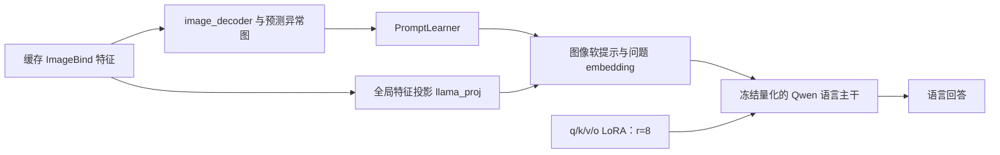

# Qwen LoRA 在本项目中如何实现：原理、代码、步骤与训练证据

整理日期：2026-11-02。本文依据本项目代码、参数审计、训练日志和适配器文件整理，没有启动新的训练。

## 1. 先分清项目中的两套 LoRA

前文 AUROC 从 82.39% 提升到 94.56%，来自**原生 Qwen3-VL-8B 的工业领域 QLoRA 微调**。后续 AnomalyGPT 对照表中的“Qwen LoRA”是另一套实验：视觉来自 ImageBind，通过异常图和软提示接入 Qwen 的语言部分。

| 项目 | 原生 Qwen 工业微调 | AnomalyGPT 迁移中的 Qwen LoRA |
|---|---|---|
| 代码入口 | `industrial_vlm.train` | `train_qwen_matched.py --lora qkvo` |
| 视觉输入 | Qwen3-VL 原生视觉路径 | 缓存的 ImageBind 特征；不使用 Qwen 原生视觉塔 |
| 监督来源 | VisA 真实异常标签与 mask 转框 | 正常源图及合成异常变体、合成 mask 和回答 |
| LoRA 位置 | 语言 attention 的 q/k/v/o | Qwen 语言部分 attention 的 q/k/v/o |
| rank / alpha / dropout | 16 / 32 / 0.05 | 8 / 16 / 0.05 |
| 语言 LoRA 可训练参数 | 15,335,424 | 7,667,712 |
| 其他可训练模块 | 无；原生视觉、连接模块和底座权重冻结 | image_decoder、prompt_learner、llama_proj |
| 本轮训练预算 | 每臂 768 来源、1,536 曝光、192 更新 | 每种子 16 更新、batch2、32 变体曝光 |
| 训练随机种子 | 42 | 42、43、44 |
| 主要评价 | 120 张同域验证图上的判断、框和连续评分 | 2,005 张真实图上的语言判断与像素指标 |

两套实验都采用量化冻结语言权重与 LoRA 更新的思路，但模型接口、训练信息、rank、损失及预算不同。下面首先详解与 94.56% AUROC 对应的原生路线，再说明迁移路线。

## 2. LoRA 究竟改变了模型什么

语言模型中的线性层原本计算：

```text
y = W₀ x
```

LoRA 为选中的线性层增加两个低秩矩阵，在常规 LoRA 缩放设置下计算：

```text
y = W₀ x + (alpha / r) · B · A · x

A 的形状：r × d_in
B 的形状：d_out × r
```

训练冻结原始权重 W₀，更新 A、B。量化路线中，W₀ 以量化格式存储，由相应内核完成前向计算；LoRA 参数保持浮点精度。训练时 LoRA 分支还应用配置的 dropout，推理时关闭 dropout。

本项目原生路线 r=16、alpha=32，所以缩放系数为 `32/16=2`。r 决定可学习更新的秩上限，alpha 控制 LoRA 分支的缩放；两者的最优值需要实验判断，本次没有对 rank 做系统搜索。

例如，实际 q_proj 的输入、输出均为 4,096 维：

| 权重 | 形状 | 参数量 |
|---|---|---:|
| 原始 q_proj 权重 W₀ | 4,096 × 4,096 | 16,777,216 |
| 新增 A | 16 × 4,096 | 65,536 |
| 新增 B | 4,096 × 16 | 65,536 |
| q_proj 新增 LoRA 参数合计 | — | 131,072 |

这一个投影的可训练新增参数约为其原始权重参数量的 0.78125%。它只解释该投影的参数比例，不代表整个模型的显存减少比例。

LoRA 学到的是根据已有图像、语言表示调整答案分布的参数增量。项目的任务专用知识体现在适配器 A、B 的权重中，推理时由底座和适配器共同使用。

## 3. LoRA 加在哪些层

项目精确匹配语言模型的模块路径：

```text
model.language_model.layers.{0..35}.self_attn.q_proj
model.language_model.layers.{0..35}.self_attn.k_proj
model.language_model.layers.{0..35}.self_attn.v_proj
model.language_model.layers.{0..35}.self_attn.o_proj
```

共 36 层，每层 4 个投影，合计 144 个模块。每个模块各有 A、B 两个可训练张量，因此合计 288 个张量。

| 投影 | 在注意力中的作用 | 本次 LoRA 适配的方向 |
|---|---|---|
| q_proj | 生成 query | 调整不同位置查询上下文的方式 |
| k_proj | 生成 key | 调整上下文中哪些信息更容易被匹配 |
| v_proj | 生成 value | 调整通过注意力传递的内容表示 |
| o_proj | 映射注意力输出 | 调整注意力结果进入后续层的表示 |

这些作用是模块的计算含义，不能仅凭选择 q/k/v/o 就声称已经证明模型学会关注缺陷区域。区域理解的效果仍需要生成框、定位评价或进一步干预验证。

选择模块时，代码先在 meta 设备构建模型骨架，枚举完整语言层路径，再传给 PEFT，避免仅用名字后缀把视觉侧同名模块也选中。加载后还会逐参数检查，任何不属于语言 attention LoRA 的可训练参数都会触发错误。

代码证据：[modeling.py 的目标匹配与审计][model-audit]、[模块枚举与注入][model-load]。

## 4. 为什么可训练参数恰好是 15,335,424

以下形状直接来自保存的 `adapter_model.safetensors` 文件头，并与 `parameter_audit.json` 一致：

| 每层模块 | A 形状 | B 形状 | 每层新增参数 |
|---|---|---|---:|
| q_proj | 16 × 4,096 | 4,096 × 16 | 131,072 |
| k_proj | 16 × 4,096 | 1,024 × 16 | 81,920 |
| v_proj | 16 × 4,096 | 1,024 × 16 | 81,920 |
| o_proj | 16 × 4,096 | 4,096 × 16 | 131,072 |
| 一层合计 | — | — | 425,984 |

```text
36 层 × 425,984 = 15,335,424 个 LoRA 参数
```

k/v 的输出维度小于 q，与该模型的分组查询注意力结构相符。因此不能把所有投影都按 4,096×4,096 计算。

审计还记录：

- 144 个 LoRA 目标模块。
- 288 个可训练张量，原生训练记录中均为 FP32。
- 保存的适配器权重也为 288 个 F32 张量，元素总数为 15,335,424。
- 适配器权重文件大小为 61,384,752 字节，约 61.38 MB；其中还包含 safetensors 元数据。

“NF4 量化模型”不意味着 LoRA 参数也按 4bit 更新。这里冻结语言权重使用 NF4、计算使用 BF16 autocast，而实际 LoRA 权重为 FP32。

证据：[参数审计][parameter-audit]、[适配器配置][adapter-config]、[适配器权重][adapter-weights]。

## 5. 第一步：准备真实工业指令数据

原生路线处理 VisA 的 10,821 张图片，建立自定义有监督分区：训练 7,575、验证 1,624、测试 1,622。第二轮从训练分区选取 768 个独立来源，12 类各 32 正常、32 异常。

异常标签和真实 mask 经校验后用于构造目标；模型推理输入只有图片与统一检查指令。

DD 中真实使用的指令为：

```text
Inspect this industrial image for defects.
Return JSON only: {"is_anomalous": true or false}.
```

一个训练目标示例是：

```json
{"is_anomalous":false}
```

区域任务从所有非零 mask 索引提取一个覆盖全部缺陷的外接框，并映射到 `[0,1000]` 坐标；正常图目标为空框。以下仅为格式示意：

```json
{"is_anomalous":true,"boxes":[[100,200,350,600]]}
```

同一源图的两次任务安排按 RR、DD、RD 派生。源图及其派生样本保持在同一分区，原始字节哈希、类别与标签一致性都有记录。

证据：[数据协议][data-protocol]、[DD 训练指令文件][train-data]。

## 6. 第二步：按 QLoRA 方式加载 Qwen

原生加载逻辑主要完成以下操作：

1. 检查模型类型为 dense Qwen3-VL，设备支持 CUDA BF16。
2. 在模型骨架中枚举语言 attention 的 144 个目标模块。
3. 语言 Linear 使用 NF4 双重量化、BF16 计算。
4. 视觉编码器、merger、DeepStack、embedding 和 lm_head 保持相应冻结浮点存储，不对整个多模态模型统一量化。
5. 将底座所有参数设为 `requires_grad=False`。
6. 使用 PEFT 注入 LoRA，随后审计实际更新范围。

量化配置的关键部分为：

```python
quantization = BitsAndBytesConfig(
    load_in_4bit=True,
    bnb_4bit_quant_type="nf4",
    bnb_4bit_use_double_quant=True,
    bnb_4bit_compute_dtype=torch.bfloat16,
    llm_int8_skip_modules=skip_names,
)
```

这里 `skip_names` 由完整架构枚举生成，并包含视觉侧与 lm_head 的排除项；上述为说明用摘录，实际代码还执行加载后的模块与精度校验。

实际参数审计记录了 252 个量化 Linear：36 层各有 q/k/v/o、gate/up/down 共 7 个。**量化与训练更新是两个维度：** MLP 的 gate/up/down 被量化冻结，但没有加入 LoRA；q/k/v/o 的原权重也冻结，仅新增 A、B 可训练。

代码证据：[NF4 加载与冻结][model-load]。

## 7. 第三步：用 PEFT 注入 LoRA

实际关键逻辑如下，`target_names` 是前一步枚举得到的完整语言 attention 路径：

```python
model = get_peft_model(
    model,
    LoraConfig(
        task_type=TaskType.CAUSAL_LM,
        r=16,
        lora_alpha=32,
        lora_dropout=0.05,
        bias="none",
        target_modules=target_names,
    ),
)
```

| 配置 | 本项目取值 | 含义 |
|---|---:|---|
| r | 16 | 低秩更新的中间维度 |
| lora_alpha | 32 | 常规缩放系数 alpha/r=2 |
| lora_dropout | 0.05 | 训练时 LoRA 分支的 dropout |
| bias | none | 不额外训练底座 bias |
| task_type | CAUSAL_LM | 使用自回归语言目标 |

语言模型启用非 reentrant 梯度检查点，减少激活存储；同时启用 embedding 输出所需的输入梯度，保证检查点与 PEFT 的反向传播兼容。`enable_input_require_grads()` 作用于中间输出，不代表解冻 embedding 权重。

本项目没有调用会整体提高冻结视觉模块精度的通用 `prepare_model_for_kbit_training` 流程，而是显式控制冻结、梯度和检查点设置。具体效果由参数审计确认。[model-load]

## 8. 第四步：编码图片和答案，仅监督 assistant

实际输入由 Qwen 原生 `AutoProcessor` 和 chat template 生成，保留原生 `pixel_values`、`image_grid_thw` 等字段。训练分别编码“用户前缀”和“用户＋assistant 完整对话”，检查前缀 token、图像网格是否一致。

随后把用户前缀与 padding 的标签设为 `-100`：

```python
labels = input_ids.clone()
labels[:, :n_prefix] = -100
labels[attention_mask == 0] = -100
```

`-100` 在交叉熵中表示该位置不直接计算监督损失。图片和问题仍是答案预测的上下文，其信息会通过模型计算影响答案。

本次 DD 首个真实样本审计为：

| 项目 | 记录 |
|---|---:|
| 总输入序列 | 516 token |
| 被遮蔽的前缀位置 | 506 token |
| 参与监督的目标 | 10 token |
| 监督文本 | `{"is_anomalous":false}<\|im_end\|>` 及结束换行 |

监督包含 JSON 答案和 assistant 结束标记，目标不是只对布尔值一个 token 计算损失。训练采用 teacher forcing，模型类内部完成 causal shift；构造标签时无需再次手动平移。

超长输入会被拒绝，不自动截断图像 token 或答案。训练最大长度为 2,048，最大图像像素预算为 524,288。

代码与记录：[输入构建][make-inputs]、[首样本审计][first-sample]。

## 9. 第五步：反向传播，优化器只更新 LoRA

原生训练器选择参数的逻辑为：

```python
parameters = [p for p in model.parameters() if p.requires_grad]
optimizer = torch.optim.AdamW(
    parameters,
    lr=1e-4,
    weight_decay=0.0,
    foreach=False,
)
```

参数审计先确保 `requires_grad=True` 的只有语言 attention LoRA，因此优化器参数集合就是这些 A、B 张量。

训练采用 microbatch=1、梯度累计8。每次更新依次处理8条指令：

```text
逐样本前向，计算 assistant CE
    ↓
CE × 当前样本监督 token 数，再 backward
    ↓
累计8个样本的梯度
    ↓
除以本次更新实际监督 token 总数
    ↓
梯度裁剪，max_norm=1.0
    ↓
AdamW 更新 LoRA，更新学习率
```

相应代码关键部分为：

```python
(loss * n_targets).backward()
# 累计多个 microstep 后：
for p in parameters:
    if p.grad is not None:
        p.grad.div_(target_tokens)
torch.nn.utils.clip_grad_norm_(parameters, 1.0)
optimizer.step()
```

这种归一化计算本次更新所有答案 token 的平均损失，适用于区域与判断目标长度不同的情况。混合任务各占一半图片，仍不意味着各占一半监督 token 或梯度贡献。

| DD 训练设置 | 实际值 |
|---|---:|
| microbatch | 1 |
| 梯度累计 | 8 |
| 更新次数 | 192 |
| 实际图片曝光 | 192×8=1,536 |
| 独立源图 | 768，每图两次 |
| 学习率配置 | 1e-4 |
| warmup | 10 次更新，随后线性衰减 |
| 第一次更新的实际学习率 | 1e-5 |
| seed | 42 |

代码证据：[优化器与训练循环][train-loop]；实际配置：[run_config.json][run-config]。

## 10. 怎样确认 LoRA 真实参与了训练

### 10.1 检查可训练参数

`parameter_audit.json` 逐项记录参数名称、元素数和 dtype。典型名称为：

```text
base_model.model.model.language_model.layers.0.self_attn.q_proj.lora_A.default.weight
base_model.model.model.language_model.layers.0.self_attn.q_proj.lora_B.default.weight
```

任何可训练视觉参数、底座参数或非目标语言参数都会使审计失败。因而配置之外，还有实际参数集合的证据。

### 10.2 检查非零梯度

训练第1次更新在优化器执行前检查非零梯度。本次 DD 日志记录 144 个非零梯度张量，均为 LoRA 的 B 分支，覆盖全部144个目标模块。

默认 LoRA 初始化通常令 B 为零，初始增量 `BA=0`；在这种初始化下首步 A 的梯度为零、B 可以得到非零梯度。当前首步记录与这一行为一致，不能要求首步288个张量都具有非零梯度才算训练成功。

### 10.3 检查更新与损失记录

| DD 训练记录 | 数值 |
|---|---:|
| 完成更新数 | 192 |
| 第1次更新 CE | 1.4420 |
| 第192次更新 CE | 0.01776 |
| 全程监督 token | 15,360 |
| 全程输入 token | 807,936 |
| 第192次诊断验证 CE | 0.03449，固定24张验证子集 |

首尾训练损失来自不同更新批次，且包含 JSON 模板拟合；其下降不能直接换算成异常准确率。性能仍通过独立来源的生成结果与连续评分评估。

### 10.4 检查适配器产物

权重文件存在、张量名称为 LoRA、288 个张量及其总元素数与参数审计一致。保存后进一步使用新加载底座重载适配器，比对指定提示位置输出。

直接读取本地权重文件的数据部分还确认：144个LoRA B矩阵全部含非零值。以第0层q_proj的B为例，L2范数约0.28016、最大绝对元素约0.004083。这与非零梯度和192次优化器更新记录共同支持适配器实际参与训练；权重发生更新本身还需要结合下游评估判断任务收益。

证据：[训练日志][train-log]、[训练汇总][summary]、[适配器权重][adapter-weights]。

## 11. 第六步：保存适配器并重新加载

最终适配器目录为：[DD adapter][adapter-dir]。

```text
adapter/
├── adapter_config.json
├── adapter_model.safetensors
├── processor_config.json
├── tokenizer.json
├── tokenizer_config.json
├── chat_template.jinja
└── training_state.json
```

保存的是增量适配器与处理器配置。推理需要相容的 Qwen 底座：先按同样 NF4 策略加载底座，再执行 `PeftModel.from_pretrained(base, adapter_path, is_trainable=False)`。

本次验证释放训练模型与优化器后，重新加载底座和已保存适配器，比较首样本提示末位置的 logits：最大绝对差为 **0.0**，top1 一致。检查范围是这个提示位置，不是对所有样本的逐位等价证明。

`training_state.json` 记录完成更新数192，但未保存优化器和 scheduler 状态；从适配器初始化继续训练与精确断点续训不同。

代码证据：[适配器保存][save-adapter]、[重载验证][reload-check]。

## 12. 第七步：评估 LoRA 后模型的实际效果

### 12.1 生成式异常判断

模型根据图像与问题生成完整 JSON，解析正常／异常结果。在120张同域验证图上，DD 检出51/60张异常，误报8/60张正常：

| 模型／判断提示 | 异常召回 | 正常 FPR | 二类 Macro-F1 |
|---|---:|---:|---:|
| RR | 70.00% | 5.00% | 82.22% |
| DD | 85.00% | 13.33% | 85.83% |
| RD | 80.00% | 11.67% | 84.14% |

### 12.2 候选似然异常评分

对四组使用相同的判断提示和 JSON 前缀，计算 `log P(true)−log P(false)`，得到连续分数并评价排序：

| 模型 | 验证 AUROC | 验证 AP |
|---|---:|---:|
| 同策略量化底座 | 82.39% | 85.58% |
| RR LoRA | 91.49% | 93.01% |
| DD LoRA | 94.56% | 95.26% |
| RD LoRA | 92.01% | 93.54% |

RR、DD、RD 都是 LoRA 训练模型，“纯判断DD”与“LoRA”不是互斥分类：前者描述监督任务，后者描述参数更新方式。

DD 相对同策略量化底座的 AUROC 提高12.17个百分点，是当前完整领域训练配方的效果。没有在相同预算下训练全参数、其他rank或其他位置的适配器，因此不能进一步断言 LoRA 算法本身优于那些替代训练方法。

120张图按每类5正常、5异常组成；属于单seed、同域开发验证。自由生成F1和候选评分AUROC来自不同输出方式，候选评分再以阈值0判断时DD F1为84.98%，应与85.83%的自由生成F1分别记录。

证据：[第二轮实验报告][report]、[连续评分汇总][score-results]。

## 13. AnomalyGPT 迁移组中的 Qwen LoRA 怎样实现

这一组将缓存 ImageBind 特征经 decoder、PromptLearner 和全局投影构建软提示，再作为 `inputs_embeds` 接入 Qwen 语言模型。加载后释放 Qwen 原生视觉塔，语言主干和 lm_head 冻结。



### 13.1 先冻结，再分别开放 bridge 与 LoRA

`train_qwen_matched.py` 先冻结整个模型，然后将下列三个模块设为可训练：

```python
BRIDGE_MODULES = ("image_decoder", "prompt_learner", "llama_proj")
```

当 `--lora qkvo` 时，在已经抽出的语言模块 `model.lm` 上执行：

```python
model.lm = get_peft_model(
    model.lm,
    LoraConfig(
        r=8,
        lora_alpha=16,
        lora_dropout=0.05,
        bias="none",
        task_type="CAUSAL_LM",
        target_modules=["q_proj", "k_proj", "v_proj", "o_proj"],
    ),
)
```

这里包装对象已是语言模块，和原生路线在完整 VLM 上枚举完整语言路径的处理方式不同。

| 匹配 Qwen 组 | bridge 可训练参数 | 语言 LoRA 可训练参数 | 合计可训练参数 |
|---|---:|---:|---:|
| 冻结 Qwen 语言模型 | 116,861,880 | 0 | 116,861,880 |
| Qwen LoRA | 116,861,880 | 7,667,712 | 124,529,592 |

因此“冻结Qwen”指语言骨干冻结，该组仍训练 bridge；“Qwen LoRA”则在训练相同 bridge 的基础上增加语言侧低秩更新。7,667,712只统计语言LoRA，不能写成这一组全部可训练参数。

### 13.2 损失和优化步骤

每个batch加载缓存的全局特征、多层patch特征、文本原型、合成mask及对话：

1. image_decoder 将4层patch特征映射后与正常／异常文本原型匹配。
2. 每层生成224×224两类概率图，计算 Focal 与 Dice 像素损失。
3. 四层异常图平均，送入 PromptLearner 产生软提示。
4. 全局特征经 llama_proj 投影到4,096维，与软提示、问题和答案embedding拼接。
5. 图像提示与用户部分labels=-100，assistant目标计算按token归一化的causal CE。
6. 组合 `L_total = L_CE + 1.0 × L_pixel`。
7. AdamW 更新bridge和LoRA，梯度裁剪1.0。

原生路线的对话使用 Qwen 原生 chat template；这条迁移路线沿用手工 `### Human / ### Assistant` 格式。

损失路径也有区别：语言CE经过语言模型影响LoRA与输入bridge；像素损失直接监督异常图。当前代码没有从语言输出回到像素图的支路，因此像素损失本身不会直接给语言LoRA产生梯度，decoder还可以通过软提示路径接收语言CE的梯度。

匹配迁移运行使用学习率1e-3、batch2、16次更新、max_tgt_len=128；同种子三臂共享bridge初值和显式样本顺序。48源图对应96个缓存变体，实际只曝光32个变体；不同种子涉及独立源图27／28／25个。seed42的Qwen LoRA实际累计504个监督token。

代码证据：[迁移组LoRA注入][bridge-lora]、[缓存前向和损失][bridge-forward]、[训练记录][bridge-run]。

### 13.3 当前观察到的效果

| 三种子匹配组 | 生成F1，均值±样本标准差 | 正常FPR，均值±样本标准差 |
|---|---:|---:|
| 冻结Qwen语言模型 | 40.63%±8.02% | 23.28%±18.29% |
| Qwen LoRA | 40.52%±12.26% | 33.66%±57.46% |

LoRA组消除了本轮无效回答，但没有获得稳定整体收益：seed42几乎全部回答No，seed43全部回答Yes。它说明低秩更新确实可以改变输出行为，但改变不一定符合任务目标。

迁移实验的下一步是固定Qwen语言底座，对比decoder更新与冻结，先排查定位和语言监督的权衡；目前该下一轮只有方案。[bridge-conclusion]

## 14. 怎样向面试官解释本项目的 LoRA

推荐表述：

> 我在Qwen3-VL-8B的语言模块36层attention的q/k/v/o投影加入rank16 LoRA，更新15,335,424个参数，冻结原生视觉模块与底座权重。语言Linear采用NF4双重量化，结合BF16计算、梯度检查点和8步梯度累计，在单张24GB GPU完成工业判断与框定位SFT。训练只监督assistant答案，实际记录可训练参数、非零梯度、图片曝光和token预算。适配器保存后用新底座重载验证，再分别评价生成判断和候选似然异常排序；纯判断模型在120张同域验证图上AUROC为94.56%，相对同策略底座提高12.17个百分点，这是单seed开发结果。

如果继续问AnomalyGPT迁移：

> 迁移组使用另一套rank8 LoRA，只包装Qwen语言部分，视觉来自ImageBind和可训练的异常bridge。我匹配三种子的bridge初值、顺序和训练预算，对比冻结语言模型与加入LoRA的效果。该小预算配方出现明显预测偏置，因此保留负结果，并通过热图交换和候选分数诊断分析信号传递。

## 15. 代码与证据索引

| 内容 | 跳转 |
|---|---|
| LoRA目标匹配及冻结范围审计 | [modeling.py][model-audit] |
| 量化、冻结及PEFT注入 | [modeling.py][model-load] |
| 原生多模态编码与assistant标签 | [make_inputs][make-inputs] |
| 参数选择、优化器及训练循环 | [train.py][train-loop] |
| 适配器保存 | [train.py][save-adapter] |
| 新底座重载验证 | [train.py][reload-check] |
| 单图推理 | [infer.py][infer] |
| 原生DD配置 | [run_config.json][run-config] |
| 实际可训练参数清单 | [parameter_audit.json][parameter-audit] |
| 第一条输入与监督 | [first_sample_audit.json][first-sample] |
| 梯度与训练日志 | [metrics.jsonl][train-log] |
| 保存的LoRA配置与权重 | [adapter_config.json][adapter-config]、[adapter_model.safetensors][adapter-weights] |
| 原生训练结果 | [summary.json][summary]、[实验报告][report] |
| 迁移组训练入口 | [train_qwen_matched.py][bridge-lora] |
| 迁移组共享损失前向 | [train_vicuna_matched.py][bridge-forward] |
| 迁移组seed42实际记录 | [run.json][bridge-run] |

[model-audit]: /Users/qiaohongfei/Desktop/实习/阿里云天池比赛vlm/industrial_vlm/src/industrial_vlm/modeling.py:18
[model-load]: /Users/qiaohongfei/Desktop/实习/阿里云天池比赛vlm/industrial_vlm/src/industrial_vlm/modeling.py:114
[make-inputs]: /Users/qiaohongfei/Desktop/实习/阿里云天池比赛vlm/industrial_vlm/src/industrial_vlm/modeling.py:207
[train-loop]: /Users/qiaohongfei/Desktop/实习/阿里云天池比赛vlm/industrial_vlm/src/industrial_vlm/train.py:263
[save-adapter]: /Users/qiaohongfei/Desktop/实习/阿里云天池比赛vlm/industrial_vlm/src/industrial_vlm/train.py:163
[reload-check]: /Users/qiaohongfei/Desktop/实习/阿里云天池比赛vlm/industrial_vlm/src/industrial_vlm/train.py:373
[infer]: /Users/qiaohongfei/Desktop/实习/阿里云天池比赛vlm/industrial_vlm/src/industrial_vlm/infer.py:34
[data-protocol]: /Users/qiaohongfei/Desktop/实习/阿里云天池比赛vlm/industrial_vlm/DATA_PROTOCOL.md
[train-data]: /Users/qiaohongfei/Desktop/实习/阿里云天池比赛vlm/industrial_vlm/prepared/multitask_v2/train_decision_decision.jsonl
[run-config]: /Users/qiaohongfei/Desktop/实习/阿里云天池比赛vlm/industrial_vlm/runs/multitask_v2/decision_decision/run_config.json
[parameter-audit]: /Users/qiaohongfei/Desktop/实习/阿里云天池比赛vlm/industrial_vlm/runs/multitask_v2/decision_decision/parameter_audit.json
[first-sample]: /Users/qiaohongfei/Desktop/实习/阿里云天池比赛vlm/industrial_vlm/runs/multitask_v2/decision_decision/first_sample_audit.json
[train-log]: /Users/qiaohongfei/Desktop/实习/阿里云天池比赛vlm/industrial_vlm/runs/multitask_v2/decision_decision/metrics.jsonl
[summary]: /Users/qiaohongfei/Desktop/实习/阿里云天池比赛vlm/industrial_vlm/runs/multitask_v2/decision_decision/summary.json
[adapter-dir]: /Users/qiaohongfei/Desktop/实习/阿里云天池比赛vlm/industrial_vlm/runs/multitask_v2/decision_decision/adapter
[adapter-config]: /Users/qiaohongfei/Desktop/实习/阿里云天池比赛vlm/industrial_vlm/runs/multitask_v2/decision_decision/adapter/adapter_config.json
[adapter-weights]: /Users/qiaohongfei/Desktop/实习/阿里云天池比赛vlm/industrial_vlm/runs/multitask_v2/decision_decision/adapter/adapter_model.safetensors
[report]: /Users/qiaohongfei/Desktop/实习/阿里云天池比赛vlm/industrial_vlm/reports/multitask_v2/实验报告.md
[score-results]: /Users/qiaohongfei/Desktop/实习/阿里云天池比赛vlm/industrial_vlm/reports/multitask_v2/scoring_matrix.json
[bridge-lora]: /Users/qiaohongfei/Desktop/实习/阿里云天池比赛vlm/AnomalyGPT/followup_20261026/train_qwen_matched.py:200
[bridge-forward]: /Users/qiaohongfei/Desktop/实习/阿里云天池比赛vlm/AnomalyGPT/followup_20261026/train_vicuna_matched.py:317
[bridge-run]: /Users/qiaohongfei/Desktop/实习/阿里云天池比赛vlm/AnomalyGPT/followup_20261026/final_results/matched_runs/qwen_lora_42/run.json
[bridge-conclusion]: /Users/qiaohongfei/Desktop/实习/阿里云天池比赛vlm/docs/strict_qwen_followup_20261026/最终实验结论.md
