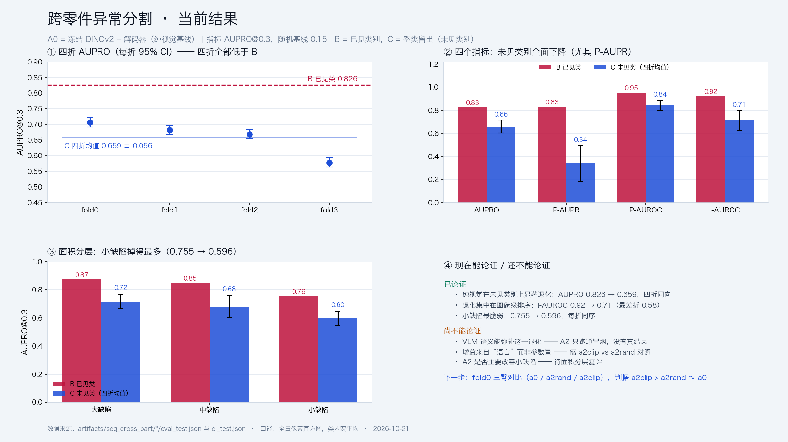

# 实验进度与版本记录

> 用法：每完成一步就往下追加一行/一节，**不删旧记录**。核对时看这里，不看聊天记录。
> 配套文档：《项目说明.md》（协议与设计的唯一依据）。
>
> **维护规则（每次实验 / 验证 / 迭代后必做三件事）**
> 1. 更新 §3 运行台账（直接贴 `python -m seg_cross_part.report_runs` 的输出）；
> 2. 更新 §2 对应版本的「已完成 / 未完成」勾选；
> 3. 在 §7 时间线追加一个节点（用 §8 的模板），写清：触发/改动/验证/结果/影响/状态/commit。
> 缺任何一条，这次实验视为「未记录」，不得进论文表。

---

## 0. 版本总览

| 版本 | 日期 | 主题 | 状态 |
|---|---|---|---|
| v0.1 | 2026-10-20 | 跨零件异常**分类**（图像级） | **已废弃**，代码删除，仅留结论 |
| v0.2 | 2026-10-21 | 跨零件异常**分割**地基（数据/指标/A0 四折） | **完成**（AUPRO 0.6587±0.0563） |
| v0.3 | 2026-10-21 | **A2 语言分支**（文本锚点 + projector） | 进行中（代码就绪，待真跑） |
| v0.3 | 待定 | A1/A2/A3 语言融合与归因 | 未开始 |
| v0.4 | 待定 | prompt adapter → LoRA | 未开始 |
| v1.0 | 待定 | 四折冻结、论文表、CI | 未开始 |

**转向原因**：项目目标是证明 VLM 的跨样本泛化能力。分类只能证明"图级判别"，
而工业场景真正要的是**缺陷在哪**；且图像级指标在 78% 异常率下极易失真（见 §4.1）。
分割能把"语言语义是否帮助定位没见过的缺陷"讲清楚。

---

## 1. v0.1（已废弃）：跨零件异常分类

### 1.1 做了什么

- 冻结数据地基：29,855 视角 / 5,971 组 / 24 类的 manifest；Protocol A/B/C 划分 + 泄漏审计（全绿）；
- 图像级指标：AUROC/AUPR/F1max/BA/Recall@FPR/ECE/Brier；
- 训练器：DINOv2 冻结 + 线性/MLP 探针（D0/D1）；Qwen3-VL 零样本（V0）；WinCLIP 零样本（Z0）；
- 阈值冻结、结果台账、防覆盖、bootstrap CI、真权重自检。

### 1.2 关键结果（存档，不再使用）

| 实验 | 设定 | 结果 | 结论 |
|---|---|---|---|
| D0 | DINOv2-B + 线性头，Protocol B，服务器 4090 | 第 2000 步：val 视角宏 AUPR **0.9562**、组级宏 AUPR 0.9785 | 监督探针很强，但**任务方向已放弃**，run 被手动终止 |
| Z0 | WinCLIP 零样本（CLIP ViT-L/14@336，`object` 中性词），Protocol B | val：宏 AUPR 0.8720 / AUROC **0.6594**；test：0.8666 / 0.6657；Recall@FPR=5% = **2.46%**；组级 F1@τ 0.8775 但 **FPR@τ = 1.0** | CLIP 零样本文本先验在该数据上很弱；AUPR 高只是 78% 阳性率的假象 |
| Z0 类名消融 | 同 Z0，prompt 给类名 | 跑到一半终止，未完成 | 待定 |

### 1.3 v0.1 遗留的两个可复用结论

1. **指标校准的坑**：异常占比 78% 时，最大化 F1 的阈值会把 FPR 推到 1.0。
   主指标必须是阈值无关的（AUPR 减基线 / Recall@固定 FPR），这条已写进新项目说明 §7.2。
2. **数据地基可直接复用**：`group_path` / `visual_group_id` / Protocol A/B/C 全部迁移到
   `artifacts/splits/`，分割线继续使用，未做任何改动。

---

## 2. v0.2（已完成）：分割地基

### 2.1 已完成

| 项 | 产出 | 验证 |
|---|---|---|
| 像素级 manifest | `artifacts/seg_cross_part/manifest_pixel.parquet`（29,855 行） | 抽查 300 张 mask：读取失败 0、像素数不一致 0、正常视角有缺陷像素 0 |
| 像素指标 | `seg_cross_part/metrics_pixel.py`（AUPRO@0.3 / 池化 P-AUPR / P-ROC / P-F1max） | 校准见 §2.2 |
| A0 训练器 | `seg_cross_part/train_seg.py`（DINOv2 冻结 + 解码器，focal+dice） | 冒烟：8 图 × 4 步端到端跑通，指标无 NaN |
| 代码解耦 | `seg_cross_part/common.py` 独立，不再依赖分类包 | 分类包已删除，`compileall` 通过 |

### 2.2 指标校准记录（重要）

| 输入 | AUROC | AUPR | AUPRO@0.3 |
|---|---|---|---|
| 完美（score = GT） | 1.0000 | 1.0000 | 1.0000 |
| 随机 | 0.4948 | 0.0351 | **0.1492** |
| 常数 | 0.5000 | 0.2024 | 0.1500 |
| 反相 | 0.0000 | 0.0178 | 0.1500 |
| 连续分数（噪声 0.1/0.3/0.6/0.9） | — | — | 0.999 / 0.999 / 0.809 / 0.251 |

**结论**：AUPRO 的随机基线是 **0.15**，不是 0.5。论文表格里必须标注基线。

修复过的 bug：
1. `metrics._roc_points` 在单标签输入时除零（已在 `metrics.py` 修复，返回 nan）；
2. `AUPRO` 未补 (0,0)/(1,1) 端点，导致反相输入得到 1.0（已修，现为 0.15）。

### 2.3 数据冻结值（核对用）

```
视角 29,855 | 组 5,971 | 类 24 | visual_group_id 4,231
正常视角 6,486 | 异常视角（mask 有效）23,369 | 盲 NG 视角（按正常处理）491
面积三分位（defect_ratio）：0.008469 / 0.023600
Protocol A：21,110 / 4,370 / 4,375（24 类）
Protocol B：20,950 / 4,515 / 4,390（24 类）
Protocol C fold0：17,890 / 4,510 / 7,455（18 训 / 18 验 / 6 测）
```

### 2.4 进度勾选

- [x] 像素级 manifest（mask/面积档/缺陷词）
- [x] 像素指标 AUPRO@0.3 + 池化 P-AUPR/P-AUROC + 图像级诊断
- [x] A0 训练器（冻结 DINOv2 + 解码器，focal+dice）
- [x] 图像/mask 几何对齐修复 + 自检
- [x] 离线复评 `evaluate_pixel.py`（分层：按类、按面积档）
- [x] 像素级 bootstrap `bootstrap_pixel.py`（group 为单位，含配对）
- [x] 开跑前复核 `preflight.py`（17 项，train_seg 强制）
- [x] 运行台账 `report_runs.py`
- [x] **A0 Protocol B 单折**（AUPRO 0.8283）
- [x] **A0 Protocol C fold3**（AUPRO 0.5847）
- [x] A0 Protocol C 四折全部完成（fold2 用离线复评补算）
- [x] A0 四折汇总：AUPRO 0.6618 ± 0.0537（见 §3.2）
- [x] A2-a 语言分支代码（`a2_language.py`，CLIP/随机锚点、shuffle 消融、anchors.pt）
- [x] 指标口径交叉验证（`check_metrics.py` + preflight 第 11b 项，Δ<1e-6）
- [x] 四折 bootstrap 95% CI（见 §3.2）
- [ ] **A2 fold0 三臂对比**（a0 / a2rand / a2clip）← 当前第一优先
- [ ] A2 四折
- [ ] A1 控制臂（VLM 视觉）
- [ ] A3/A4/A5（融合 + prompt adapter + LoRA）

---

## 3. 运行台账

**生成方式**（服务器上执行，秒级，不需要 GPU）：

```bash
python -m seg_cross_part.report_runs          # 打印表格
python -m seg_cross_part.report_runs --md docs/run_ledger.md   # 写成文件
```

**规则**：每个 run 结束（或中途作废）后立刻更新本表；作废的 run 不删行，标「作废」并写原因。

### 3.1 当前台账（2026-10-21 16:10，**口径已统一**）

> ⚠️ 所有指标现在统一由 `stats_pixel`（全量像素直方图）计算，训练器与离线复评结果逐位一致。
> 早期 `train_seg` 输出的 P-AUPR/P-AUROC 因抽样 bug 只统计了每类前 ~10 张图，**以本表为准**。

| exp_id | 协议 | fold | 状态 | test AUPRO | test P-AUPR | test P-AUROC | test I-AUROC |
|---|---|---|---|---|---|---|---|
| `b_a0_fix_s20261021` | b | — | ✅ 完成 | **0.8258** | 0.8301 | 0.9533 | 0.9215 |
| `c_f0_a0` | c | 0 | ✅ 完成 | **0.7064** | 0.3849 | 0.8942 | 0.7587 |
| `c_f1_a0` | c | 1 | ✅ 完成 | **0.6822** | 0.5003 | 0.8566 | 0.7660 |
| `c_f2_a0` | c | 2 | ✅ 完成* | **0.6688** | 0.3427 | 0.8351 | 0.7412 |
| `c_f3_a0` | c | 3 | ✅ 完成 | **0.5776** | 0.1266 | 0.7860 | 0.5826 |
| `c_f0_a2rand` | c | 0 | ✅ 完成 | **0.7092** | 0.3032 | 0.8909 | 0.7234 |
| `b_a0_s20261021` | b | — | ❌ 作废 | 0.8222 | 0.5378 | 0.9288 | 0.8344 |
| 旧 `c_f0/c_f1/c_f2` | b | — | ❌ 作废 | ≈0.828 | ≈0.740 | — | — |

\* `c_f2_a0` 训练在最终评测前被中断，指标由 `evaluate_pixel.py` 用 `best.pt` 离线复评补算。

### 3.2 A0 四折汇总（**当前基线**）




| 指标 | B 已见类 | **C 四折均值 ± std** | 每折 (f0/f1/f2/f3) | Δ vs B |
|---|---|---|---|---|
| **AUPRO@0.3** | 0.8258 | **0.6587 ± 0.0563** | .706/.682/.669/.578 | **−0.1671** |
| P-AUPR | 0.8301 | 0.3386 ± 0.1563 | .385/.500/.343/.127 | −0.4915 |
| P-AUROC | 0.9533 | 0.8430 ± 0.0452 | .894/.857/.835/.786 | −0.1103 |
| I-AUROC | 0.9215 | 0.7121 ± 0.0870 | .759/.766/.741/.583 | −0.2094 |

**四折方向完全一致**（全部低于 B），退化来自"未见类别"本身，不是某一折的偶然。

每折 95% CI（group_path 重采样，1000 次，`ci_test.json`）：

| fold | AUPRO 点估计 | 95% CI | 宽度 |
|---|---|---|---|
| 0 | 0.7064 | [0.6919, 0.7228] | 0.031 |
| 1 | 0.6822 | [0.6688, 0.6960] | 0.027 |
| 2 | 0.6688 | [0.6534, 0.6841] | 0.031 |
| 3 | 0.5776 | [0.5640, 0.5930] | 0.029 |

**折内 CI 只有 ±0.015，但折间 std 是 0.056**——主要不确定性来自"抽到哪 6 个 holdout 类"，
不是采样噪声。所以 A2 必须**按折配对**比较（四折同向），不能只看均值。
P-AUPR 的折间方差最大（std 0.156）——fold3 只有 0.127，说明有些类别上模型几乎不做正确排序。

### 3.3 按缺陷面积分层（AUPRO@0.3）

| 面积档 | B（已见类） | C 四折均值 ± std | 每折 |
|---|---|---|---|
| large | 0.874 | **0.716 ± 0.052** | .779/.730/.700/.656 |
| medium | 0.850 | 0.679 ± 0.078 | .684/.716/.748/.568 |
| small | 0.755 | **0.596 ± 0.050** | .665/.600/.558/.559 |

每一折都是 large > small；小缺陷掉得最多（B 0.755 → C 0.596，−0.16）。
**这是 A2 的可检验预测：语言分支若真在补语义，应主要改善 small 档。**
B 的数值来自 `b_a0_fix` 的 `eval_test.json`（离线复评，面积档口径与 C 一致）。

### 3.4 判读

- A0 在未见类别上 **AUPRO 掉 0.167（−20%）**、P-AUPR 掉 0.49、I-AUROC 掉 0.21；
- I-AUROC 均值 0.712、最差折 0.583 → **图像级排序接近失效**，模型不是"定位略偏"，而是"在新零件上不知道该看哪"；
- 折间 std 0.056（AUPRO），而 A2 期望效果量级也是 0.05–0.10 → **必须按折配对**，四折同向才算数；
- 目标线：A2 四折均值 **AUPRO ≥ 0.72（+0.06）且四折同向**；**≥ 0.76** 才够写进摘要。

## 4. 已知问题清单

| # | 问题 | 影响 | 处理 |
|---|---|---|---|
| 1 | **A1/A2/A3 未实现** | 核心主张（语言弥补跨类泛化）目前**没有代码支撑** | v0.3 首要任务 |
| 2 | 四折按字母序轮转，未按分辨率/缺陷词分层 | 折间方差混入分辨率差异（fold1 测试中位宽 1,026 vs fold2 767） | 写作时如实交代；必要时重排折 |
| 3 | AUPRO 是自实现（per-region + 100 阈值） | 与 anomalib 等参考实现可能有小差异 | 出主表前用同一份预测与 anomalib 对一次数 |
| 4 | 语言分支的文本空间未定 | VLM 文本与 DINOv2 patch 不对齐，projector 设计未验证 | v0.3 先做 CLIP 文本（易对齐）再换 VLM |
| 5 | 图像级 F1@τ 在该数据上不可用 | 78% 异常率下阈值滑向"全判异常"，FPR 可达 1.0 | 主表改用 Recall@FPR=5% |
| 6 | 服务器上旧的分类代码未清理 | 与新方向混淆 | 本次同步时删除 |
| 7 | **池化像素抽样 bug**（已修） | 训练器 P-AUPR/P-AUROC 只统计每类前 ~10 张图（预算被吃光后 rate=0） | 改为全量直方图累加，训练/离线口径逐位一致；历史数字以 §3 为准 |
| 8 | `stats_pixel.load` 曾是 O(n²) 解压（已修） | bootstrap 被 OOM 杀掉（`Killed`） | 先解压一次再逐行切；1000 次 bootstrap 约 30 s、峰值 <300 MB |

---

## 5. 环境与资产

| 项 | 本地（Mac） | 服务器（AutoDL 4090D） |
|---|---|---|
| 路径 | `~/Desktop/实习/阿里云天池比赛vlm` | `/root/autodl-tmp/vlm` |
| Python | 3.12（系统） | `.venv/bin/python`（3.12.3） |
| torch / transformers | 2.10.0 / 4.43.1 | 2.5.1+cu124 / 5.14.1 |
| 加速器 | MPS | RTX 4090D 24 GB |
| DINOv2 权重 | **无** | `models/dinov2-base`（331 MB，已下载） |
| 注意 | `import torch` 在服务器上约 85 s，远端命令要给足超时 | 同左 |

---

## 6. 下一步（按优先级）

A0 四折已闭合（口径统一后）= **AUPRO 0.6587 ± 0.0563**。下一步全部围绕 A2。

1. **[进行中] A2 fold0 三臂对比**：`a0` / `a2rand`（随机锚点）/ `a2clip`（CLIP 文本）。
   判据：a2clip > a2rand ≈ a0 才算语义起作用；
2. **A2 四折**：三臂都过线后再铺四折，按折配对报告；
3. **A2-b**：把 CLIP 文本换成 Qwen3-VL 文本（主张本身）；
4. **A1 控制臂**：VLM 视觉特征替换语言分支，排除"只是更强 backbone"；
5. **A3/A4/A5**：融合 + prompt adapter + LoRA（第二阶段）。

---

## 7. 迭代时间线（按时间正序，带 commit）

> 每个节点记六件事：**时间 / 触发 / 改动 / 验证 / 结果 / 影响**。
> 没有 commit 的节点说明只改了数据或只在服务器上操作。

### 7.0 节点索引

| ID | 时间 | 主题 | 结果 | 状态 | commit |
|---|---|---|---|---|---|
| I-01 | 10-20 | v0.1 分类线落地 | B 宏 AUPR 0.956（D0）/0.867（Z0） | 已废弃 | — |
| I-02 | 10-20 | 服务器清理 42G→27.5G | 只留 Dataset/models/.venv | 完成 | — |
| I-03 | 10-21 | **转向分割**，建 `seg_cross_part` | 分类代码与文档删除 | 完成 | 7a79177 |
| I-04 | 10-21 | 像素指标 v1.0 + 校准 | 完美 1.0 / 随机 0.15 | 冻结 | — |
| I-05 | 10-21 | A0 首跑（对齐 bug） | P-AUPR 0.538（作废） | 作废 | — |
| I-06 | 10-21 | 修复图像/mask 几何错位 | 对齐 IoU 0.9997 | 完成 | — |
| I-07 | 10-21 | A0 重跑 B（旧口径） | AUPRO 0.8283 | 被 I-11 修正 | — |
| I-08 | 10-21 | 协议配置事故 | c_f0/f1/f2 实为 B，作废 | 已修 | a8cd559 |
| I-09 | 10-21 | preflight 上线（17 项） | C fold0 17/17 通过 | 完成 | a8cd559 |
| I-10 | 10-21 | C 四折跑完 | AUPRO 0.709/0.682/0.672/0.585 | 完成 | 16521a3 |
| I-11 | 10-21 | **指标统一**（池化抽样 bug） | 四折 AUPRO 0.6587±0.0563 | 完成 | 4fa0182 |
| I-12 | 10-21 | bootstrap OOM 修复 | 1000 次 ≈30 s，峰值<300 MB | 完成 | 4fa0182 |
| I-13 | 10-21 | 四折 95% CI | 见 §3.2 | 完成 | — |
| I-14 | 10-21 | **A2-a 语言分支** + 口径交叉验证 | 冒烟通过，待真跑 | 进行中 | a5a92d6 |
| I-15 | 10-21 | GitHub 仓库整体替换 | HEAD 只剩 54 个文件 | 完成 | 7a79177→a5a92d6 |
| I-16 | 10-21 | **A2 随机锚点对照**（fold0） | ΔAUPRO +0.003（不显著），ΔP-AUPR −0.082（显著变差） | 完成 | — |

---

### I-01 · 2026-10-20 · v0.1 分类线落地
- **触发**：确定"跨零件异常分类"方向。
- **改动**：manifest（29,855/5,971/24）、Protocol A/B/C、图像级指标、DINOv2 探针训练器、Qwen3-VL 零样本、WinCLIP 零样本。
- **结果**：D0 在 Protocol B val 宏 AUPR 0.9562（@2000 步）；Z0 test 宏 AUPR 0.8666 / AUROC 0.6657。
- **影响**：发现"78% 阳性率下 AUPR 虚高、F1 阈值滑向全判异常"（FPR@τ=1.0），直接促成后来的指标纪律。
- **状态**：已废弃（代码删除），仅存档数字。

### I-02 · 2026-10-20 · 服务器清理
- **改动**：删除 85 项旧分割/比赛代码与 7.3G artifacts；归档旧 fold1 划分与 C2 ckpt 到 `archive_c2`。
- **结果**：仓库 42,180 MB → 27,560 MB。
- **影响**：后续所有实验都在干净环境里跑。

### I-03 · 2026-10-21 · 转向分割，建 `seg_cross_part`
- **触发**：项目目标是证明 VLM 的跨**样本**泛化，分类只能证明图级判别，分割才见定位。
- **改动**：删除 `classification_cross_part` 等旧代码；新增 `common/metrics/metrics_pixel/build_mask_manifest/train_seg`；冻结划分迁到 `artifacts/splits/`。
- **验证**：manifest_pixel 29,855 行；抽查 300 张 mask 零错误。
- **commit**：7a79177（仓库整体替换）。

### I-04 · 2026-10-21 · 像素指标 v1.0（冻结）
- **改动**：AUPRO@0.3（256 阈值、区域等权、FPR 覆盖全部图像）+ 池化 P-AUPR/P-AUROC/F1max + 图像级诊断。
- **验证**：完美 1.000 / 随机 0.156 / 常数 0.150 / 反相 0.150；噪声单调 1.000→0.413。
- **影响**：确立"AUPRO 随机基线是 0.15，不是 0.5"这条写作纪律。

### I-05 · 2026-10-21 · A0 首跑（作废）
- **现象**：训练 loss 在 0.1–0.5 抖动，AUPRO 在 1000 步见顶后回落；P-AUPR 0.538、AUPRO 0.822。
- **根因**：训练时图像走 `RandomResizedCrop + Flip`，mask 只 resize → 监督与输入错位（合成自检 IoU = **0.00**）。
- **影响**：整轮作废；确立"改数据增强必须先跑对齐自检"。

### I-06 · 2026-10-21 · 修复几何错位
- **改动**：`SegDataset._geom` 让图像与 mask 共用同一裁剪框与翻转；新增 `--check-align`（IoU≥0.90）。
- **验证**：修复后 IoU 0.9997（最小 0.9986）。
- **影响**：A0 重跑后 P-AUPR 0.538→0.740（旧口径），loss 降到 0.06–0.19。

### I-07 · 2026-10-21 · A0 重跑 Protocol B
- **结果**（旧口径）：AUPRO 0.8283 / P-AUPR 0.7400 / P-AUROC 0.9653 / I-AUROC 0.9283；best ckpt 在 5000 步。
- **影响**：确立"已见类"参考线；后续 I-11 修正为 0.8258 / 0.8301 / 0.9533 / 0.9215。

### I-08 · 2026-10-21 · 协议配置事故（c_f0/f1/f2 作废）
- **现象**：`c_f0_a0` 的 test 指标与 `b_a0_fix` 逐位相同。
- **根因**：`--protocol` 只改协议名，配置文件仍是 `seg_default.yaml`（type=b），`--fold` 被静默忽略。
- **证据**：test 为 24 类 / 4,390 图（B 的测试集），而 C fold0 应为 6 类 / 7,455 图。
- **改动**：拆出 B/C 两份配置；`--protocol` 自动选中同名配置；`check_protocol()` 三类硬校验。
- **commit**：a8cd559。

### I-09 · 2026-10-21 · preflight 上线
- **改动**：`preflight.py` 17 项检查（协议一致性/类别交集/规模/覆盖/抽样可读/几何对齐/目录冲突/设备），`train_seg` 默认强制。
- **验证**：B 16/16、C fold0 17/17 通过；「C 名字 + B 配置」在训练前被拦下（退出码 1）。
- **后续**：I-14 增加第 11b 项"指标口径自洽"。

### I-10 · 2026-10-21 · C 四折跑完
- **过程**：f0 34 min、f1 34 min、f3 34 min；f2 在最终评测前被中断，用 `evaluate_pixel` 离线补算。
- **结果**（旧口径）：AUPRO 0.7086 / 0.6821 / 0.6719 / 0.5847。
- **影响**：首次拿到"未见类别"基线，确认 A0 在跨类上显著退化。

### I-11 · 2026-10-21 · **指标统一**（重要）
- **现象**：CI 的点估计与训练日志对不上（fold3 P-AUPR 0.127 vs 0.215）。
- **根因**：训练器的池化像素抽样按"剩余预算"算 rate，前 ~10 张图就把 2M 预算吃光，之后 `rate=0` 全部跳过（实测 50 张图只有 9.96 张进统计）。
- **改动**：两套实现统一到"全量像素直方图"；`PixelEvaluator` 与 `PixelStats` 逐位一致。
- **结果（修正后，当前基线）**：B 0.8258 / 0.8301 / 0.9533 / 0.9215；C 四折 AUPRO **0.6587 ± 0.0563**。
- **commit**：4fa0182。

### I-12 · 2026-10-21 · bootstrap OOM 修复
- **现象**：用户跑 CI 循环，四次全 `Killed`。
- **根因**：`PixelStats.load` 写成 `z["neg"][i]`，每个样本都重新解压整个 npz 成员（O(n²)）→ 内存爆掉被 OOM killer 杀掉。
- **改动**：先解压一次再逐行切；bootstrap 改用 `bincount` 加权矩阵乘法。
- **验证**：load 0.12 s；1000 次 ≈30 s；峰值 <300 MB。
- **commit**：4fa0182。

### I-13 · 2026-10-21 · 四折 95% CI
- **结果**：f0 0.7064 [0.6919, 0.7228]；f1 0.6822 [0.6688, 0.6960]；f2 0.6688 [0.6534, 0.6841]；f3 0.5776 [0.5640, 0.5930]。
- **影响**：折内 CI 很窄（±0.015），但**折间 std 0.056 远大于 CI** → 说明主要不确定性来自"抽到哪 6 个 holdout 类"，A2 必须按折配对比较。

### I-14 · 2026-10-21 · A2-a 语言分支 + 口径交叉验证（进行中）
- **改动**：新增 `a2_language.py`（CLIP/随机锚点、projector、余弦→logsumexp、加性融合）、`check_metrics.py`（两套实现逐位比对）、preflight 第 11b 项；`train_seg --arm a2`；`evaluate_pixel` 支持 A2（读 `anchors.pt`）。
- **验证**：random 锚点 + stub 冒烟通过（5.3 s/step）；两套指标 Δ=0；CLIP 权重下载中。
- **踩坑**：语言分支最初建在 448 分辨率上，3×3 卷积使每步 60 s（应为 32×32，5.3 s）。
- **commit**：a5a92d6。
- **待办**：fold0 三臂（a0 / a2rand / a2clip）对比。

### I-15 · 2026-10-21 · GitHub 仓库整体替换
- **改动**：清空旧项目 68 项，放入新项目；HEAD 只保留 54 个文件（代码/文档/冻结划分/manifest）。
- **commit**：7a79177 → a8cd559 → 16521a3 → 4fa0182 → a5a92d6。

---

### I-16 · 2026-10-21 · A2 随机锚点对照（fold0）
- **触发**：A2 比 A0 多约 1.58M 可训练参数（3.44M→5.02M，+46%）和一条融合路径，
  必须先量化"只加结构/容量"能拿多少，否则 a2clip 的增益无法归因。
- **改动**：`--arm a2 --text-encoder random`，其余（projector、融合、损失、步数、seed）完全一致。
- **验证**：`evaluate_pixel`（7,455 图 / 6 未见类）+ 配对 bootstrap（500 次）。
- **结果**：

| 指标 | A0 fold0 | A2-random fold0 | 配对 Δ [95% CI] |
|---|---|---|---|
| AUPRO@0.3 | 0.7064 | 0.7092 | **+0.0027 [−0.0024, +0.0076]**，P(Δ≤0)=0.162 |
| P-AUPR | 0.3849 | 0.3032 | **−0.0817 [−0.0902, −0.0738]** |
| P-AUROC | 0.8942 | 0.8909 | −0.0033 [−0.0052, −0.0014] |
| I-AUROC | 0.7587 | 0.7234 | 显著下降 |

面积档：large 0.779→0.755、medium 0.684→0.687、small **0.665→0.679**。

- **影响（关键）**：
  1. **只加容量/结构，在未见类别上不提高 AUPRO**（CI 跨 0）；像素级 AUPR 反而显著变差
     → 随机分支引入了噪声成分；
  2. 训练时 val AUPRO 0.8673（高于 A0 的 0.8438），但 test 没有提升
     → **典型的"对已见类过拟合"**：容量记住了训练类，没学会迁移；
  3. 因此 A2 的对照基线已经干净：**a2clip 若能在 AUPRO 上显著超过 a2rand，才可归因于语言**。
- **状态**：完成（这是对照臂，不是待改进的主结果）。
- **commit**：—

## 8. 新增节点时的模板

复制下面这段，填好后**追加到 §7 末尾**，并在 §7.0 索引表里加一行：

```markdown
### I-XX · YYYY-MM-DD · 一句话主题
- **触发**：为什么要做这件事
- **改动**：改了哪些文件 / 数据 / 配置
- **验证**：怎么确认它是对的（命令 + 关键数字）
- **结果**：核心指标（必须带口径：哪个 split / 哪个指标 / 用哪套实现算的）
- **影响**：对下一步/论文结论意味着什么
- **状态**：完成 / 作废 / 进行中
- **commit**：七位哈希（没提交就写 —）
```
