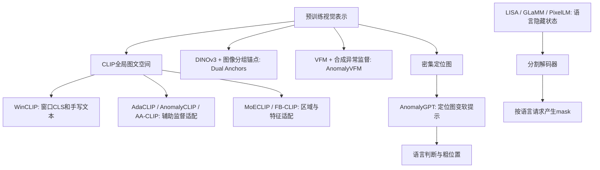

# 论文原文、精读报告与代码阅读索引

阅读日期：2026-10-23。范围是本地十篇主要论文的原文、补充材料、逐篇精读笔记、总报告，以及训练、模型、推理、评测的核心调用链；另阅读十篇基础、分割与异常检测辅助论文的机制与实验边界。本文以本地版本为准，没有在线核验最新发布状态，没有运行训练或模型推理。论文数值、已有日志、本次静态代码结论分别对待。

## 材料与详细证据

| 主题 | 详细阅读记录 |
|---|---|
| AnomalyGPT、Transformer、当前项目接口与评测 | [AnomalyGPT 与本项目](阅读核对_20261023/AnomalyGPT与本项目.md) |
| CLIP、WinCLIP 两份社区实现、AnomalyCLIP | [CLIP 与局部异常适配](阅读核对_20261023/CLIP_WinCLIP_AnomalyCLIP.md) |
| AdaCLIP、AA-CLIP、Dual Anchors，及额外补充源码 | [混合提示与图像锚点](阅读核对_20261023/AdaCLIP_AACLIP_DualAnchor.md) |
| MoECLIP、FB-CLIP、AnomalyVFM | [近期三篇方法与实现](阅读核对_20261023/MoECLIP_FBCLIP_AnomalyVFM.md) |
| CLIPSeg、SegGPT、DINOv2 | [密集视觉与条件分割](阅读核对_20261023/补充_密集视觉.md) |
| LISA、GLaMM、PixelLM | [语言模型驱动分割](阅读核对_20261023/补充_语言分割.md) |
| SEEM、OMG-LLaVA、CLAD | [统一接口与异常检测补充](阅读核对_20261023/补充_统一接口.md) |

辅助库的 AnomalyGPT、AnomalyCLIP PDF 与主集合按同一工作归并，不重复计数。辅助论文主要只有 PDF，本地没有相应完整实现，因此其方法理解与主集合的代码核验覆盖程度不同。第三方通用库、词表和大型问答模板未逐行穷尽阅读。

`论文参考/README.md` 引用的 `VLM分割论文调研与本项目路线建议_20260928.md` 未在当前工作区发现，因此未纳入已读报告；对应辅助论文按本地 PDF 核对。

已读总报告：`零样本异常检测十篇精读报告.docx` 的全部正文/表格，根目录的四篇对照、七篇总表、复现避坑报告，以及 `WinClip/与AdaCLIP对照.md`。DOCX/PDF 是同名报告的交付格式，本次逐段解析的是 DOCX。`docs/paper_notes/` 中五份报告与根目录对应笔记逐字节相同。

各记录保留研究问题、特征与张量流、损失/更新参数、训练和测试信息权限、指标含义、报告修订依据。代码路径按工作区根目录定位；本项目五个训练/数据/评测脚本位于 `seg_cross_part/`。

## 十篇主要论文如何连接

| 工作与本地版本 | 核心机制 | 异常任务训练信号 | 推理输出/信息权限 |
|---|---|---|---|
| CLIP · 2103.00020 v1 | 图像与文本全局表示的对称对比学习 | 400M 图文预训练；公开库主要是推理接口 | 候选文本相似度；本身不是异常分割器 |
| WinCLIP · 2303.14814 v1 | 正常/异常组合模板、窗口 CLS、多尺度聚合 | 无异常任务梯度训练 | 分数与热图；类别名；WinCLIP+允许目标正常参考 |
| AdaCLIP · 2407.15795 v1 | 双塔静态+逐图动态提示、patch 投影、HSF | 辅助域图像标签与异常 mask | 分数与热图；动态 prompt 需额外视觉前向 |
| AnomalyCLIP · 2310.18961 v12 | object 通用提示、深层文本提示、DPAM、全局局部损失 | 辅助域图像标签与异常 mask | 不需目标类名的分数与热图；当前脚本用顶层局部特征 |
| AA-CLIP · 2503.06661 v1 | 先文本异常解耦，再视觉残差适配与多尺度对齐 | 辅助域真实标签/mask；另有类别描述构造 | margin/热图；最终图像分另做聚合 |
| AnomalyGPT · 2308.15366 v4 | 视觉定位图→软提示→冻结 LLM | 正常图在线合成异常、自动 mask、模板问答、通用对话 | 地图、语言判断和粗位置；跨域实验还用正常参考 |
| Dual Anchors · 2608.11933 v1 | DINOv3 层级分组、正常/异常组锚点、图像条件文本提示 | 辅助域异常 mask，还监督分组语义 | 分数与热图；本地代码目录只有说明 |
| MoECLIP · 2603.03101 v2 | patch 路由的残差专家、正交子空间、ETF、多尺度投影 | 辅助域图像标签与异常 mask | 分数与热图；训练算全专家、推理才稀疏 |
| FB-CLIP · 2603.19608 v1 | 文本多种池化、视觉三视图、前景背景注意力和原型抑制 | 辅助域图像标签与异常 mask | 分数与热图；不提供原生自然语言解释 |
| AnomalyVFM · 2601.20524 v2 | 合成数据、VFM 内部 PEFT、卷积定位头和置信度损失 | 主模型仅用合成图及自动标签/mask | 检测网络无文本分支；生成数据仍用语言模型/文本条件生成器 |

“零样本”首先是信息权限：无异常任务训练、未见目标类别、未见目标数据集，以及允许 K 张目标正常图，是不同条件。不能仅凭方法名把它们当同一赛道排总榜。跨论文还存在骨干、分辨率、辅助集、图像与像素指标分母不同。

四类关键接口如下。

AnomalyGPT 的主要耦合方向是**定位证据进入语言模型**。LISA、GLaMM、PixelLM 则用语言模型输出 token 的隐藏表示驱动 mask 解码。两者训练目标和验证问题不同；前者能解释已有定位，不自动说明语言反过来提升像素定位。

## AnomalyGPT：应保留的准确理解

当前本地代码为：224²图像→ImageBind-Huge 四层 16×16×1280 patch→四个 1280→1024 线性投影→与正常/异常文本计算余弦→插值 logits、二类 softmax、四层平均→异常图。正常参考模式改用原始 patch 最近邻距离图，并替换文本匹配图。

异常图经六个卷积层（前五个带池化）产生 3×3×4096，展平为九个动态 token，拼接九个 base token；另有一个整图全局 token。冻结的 Vicuna 根据这组软提示与用户文本生成回答。九个动态 token 有高度重叠的感受野，不能简单等同九个彼此独立的九宫格解释标签。

训练代理实际只更新 decoder 与 Prompt Learner。按形状计算，两者分别为 5,246,976 和 107,416,504 参数，总计 112,663,480；最后一个卷积自身为 104,861,696。不能因为只新增少量 token，就把整个 Prompt Learner 当成几万个参数。

| AnomalyGPT 设置 | Image AUROC | Pixel AUROC | 语言 Accuracy |
|---|---:|---:|---:|
| MVTec 正常图训练、MVTec 同域测试 | 97.4 | 93.1 | 93.3 |
| VisA 训练、MVTec 跨域 1-normal-shot | 94.1 | 95.3 | 86.1 |
| MVTec 训练、VisA 跨域 1-normal-shot | 87.4 | 96.2 | 77.4 |

这些是原文报告结果。图像 AUROC 来自热图最大值，像素 AUROC 来自地图，Accuracy 来自语言回答，不能互相替代。七篇总表的 VisA image AUROC=77.4 是错列，应为87.4。

“无需手调阈值”指直接生成有/无异常的语言决策；并不证明跨域校准，也不解决二值 mask 的全部阈值问题。论文三种损失 CE/Focal/Dice，在代码里组织为文本损失+像素损失，与论文并不矛盾。

## 原有精读报告中优先修正的结论

原报告保留原样；以下为本次阅读得到的修订依据，具体文件行号见各详细记录。

| 主题 | 核对后的结论 | 主要证据位置 |
|---|---|---|
| CLIP 的局部监督 | 全局损失通过网络间接影响 patch；缺少直接局部图文对齐监督，不等于 patch 完全没有收到梯度 | `CLIP/code/clip/model.py:223`、`:358` |
| WinCLIP 代码来源 | 本地两份为不同社区实现；`official_code` 元数据字段不能覆盖 README 的 unofficial 声明 | `WinClip/code/README.md`、`third_party/WinCLIP/README.md` |
| WinCLIP 聚合 | caoyunkang 版是 1−正常概率的调和均值；“窗口调和、跨尺度直接算术平均异常图”不准确 | `WinClip/code/WinCLIP/model.py:172`、`:194` |
| AnomalyCLIP 配方 | Python 默认可选多层；当前 sh 显式只取24层，与本地 v12 原文一致 | `AnomalyCLIP/code/train.sh:16`、`test.sh:17` |
| 参数统计 | AnomalyCLIP 的43K是实际生效提示向量；还有注册但未参与前向的投影参数 | `AnomalyCLIP/code/prompt_ensemble.py:165`、`:264` |
| AdaCLIP 描述 | 其 PEFT 主要是双塔 hybrid prompts 与投影，不能写成原方法就是本项目的 LoRA adapter | `AdaCLIP/code/method/adaclip.py` |
| AdaCLIP 默认辅助集 | 更正版是 MVTec 1725+ColonDB 380=2105；2337 是旧配置，不能把 ClinicDB 混入当前默认 | `AdaCLIP/精读笔记.md`、原文更正与数据设置，详见记录 |
| AA-CLIP 描述来源 | 本地补充说明类别描述由 GPT-4 根据正常样本生成，不宜称“每类纯手写描述、无额外图像信息” | `AACLIP/source/sec/X_suppl.tex` |
| AA-CLIP 2-shot | 指辅助类别各两张，非目标类两张；评 MVTec 默认用 VisA，12×2=24，30 张属于反向设置 | 原文主表脚注、`AACLIP/code/dataset/__init__.py` |
| Dual Anchors 可用材料 | 本地无真实训练实现，但存在补充文字，含10 epochs、batch8、Adam1e-4、16→2分组；“无任何超参”错误 | `DualAnchor/source/sec/X_suppl.tex` |
| MoECLIP 图像头 | 论文和代码均为 patch 聚合；`tokens[-3]` 是末层 s=1，并非第三尺度或 CLS | `MoECLIP/code/model/moe_adapter.py:459` |
| FB-CLIP 文本融合 | `fusion_weights` 虽注册，实际融合用固定1/.5/.5；`bg_weight=.1`亦未进入有效前向 | `FB-CLIP/code/FBCLIP_lib/FBCLIP.py:503`、`:76` |
| FB-CLIP 软掩码 | center 指特征均值中心；temporal 指选中层间差异，非图像几何中心和跨增强 | 同文件 `:766`、`:780` |
| AnomalyVFM 数据 | 主方法 solely generated data；评MVTec换VisA的描述针对部分比较方法，非主模型另加真实VisA | `AnomalyVFM/paper.tex:243` |
| AnomalyVFM 配置 | 论文给500步/768²/LoRA/两上采样块；当前代码README明确已改，默认200步/DoRA/一个块 | `AnomalyVFM/code/train.py:51`、`:71`、`:148`、README |
| 辅助文献身份 | OMG-LLaVA 实际标题含 Image-level/Object-level/Pixel-level；2412.00890 实际为 Exploring Large Vision-Language Models for Robust and Efficient Industrial Anomaly Detection | 两份 PDF 首页；`论文参考/README.md` 的相应标题有误 |
| 阈值与指标 | margin也可在验证集选阈值；max-F1是扫阈值上界，不能证明概率校准或部署阈值有效 | 多篇测试脚本与评测定义 |

有些笔记从“代码有差异”直接推导“就是该差异造成性能低”“不这样做必然训练崩溃”，超出现有证据。静态阅读能确认算式和控制流；性能因果仍需同条件消融。

## 和当前项目的对应关系

本项目原始主张是：在 Protocol C 未见零件类上，证明语言让像素 AUPRO 优于同容量、同监督的视觉基线。AnomalyGPT 的语言交互能力可作为另一个目标，但不能替代这一像素增益证明。现有 v2 文档是架构草案；已实现的 DINOv2→64视觉token 对齐与 LoRA 脚本，还没有完整包含图像分组锚点、定位图→9token、通用数据交替训练。

阅读相关代码时还发现三处会影响后续实验解释的具体问题，已在详细记录中定位，尚未改动或重跑：

1. `align_dino_llm.py:138–142` 对 batch 内不同样本始终使用 `vis[:1]`，batch>1 时发生图文错配。
2. `build_sim_anomaly.py:143,150–152` 从 train+val 取源图、从全局 manifest 取真实 mask 面积；如果这些合成图用于训练，会引入验证实例和目标留出类的标签统计。
3. `eval_pair_big.py:117` 的 `ans_first_rate` 是异常真实位置比例，不是模型选第一张比例。现有两个 `pair_*.json` 只有汇总，没有逐组记录，无法据本地文件重算所声称的位置偏置检查。

实验记录 I-30 已说明79.25%对75%的微调增益不显著（p=.124、非配对样本）；因此应把“这批样例存在相对判别信号”和“微调有效”分开。现有CI也未覆盖有放回抽样中重复零件视角的相关性。

后续可以围绕三个独立问题推进讨论：视觉定位是否更好；语言是否利用了真实定位证据；二者的输出是否一致。对应的消融分别是同骨干/同预算基线、真实/打乱/无定位图，以及位置与判断一致性评测。本文是阅读与核对记录，尚未实施这些新实验。
