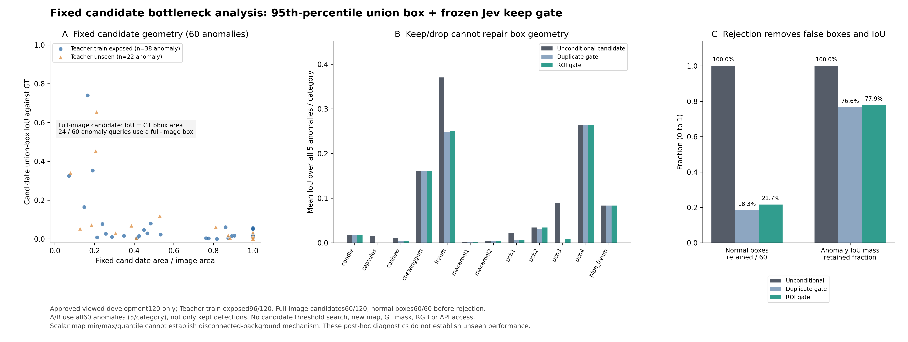

# 固定候选框瓶颈与复核损失分析

本分析仅使用已冻结stage03候选与stage05评价records，120个已查看开发来源；不重新打开RGB、Teacher map或GT mask，不尝试新quantile/阈值，不发新API，confirmation未开启。

## 主要发现

- 无条件Teacher候选全异常meanIoU=0.089529；duplicate门控=0.068542；ROI门控=0.069719。分母固定60异常。
- 120个来源中60个候选是全图，其中异常24、正常36；全图candidate与crop PNG相同60个。
- 固定候选生成器对全部60正常都出框；duplicate只保留11个正常框，ROI保留13个。过滤降低正常出框，但同时丢弃真实异常IoU质量。

| 门控 | 异常保留/60 | 正常框保留/60 | 全异常meanIoU | 相对无条件IoU均值损失 | 保留IoU总质量比例 |
|---|---:|---:|---:|---:|---:|
| duplicate | 39 | 11 | 0.068542 | 0.020986 | 76.56% |
| roi | 43 | 13 | 0.069719 | 0.019810 | 77.87% |

## 为什么95%分位的union可能退化成整图

冻结规则是对224×224 map取numpy.quantile(...,0.95,method=linear)，保留>=阈值的像素，然后把所有保留位置包成一个union bbox。这里“95%分位”描述分数排名，不代表候选框面积只有5%，也不表示95%置信度。只要入选位置的最小x/y触达左/上边、最大x/y触达右/下边，包围框就覆盖整图；少量相距很远的高分位置也会让union很大。>=还可能在分数有并列时选中超过5%的像素。

这些是规则的数学性质。现有记录只有map_range、quantile_threshold和最终bbox，没有完整空间分布或并列计数，因此不能断言本数据的全图框一定由离散背景点、分数并列或某一种具体机制造成。本分析不重开map、不补试阈值寻优，只能确认几何退化已经发生。

在24个全图异常候选中，candidate IoU等于GT union bbox归一化面积，最大绝对误差6.9e-18。例如一个GT框只占全图0.15%，全图候选的IoU约0.0015；即使Jev准确判断有异常，保留原全图框也不会提高几何IoU。

## 按面积、训练暴露和类别分解

| 面积组 | 全部 | 异常 | 正常 | 全异常candidate meanIoU | ROI meanIoU |
|---|---:|---:|---:|---:|---:|
| area_lt_0.01 | 0 | 0 | 0 | — | — |
| area_0.01_to_0.1 | 4 | 3 | 1 | 0.413849 | 0.305497 |
| area_0.1_to_0.5 | 29 | 21 | 8 | 0.166781 | 0.130300 |
| area_0.5_to_1 | 27 | 12 | 15 | 0.027645 | 0.027116 |
| fullbox | 60 | 24 | 36 | 0.012335 | 0.008540 |

| Teacher暴露 | 来源 | 异常 | 正常 | candidate meanIoU | ROI meanIoU |
|---|---:|---:|---:|---:|---:|
| teacher_training_exposed | 96 | 38 | 58 | 0.074965 | 0.047232 |
| teacher_unseen | 24 | 22 | 2 | 0.114684 | 0.108560 |

Teacher训练暴露96/120；unseen24中22异常、2正常。子组分布差异很大，不能把均值差异解释成训练暴露的因果作用，2张unseen正常也无法验证低FPR。逐类全分母值见JSON及图B。

## 研究含义与下一动作

当前复核只做keep/drop，不移动或细化框，因此几何上界由固定candidate决定；分类正确也可能定位很差。先前ROI−duplicate meanIoU差值约0.00118且配对95%区间跨0，不能据此宣称稳定定位改进。

后续可以另立协议研究连通域、top-k局部候选、面积/空间约束或学习式定位，但必须在新的开发来源预先固定规则和预算，不能反复在这60异常上调quantile取最好结果。若Teacher用于新路线，需先审其训练来源暴露，严格未见主张不能依赖当前120。当前继续执行既定stage08–12，不让本归因分析触发额外API或修改冻结候选。

## 图与溯源

- JSON：stages/candidate_failure_analysis.json
- 新脚本：code/analyze_candidate_failures.py
- 图：figures/candidate_failure_analysis.png / .svg / .provenance.json
- stage03 SHA256：8ce1e859a74de0d33abefaff8c0b3f66a58a8daeca6eb7be70d5cd23591414ef
- stage05 SHA256：fe2702586f60d575b319790c7ec37b737bc189d864d6f6238b98f34588992a92
- 分析JSON SHA256：ba251673012c6facaebddac77b32d6426764fdc7c4a93e1c3867f4b5075c7014
