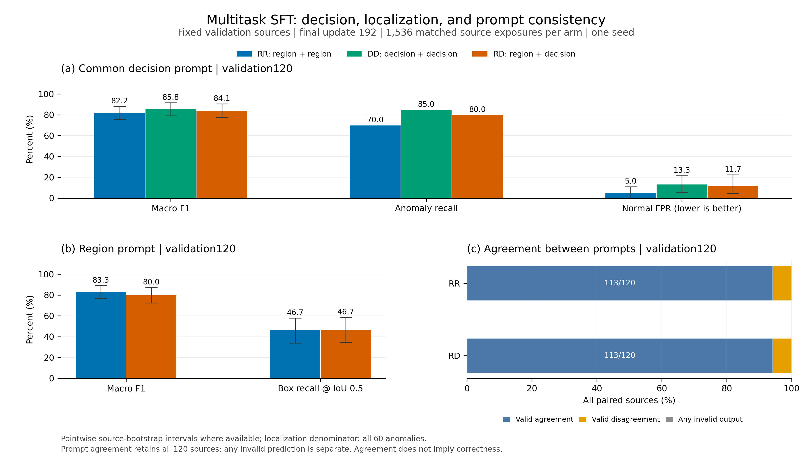
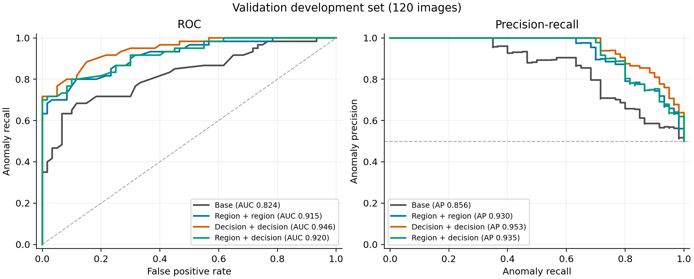

# Qwen3-VL 工业异常检测：固定曝光预算的任务消融与连续评分

## 结论

第二轮已完成三组 QLoRA 训练、五项验证集生成评估、八项连续评分及阈值校准。**当前没有证据支持“混合判断与区域任务整体优于单任务训练”**：纯判断训练 DD 的验证判断 Macro F1 点估计最高，为 **85.83%**；纯区域训练 RR 的端到端框召回为 **46.67%**。混合训练 RD 没有提高整体提示一致性，框召回也没有提高。

连续评分补齐了生成式判断之外的排序与阈值控制能力。DD 的验证 AUROC 为 **94.56%**，旧测试开发回归 AUROC 为 **95.26%**。但在验证正常图上固定的 5% 经验误报目标，应用到回归集后得到 **6.67% FPR**，说明该规则不提供未来误报率保证。

本轮是单训练 seed 的开发实验。新封存的 **240 张确认图尚未用于模型推理**；因此以下结果均不称为最终独立确认结果。当前保留 DD 作为判断候选、RR 作为区域候选，后续依据任务需求和预先固定的选择规则继续验证。

## 数据、问题与控制条件

本项目使用官方 VisA 10,821 张图像，按源图自定义划分为 7,575 训练、1,624 验证、1,622 测试来源。训练使用真实异常及其标注，属于有监督领域后训练。它与 AnomalyGPT 原始正常训练图加模拟异常的无监督实验条件不同，不能直接比较论文性能数字。完整原始数据协议见 [DATA_PROTOCOL.md](../../DATA_PROTOCOL.md)。

本轮复用第一轮面积覆盖策略选出的 768 张训练来源，即 12 类、每类 32 正常和 32 异常。只改变每张图两次曝光时的任务分配，不重新采样、不增加合成或裁剪。

| 训练臂 | 每张图的任务 | 独立来源 | 实际曝光 | 更新次数 |
|---|---|---:|---:|---:|
| RR：region_region | 两次区域任务 | 768 | 1,536 | 192 |
| DD：decision_decision | 两次判断任务 | 768 | 1,536 | 192 |
| RD：region_decision | 一次区域、一次判断 | 768 | 1,536 | 192 |

RD 在每个类别和标签内平衡首次曝光的任务，第二次反转。三臂使用相同实际源图顺序、初始 LoRA 权重、seed=42、最终第 192 次更新、优化器和输入预算。逐曝光日志及初始参数哈希验证了这些控制条件。

区域任务输出异常布尔值和覆盖全部标注缺陷的一个外接框；判断任务只输出布尔值。框为完整图像上的 `[0,1000]` 归一化 xyxy 坐标。VisA mask 的所有非零类别索引都视为异常前景，正常图目标为空框。

本轮验证集固定为 120 张图，即每类 5 正常、5 异常。旧的 120 张测试图已经在第一轮被查看，本轮连续评分将其明确标为“开发回归”。新确认集从原测试分区中排除历史已评测来源及相同字节哈希后，冻结为每类 10 正常、10 异常，共 240 张；这用完了该分区剩余未评测的 120 个异常来源，应留给最终固定方案。

相同曝光次数不等于相同 token 数、损失权重或计算量。训练按一次梯度累计内的监督 token 总数归一化；RD 两任务各占一半样本，不代表各占一半梯度。本消融检验固定图片曝光预算下的任务分配，不能单独归因为坐标监督的因果收益。冻结前协议见 [实验协议.md](实验协议.md)。

## 单卡训练实现与实际成本

底座为本地 Qwen3-VL-8B-Instruct。语言 Linear 使用 NF4 双重量化；视觉编码器、merger 和 DeepStack 保持冻结 BF16；语言 attention 的 q/k/v/o 使用 LoRA，r=16、alpha=32、dropout=0.05。实际可训练参数 **15,335,424**。使用原生多模态 processor，保留视觉网格与位置编码；仅 assistant 目标计算 causal CE。

三臂均使用 microbatch=1、梯度累计 8、max_pixels=524,288、max_length=2,048、学习率 1e-4、warmup=10、梯度检查点。更新 64/128/192 时在固定前 24 张验证样本上计算诊断 CE；最终适配器按协议固定在 192，不依据这些 CE 选择。不同目标任务的 CE 不用于跨臂性能排名。

| 训练臂 | 输入 token | 监督 token | 训练循环秒 | 峰值 allocated GiB |
|---|---:|---:|---:|---:|
| RR | 906,996 | 33,012 | 836.00 | 8.39 |
| DD | 807,936 | 15,360 | 833.20 | 8.23 |
| RD | 857,466 | 24,186 | 849.90 | 8.39 |

计时包含循环内验证 CE，不含首次模型加载与最终适配器重载；显存为 PyTorch allocated 峰值，不能当作整机占用或所有分辨率下的保证。硬件为单张 RTX 4090D 24GB。本次保留的可用运行环境为 Python 3.12.3、PyTorch 2.5.1/CUDA 12.4、Transformers 5.14.1、PEFT 0.21.2、bitsandbytes 0.48.2、Accelerate 1.14.0，详见 [运行审计](../../ops/runtime_audit.json)。它与最初镜像预装版本不同，应以实际记录为复现依据。

三个适配器都通过“新底座加载已保存适配器”的比对：首样本提示末位置 logits 的最大绝对差为 0。检查范围是这一个提示位置，不代表全数据逐位等价。训练未保存优化器状态，不能精确断点续训。

## 生成式判断与区域结果

下表均来自相同 120 张验证图。Macro F1 是正常/异常两个标签 F1 的平均，不是 12 类宏平均。框 R@IoU≥0.5 以全部 60 张异常图为分母，漏检、无框和格式失败都不能从分母中剔除。

| 训练臂／推理提示 | Macro F1 | 异常召回 | 正常 FPR | 框 R@IoU≥0.5 |
|---|---:|---:|---:|---:|
| RR／区域 | 83.26% | 76.67% | 10.00% | 46.67% |
| RR／判断 | 82.22% | 70.00% | 5.00% | — |
| DD／判断 | 85.83% | 85.00% | 13.33% | — |
| RD／区域 | 80.00% | 80.00% | 20.00% | 46.67% |
| RD／判断 | 84.14% | 80.00% | 11.67% | — |

五项评估的 parser 格式有效率均为 100%。该 parser 允许 JSON 代码围栏、有限浮点坐标和多框，再将多框合并为外接矩形；因此这不等于严格整数、单框 schema 合规率。

RR 和 RD 在区域／判断两提示下均有 **113/120=94.17%** 的异常判断一致。两次都正确的比例分别为 80.00% 和 79.17%。RR 从区域改为判断提示时出现 7 次 true→false、0 次反向改变；RD 为 6 次和 1 次。混合任务没有改善整体提示一致性。



图的可编辑版本：[PDF](figures/validation_comparison.pdf)、[SVG](figures/validation_comparison.svg)。训练曲线：[PNG](figures/training_dynamics.png)、[PDF](figures/training_dynamics.pdf)。完整指标、分类计数、分类别结果及预算见 [validation_matrix.md](validation_matrix.md) 与同名 JSON。

### 配对差异如何解读

对相同源图做 2,000 次配对 bootstrap，seed=17，以下为差值的百分位 95% 区间，单位为百分点。

| 比较 | 指标差值 | 95% 区间 |
|---|---:|---:|
| RD 判断 − RR 判断 | Macro F1 +1.92 | [−3.29, +7.33] |
| RD 判断 − DD 判断 | Macro F1 −1.69 | [−6.46, +2.54] |
| RD 区域 − RR 区域 | Macro F1 −3.26 | [−8.38, +2.00] |
| RD 区域 − RR 区域 | 框召回 0.00 | [−6.67, +6.45] |

这些区间覆盖零，无法据此证明混合任务在 F1 或定位上有整体优势。RD 判断相对 RR 判断的漏报率降低 10.00pp，同时误报率提高 6.67pp；RD 区域相对 RR 区域的误报率提高 10.00pp。它们体现不同任务预算下的召回与误报取舍。

区间只刻画当前固定模型在该验证样本上的重采样差异，未包含训练 seed 波动；多个指标和比较没有做多重校正。完整差异与区间见 [paired_differences.md](paired_differences.md)。第一轮 96 更新测试结果与本轮 192 更新验证结果不构成直接提升对比。

## 从布尔答案到连续异常评分

自由生成的 true/false 不能直接提供 AUROC。本轮新增固定判断提示与 JSON 前缀 `{"is_anomalous":` 的候选似然评分：分别计算 `true`、`false` 值 token 的条件对数似然，以二者之差作为异常 log-odds，并在这两个候选之间归一化。当前实际 tokenizer 的值 token ID 为 1866 和 3849，原生完整编码、token 边界、共同前后缀及图像网格均有校验。

模型 forward 不接收真实标签，标签只用于事后评价。两个候选的归一分数不是经过校准的真实异常概率。排序使用 log-odds，避免 sigmoid 饱和引入额外并列值；AUROC 正确处理并列分数，AP 采用非插值 average precision，而非 PR 梯形面积。

| 模型 | 验证 AUROC | 验证 AP | 旧测试开发回归 AUROC | 旧测试开发回归 AP |
|---|---:|---:|---:|---:|
| 原始量化底座 | 82.39% | 85.58% | 83.39% | 86.95% |
| RR | 91.49% | 93.01% | 92.83% | 94.17% |
| DD | 94.56% | 95.26% | 95.26% | 95.65% |
| RD | 92.01% | 93.54% | 94.10% | 94.82% |

当前同域数据上的排序点估计支持继续研究领域 SFT，但不证明跨域泛化，也不证明 DD 在多次训练中稳定优于其他任务配方。



向量曲线：[验证 PDF](figures/scoring_validation_curves.pdf)、[回归 PDF](figures/scoring_regression_curves.pdf)。回归图明确标注其已被评测的开发用途。

### 仅用正常验证图固定阈值

每个模型只用相同 60 张验证正常图的分数顺序统计量确定阈值，随后固定应用于来源不相交的旧测试开发回归集。判异常规则为 `log_odds > threshold`，边界相等判正常。5% 经验目标对应至多 3/60 个校准误报；本次各模型实际均为 3 个。

| 模型 | 固定 log-odds 阈值 | 回归异常召回 | 回归正常 FPR | 回归 Macro F1 |
|---|---:|---:|---:|---:|
| 底座 | −1.875 | 45.00% | 1.67% | 69.50% |
| RR | 0 | 71.67% | 3.33% | 83.92% |
| DD | 0.5 | 78.33% | 6.67% | 85.75% |
| RD | 0.75000003 | 66.67% | 1.67% | 82.05% |

校准不一定提高 F1。以同一 DD scorer 为例，等似然阈值 0 时回归召回为 83.33%、FPR 为 10.00%、Macro F1 为 86.65%；改用验证正常阈值后误报降低，召回也降低。RD 等似然阈值的回归 F1 为 87.43%，但不能依据已见回归集的最高 F1 选模型，再把它称为独立测试成功。阈值的比较应在同一个 scorer 内进行，不能将其与自由生成结果混为同一种决策规则。

60 张正常校准图的误报率步长约为 1.67%。验证经验 FPR≤5% 不保证未来、真实生产分布或跨数据集 FPR≤5%；DD 的回归结果已经展示这一限制。完整审计、阈值及指标见 [scoring_matrix.md](scoring_matrix.md) 与同名 JSON。

## 主要技术工作

| 技术环节 | 本轮实际工作 | 对应的技术问题 |
|---|---|---|
| 多模态指令数据 | 同一源图派生判断／区域任务，mask 转全图坐标，来源与标签一致性检查 | 图像、文本、视觉 token 与空间目标如何一一对应 |
| 领域后训练 | 原生 Qwen3-VL 视觉路径、语言侧 NF4+LoRA、assistant-only SFT | 冻结范围、目标 mask、量化及梯度累计的正确性 |
| 多任务优化 | 固定曝光顺序与初始化，记录实际监督 token，比较 RR/DD/RD | 为什么一半任务样本不代表一半损失权重，如何避免预算混淆 |
| 判别评分 | 从生成模型提取候选条件似然、检查 causal token 对齐、处理并列排序 | 如何把语言答案转成可排序分数及可控制的决策阈值 |
| 实验与复现 | 配对差异、验证／回归／确认隔离、冻结运行源码、哈希与重载检查 | 如何排除来源变化、挑 checkpoint、阈值泄漏等替代解释 |

这些工作覆盖“8B VLM 工业领域后训练与评估”。本项目继承已有视觉语言表示，通过语言侧 LoRA 做领域和空间 grounding 适配；当前视觉连接模块冻结，证据支持这一范围的经验。指令质量来自标注可追溯、转换验证和覆盖设计；第一轮面积覆盖对随机采样的优势尚未被证实，不能包装为已验证的数据质量算法突破。

## 审计、交付与复核入口

训练／生成审计 **101/101** 通过，见 [verification.json](../../experiments/multitask_v2/verification.json)。连续评分审计 **256/256** 通过；15 项 CPU 评分检查通过，包含原生 processor 集成与完成后篡改检测，记录见 `score_cpu_audit.log`（原工作区日志，本发布包省略原始 `.log`；见[资产说明](../../../ASSETS.md)）。交付时重新核对了 1,008 张原图的 SHA256，即 768 训练、120 验证、120 回归来源，见 [source_byte_audit.json](../../experiments/multitask_v2/source_byte_audit.json)。该字节审计没有打开确认图像。

本轮训练实际导入的源码保存在 `experiments/multitask_v2/runtime_src/`，评分实际导入的源码保存在 `scoring_runtime_src/`，并分别保留文件哈希。数据、配置和训练 runner 的冻结输入哈希为 `input_hashes.json`。原始第一轮报告及归档独立保留。

第二轮交付索引为 [delivery_manifest.json](../../experiments/multitask_v2/delivery_manifest.json)，代码与协议快照为 `code_snapshot.tar.gz`。快照包含源码、冻结运行时、配置、指令清单和报告元数据。权重、逐图结果行及图形文件在各自目录独立保存；交付索引另记录适配器、结果和图形文件哈希，底座权重哈希保存在运行审计中。它不是一份包含全部训练资产的压缩包。

在服务器已有完整交付的情况下，可只读核验压缩包成员与源码、适配器、逐图结果、阈值、图形及第一轮归档的哈希，无需重跑训练或打开确认图：

```bash
cd /root/autodl-tmp/industrial_vlm
PY=/root/autodl-tmp/vlm/.venv/bin/python
$PY ops/verify_delivery_multitask_v2.py
```

统计重算脚本 `verify_multitask_v2.py`、`analyze_multitask_v2.py`、`analyze_scores_v2.py` 会重写审计或报告。需要重新计算时，应复制相应项目元数据与结果到独立副本后运行；保持正式交付目录的报告字节与索引一致。

训练和评分的完整执行参数分别由 `ops/run_multitask_v2.py` 与 `ops/run_scores_v2.py` 及其运行日志记录。新实验须派生新目录并更新绝对路径配置，保留本轮数据、源码、适配器与结果字节；训练中断后不能将新历史接入已有适配器目录。单图演示可使用：

```bash
export PYTHONPATH="$PWD/experiments/multitask_v2/runtime_src"
$PY -m industrial_vlm.infer \
  --model models/Qwen3-VL-8B-Instruct \
  --adapter runs/multitask_v2/region_region/adapter \
  --image /absolute/path/to/image.png --task region --output /tmp/prediction.json
```

演示图应取训练之外且不属于封存确认集的图片。判断演示可换 DD 适配器并使用 `--task decision`。

## 下一阶段的优先级与边界

优先在训练分区内部构建独立的困难正常样本挖掘流程，控制类别和标签配额，检验误报是否下降；同时将全图输入分辨率作为独立变量，记录视觉 token、成本及小缺陷召回。这两个因素应分开比较，避免同时变更多项而无法归因。

在验证集固定最终训练配方、评分规则和阈值方法后，至少运行三个预先指定的训练 seed，报告每个 seed 和汇总结果。最后再一次性打开封存 240 张确认集，按预先固定的模型与规则评价，不能根据确认结果返回挑选配方。

本轮没有新增 MVTec 评分。第一轮外部 pilot 的误报问题仍未解决；要研究跨域表现，应先固定迁移协议并使用明确留出的外部来源。当前均衡小样本上的 AP、F1 和精度不代表真实工厂异常先验下的结果。源图字节隔离也不能保证物理工件身份或近重复完全隔离，公开数据在基座预训练中的暴露未知。定位仅评价缺陷外接矩形，不支持像素分割或实例检测结论。
