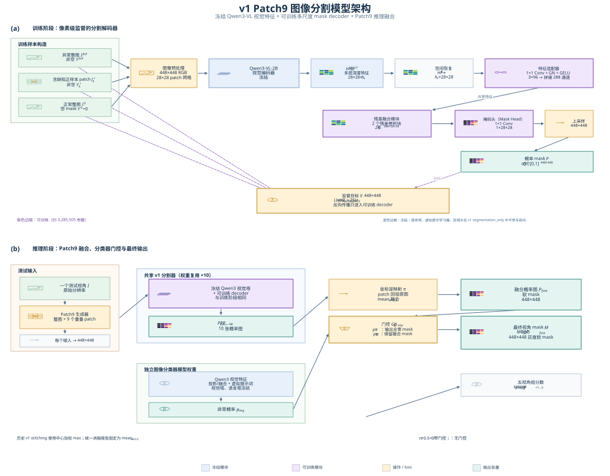

# v1 Patch9 分割模型：结构、训练与推理

**图 1.** v1 Patch9 的训练和推理架构。面板 (a) 展示监督 mask decoder 的完整数据流和梯度边界；面板 (b) 展示测试时整图/九宫格 Patch9、分类器 gate 和最终 mask 的串联关系。浅蓝色表示冻结模块，紫色表示可训练模块，黄色表示几何变换或 loss，青绿色表示输出张量。PDF 适合论文排版，SVG 适合矢量编辑，PNG 适合快速预览。

中文版精修图提供了输入图像、Patch9 网格、视觉编码器、特征图、掩码图、损失和门控等图标，适合汇报和中文技术文档；同目录下的英文版适合直接放入英文论文。

这里的 **v1** 指跨版本消融表里的 `segmentation_qwen3_patch9_emptymask_12000`，不是更早的 `decoder_only_12000`。结构图把 v1 自身的分割网络、训练样本构造、提交时外接的分类器和 gate 分开画出。图中“历史 max”和“统一消融 mean_w0.5”是**同一个 v1 分割 checkpoint 的两种推理口径**，不是两套不同的模型权重。

## 一、v1 分割网络由什么构成

| 模块 | 输入与输出 | 训练状态 | 用途 |
|---|---|---|---|
| Qwen3 图像预处理 | 将每张整图或 crop 变成 448×448，形成 28×28 patch 网格 | 无参数 | 给冻结视觉塔提供统一尺度输入 |
| Qwen3-VL-2B-Instruct 视觉塔 | 读取第 5、11、17 层的 patch 特征，并恢复为空间特征图 | **冻结** | 提供多层视觉语义和局部纹理特征 |
| 多层特征投影 | 每层 1×1 Conv、GroupNorm、GELU，投影到 96 通道，三层拼接为 288 通道 | **训练** | 对齐并合并不同深度的视觉特征 |
| 融合主体 | 两个残差卷积块，保持空间网格 | **训练** | 聚合局部上下文 |
| mask head | 1×1 Conv 生成单通道 28×28 logits，双线性上采样到 448×448 | **训练** | 输出每个像素的异常概率 |
| region head | 代码中随 `PatchDecoder` 一起实例化 | **冻结、不参与 v1 loss** | 此分割实验未使用九宫格位置分类目标 |
| Qwen3 语言塔、LM head、虚拟 prompt learner | v1 的 `segmentation_only()` 前向路径不调用 | **冻结、不参与 v1 前向与更新** | v1 分割不依赖语言生成或 Yes/No token |

v1 的实际可训练参数约 **3,285,505** 个，梯度检查只允许 `decoder.projections`、`decoder.fusion`、`decoder.mask_head` 接收梯度。Qwen3 基座、region head 和 prompt learner 均没有更新。这是**在冻结 VLM 视觉特征上训练一个外接像素 decoder**，不是微调 Qwen3 的主干权重。

## 二、v1 实际怎样训练

| 环节 | 实际做法 | 目的 |
|---|---|---|
| 数据划分 | 旧 fold1：18 个训练类别，train 18,775 视角、dev 3,600 视角 | 在已见零件类别上训练并验证 |
| 异常整图 | 每步抽 2 个异常视角，各自缩放成 448×448；若 tiny GT 在整图缩放后消失，则省略该整图训练例 | 学全局上下文，同时避免把真实异常误标为空 |
| 正缺陷 patch | 每个异常视角再从原图 3×3 重叠窗口中随机取 1 个与 GT 相交的 patch，并缩放到 448×448 | 局部放大细小缺陷 |
| 正常整图 | 每步抽 4 个正常视角，目标 mask 全零 | 学习正常图的静默输出 |
| 标准逻辑 batch | 通常为 2 异常整图 + 2 正 patch + 4 正常整图，梯度累积 8；tiny 整图省略时实际输入可能少于 8 | 平衡异常与正常监督 |
| loss | `Focal(gamma=2, positive_alpha=0.25) + Soft Dice`；`allow_empty=True`，正常空 mask **也参与 Dice** | 同时约束像素分类和区域重叠 |
| 优化 | AdamW，LR `1e-4`，weight decay `0.01`，warmup 50 步后 cosine，总计 12,000 optimizer steps | 只更新 decoder 的投影、融合和 mask head |

这里有一个重要限制：v1 **没有把异常图中的无缺陷 patch 当作空 mask 样本训练**。它只在异常图中选正 patch，但推理会对全部 9 个 patch 前向，包括无缺陷窗口。v2 后来加入 defect-free patch 监督，正是为了解决这个分布缺口。

## 三、推理怎样从单张图产生提交 mask

1. 每个测试视角先生成一张整图输入和原始分辨率上的 9 个重叠 crop；每份输入均缩放为 448×448，进入同一套冻结 Qwen3 视觉塔和 v1 decoder。
2. 将 9 张 patch 概率图回投到原图坐标，与整图概率图融合，再缩放成 448×448 的灰度软 mask。历史 v1 stitching 采用中心加权逐像素 max；后来的统一消融为了公平，重算 v1–v5 时统一采用 `mean_w0.5`。
3. 提交的**图像分类器是另一套独立训练的模型**。它给每个视角输出异常概率 `p`；若采用 gate=0.5，`p<0.5` 的视角强制写全零 mask；gate=0 则所有视角保留分割输出。
4. `submission.csv` 中每个五视角样本组的异常分数取五个视角 `p` 的最大值。分类器的分数不是由 v1 mask decoder 的输出计算出来的。

## 四、此前究竟训练过哪些部分

| 训练线 | 实际训练的参数 | 冻结的参数 | 目标函数 | LoRA / SFT？ |
|---|---|---|---|---|
| 早期 E1 联合尝试 | 外接 decoder + 条件虚拟 prompt learner | Qwen3 视觉塔、语言塔、LM head | 图像分类 BCE + 分割 Focal/Dice + region CE 的组合 | 没有 LoRA；没有生成式 SFT |
| 独立分类器 v1.0 及后续 v1.1、v1.2、v2.0 路线 | decoder 的**特征投影/融合主体** + 条件虚拟 prompt learner；mask/region head 冻结 | Qwen3 视觉塔、语言塔、LM head | 图像级 Yes/No logit 的 BCE；无像素 mask loss | 没有 LoRA；没有生成式 SFT |
| `decoder_only` 分割基线 | decoder 的投影、融合、mask head | Qwen3 基座、prompt learner、region head | 异常整图 mask 的 Focal/Dice | 没有 LoRA；没有 SFT |
| v1–v5、旧 v5-hard、新数据 v5 teacher/hard 分割线 | decoder 的投影、融合、mask head | Qwen3 基座、prompt learner、region head | mask Focal/Dice；v5 起改为面积加权 Focal/Tversky；后续还有采样调整 | 没有 LoRA；没有 SFT |

因此，“**之前只训练 decoder**”对于独立分割模型 v1–v5 是准确的；对于整个项目并不准确，因为独立分类器还训练了虚拟 prompt learner，早期 E1 也做过 decoder + prompt 的联合尝试。分类器中的“decoder”主要承担**视觉特征适配**，其 mask head 冻结；分割器中的“decoder”才承担像素 mask 预测。两条线通常使用各自的 checkpoint，最终在推理阶段串联。

本项目文档中的 **Visual Adapter** 指计划进一步插入或训练的视觉适配模块；它没有作为独立的 E2 版本进入上述已完成主线。现有可训练的 `1×1 Conv + 残差融合块` 可以理解为分割任务的特征投影/融合头，但不等同于在 Qwen3 主干内部添加 LoRA。**LoRA** 会在基座线性层旁增加低秩可训练矩阵；目前这些分割/分类训练脚本没有这样做。**SFT** 通常用指令-回答样本对语言模型做监督微调；这里虽然分类器通过冻结语言塔读取 Yes/No token logits，却没有训练语言塔生成回答。

## 证据入口

- v1 冻结协议：`artifacts/segmentation_qwen3_patch9_emptymask_12000/frozen_training_protocol.json`
- v1 梯度审计：`artifacts/segmentation_qwen3_patch9_emptymask_12000/forward_validation.json`
- v1 训练：`e1/train_segmentation_patch9.py`
- 核心模型与 loss：`e1/model.py`
- 历史 v1 stitching：`e1/patch9.py`、`Patch9空mask模型stitching推理评测报告.md`
- 统一消融口径：`artifacts/version_audit_20260923/完整评测对比报告.md`
- 分类器结构与训练：`e1/classification_model.py`、`e1/train_classification_fold1.py`
- 早期联合 E1：`e1/train_fold1.py`、`e1/config.json`
